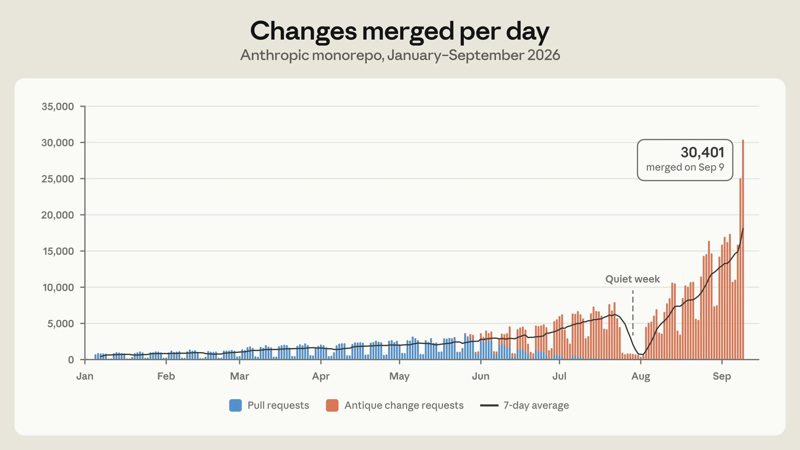
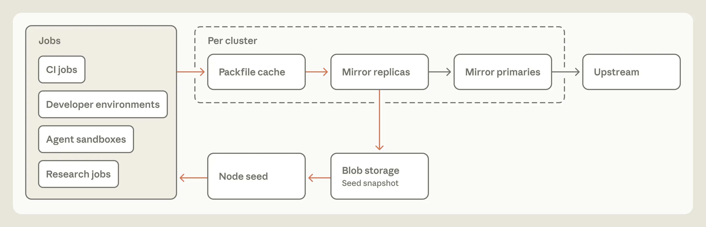
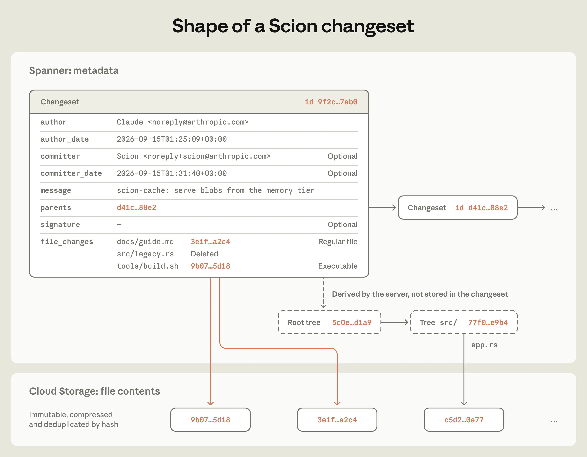
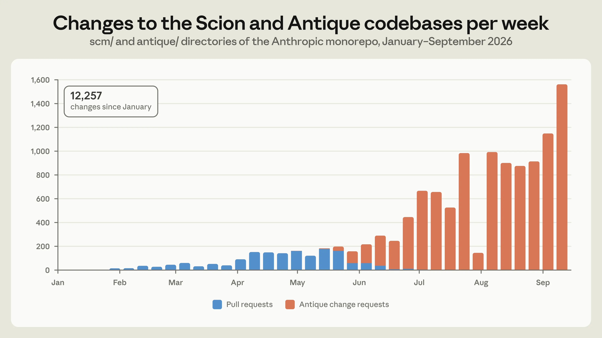
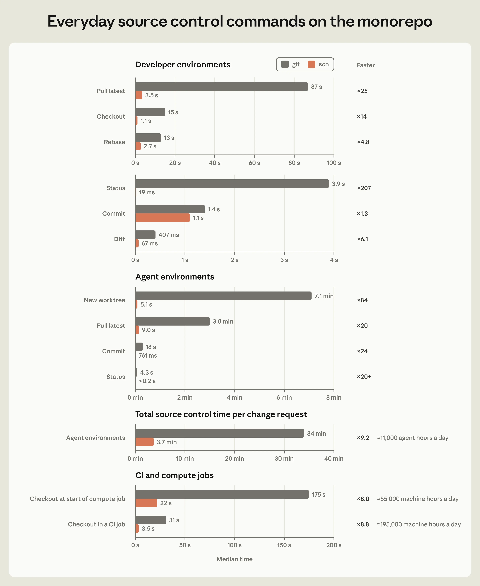

# 重新设计 Anthropic 的源码控制系统（中英对照）

> **原文标题：** Redesigning source control at Anthropic
> **作者：** Nick G. 及 source control 团队（Anthropic）
> **原文链接：** https://www.anthropic.com/engineering/redesigning-source-control
> **发布日期：** 2026-10-13（2026-10-15 更新）
> 排版：每段英文原文在前，中文翻译紧随其后。术语保留英文原文并附中文释义。

---

*Updated October 15 to include more detail on the projects that pioneered many of the techniques we use in Scion.*

*2026 年 10 月 15 日更新：补充了关于率先开创 Scion 中诸多技术的相关项目的更多细节。*

At Anthropic, coding is no longer the bottleneck to building systems or doing research. Claude is able to autonomously iterate on research loops, micro-optimize complex programs, and build new services from the ground up at a speed and scale we haven't seen before. The bottleneck, now, is all of the developer infrastructure built for human scale: source control, builds, and CI.

在 Anthropic，编写代码已经不再是构建系统或开展研究的瓶颈。Claude 能够自主迭代研究循环、对复杂程序做微优化、从零构建新服务，其速度和规模都是我们前所未见的。如今的瓶颈，反而是所有为"人类规模"构建的开发者基础设施：源码控制（source control）、构建和 CI。

In May 2026, Anthropic averaged around 2,500 code changes merged per day; as of September, we merged over 30,000 per day. We don't expect this rate of growth to slow down anytime soon; the latent demand for merging code is practically infinite, and every bottleneck we remove immediately leads to a further increase in the amount of code we produce.

2026 年 5 月，Anthropic 平均每天合并约 2,500 次代码变更；到 9 月，我们每天合并的变更已超过 30,000 次。我们不指望这种增长速度很快放缓：合并代码的潜在需求实际上无穷无尽，而每移除一个瓶颈，都会立刻带来代码产量的进一步上涨。

**图 1：** 2026 年 1 月至 9 月，我们 monorepo 每日合并的变更数

In order to support this growth, we built Scion, an in-house version control system, and fully migrated our monorepo from git in five months. We also built and shipped a code review surface (called Antique), code search, a rich source control IAM system, novel ways of managing and landing large amounts of reviewed code, and more, all in that same time period. In this post, we'll focus on how we built Scion specifically. It makes for an interesting case study: Claude's ability to write code was both what put us in this situation in the first place and how we were able to quickly build a high-quality, scalable system to deal with it.

为了支撑这种增长，我们构建了 Scion——一套自研版本控制系统，并在五个月内把我们的 monorepo 从 git 上完整迁移了过来。同一时期，我们还构建并上线了代码评审界面（名为 Antique）、代码搜索、一套丰富的源码控制 IAM 系统、管理和合入大量已评审代码的新方式，等等。本文将聚焦我们如何构建 Scion。它构成了一个有趣的案例研究：Claude 写代码的能力既是最初把我们逼进这一处境的原因，也是我们能快速构建出一套高质量、可扩展系统来应对的原因。

## 壮大我们的 monorepo（Growing our monorepo）

Before we explore what we built, we should acknowledge how unusual our workload is. Unsurprisingly, Anthropic uses Claude to write software far more than almost any other company, so we're often the first to see where tools built for human scale start to strain. Source control is just one example of this. While we don't expect many organizations to have these problems in the very near term, we suspect it won't be too long before others who use AI coding tools experience these same pressure points, which is why we wanted to share what we built and what we learned.

在展开我们构建了什么之前，应当先承认：我们的工作负载有多不寻常。不出意外，Anthropic 使用 Claude 写软件的规模远超几乎所有其他公司，所以我们往往最先看到"为人类规模"构建的工具从哪里开始吃紧。源码控制只是其中一个例子。虽然我们不预期短期内会有很多组织遇到这些问题，但我们怀疑，用不了太久，其他使用 AI 编程工具的人也会遭遇同样的压力点——这正是我们想分享所建之物与所学之事的原因。

Git is a decentralized system: every clone is a complete, self-contained repository that can compute diffs, read history and blame, and check out any revision while fully offline. For the vast majority of repositories, this is the right design, and it's a large part of why git became the standard.

Git 是一个去中心化系统：每一次 clone 都是一个完整、自包含的仓库，可以在完全离线的状态下计算 diff、读取历史与 blame、检出任意修订版。对绝大多数仓库而言，这是正确的设计，也是 git 能够成为事实标准的重要原因。

As our monorepo grows, it increasingly doesn't fit that design space. The history of our main branch alone is almost 100 GB, and a compressed working copy is over 25 GB. We perform on the order of 25 million code checkouts per day for CI, before counting developer environments, agent sandboxes, and research jobs. Fetched naively, that would be over 600 PB of git traffic per day.

随着我们的 monorepo 不断长大，它越来越不属于这个设计空间。仅 main 分支的历史就将近 100 GB，压缩后的工作副本也超过 25 GB。我们每天为 CI 执行约 2,500 万次代码检出——这还没算开发者环境、agent 沙箱和研究任务。如果按朴素方式拉取，那将是每天超过 600 PB 的 git 流量。

Git offers tools for working with a slice of a repository, such as shallow clones, sparse checkouts, and promisor remotes. Beyond these, there are standard workarounds for large monorepos, like internal git mirrors and repository snapshots (seeds) kept in blob storage. We've used all of them—at our peak, we operated several hundred internal git mirrors to deal with the load. This bought us time, but they became harder to operate as our merge rate increased. Seeds fell further from the tip of main between refreshes, and it took more and more care to keep operations that depend on history, like diff and blame, working on partial clones.

Git 提供了处理仓库切片的工具，例如 shallow clone（浅克隆）、sparse checkout（稀疏检出）和 promisor remote。除此之外，还有针对大型 monorepo 的标准变通方案，比如内部 git 镜像，以及保存在 blob 存储中的仓库快照（种子，seeds）。这些我们都用过——高峰期我们运维着几百个内部 git 镜像来消化负载。这为我们争取了时间，但随着合并率上升，它们越来越难运维。种子在两次刷新之间离 main 的最新提交越来越远，而要让 diff、blame 这类依赖历史的操作在部分克隆上持续可用，所需的小心翼翼也越来越多。

**图 2：** 扩展 git checkout 的典型架构

Taking a step back, we noticed that, like most companies, we were using git as a centralized system with one authoritative copy, but nearly all of our clients were agents and jobs that are online by definition. The properties that make git excellent for distributed, offline work were actively undermining our ability to scale as the repo grew. So we asked ourselves: if we designed source control with the fact that agents are always online in mind from the start, what would it look like?

退一步看，我们发现：和大多数公司一样，我们把 git 当作只有一个权威副本的集中式系统来用，但我们的客户端几乎全是 agent 和任务——它们从定义上就是在线的。让 git 在分布式、离线场景下卓越的那些特性，随着仓库增长，正在实实在在地侵蚀我们的扩展能力。于是我们问自己：如果从设计源码控制系统的第一天起，就把"agent 永远在线"这一事实纳入考量，它会是什么样子？

## Agent 规模源码控制的设计原则（Principles for agent-scale source control）

With agentic coding, many common assumptions about how software is developed are evolving. We embraced these changes when building Scion, which allowed us to take a fundamentally different approach than git on several core principles. Source control for huge monorepos has prior art, notably Google's Piper and Meta's Sapling[^2], so we were able to build Scion with their hard-won lessons in mind. Our principles are:

随着 agentic coding 的兴起，关于软件开发方式的许多常见假设都在演变。构建 Scion 时我们主动拥抱了这些变化，这让我们得以在几条核心原则上采取与 git 根本不同的路径。面向超大 monorepo 的源码控制并非没有先例，最著名的是 Google 的 Piper 和 Meta 的 Sapling[^2]，因此我们得以带着它们用血泪换来的经验教训来构建 Scion。我们的原则是：

**Clients are always online.** Git assumes that clients work offline and need a complete copy of the repository. Since nearly all of our clients are agents and jobs, we designed Scion's client and protocols around a server that is always reachable, and have clients fetch data when they need it.

**客户端永远在线。** Git 假设客户端离线工作、需要持有仓库的完整副本。既然我们的客户端几乎全是 agent 和任务，我们把 Scion 的客户端与协议设计成围绕一台始终可达的服务器运转，客户端在需要数据时随时拉取。

**Client-server asymmetry.** In git, every client is capable of being a full-fledged server. In Scion, the server answers questions about file history and blame, creates commits, performs merges and rebases, and so on. The client maintains a bounded local object cache, lays out the working copy files on disk, monitors for filesystem changes, and gives users an ergonomic way to work with the server. It can compute very little on its own but, in exchange, it requires much less data locally.

**客户端-服务器非对称。** 在 git 中，每个客户端都有能力成为一个完整的服务器。在 Scion 中，服务器负责回答文件历史与 blame 相关的问题、创建 commit、执行 merge 与 rebase 等等。客户端则维护一个有界的本地对象缓存、把工作副本文件布局到磁盘、监视文件系统变化，并为用户提供一个符合人体工学的方式来使用服务器。它自己几乎算不了什么，但作为交换，它在本地需要的数据也少得多。

**A comprehensive source control service can power many novel applications.** With git, a CI job or tool that needs to ask a question about the repository, such as who last changed a line or how two commits are related, has to maintain a local copy of the repo or hope that vendor-specific APIs provide the answer. With Scion, all of the source control queries the client uses are also exposed via API, so in many cases jobs don't need a local repository at all. Many internal tools, such as our automated bisect and revert pipelines, wouldn't be practical at scale without this cheap, programmatic access to source control.

**一个全面的源码控制服务可以支撑许多新型应用。** 在 git 下，一个想向仓库提问的 CI 任务或工具——比如"这一行最后是谁改的""两个 commit 之间是什么关系"——要么自己维护一份仓库本地副本，要么指望厂商特定的 API 能给出答案。在 Scion 下，客户端用到的全部源码控制查询都通过 API 暴露，所以在很多情况下，任务根本不需要本地仓库。许多内部工具，比如我们自动化的 bisect 与 revert 流水线，若没有这种廉价、可编程的源码控制访问，在规模化后根本不现实。

**Everything must be horizontally scalable.** At our peak, we ran several hundred git mirrors, which significantly strained capacity and no longer scaled once the repo outgrew the mirrors' disks or memory limits. In Scion, the repository's data is distributed, and every component is independently scalable; there is no fully materialized copy of the repo anywhere, even on the server. There is no equivalent of packfiles (git's compressed bundles of objects), so no repository maintenance is needed.

**一切必须可水平扩展。** 高峰期我们运行着几百个 git 镜像，这极大挤压了容量；一旦仓库的体量超出镜像的磁盘或内存上限，这套架构就不再可扩展。在 Scion 中，仓库数据是分布式存放的，每个组件都可独立扩展；任何地方都不存在完整物化的仓库副本，连服务器上也没有。没有 packfile（git 的对象压缩打包文件）的对应物，因此也不需要任何仓库维护。

**Commits must be cheap, incremental, and lock-free.** In git, you commit locally and then push to share your work. In Scion, every commit, rebase, or merge happens on the server, so there's nothing to push, but each of those operations needs to be fast. The cost of creating a commit and updating its downstream data structures has to scale with the size of the change, not the overall size of the repo, or the server can't keep up. The development lifecycle in Scion discourages refs (pointers to commits, such as branches and tags), except for the main ref or release branches, because global state that every server has to agree on is a looming scaling problem.

**commit 必须廉价、增量、无锁。** 在 git 中，你在本地 commit，然后 push 出去共享工作成果。在 Scion 中，每一次 commit、rebase、merge 都发生在服务器上，因此没有什么可 push 的，但每一个这样的操作都必须快。创建 commit 并更新其下游数据结构的开销，必须随变更的规模伸缩，而不是随整个仓库的规模伸缩，否则服务器就跟不上了。Scion 的开发生命周期不鼓励使用 ref（指向 commit 的指针，例如分支与标签）——main ref 和发布分支除外——因为需要每台服务器都达成一致的全局状态，是一个随时会爆发的扩展性问题。

**The working copy is optional, and sparse by design.** Because our monorepo is so large, and because we check out code tens of millions of times a day for CI, we wanted to avoid checkouts whenever we could. With Scion, a CI job that needs the diff between a commit and its merge base, for example, can ask the server for it. The same goes for writes: many write workloads can also skip the checkout and function entirely via API. Scion's protocol is centered around sparse checkouts, which only contain the directories the client asks for, and virtualized checkouts, which materialize files on demand, so when a job does need files on disk, the client only pays for what it actually reads.

**工作副本是可选的，且生来稀疏。** 因为我们的 monorepo 太大，也因为我们每天为 CI 检出代码数千万次，我们希望尽可能避免检出。在 Scion 下，比如一个需要某个 commit 与其 merge base 之间 diff 的 CI 任务，可以直接向服务器索要。写操作同理：许多写负载也可以跳过检出，完全通过 API 完成。Scion 的协议围绕稀疏检出（只包含客户端请求的目录）与虚拟化检出（按需物化文件）构建，因此当任务确实需要磁盘上的文件时，客户端只需为它实际读取的内容买单。

## Scion 的工作原理（How Scion works）

It's helpful to understand how these principles came together in practice when building Scion. These insights can apply to other source control systems or, more broadly, to other stages of the software development lifecycle.

理解这些原则在构建 Scion 时如何落地，会很有帮助。这些洞见可以迁移到其他源码控制系统，或者更广泛地说，迁移到软件开发生命周期的其他环节。

### 数据结构（Data structures）

In Scion, the unit of work is a "changeset," an entry in a write-ahead log. A changeset stores most of what you'd expect from a commit in git. But where a git commit stores a pointer to the tree, a changeset stores a list of the files that changed relative to its first parent[^1], along with content-addressed pointers to the compressed file contents in blob storage. Changesets are created server-side and are available everywhere, instantly.

在 Scion 中，工作单元是 changeset——预写日志（write-ahead log）中的一个条目。changeset 存储了你对 git commit 所期待的大部分内容。但 git commit 存储的是指向树（tree）的指针，changeset 存储的则是"相对其第一父提交（first parent）发生了变更的文件列表"[^1]，外加指向 blob 存储中压缩文件内容的内容寻址（content-addressed）指针。changeset 在服务器端创建，即刻在所有地方可用。

**图 3：** Scion 中 changeset 的结构

This structure lets us accept changesets with very high throughput because there are no packfiles to accept, no locking or cross-server coordination, and no refs to move around. Scion does technically support refs, but since neither creating nor fetching commits involves them, moving one is a compare-and-swap on a single Spanner row that happens separately from creating changesets.

这种结构让我们能以极高的吞吐接收 changeset：没有要接收的 packfile，没有锁或跨服务器协调，也没有需要移动的 ref。Scion 在技术上确实支持 ref，但由于创建和获取 commit 都不涉及 ref，移动一个 ref 只是对单行 Spanner 记录的一次 compare-and-swap，与 changeset 的创建彼此独立。

A changeset records only what's changed, so on its own, it can't quickly answer questions like who last edited a line or which commits affected a file. To answer those, Scion builds additional data structures from the changesets, including dedicated structures for file blame and path history and skip lists for the commit graph. We call everything that isn't directly part of the changeset "derived data," and we compute it all through one generic mechanism. Each type of derived data is defined recursively, so its value for a changeset is computed from its values for that changeset's parents.

changeset 只记录"变了什么"，所以单靠它无法快速回答诸如"某一行最后是谁编辑的""哪些 commit 影响过某个文件"之类的问题。为了回答这些问题，Scion 从 changeset 出发构建额外的数据结构，包括文件 blame 与路径历史的专用结构，以及提交图（commit graph）的跳表（skip list）。我们把所有不直接属于 changeset 的东西统称为派生数据（derived data），并通过一个通用机制来计算它们。每一类派生数据都是递归定义的：它对某个 changeset 的取值，由它对该 changeset 各父提交的取值计算而来。

This mechanism has three benefits. First, we can easily add a new type of derived data when a new data structure would make some operation faster. Second, for each type, we can choose whether to compute it eagerly or defer the work, so we avoid materializing data we don't need. And third, because the client never sees the internals of these data structures, we can optimize them without changing the client. We've added new types of derived data many times as the system has grown, such as new indices for performing copy detection or path-based file search.

这套机制有三个好处。第一，当新的数据结构能让某个操作变快时，我们可以轻松新增一类派生数据。第二，对每一类派生数据，我们可以选择立即计算还是推迟计算，从而避免物化不需要的数据。第三，由于客户端永远看不到这些数据结构的内部实现，我们可以在不改动客户端的前提下优化它们。随着系统成长，我们已多次新增派生数据类型，例如用于副本检测（copy detection）或基于路径的文件搜索的新索引。

### Scion 的扩展方式（Scaling Scion）

A small fleet of Scion servers provides source control APIs for any operation a client needs, such as getting changesets, computing diffs, finding merge bases, and fetching blobs. All source control data is content-addressed, so a piece of data never changes once it's stored, and any server can cache it without checking with the others. As a result, the servers are horizontally scalable and require little coordination. They are essentially large caches that can also compute derived data on the fly and write the results back to Spanner.

一小队 Scion 服务器为客户端所需的任何操作提供源码控制 API：获取 changeset、计算 diff、寻找 merge base、抓取 blob，等等。所有源码控制数据都是内容寻址的，因此任何数据一经存储便永不改变，任何服务器都可以径直缓存它，无需与其他服务器核对。于是，这些服务器可以水平扩展，几乎不需要协调。它们本质上是大型缓存，同时也能即时计算派生数据并把结果写回 Spanner。

Scion's many consumers no longer need to maintain local repositories of their own. Fetching and maintaining the repository used to be a significant maintenance burden for CI jobs or tools that needed to ask source control questions, particularly about commit ancestry and blame. Early in the migration, before we had our own client, repo format, or protocols, Scion only answered these "metadata" queries. Fetching file contents and materializing working copies are far more data-intensive operations, and they needed a design of their own.

Scion 众多的使用方不再需要各自维护本地仓库。过去，对那些需要向源码控制提问的 CI 任务或工具来说，拉取并维护仓库本身就是一项沉重的维护负担，尤其是涉及 commit 谱系（ancestry）与 blame 的问题。迁移早期，在我们拥有自己的客户端、仓库格式和协议之前，Scion 只回答这类"元数据"查询。而抓取文件内容、物化工作副本是数据密集得多的操作，需要单独的设计。

Scion's scn client deviates from git's fetch protocols in several important ways and, as a result, lends itself to a highly scalable architecture that requires significantly less CPU than git servers. Scion's negotiation doesn't tell the server what the client already has; instead, it operates exclusively on trees and blobs the client wants. Starting from a root tree, the client checks its local store for missing trees and requests them recursively, then repeats the process for blobs. Every request is for a specific object that never changes, so any cache can answer it, and the architecture closely resembles traditional tiered caches. The process is also efficient and resumable, because there is no single multi-gigabyte packfile response. Sparse and even virtualized checkouts don't need special support, because the client simply doesn't ask for trees it doesn't want.

Scion 的 scn 客户端在几个重要方面偏离了 git 的 fetch 协议，因此得以采用一种高度可扩展、CPU 消耗远低于 git 服务器的架构。Scion 的协商（negotiation）不向服务器报告"客户端已经有什么"；相反，它只围绕客户端想要的树与 blob 展开。从一棵根树出发，客户端检查本地存储缺哪些树并递归请求，然后对 blob 重复这一过程。每个请求都针对一个永不改变的具体对象，因此任何缓存都能应答，整个架构非常接近传统的分层缓存。这一过程还高效且可断点续传，因为不存在动辄数 GB 的单一 packfile 响应。稀疏甚至虚拟化检出都不需要特殊支持——客户端不想要的树，它压根就不去要。

In the fleet, the client talks over a socket to a daemon, scion-daemon, that stores objects for the whole node. Most of our nodes need access to the monorepo, and jobs on the same node reuse most of the same objects. Each daemon starts from a periodically refreshed snapshot, then talks only to the tree and blob cache servers in its region, called scion-cache. These cache servers stream objects directly from memory, in the disk format that the daemon will consume, so they don't need to spend time computing the client's missing objects or performing delta compression. When a cache is missing an object, it asks the authoritative scion-servers, which read from Spanner or cloud storage as needed.

在机群中，客户端通过 socket 与一个守护进程 scion-daemon 通信，它为整个节点存储对象。我们的绝大多数节点都需要访问 monorepo，而同一节点上的任务会复用大部分相同的对象。每个 daemon 从一个定期刷新的快照启动，之后只与本区域的树/blob 缓存服务器（称为 scion-cache）通信。这些缓存服务器直接从内存中以 daemon 将要消费的磁盘格式流式输出对象，因此无需花时间计算客户端缺失的对象，也无需做增量压缩。缓存缺失某个对象时，它会去问权威的 scion-server，后者按需从 Spanner 或云存储读取。

The scion-daemon, scion-cache, and scion-server all respond to identical RPCs for this protocol, so the client doesn't need to know the cache topology. Any tier could theoretically talk to any other, but we strictly enforce the tiering to isolate failure domains. We want to avoid a situation where a failure in a regional scion-cache overwhelms the upstream scion-servers and brings down the entire system.

scion-daemon、scion-cache 与 scion-server 对该协议响应完全相同的 RPC，因此客户端无需知晓缓存拓扑。理论上任何一层都可以与任何另一层对话，但我们严格执行分层，以隔离故障域。我们要避免这样一种局面：某个区域 scion-cache 的故障压垮上游的 scion-server，进而拖垮整个系统。

**图 4：** Scion 的 checkout 架构

Each tier of this system maintains a cache hit rate of over 99% and does not require long-lived state, so it's easy to scale up if needed. Our Scion infrastructure footprint is now 200x smaller than our previous git mirroring infrastructure in terms of CPU and memory requirements. CI and research jobs check out code two orders of magnitude faster (in seconds rather than minutes), which frees up a sizable amount of capacity across the fleet; CI alone realized a 25% CPU capacity win. Neither clients nor caches need to perform repository maintenance, which simplifies the lifecycle management of our jobs.

这套系统的每一层都保持着超过 99% 的缓存命中率，且不依赖长驻状态，因此需要时很容易扩容。就 CPU 与内存需求而言，我们如今的 Scion 基础设施足迹比之前的 git 镜像基础设施小 200 倍。CI 与研究任务检出代码的速度快了两个数量级（以秒计而非以分钟计），这在整个机群中释放了相当可观的容量；仅 CI 一项就获得了 25% 的 CPU 容量收益。客户端与缓存都不需要执行仓库维护，这让我们的任务生命周期管理变得简单。

## 构建 Scion 的心得（What we learned building Scion）

We started building Scion around the same time as Claude Mythos Preview and Claude Tag became available internally. Both of these releases simultaneously amplified the need for Scion and meaningfully accelerated how quickly we could build it.

我们开始构建 Scion 的时间，大致与 Claude Mythos Preview 和 Claude Tag 在内部可用的时间重合。这两个发布同时放大了对 Scion 的需求，也实实在在地加快了我们构建它的速度。

Here's a particularly striking example. Earlier in the year, we had largely handwritten the first version of the git-to-Scion ingestion pipeline as a prototype. We thought it was good—until we got our hands on an early internal snapshot of Claude Mythos Preview. We asked it to rewrite the whole thing, and with no further instructions, it produced a version that consumed 20x less memory and was 4x faster, while preserving all of the implicit invariants around ingestion ordering and data structures.

举一个特别惊人的例子。今年早些时候，作为原型，git-to-Scion 摄取（ingestion）流水线的第一版基本是我们手写的。我们觉得写得不错——直到我们拿到 Claude Mythos Preview 的早期内部快照。我们让它把整条流水线重写一遍，在没有给出任何进一步指示的情况下，它产出了一个内存占用降低 20 倍、速度快 4 倍的版本，同时还完整保留了围绕摄取顺序与数据结构的全部隐含不变量。

**图 5：** 2026 年 1 月至 9 月，Scion 与 Antique 代码库每周合并的变更数

What we learned building and operating Scion offers some interesting lessons for what building agent-scale software could look like.

构建与运维 Scion 的所学，为"构建 agent 规模的软件可能是什么样子"提供了一些有趣的启示。

**Rapid development with a small team will become more common.** A team of seven people built both Scion and Antique (our code review tool, which we could easily write a whole other blog post about), not to mention half a dozen related systems, and fully migrated to them in five months. We did all this while the volume of code merged per day increased by 10x. In the past, developing and deploying a source control system like this would have taken a company years of iterative migration, with many more engineers. We think this sort of fast, nimble migration will become more common in the future.

**小团队的高速开发将成为常态。** 一个七人团队同时构建了 Scion 与 Antique（我们的代码评审工具，它的故事轻松够再写一篇博客），外加六个左右的配套系统，并在五个月内完成了整体迁移。而这一切发生的同时，每日合并的代码量还增长了 10 倍。放在过去，开发并部署这样一套源码控制系统，通常要一家公司投入更多工程师、历经数年的迭代式迁移。我们认为，这种快速、敏捷的迁移在未来会越来越常见。

**Engineers are no less valuable, but their work is changing.** All of the engineers who worked on this system would now rate Claude as better at writing code than them. But our engineers still supplied the invaluable understanding of the high-level inter-system components and the design-level tradeoffs, making informed choices around the problems we wanted to solve and the scale we knew we needed to achieve. Very often, we found that the role of the engineers was to tell Claude "no." Agents will sometimes violate core system constraints to satisfy a pattern that should never have been allowed in the first place. This was particularly common in our migration. For example, there were multiple systems that tried to brute force looking up when a change merged to main by linearly reading the commit log instead of asking our code review tool. Anthropic also makes extensive use of adversarial review, and, while this is incredibly effective in many ways, it can also be myopic, so skilled engineers needed to steer Claude away from over-engineering parts of the system in response to hypothetical concerns. For example, one such review was overly defensive about trusting another internal service, which resulted in Claude adding excessive validation and complexity. Our team members still review every change request for the system, but they now examine the intent of the change as opposed to reading every line of code.

**工程师的价值丝毫未减，但他们的工作正在改变。** 参与这套系统的所有工程师如今都会承认，Claude 写代码比他们自己写得更好。但我们的工程师依然贡献着无可替代的东西：对高层系统间组件与设计级权衡的深刻理解，围绕"我们要解决什么问题、要达到我们明知必须达到的规模"做出有依据的取舍。很多时候，我们发现工程师的角色是对 Claude 说"不"。agent 有时会为了满足某种本就不该被允许的模式而违反核心系统约束，这在我们的迁移过程中尤其常见。例如，有多个系统试图暴力查询某个变更何时合入 main——线性读取提交日志，而不是去问我们的代码评审工具。Anthropic 也大量使用对抗式评审（adversarial review），虽然它在许多方面极其有效，但也可能短视，因此需要资深工程师引导 Claude 不要为了应对假设性的担忧而过度设计系统的某些部分。例如，曾有一次这样的评审对"信任另一个内部服务"过度防御，导致 Claude 添加了过度的校验与复杂度。我们的团队成员仍然评审该系统的每一次变更请求，但他们现在审视的是变更的意图，而不是逐行阅读代码。

**We were able to substantially improve optimization and quality.** By virtue of Claude's ability to write immense amounts of code much faster than we could ourselves, Scion is among the most well-tested and well-defended codebases we have ever worked on. Even on our tight timeline, we were able to build hermetic simulations of every non-trivial infrastructure and source control interaction we've ever encountered, as well as fuzzing and sophisticated rate limiting. Claude also casually found significant optimizations—for example, an algorithmic optimization to ancestry queries that missed one of our indexes—that would have taken an expert days or weeks of analysis and tuning… and then did it all again the next day.

**我们得以大幅提升优化水平与代码质量。** 凭借 Claude 以远超我们的速度写出海量代码的能力，Scion 成为我们经手过的测试最充分、防护最严密的代码库之一。即便时间线如此紧张，我们还是为曾遇到过的每一个非平凡的基础设施与源码控制交互都构建了封闭式仿真（hermetic simulations），外加模糊测试（fuzzing）与精细的限流。Claude 还顺手发现了显著的优化点——例如对谱系查询的一个算法级优化（它绕开了我们的某个索引）——这种优化放在过去要一位专家花上数天甚至数周来分析与调优……而它第二天又照此重来了一遍。

**图 6：** 在原生 Scion 仓库上观测到的性能提升

**We laid the groundwork for new forms of monorepo security.** Managing safety, security, and compliance in a massive monorepo is as important as managing the size and scale. We built Scion with these in mind from the start. It supports rich access control on repositories, as well as the ability to apply permissions to individual directories in order to protect the most sensitive code without losing the benefits of a monorepo. Furthermore, the code review tooling we built can express complex semantic constraints on approvals, which lets us differentiate simple things like comment-only changes from sensitive logical changes, so that human reviewers can focus on the most consequential changes.

**我们为新型 monorepo 安全打下了地基。** 在超大规模 monorepo 中管理安全（safety）、安防（security）与合规，与管理体量和规模同样重要。我们从第一天起就把这些纳入 Scion 的设计。它支持对仓库的丰富访问控制，还支持把权限施加到单个目录，从而在不牺牲 monorepo 优势的前提下保护最敏感的代码。此外，我们构建的代码评审工具可以在审批上表达复杂的语义约束，让我们能区分"只改注释"与"敏感逻辑变更"这类差异，让人类评审者把精力集中在最举足轻重的变更上。

**A new level of operational excellence is possible.** Our team uses Claude Tag heavily, which has helped us monitor each component of the system. For example, we created Slack channels where we tasked Claude with being obsessively focused on the health of a single component. We call these Claudes "superfans." We have a scion-daemon superfan, a scion-cache superfan, an Antique merge queue superfan, and so on. They have access to our telemetry and logs, and act like an experienced engineer who has nothing better to do than to refresh charts and look for anything strange. We also have traditional alerts for all of our systems, but our superfans can detect subtle and novel issues that make these alerts seem one-dimensional by comparison.

**一种全新水平的运维卓越是可能的。** 我们的团队重度使用 Claude Tag，它帮助我们监控系统的每一个组件。例如，我们创建了一些 Slack 频道，指派 Claude 痴迷地盯住单个组件的健康状况。我们把这些 Claude 称为"超级粉丝"（superfans）。我们有 scion-daemon superfan、scion-cache superfan、Antique 合并队列 superfan，等等。它们可以访问我们的遥测与日志，表现得像一位经验丰富、除了刷图表找异常之外无事可做的工程师。我们当然也为所有系统配置了传统告警，但 superfan 们能发现那些微妙而新颖的问题——相比之下，传统告警显得单薄得多。

**We're completely rethinking our priors.** This project prompted us to take a very hard look at other workflows designed for human scale. A proper merge queue, for example, doesn't make much sense at agent scale. What does CI even mean when hundreds or even thousands of changes can merge while tests are running? We haven't been able to effectively replicate the industry standard of a global repository lock on the merge queue, so instead, we've invested in post-merge and pre-deploy automated testing. This does mean that concurrent changes can conflict, but Claude can typically fix these conflicts faster than humans can even identify them.

**我们正在彻底重审自己的先验。** 这个项目促使我们认真反思其他"为人类规模"设计的工作流。例如，一个正经的合并队列（merge queue）在 agent 规模下已经没有太大意义：当成百上千个变更可以在测试运行期间完成合并时，CI 究竟意味着什么？我们始终无法有效复刻"全局仓库锁合并队列"这一行业标准，于是转而投资合并后与部署前的自动化测试。这确实意味着并发变更可能冲突，但 Claude 修复这些冲突的速度，通常比人类识别出冲突的速度还快。

## 反哺更广泛的生态（Contributing to the wider ecosystem）

We see Scion as just one part of the answer to the scaling concerns that increasingly capable AI agents have raised. We're sharing these details as an example of how teams can tackle similar challenges, though we don't expect our solution, or our considerations, to suit every case.

我们把 Scion 视为"能力日益强大的 AI agent 所引发的扩展性担忧"的答案之一。我们分享这些细节，是想给出一个团队如何应对类似挑战的示例——尽管我们不指望我们的方案或考量放之四海而皆准。

Scion is by no means a suitable replacement for git for general use. The concepts we've outlined here really only make sense for truly enormous monorepos, with either tens of thousands of engineers or swarms of agents prolifically writing code. Plus, Anthropic is unique in that our ability to spend tokens for internal use far exceeds what any other business would realistically want to spend. We do this both to address our own software development needs, and to test Claude's capabilities.

就一般用途而言，Scion 绝不是 git 的合适替代品。我们在此阐述的这些概念，只对真正巨大的 monorepo 才有意义——要么拥有数以万计的工程师，要么有成群的 agent 在高产地写代码。此外，Anthropic 的独特之处在于：我们能为内部使用消耗的 token 量，远超任何其他企业现实上愿意开销的水平。我们这样做，既是为了满足自身的软件开发需要，也是为了检验 Claude 的能力边界。

Practically speaking, it's difficult to offer Scion in a form that would be broadly useful to other organizations. It diverges significantly from git, meaning companies would need to migrate every piece of the development lifecycle, and it requires its own code review, code search, and CI. Our internal versions of these components are highly bespoke, so they would be difficult for other organizations to adopt, and we worry that attempting to build a public version that tries to please everyone wouldn't actually be very useful.

务实地讲，很难以对其他组织广泛有用的形式对外提供 Scion。它与 git 分歧巨大，意味着公司需要迁移开发生命周期的每一个环节，而且它需要配套自己的代码评审、代码搜索与 CI。这些组件的内部版本高度定制，其他组织很难采用；我们也担心，试图打造一个想取悦所有人的公开版本，实际上未必有用。

However, we anticipate that this class of problems will become more commonplace over the next six to 12 months, and it would be an inefficient use of engineering resources for every company using git to face similar challenges alone. Given that, we think the most impactful thing we can do is to share our thinking, so that other developers can apply some of the most successful parts of Scion to git without departing from the overall model. A git server doesn't have to work the same way as a git client does; novel server architectures exist that provide significant scaling improvements. Git platforms can provide comprehensive server-side RPCs like Scion, perhaps even in a standardized way across forges that the git client can learn to talk to. The negotiation protocol doesn't have to look exactly like it does today, either, and the various sparse and shallow features in git can be made to compose well.

不过，我们预计这类问题在未来六到十二个月会变得更加普遍，而每一家使用 git 的公司都单枪匹马面对类似挑战，将是对工程资源的低效消耗。有鉴于此，我们认为最有影响力的事是分享我们的思考，让其他开发者能把 Scion 最成功的部分应用到 git 上，而不必脱离 git 的整体模型。git 服务器未必要与 git 客户端以同样的方式工作；新颖的服务器架构是存在的，它们能带来显著的扩展性改进。git 平台可以像 Scion 那样提供全面的服务端 RPC——甚至可以跨代码托管平台（forge）标准化，让 git 客户端学会与之对话。协商协议也未必要保持今天这副模样，git 中各种稀疏与浅克隆特性也完全可以被打磨得彼此组合良好。

Lastly, we want to acknowledge that the git community has spent nearly two decades scaling the platform for millions of developers. Our contribution is far narrower: sharing our early view into how agentic software development interacts with these systems, so that we can partner with GitHub, GitLab, and the OSS community to support the changing needs of developers. We're all in it together as the software development lifecycle intersects with the AI exponential.

最后，我们想致意 git 社区：你们花了近二十年时间为数百万开发者扩展这个平台。我们的贡献要窄得多——分享我们关于"agentic 软件开发如何与这些系统交互"的早期观察，以便与 GitHub、GitLab 以及开源社区合作，共同支持开发者不断变化的需求。在软件开发生命周期与 AI 指数曲线交汇的时刻，我们同在一条船上。

## 致谢（Acknowledgements）

Written by Nick G. and the source control team: S.G., R.K., Dan C., Garrett H., Ben L., Colin M., Joe P. We're grateful to Vilas J. and Sergiu D. for supporting the source control team on this ambitious journey and Amir O. for early contributions to Antique.

本文由 Nick G. 与 source control 团队撰写：S.G., R.K., Dan C., Garrett H., Ben L., Colin M., Joe P。感谢 Vilas J. 与 Sergiu D. 在这段雄心勃勃的旅程中对 source control 团队的支持，感谢 Amir O. 对 Antique 的早期贡献。

## 脚注（Footnotes）

[^1]: Storing changed files relative to the first parent of a merge is a stylistic choice; in practice, we've found that people only care about history or blame for commits on the main line in trunk-based development in a monorepo. / 将变更文件相对 merge 的第一父提交来存储是一种风格选择；实践中我们发现，在 monorepo 的主干开发（trunk-based development）中，人们只关心主线（main line）上 commit 的历史与 blame。
[^2]: Specifically, the server component of Sapling, Mononoke. It pioneered many of the techniques we use in Scion, in particular the Bonsai data model. / 具体指 Sapling 的服务器端组件 Mononoke。它开创了我们在 Scion 中使用的许多技术，尤其是 Bonsai 数据模型。
