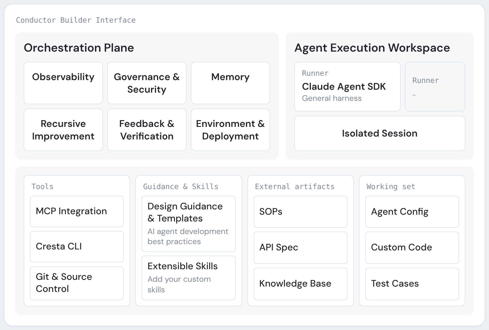
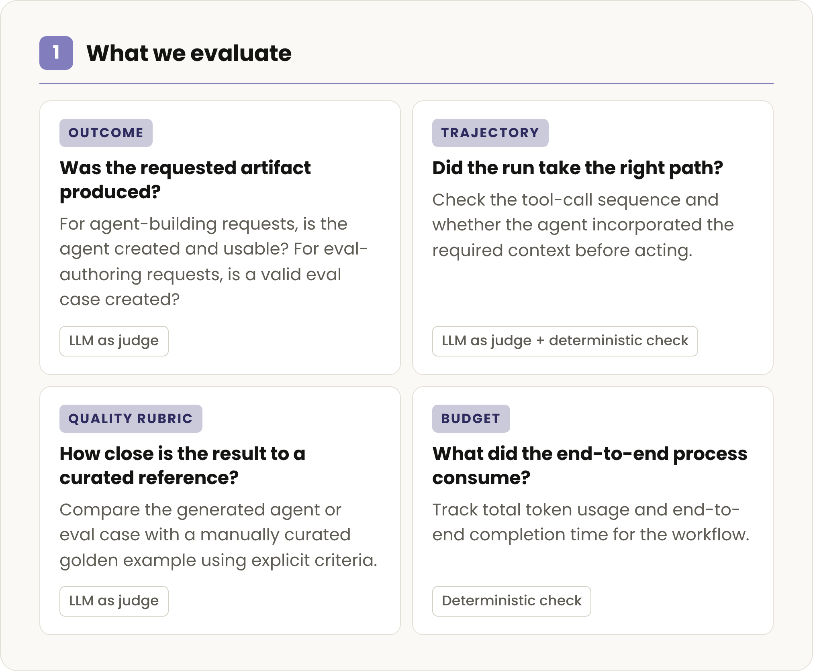
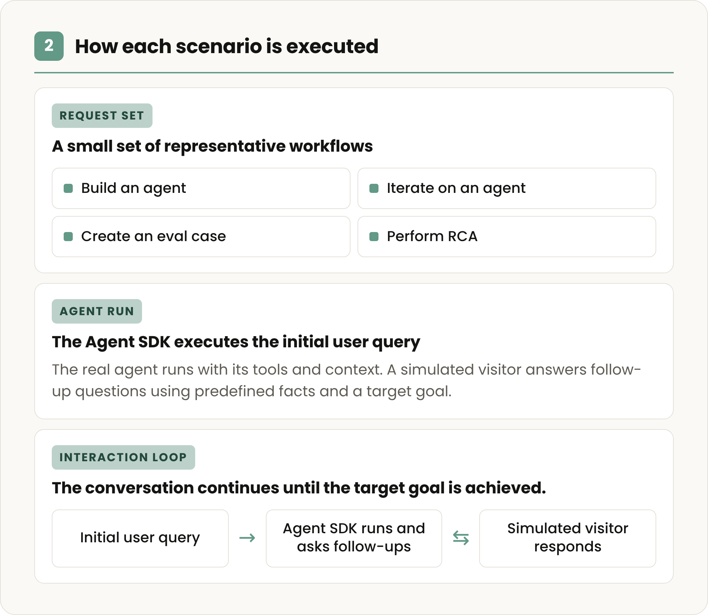
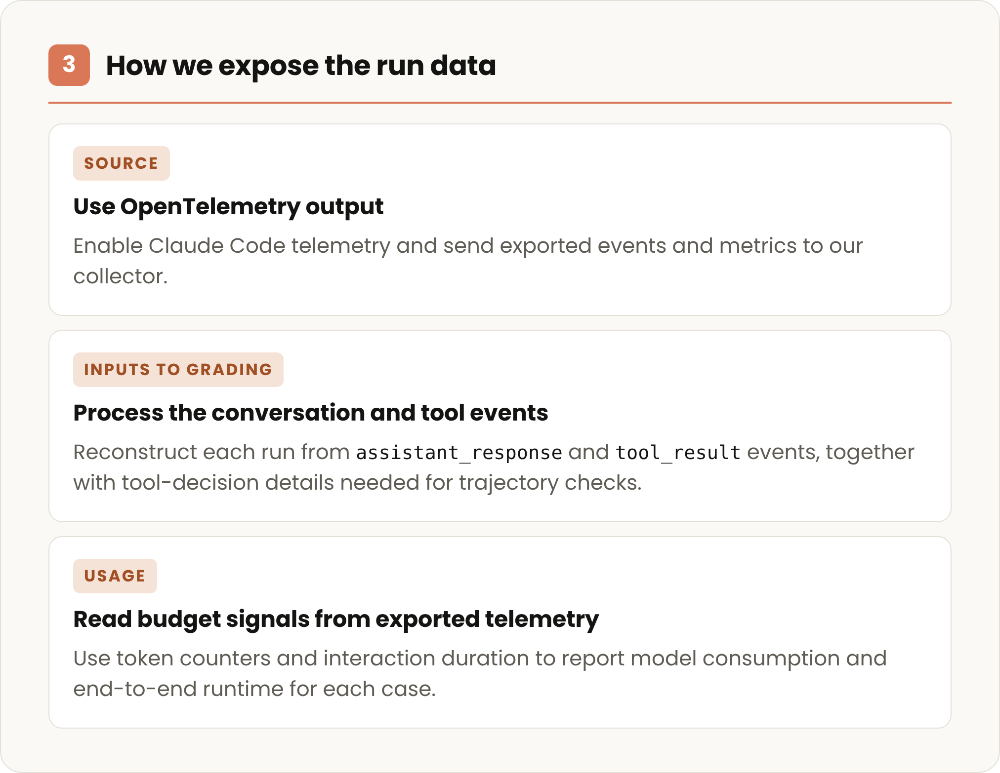

# Cresta 如何把 CX 专业能力变成 Claude Agent SDK 上的 agent 构建器（中英对照）

> **原文标题：** How Cresta turned CX expertise into an agent builder on the Claude Agent SDK
> **原文链接：** https://claude.com/blog/how-cresta-turned-cx-expertise-into-an-agent-builder-on-the-claude-agent-sdk
> **原文作者：** Cresta 团队（原文未逐段署名）
> **发布日期：** 2026-10-05
> **翻译模型：** DeepSeek-V4.1-Flash
> **评分：** ★★★☆☆ —— 一篇客户案例：讲清了 Conductor 这个"造 agent 的 agent"如何用 Claude Agent SDK 充当通用执行壳、如何把 CX 领域知识沉淀成可复用 skill，以及如何用固定任务集做回归评测，但整体偏产品叙事，缺少实现细节与量化数据
> 排版：每段英文原文在前，中文翻译紧随其后。默认收录正文主体。术语保留英文原文并附中文释义。

---

See how Cresta built Conductor, an agent that builds other agents, on the Claude Agent SDK, and how the team evaluates it with every new Claude model.

看看 Cresta 如何在 Claude Agent SDK 上构建 Conductor——一个能构建其他 agent 的 agent，以及团队如何用每一个新的 Claude 模型对它进行评测。

In our series, How startups build with Claude, we look at the decisions behind AI products. Here, we explore how Cresta brought its expertise building AI-native customer experience into Conductor, an agent that helps developers build and improve other agents.

在我们的"初创公司如何用 Claude 构建产品"系列中，我们关注 AI 产品背后的决策。本文中，我们探讨 Cresta 如何把它在构建 AI 原生客户体验方面的专长，带进 Conductor——一个帮助开发者构建和改进其他 agent 的 agent。

Building enterprise AI agents for customer experience use cases requires understanding the context embedded across a wide range of customer interactions. For example, customers may:

为客服体验（CX）场景构建企业级 AI agent，需要理解散落在各类客户交互中的上下文。例如，客户可能会：

- Ask for a refund without saying which purchase they mean,
- Report a billing problem and a login issue in the same message, or
- Request a refund after the return window has closed.

- 要求退款，却没说是哪一笔购买；
- 在同一条消息里既报告账单问题、又报告登录问题；或
- 在退货窗口关闭之后才要求退款。

To respond correctly, the agent may need to check what the customer bought, the refund policy, their account history, or the payment status.

为了正确回应，agent 可能需要查清客户买了什么、退款政策、其账户历史，或支付状态。

Cresta sees these interactions at volume. Its platform powers customer experience, AI agents that handle conversations on their own, provide real-time guidance for the human agents working alongside them, and surface conversation intelligence that shows the business where to improve.

Cresta 会大量接触到这类交互。其平台驱动着客户体验：AI agent 可自行处理对话，为与之协作的人工客服提供实时指导，并输出对话智能（conversation intelligence），让业务方看到该在哪里改进。

Building and maintaining customer experience agents requires organizations to make key decisions on operating requirements: what the agent needs to know, which systems it must access, and where its behavior should be flexible or deterministic. Cresta wanted to make that judgment available to more teams without each one starting from scratch.

构建和维护客户体验 agent，要求组织在运行需求上做出关键决策：agent 需要知道什么、必须访问哪些系统，以及它的行为在哪里应当灵活、在哪里应当确定（deterministic）。Cresta 希望把这种判断力带给更多团队，而不必每个团队都从零开始。

Conductor is the result: a natural language agent builder that helps teams turn complex business context into production-ready agents. Users describe what they want to build, and Conductor guides the work from a grounded blueprint through implementation, evaluation, and optimization.

Conductor 就是这一努力的成果：一个自然语言 agent 构建器，帮助团队把复杂的业务上下文转化为可直接上生产的 agent。用户描述自己想构建什么，Conductor 便引导整个工作从有依据的蓝图（grounded blueprint）走向实现、评测与优化。

Cresta originally built an early version of Conductor using Claude Sonnet and Claude Opus to help internal teams support customer deployments. The open question was whether Cresta could turn that system into a product customers could use to build agents directly within the platform.

Cresta 最初用 Claude Sonnet 和 Claude Opus 构建了 Conductor 的早期版本，用于帮助内部团队支持客户部署。悬而未决的问题是：Cresta 能否把这套系统变成一款产品，让客户直接在平台内构建 agent。

To carry out open-ended development work, Conductor uses the Claude Agent SDK as a general-purpose harness to gather context, use tools, write and run code, and adapt based on the results.

为了完成开放式的开发工作，Conductor 把 Claude Agent SDK 用作通用执行框架（harness），用来收集上下文、使用工具、编写并运行代码，并根据结果做出调整。

> “We used Claude Code internally as a dev tool because it was very effective at the software development aspects of building an agent,” said Renjie Li, Engineering Lead for Cresta Conductor. “The Claude Agent SDK gave us a way to use that same agentic development harness programmatically. With Conductor, we’ve connected it with Cresta’s deep conversation intelligence, CX expertise, evaluations, and runtime to give users the agent-building experience we wish we’d had from day one.”

> “我们在内部把 Claude Code 当作开发工具使用，因为它在构建 agent 的软件开发环节非常高效，”Cresta Conductor 工程负责人 Renjie Li 说。“Claude Agent SDK 让我们能够以编程方式使用同一套 agentic 开发框架。通过 Conductor，我们把它与 Cresta 深厚的对话智能、CX 专长、评测和运行时连接起来，为用户提供我们从第一天起就希望拥有的 agent 构建体验。”

Cresta reports that in early use cases across Cresta and its partners, Conductor cut initial deployment time roughly in half.

Cresta 表示，在 Cresta 及其合作伙伴的早期用例中，Conductor 把初始部署时间缩短了大约一半。

> **Figure 1:** The Conductor builder interface: an orchestration plane for governance, memory and feedback, alongside an agent execution workspace running the Claude Agent SDK in an isolated session.
> **图 1：** Conductor 构建器界面：一层用于治理、记忆与反馈的编排平面（orchestration plane），旁边是一个在隔离会话（isolated session）中运行 Claude Agent SDK 的 agent 执行工作区。

# 一个帮助构建下一个 agent 的元 agent（A meta-agent that helps build the next agent）

Conductor is a self-improving meta-agent built on established best practices for CX agent development. As teams build and refine more agents with it, they capture their own proven patterns, workflows, and expert judgment. This creates a knowledge flywheel that makes future development faster and more consistent.

Conductor 是一个自我改进的元 agent（meta-agent），建立在 CX agent 开发的成熟最佳实践之上。随着团队用它构建和打磨更多 agent，他们会沉淀下自己已验证的模式、工作流和专家判断。这就形成了一个知识飞轮（knowledge flywheel），让未来的开发更快、更一致。

After launch, production interactions, workflow outcomes, and feedback become new signals for the next improvement.

上线之后，生产环境中的交互、工作流结果和反馈，都会成为下一轮改进的新信号。

Conductor helps builders turn what they learned from an agent build into a reusable memory artifact, capturing patterns, business rules, and evaluation approaches. They can then share it as skill with the rest of the team, so others can build from the same proven practices.

Conductor 帮助构建者把从一次 agent 构建中学到的东西，变成一个可复用的记忆产物（memory artifact），其中记录了模式、业务规则和评测方法。随后他们可以把它作为 skill 分享给团队其他成员，让其他人也能基于同样已验证的实践来构建。

## 让关键决策更容易（Making the important decisions easier）

Writing the first prompt is only one part of building a useful agent. One of the harder calls is where a conversation should stay flexible and where it needs explicit business rules and controlled tool behavior.

写好第一个 prompt 只是构建一个有用 agent 的一部分。更难的判断之一，是对话在哪里应当保持灵活，在哪里需要明确的业务规则和受控的工具行为。

> "You don't want to go too deterministic, otherwise you create a giant decision tree trying to map out every possible branch… but there are enterprise-critical workflows that you need to make sure work all the time, especially for highly regulated industries with low risk tolerance," said Renjie. "Conductor helps discover and harden those deterministic requirements and the implementation with the flexibility to improve the overall experience."

> “你不希望过度确定化，否则就会造出一棵巨大的决策树，试图穷举所有可能的分支……但有些对企业至关重要的流程，你必须确保它们始终可用，尤其是在风险容忍度很低的高度受监管行业，”Renjie 说。“Conductor 帮助发现并固化这些确定性需求及其实现，同时又保留改进整体体验所需的灵活性。”

Conductor draws on historical conversations to help teams identify where a human should stay in the loop and where the model can be given room to adapt. Once those boundaries are set, developers still need to test the deterministic pieces against the requirements they're meant to enforce, and revise those tests as the underlying business rules change.

Conductor 借助历史对话，帮助团队判断哪里应当保留人工介入（human in the loop），哪里可以给模型留出适应空间。边界一旦划定，开发者仍需针对这些确定性部分所应执行的规则来测试它们，并在底层业务规则变化时修订这些测试。

# Cresta 如何评测 Conductor（How Cresta evaluates Conductor）

Conductor is measured on how well it builds agents. To that end, Cresta runs Conductor through a set of build tasks:

衡量 Conductor 的标准，是它构建 agent 的效果如何。为此，Cresta 让 Conductor 跑一组构建任务：

- Build a new agent
- Write a test case for one
- Change an agent that already exists
- Perform root cause analysis

- 构建一个新的 agent
- 为某个 agent 编写一个测试用例
- 修改一个已存在的 agent
- 执行根因分析（root cause analysis，RCA）

Finishing the task is not the only bar. The team also looks at the outcomes, how Conductor got there, and what it used along the way.

完成任务并不是唯一的标准。团队还会看结果、Conductor 是如何走到那一步的，以及过程中用了什么。

Those same tasks function as a safety net. When a new Claude model is launched or the Conductor framework is updated, Cresta reruns its evaluations. It uses the same tasks and same scoring to identify what improved and what still needs work before anyone commits to the change.

这同一组任务还起到安全网的作用。当有新的 Claude 模型发布，或 Conductor 框架更新时，Cresta 会重跑评测。它用相同的任务和相同的评分，在任何人确认这项变更之前，识别出哪些地方变好了、哪些地方仍需改进。

> **Figure 2:** Step 1 of Cresta's evaluation: what we evaluate — outcome, trajectory, quality rubric, and budget, each with its own grading method.
> **图 2：** Cresta 评测的第 1 步：我们评测什么——结果（outcome）、轨迹（trajectory）、质量评分标准（quality rubric）与预算（budget），每项各有自己的评分方式。

> **Figure 3:** Step 2: how each scenario is executed — a small request set of representative workflows, an agent run on the Agent SDK, and an interaction loop with a simulated visitor.
> **图 3：** 第 2 步：每个场景如何执行——一小组具有代表性的工作流请求集（request set）、由 Agent SDK 执行的一次 agent 运行，以及与模拟访客（simulated visitor）的交互循环。

> **Figure 4:** Step 3: how we expose the run data — OpenTelemetry output as the source, conversation and tool events as inputs to grading, and token counters for usage.
> **图 4：** 第 3 步：我们如何暴露运行数据——以 OpenTelemetry 输出为数据源，把对话与工具事件作为评分输入，并用 token 计数器统计用量。

That same evaluation discipline is built into Conductor, which allows its users to check and see if their agents are performing as intended. Conductor turns requirements and edge cases captured during the build phases into tests within its evaluation module.

同样的评测纪律也内建在 Conductor 中，让用户能够检查自己的 agent 是否按预期运行。Conductor 会把构建阶段捕获的需求和边界情况（edge case），转化为其评测模块中的测试。

Teams can then monitor the workflows that need to work every time as policies, connected systems, and conversation patterns change. That gives them a practical way to update an agent as the business changes without losing the reliability of the workflows they have already hardened.

这样一来，当政策、所连接系统和对话模式发生变化时，团队就能持续监控那些必须每次都能正常运行的流程。这给了他们一种务实的方式，在业务变化时更新 agent，同时不丢失那些已经固化的流程的可靠性。

# 在 Claude Agent SDK 上构建 Conductor（Building Conductor on the Claude Agent SDK）

Cresta designed Conductor as the CX-specific control plane for agent development. It brings together conversation data, domain expertise, and development practices, then governs each agent run through policy, observability, verification, and feedback-driven improvement.

Cresta 把 Conductor 设计为面向 CX 的 agent 开发控制平面（control plane）。它把对话数据、领域专长和开发实践汇集在一起，再通过策略、可观测性（observability）、验证和反馈驱动的改进来治理每一次 agent 运行。

The Claude Agent SDK sits beneath Conductor as a general-purpose execution harness. It manages the work of gathering context, calling tools, and writing and running code; Conductor layers Cresta's CX workflows, tools, and domain context on top.

Claude Agent SDK 位于 Conductor 之下，作为通用的执行框架。它负责收集上下文、调用工具、编写并运行代码等工作；Conductor 则在其之上叠加 Cresta 的 CX 工作流、工具和领域上下文。

The team evaluated the SDK against the work Conductor needed to perform: tasks with multiple steps, substantial context, and repeated tool use. Its review covered data privacy, tenant architecture, organization-level key distribution, controls, and observability across the implementation.

团队对照 Conductor 需要完成的工作来评估这个 SDK：多步骤任务、大量上下文，以及反复的工具调用。评审覆盖了数据隐私、租户架构（tenant architecture）、组织级密钥分发、管控措施，以及整个实现中的可观测性。

> "Anthropic gives us a strong, general-purpose foundation for agentic software development. That lets us put our engineering investment where Cresta creates the most durable customer value," said Xiangru Chen, VP of Engineering at Cresta.

> “Anthropic 为 agentic 软件开发给了我们一个强大且通用的基础。这让我们能把工程投入放在 Cresta 创造最持久客户价值的地方，”Cresta 工程副总裁 Xiangru Chen 说。

# 把 Cresta 的工程专长直接交到客户手中（Putting Cresta's engineering expertise directly in customers' hands）

Conductor started inside Cresta, helping its own forward-deployed team learn which development tasks could become repeatable, where context mattered most, and what builders needed to inspect along the way. Its success in that internal work gave the team confidence to bring the same capabilities to customers and partners.

Conductor 起步于 Cresta 内部，帮助其自有的前置部署（forward-deployed）团队弄清哪些开发任务可以变得可复用、上下文在哪里最关键，以及构建者在过程中需要检查什么。它在内部工作中的成功，让团队有信心把同样的能力带给客户和合作伙伴。

For any team whose product deploys custom agents faster than its engineers can hand-build them, Cresta's approach is a useful reference point: with agents or meta-agents, the work after the initial build is often the hardest part.

对于任何产品部署自定义 agent 的速度快于工程师手工构建速度的团队来说，Cresta 的做法是一个有用的参考：无论是 agent 还是元 agent，最初构建之后的工作往往才是最难的。

See how Conductor turns business context into better agent design, implementation, and ongoing improvement.

看看 Conductor 如何把业务上下文转化为更好的 agent 设计、实现与持续改进。
