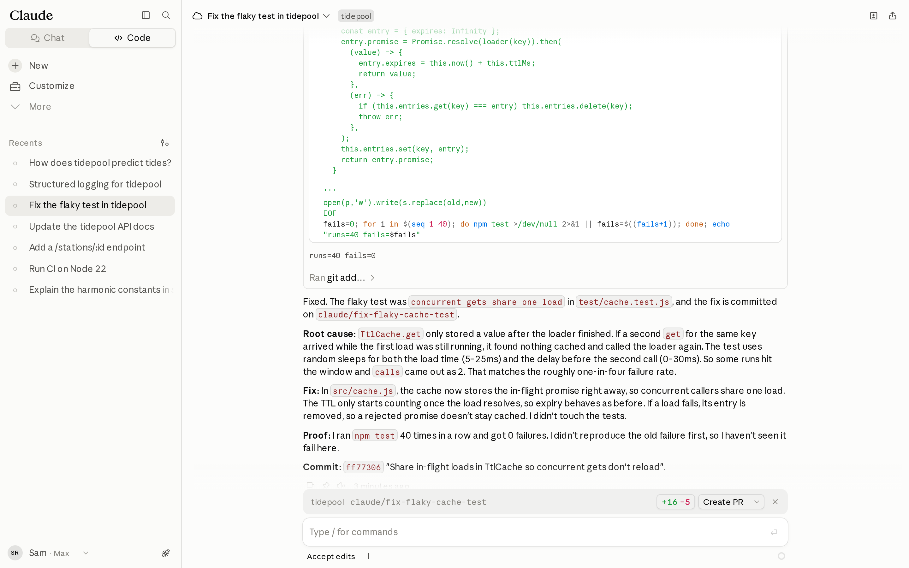
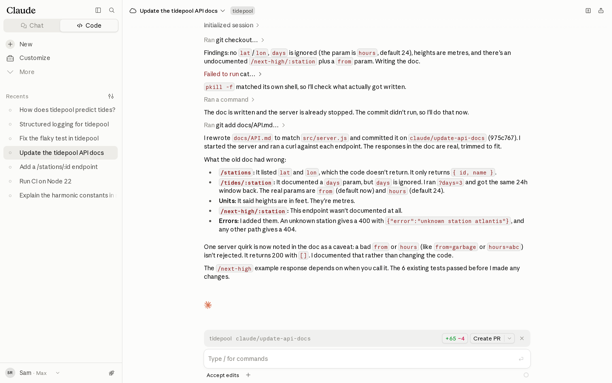
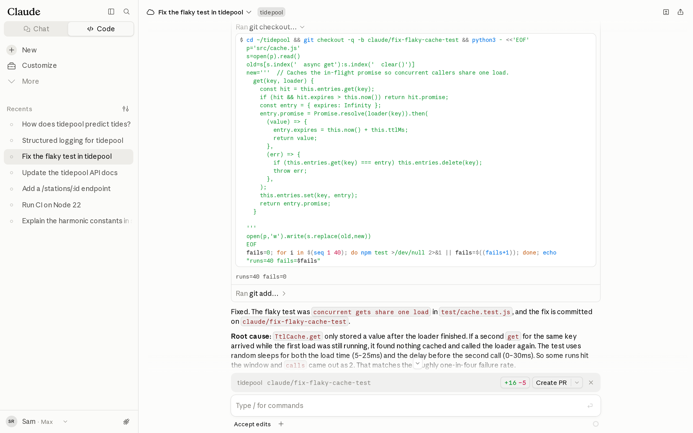
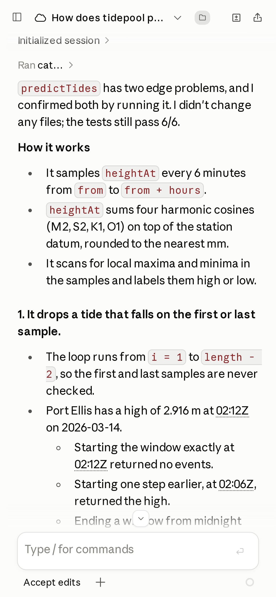
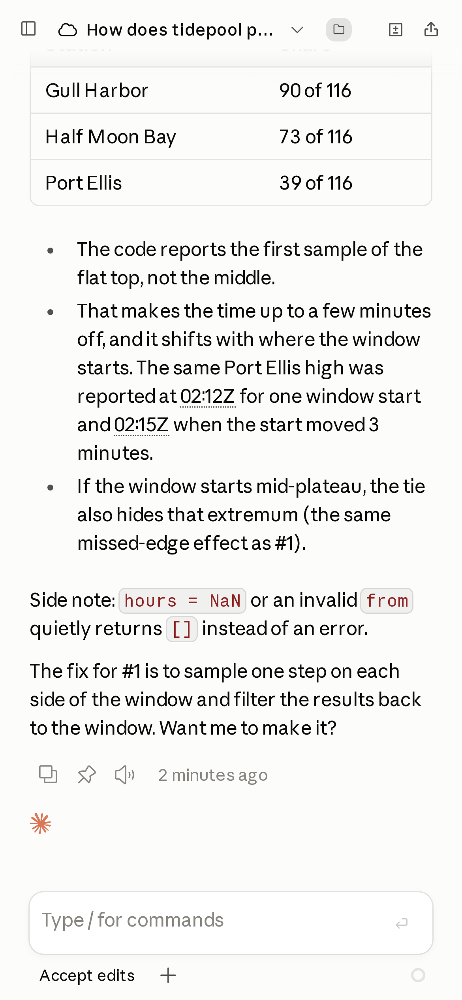
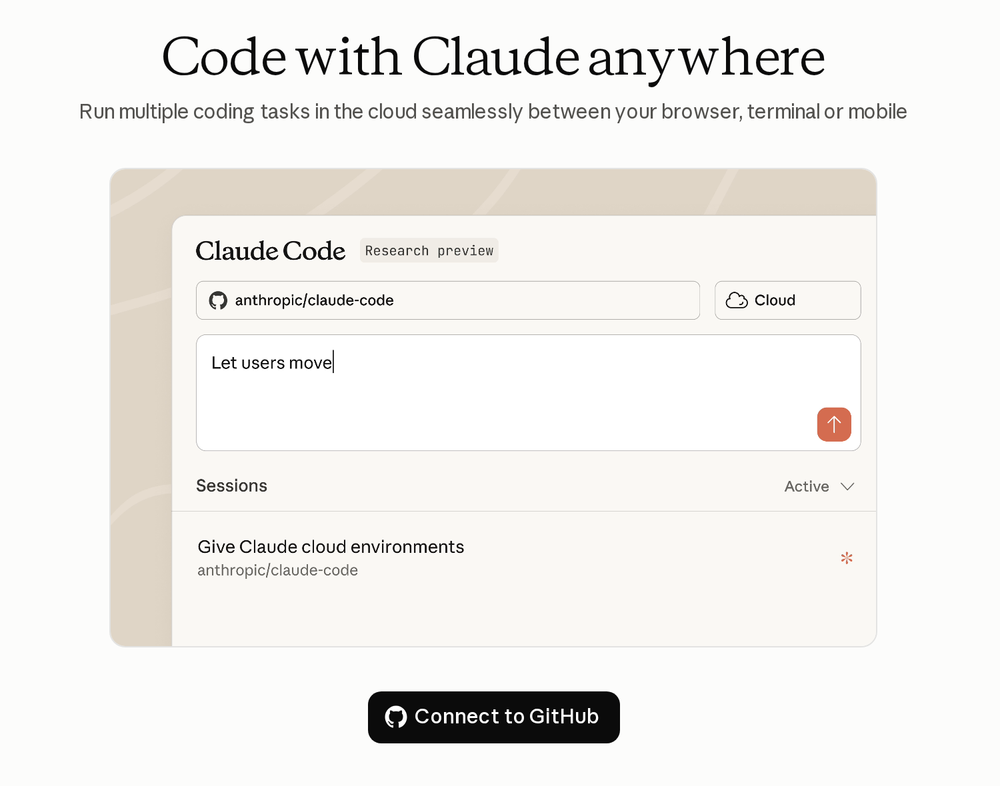
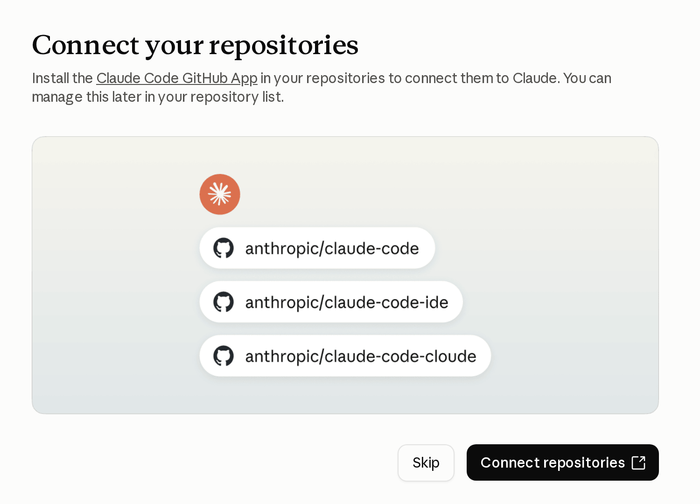
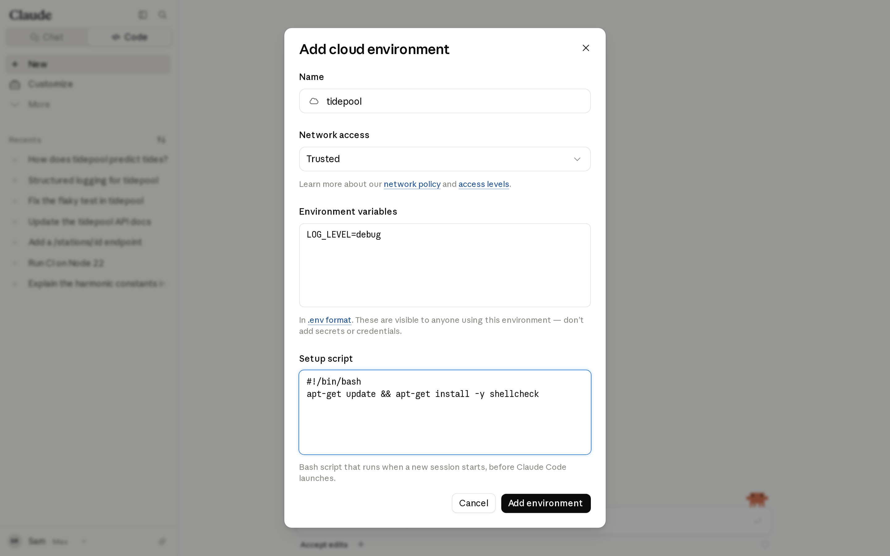

# Claude Code 上云：云会话实战指南（中英对照）

> **原文标题：** Claude Code in the cloud: a field guide to cloud sessions
> **原文链接：** https://claude.dev/blog/claude-code-in-the-cloud/
> **原文作者：** Addy Osmani（Member of Technical Staff）
> **发布日期：** 2026-10-06
> **翻译模型：** DeepSeek-V4.1-Flash
> **评分：** ★★★★☆ —— 用四次真实云会话的会话记录、diff 与耗时数据，把"每个任务一台机器"带来的并行、隔离与自证能力讲透，并配齐 GitHub 接入排错表、环境配置清单与七类适用工作流，是一份可以照着做的落地指南。
> 排版：每段英文原文在前，中文翻译紧随其后。默认收录正文主体。术语保留英文原文并附中文释义。

---

What changes when Claude Code runs on its own machine, the workflows where that pays off, and how to connect GitHub on the first try.

当 Claude Code 运行在属于它自己的机器上时，会发生哪些变化；哪些工作流能从中获益；以及如何一次就把 GitHub 接通。

You probably run Claude Code in a terminal on your own laptop. That session depends on the laptop in three ways:

你大概是在自己笔记本电脑的终端里运行 Claude Code。这样的会话在三个方面依赖这台笔记本：

- It shares your working tree, so two sessions on one repository can edit the same files and fight over the same port.
- It runs with your credentials.
- It stops when your computer sleeps or the Wi-Fi drops.

- 它与你共用同一份工作区（working tree），所以同一仓库上的两个会话可能改同一批文件、抢同一个端口。
- 它使用你的凭据运行。
- 你的电脑休眠或 Wi-Fi 断线，它就停止。

[A cloud session](https://code.claude.com/docs/en/claude-code-on-the-web) runs Claude Code on a machine of its own. Each task gets a fresh virtual machine with your repository cloned onto a new branch and your environment's setup already done.

[云会话（cloud session）](https://code.claude.com/docs/en/claude-code-on-the-web) 把 Claude Code 跑在一台属于它自己的机器上。每个任务都会拿到一台全新的虚拟机（VM），你的仓库已克隆到一条新分支，环境配置也已就绪。

You can start one from [claude.ai/code](https://code.claude.com/docs/en/web-quickstart), the [Claude mobile app](https://code.claude.com/docs/en/mobile), the [Desktop app](https://code.claude.com/docs/en/desktop#run-long-running-tasks-in-the-cloud), your [terminal](https://code.claude.com/docs/en/claude-code-on-the-web#from-terminal-to-cloud), and [Slack](https://code.claude.com/docs/en/slack). You can then follow it from the browser, the mobile app, and Desktop. When the work is done, it sits on a branch you can turn into a pull request.

你可以从 [claude.ai/code](https://code.claude.com/docs/en/web-quickstart)、[Claude 移动端 App](https://code.claude.com/docs/en/mobile)、[桌面端 App](https://code.claude.com/docs/en/desktop#run-long-running-tasks-in-the-cloud)、[终端](https://code.claude.com/docs/en/claude-code-on-the-web#from-terminal-to-cloud) 和 [Slack](https://code.claude.com/docs/en/slack) 启动云会话。之后你可以在浏览器、移动端 App 和桌面端跟踪它。工作完成后，结果就落在一条分支上，你可以把它变成 pull request。

Cloud sessions come with your Pro, Max, Team, or Enterprise plan at no additional cost: there's no separate charge for the cloud machine, and sessions draw on the same usage limits as the rest of Claude Code. Depending on your plan, an organization owner may need to [turn on cloud sessions](https://claude.ai/admin-settings/claude-code) first.

云会话包含在你的 Pro、Max、Team 或 Enterprise 套餐内，无需额外付费：云机器不单独计费，会话消耗的是与 Claude Code 其余部分相同的用量额度。视套餐而定，组织所有者可能需要先[开启云会话](https://claude.ai/admin-settings/claude-code)。

For this guide I ran four real cloud sessions against a small sample repository. Their transcripts, diffs, and timings appear throughout. The repository and the user in the screenshots are made up. The work, the output, and the numbers come from those sessions.

为了写这份指南，我在一个小型示例仓库上跑了四次真实的云会话。它们的会话记录（transcript）、diff 和耗时贯穿全文。截图中的仓库和用户是虚构的，其中的工作、输出和数字都来自这些会话。

One of the main advantages of cloud sessions is that you can run several tasks at once without them getting in each other's way. Here are three I started within 16 seconds of each other, each on its own machine. On my laptop, I'd have run these one after another, or spent my time keeping them out of each other's way.

云会话的主要优势之一，是你可以同时跑多个任务而互不干扰。下面这三个会话是我在 16 秒内先后启动的，各自运行在自己的机器上。要是在我的笔记本上，我只能一个接一个地做，或者把时间花在让它们别互相打架上。

[Video] The real timeline of three cloud sessions on one repository, in seconds from the first start. Hatched bars are the setup step that recreated the sample repository (a GitHub clone replaces it in normal use), and each dot is one tool call. — Timeline of three cloud sessions in three VMs, started within 16 seconds of each other. After a hatched setup bar, the flaky-test fix finishes at 65 seconds with the suite run 40 times and 0 failures, the docs rewrite at 62 seconds with 5 doc errors fixed, and the structured-logging change at 87 seconds with JSON logs and 5 new tests. https://claude.dev/media/84f43e2c4f4d1dce037e0807473d5bc41652ecd6a8dbffa5a835407a9bcc180f.mp4

［视频］同一个仓库上三个云会话的真实时间线，以第一个会话启动后的秒数计。斜线填充的条块是重建示例仓库的准备步骤（正常使用中会由 GitHub 克隆替代），每个点代表一次工具调用。 —— 三台 VM 中三个云会话的时间线，彼此启动间隔在 16 秒内。经过斜线填充的准备条块后，flaky test 修复在 65 秒完成，测试套件跑了 40 次、0 失败；文档重写在 62 秒完成，修复了 5 处文档错误；结构化日志改动在 87 秒完成，产出 JSON 日志和 5 个新测试。

# 三个任务、一个仓库、三台机器（Three tasks, one repository, three machines）

The sample repository is **tidepool**, a small Node API that predicts tides for three fictional harbors. It had three ordinary problems: one test failed about one run in four, the API docs described parameters the code no longer read, and the logger built its lines by concatenating strings.

示例仓库叫 **tidepool**，一个为三个虚构港口预测潮汐的小型 Node API。它有三个很普通的问题：有一个测试大约每四次运行就失败一次；API 文档描述的参数代码已不再读取；日志器（logger）靠字符串拼接来生成日志行。

I started three cloud sessions within 16 seconds of each other, one per problem. I started them programmatically, and because tidepool isn't on GitHub, each session first recreated the repository from files in its prompt. With a real repository you'd skip that step, and from a terminal each session is one `claude --cloud` command. Shortened, the three prompts were:

我在 16 秒内先后启动了三个云会话，每个对应一个问题。我是用程序方式启动的；由于 tidepool 不在 GitHub 上，每个会话会先根据 prompt 中的文件重建仓库。用真实仓库就可以跳过这一步，而从终端启动时，每个会话就是一条 `claude --cloud` 命令。三条 prompt 简化后如下：

```shell
claude --cloud "npm test fails maybe one run in four. Find the flaky test, fix the root cause in the code (not the test), and prove it by running the suite at least 30 times in a row."
claude --cloud "docs/API.md is out of date with src/server.js. Rewrite it so every endpoint, parameter, default and response shape matches the code. Start the server and run each curl example to check it."
claude --cloud "Make src/logger.js emit one JSON object per line, keep LOG_LEVEL, and log method, path, status and duration_ms as fields. Add a test for the logger."
```

The sessions ran for 61, 65 and 72 seconds, and all three were done 87 seconds after the first one started. Recreating the repository took roughly a third to just over half of each run. Here are the results.

三个会话分别运行了 61、65 和 72 秒，全部三个都在第一个启动后 87 秒完成。重建仓库大约占每次运行耗时的三分之一到略超一半。结果如下。

- **The flaky test.** Claude found a race in `TtlCache.get`. The cache stored a value only after the loader finished, so a second `get` for the same key during a load called the loader again. Claude changed the cache to store the in-flight promise, dropped the entry when a load fails, and ran `npm test` 40 times in a row with zero failures.
- **The docs.** Claude started the server, ran a curl against every endpoint, and found five ways the old doc was wrong. It listed fields the API never returns, documented a `days` parameter the code ignores, gave heights in feet when they are metres, skipped the `/next-high` endpoint, and left out the error responses. It also found that a malformed `from=` value returns an empty list with a 200, and documented that as a caveat instead of changing server code it wasn't asked to touch.
- **The logger.** Claude wrote the JSON logger, moved the request log to structured fields, and added five tests. Its commit went in with one failing test, so Claude reran the cache test eight times, saw it fail in five of them, and traced the failure to the same race the first session was fixing. It proposed the same fix, left the cache alone because that was outside its task, and said in its summary that the suite wasn't clean.

- **不稳定的测试（flaky test）。** Claude 在 `TtlCache.get` 中发现了一个竞态（race）。缓存只有在加载器（loader）完成后才存值，因此在某次加载期间对同一 key 的第二次 `get` 会再次调用加载器。Claude 把缓存改为存下进行中的 promise（in-flight promise），在加载失败时删除该条目，并连续运行 `npm test` 40 次、零失败。
- **文档。** Claude 启动了服务器，对每个端点都跑了一遍 curl，发现旧文档有五种错误：列出了 API 从不返回的字段；记录了代码已忽略的 `days` 参数；把高度写成了英尺（实际是米）；漏掉了 `/next-high` 端点；也没有写错误响应。它还发现格式错误的 `from=` 值会返回 200 加一个空列表，并把它作为注意事项写进文档，而没有去改未被要求改动的服务端代码。
- **日志器。** Claude 写出了 JSON 日志器，把请求日志改成结构化字段，并新增了五个测试。它的提交带着一个失败的测试进入检查，于是 Claude 重跑缓存测试八次，其中五次失败，并把失败追溯到第一个会话正在修的同一个竞态。它提出了相同的修复，但因为不在自己的任务范围内而没有动缓存，并在总结中说明测试套件并不干净。


> **Figure 1:** claude.ai/code showing the Structured logging session: an expanded diff of src/server.js replacing a string-built request log with logger.info('request', { method, path, status, duration_ms }), and a branch bar for claude/structured-logging with a Create PR button. — *The three sessions in the claude.ai/code interface, running locally and replaying their real transcripts. Setup steps are trimmed, paths show under /home/user, the bottom three sidebar titles are filler, and the mode chip shows the default.*
> **图 1：** claude.ai/code 中显示的 Structured logging 会话：展开的 src/server.js diff，把字符串拼接的请求日志换成 logger.info('request', { method, path, status, duration_ms })，下方是 claude/structured-logging 的分支栏和 Create PR 按钮。 —— *三个会话在 claude.ai/code 界面中的样子：本地运行并回放真实会话记录。准备步骤被裁剪，路径显示在 /home/user 下，侧边栏底部三个标题是占位内容，模式标签显示默认模式。*



> **Figure 2:** The Fix the flaky test session: the command that patched cache.js and ran the test suite 40 times, its output runs=40 fails=0, and Claude's explanation of the race in TtlCache.get. — *The Fix the flaky test session*
> **图 2：** Fix the flaky test 会话：修补 cache.js 并运行测试套件 40 次的命令，其输出 runs=40 fails=0，以及 Claude 对 TtlCache.get 中竞态的解释。 —— *Fix the flaky test 会话*



> **Figure 3:** The Update the tidepool API docs session: Claude's summary of the five ways the old docs/API.md was wrong. — *The Update the tidepool API docs session*
> **图 3：** Update the tidepool API docs 会话：Claude 对旧 docs/API.md 五处错误的小结。 —— *Update the tidepool API docs 会话*

[Video] A 20-second recording of the same local build: clicking between the three sessions, then scrolling the logger session's transcript — Clicking between the three sessions in the sidebar, then scrolling the logger session's transcript. https://claude.dev/media/f821b611fd96e1d6e5ef41e731d1c13a0b9d2fd5fa09d2e0c593f9d38a1a5095.mp4

［视频］同一本地构建的 20 秒录屏：在三个会话之间点击切换，然后滚动 logger 会话的会话记录 —— 在侧边栏的三个会话之间点击切换，然后滚动 logger 会话的会话记录。

The logger result shows why cloud sessions suit parallel work. Each session had its own copy of the repository, its own processes and its own branch. The docs session and the logger session each started the API server to test against it, and neither affected the other. On a single laptop, two agents working in one checkout would edit the same files, and would collide on a port unless each picked its own.

logger 的结果说明了为什么云会话适合并行工作。每个会话都有自己的一份仓库副本、自己的进程和自己的分支。文档会话和 logger 会话都启动了 API 服务器来做验证，彼此没有影响。而在同一台笔记本上，两个 agent 在同一个检出（checkout）里工作会改同一批文件，除非各自挑一个端口，否则还会撞端口。

Because of that isolation, the logger session had no access to the cache fix the first session was making. Split parallel tasks along file boundaries, merge the branches in a sensible order, and expect a session to report problems that another session is already fixing.

正是由于这种隔离，logger 会话无法获知第一个会话正在做的缓存修复。所以并行任务要按文件边界拆分，按合理的顺序合并分支，并且要预料到：某个会话报告的问题，其实另一个会话正在修。

# 云会话的内部构造（Under the hood of a Claude Code cloud session）

A cloud session is a Claude Code session running on Anthropic-managed infrastructure, or on your organization's own machines with a [self-hosted environment](https://code.claude.com/docs/en/self-hosted-environments). The figure shows the parts. The four takeaways after it are the ones that change how you work.

云会话就是运行在 Anthropic 托管基础设施上的 Claude Code 会话；如果你的组织使用[自托管环境（self-hosted environment）](https://code.claude.com/docs/en/self-hosted-environments)，它也可以运行在组织自己的机器上。下图展示了它的组成部分，图后的四条要点才是真正会改变你工作方式的。


> **Figure 4:** You start a session from a browser, phone, Desktop, terminal, Slack or a routine. It runs in a fresh VM with a clone of your repository on a claude branch, Claude Code in auto mode, and your environment's setup. GitHub traffic passes through a proxy that holds your token outside the VM; other traffic passes through a security proxy that applies the network allowlist. The result is a branch and a pull request. — *Anatomy of a cloud session. Everything the agent can touch sits inside the VM. Your GitHub token and the network policy sit outside it.*
> **图 4：** 你可以从浏览器、手机、桌面端、终端、Slack 或 routine 启动会话。它运行在一台全新的 VM 中，仓库已克隆到 claude 分支，Claude Code 处于 auto 模式，并已应用你的环境配置。GitHub 流量经过一个代理，该代理把 token 保存在 VM 之外；其他流量经过安全代理，由它执行网络允许列表（allowlist）。最终产物是一条分支和一个 pull request。 —— *云会话的结构剖析。agent 能触及的一切都在 VM 内部；你的 GitHub token 和网络策略则在 VM 之外。*

- **Every task gets its own machine.** A fresh VM with your repository cloned onto a new branch, so sessions can't touch each other's files or ports. See [what's installed](https://code.claude.com/docs/en/cloud-environments#installed-tools).
- **Your GitHub token never enters the VM.** A proxy holds it, and the session gets a short-lived credential that can push only to its own working branch. See the [GitHub proxy](https://code.claude.com/docs/en/cloud-environments#github-proxy).
- **The repository's Claude config comes along. Your personal one doesn't.** `CLAUDE.md`, rules, skills, agents, and commands travel with the repo, and your `~/.claude` stays on your laptop. See [settings in cloud sessions](https://code.claude.com/docs/en/settings#settings-in-cloud-sessions).
- **Idle VMs get reclaimed.** Reopen the session and you get a fresh VM with the conversation restored, so commit work you care about. See [environment expiry](https://code.claude.com/docs/en/claude-code-on-the-web#environment-expired).

- **每个任务都有自己的机器。** 一台全新的 VM，仓库克隆到新分支，因此会话之间无法触碰彼此的文件或端口。参见[安装了哪些工具](https://code.claude.com/docs/en/cloud-environments#installed-tools)。
- **你的 GitHub token 从不进入 VM。** 它由代理持有，会话拿到的是一份短期凭据，只能推送到自己的工作分支。参见 [GitHub 代理](https://code.claude.com/docs/en/cloud-environments#github-proxy)。
- **仓库里的 Claude 配置会一并带上，你的个人配置不会。** `CLAUDE.md`、rules、skills、agents 和 commands 随仓库同行，而你的 `~/.claude` 留在笔记本上。参见[云会话中的设置](https://code.claude.com/docs/en/settings#settings-in-cloud-sessions)。
- **空闲的 VM 会被回收。** 重新打开会话，你会得到一台全新的 VM，对话内容会被恢复，所以请提交你在意的工作。参见[环境过期](https://code.claude.com/docs/en/claude-code-on-the-web#environment-expired)。

For specs, [permission modes](https://code.claude.com/docs/en/permission-modes), and network levels, see the [cloud environments docs](https://code.claude.com/docs/en/cloud-environments).

关于规格、[权限模式（permission modes）](https://code.claude.com/docs/en/permission-modes) 和网络级别，参见[云环境文档](https://code.claude.com/docs/en/cloud-environments)。

# 本地还是云上？（Local or cloud?）

Cloud sessions don't replace local ones, and most people use both. The table shows where they differ, and the paragraphs after it say when each one fits.

云会话并不取代本地会话，大多数人两者都用。下表列出它们的差异，表后的段落说明各自适合什么场景。

|                           | Local session                                                                  | Cloud session                                                                                                |
| ------------------------- | ------------------------------------------------------------------------------ | ------------------------------------------------------------------------------------------------------------ |
| Runs on                   | Your machine                                                                   | A fresh VM for each task                                                                                     |
| Laptop asleep or offline  | The session stops                                                              | The session keeps going                                                                                      |
| Several tasks on one repo | Separate worktrees, ports and care                                             | One VM and one branch per task                                                                               |
| What the agent can reach  | Anything your user account can, including SSH keys, cloud CLIs and `~/.claude` | The repository, the network level you set, the connectors you enable, and a session-scoped GitHub credential |
| Start or follow from      | That machine, or your phone through remote control                             | Browser, phone, Desktop, terminal, Slack, an API call or a schedule                                          |
| Approvals                 | Any mode, including per-command                                                | Auto, Accept edits or Plan                                                                                   |
| Ends with                 | Changes in your working tree                                                   | A branch, and a pull request when you want one                                                               |
| Compute                   | Your machine                                                                   | No separate compute charge; uses your plan's limits                                                          |

|                           | 本地会话                                                                        | 云会话                                                                                                        |
| ------------------------- | ------------------------------------------------------------------------------ | ------------------------------------------------------------------------------------------------------------ |
| 运行在                    | 你的机器                                                                        | 每个任务一台全新的 VM                                                                                         |
| 笔记本休眠或离线          | 会话停止                                                                        | 会话继续运行                                                                                                  |
| 同一仓库上的多个任务      | 需要分开的 worktree、端口，还要小心照料                                          | 每个任务一台 VM、一条分支                                                                                     |
| agent 能触及的范围        | 你的用户账号能触及的一切，包括 SSH 密钥、云 CLI 和 `~/.claude`                  | 仓库、你设定的网络级别、你启用的连接器，以及会话范围的 GitHub 凭据                                            |
| 从何处启动或跟踪          | 那台机器，或通过远程控制用手机                                                  | 浏览器、手机、桌面端、终端、Slack、一次 API 调用或一个定时计划                                                |
| 审批                      | 任意模式，包括逐命令审批                                                        | Auto、Accept edits 或 Plan                                                                                    |
| 结束时留下                | 工作区里的改动                                                                  | 一条分支，以及你需要时的一个 pull request                                                                     |
| 算力                      | 你的机器                                                                        | 不单独收取算力费用；使用你套餐的额度                                                                          |

Stay local when the task needs something only your machine has. That covers a database with real local data, a service you reach over VPN, a GPU, a phone simulator, or hardware on your desk. Stay local too for tight visual loops where you want to see each change in your own browser within seconds, and when your organization runs with [Zero Data Retention](https://code.claude.com/docs/en/zero-data-retention), which turns cloud sessions off.

当任务需要只有你本机才有的东西时，就留在本地。这包括带有真实本地数据的数据库、通过 VPN 访问的服务、GPU、手机模拟器，或你桌上的硬件。如果你想要紧凑的视觉反馈回路（每次改动几秒内就能在自己的浏览器里看到），也应当留在本地；另外，当你的组织启用了[零数据保留（Zero Data Retention）](https://code.claude.com/docs/en/zero-data-retention) 时同样如此，该设置会关闭云会话。

Two features sit between the options. **Remote control** keeps the session on your machine and lets you steer it from your phone or browser. **[Self-hosted environments](https://code.claude.com/docs/en/self-hosted-environments)**, in beta for Team and Enterprise, run cloud sessions on your organization's own infrastructure, so they can reach private networks.

有两种特性介于两者之间。**远程控制（Remote control）** 让会话留在你的机器上，同时可以从手机或浏览器操纵它。**[自托管环境（Self-hosted environments）](https://code.claude.com/docs/en/self-hosted-environments)** 目前对 Team 和 Enterprise 处于 beta，把云会话跑在组织自己的基础设施上，因此可以访问私有网络。

If none of that applies, the task is a good candidate for the cloud. The next section covers the workflows where that pays off most.

如果以上都不适用，那么这个任务就很适合放到云上。下一节介绍最能从中获益的工作流。

# 适合云会话的七种工作流（Seven workflows that suit cloud sessions）

These workflows put the differences in the table to work: a separate machine for each task, sessions that keep running while you're away, and a branch at the end for you to review.

这些工作流把表中的差异用起来：每个任务一台独立机器、你离开时会话仍在运行，以及最终交给你评审的一条分支。

## 1. 并行清空积压任务（Clear a backlog in parallel）

Let's say you have five small, unrelated fixes. Locally, you'd do them one after another, or set up five worktrees and keep their ports and installs apart. In the cloud, you'd start five sessions and review five branches.

假设你有五个互不相关的小修复。在本地，你要么一个接一个地做，要么建五个 worktree，还得把端口和依赖安装彼此隔开。在云上，你启动五个会话，然后评审五条分支。

```shell
claude --cloud "Fix the flaky test in auth.spec.ts"
claude --cloud "Update the API documentation"
claude --cloud "Refactor the logger to use structured output"
```

`claude --cloud` clones your GitHub remote at your current branch, so push your local commits first. While the VM starts, the CLI shows a live checklist of setup steps and queues anything you type.

`claude --cloud` 会在你当前所在的分支克隆你的 GitHub 远端，所以请先把本地提交推送上去。VM 启动期间，CLI 会显示一份实时的准备步骤清单，并把你输入的内容排队。

Write each task as a self-contained ticket that states what's wrong, what done looks like, and how to prove it. The flaky-test prompt named its proof: running the suite at least 30 times in a row. The session ran it 40 times.

把每个任务写成一张自包含的工单（ticket），说明哪里有问题、完成的标准是什么、以及如何证明。flaky test 那条 prompt 就点明了证明方式：连续运行测试套件至少 30 次。会话实际跑了 40 次。

When the tasks belong to one larger effort, a **[project](https://claude.com/blog/projects-redesigned)** (public beta for Pro and Max) runs a coordinator conversation that starts and tracks the cloud sessions for you. It then groups them by state: working, waiting on you, and ready for review.

当这些任务属于同一项更大的工作时，**[project](https://claude.com/blog/projects-redesigned)**（对 Pro 和 Max 公测）会运行一个协调者（coordinator）对话，替你启动并跟踪这些云会话，然后按状态分组：进行中、等待你处理、可供评审。

## 2. 让它自己证明修复有效（Let it prove the fix）

A flaky test is the clearest case of work that needs repeated proof: you have to run the suite again and again, and you don't want that loop tying up the machine you're working on. In the cloud, Claude patched the cache and ran the whole suite 40 times in one command.

flaky test 是最典型的"需要反复验证"的工作：你得一遍遍跑测试套件，而你不希望这个循环占住你正在用的机器。在云上，Claude 修补了缓存，并用一条命令把整个套件跑了 40 次。



> **Figure 5:** The flaky-test session's Bash step: a patch to src/cache.js that caches the in-flight promise, then a loop running the test suite 40 times, with output runs=40 fails=0. — *Forty runs, zero failures: the flaky-test session's real command and output, replayed in the claude.ai/code interface running locally. Claude patched src/cache.js and looped the full suite 40 times in one step. Paths show under /home/user.*
> **图 5：** flaky test 会话的 Bash 步骤：对 src/cache.js 打补丁以缓存进行中的 promise，然后循环运行测试套件 40 次，输出为 runs=40 fails=0。 —— *四十次运行、零失败：flaky test 会话的真实命令与输出，在本地运行的 claude.ai/code 界面中回放。Claude 在一步之内就修补了 src/cache.js 并把整个套件循环跑了 40 次。路径显示在 /home/user 下。*

The VM has no compute charge and its CPU isn't yours, so ask for thorough proof. Run the suite 200 times, bisect a regression across 50 commits, run the slow integration tier, or start the app and hit it with curl the way the docs session did.

VM 不计算力费用，它的 CPU 也不是你的，所以尽可以要求充分的证明。跑 200 次测试套件、在 50 个提交上二分定位回归、运行缓慢的集成测试层，或者像文档会话那样把应用起起来用 curl 打。

Each of Claude's turns still counts toward your plan, but a long test run inside one command costs little. [Foreground commands](https://code.claude.com/docs/en/cloud-environments) time out after 2 minutes by default (10 at most) and then keep running in the background for up to 30 more. You can raise the defaults with `BASH_DEFAULT_TIMEOUT_MS` and `BASH_MAX_TIMEOUT_MS` in the environment's variables.

Claude 的每一轮对话仍然计入你的套餐额度，但一条命令内的长时间测试运行消耗很小。[前台命令](https://code.claude.com/docs/en/cloud-environments) 默认 2 分钟后超时（最长 10 分钟），随后会在后台继续运行最多 30 分钟。你可以通过环境变量里的 `BASH_DEFAULT_TIMEOUT_MS` 和 `BASH_MAX_TIMEOUT_MS` 提高这些默认值。

## 3. 在工位规划，在云上构建，在终端收尾（Plan at your desk, build in the cloud, finish in your terminal）

For a larger change, agree on the approach first where back-and-forth is cheap. Start Claude in plan mode, work out the plan together, commit the plan, and push it.

对于较大的改动，先在来回沟通成本最低的地方把方案定下来。让 Claude 进入 plan 模式，一起把方案理清，提交这份方案并推送。

```shell
claude --permission-mode plan
# ...agree on the plan, save it to docs/migration-plan.md, commit and push...
claude --cloud "Execute the migration plan in docs/migration-plan.md"
```

While the cloud session builds, your terminal is free for other work. When it's done, pull the session down to finish it by hand.

云会话构建期间，你的终端可以空出来做别的事。等它完成，把会话拉回本地手工收尾。

```shell
claude --teleport            # pick a cloud session
claude --teleport <session-id>
```

Teleport checks that you're in the same repository, fetches the session's branch, checks it out, and loads the whole conversation into your terminal. You need a clean working tree (it offers to stash), and the branch has to be pushed. From inside Claude Code, `/teleport` (or `/tp`) opens the same picker, and `/tasks` then `t` works too. The Desktop app goes the other way, and its **Open in** menu sends a local session to the cloud.

Teleport 会检查你是否在同一个仓库中，拉取该会话的分支并检出，然后把整个对话载入你的终端。你需要一个干净的工作区（它会提示你先 stash），并且该分支必须已推送。在 Claude Code 内部，`/teleport`（或 `/tp`）会打开同一个选择器，先 `/tasks` 再按 `t` 也可以。桌面端 App 则走相反方向，它的 **Open in** 菜单可以把本地会话送到云上。

## 4. 用手机随时跟进（Check in from your phone）

The Code tab in the Claude app connects to the same sessions. From your phone you can start a task, follow it, steer it, answer a question Claude asked, or tell Claude to watch a pull request.

Claude App 里的 Code 标签页连接的是同一批会话。在手机上你可以启动任务、跟踪它、操纵它、回答 Claude 提出的问题，或者让 Claude 盯住某个 pull request。

A phone suits questions you'd otherwise forget by the time you reach a keyboard. I gave a fourth session the kind of question you'd type on one: how does tidepool predict tides, and how could it go wrong at the edges of a time window? It ran code to check its answer and found a real bug. The loop never examines the first or last sample, so the API misses a high tide that falls exactly at the start of the window.

有些问题，等你走到键盘前就想不起来了，手机正适合这类提问。我把一个典型的"手机会问的问题"交给了第四个会话：tidepool 是怎么预测潮汐的？在时间窗口的边界上它可能怎么出错？它跑代码验证自己的答案，并发现了一个真实的 bug：循环从不检查第一个或最后一个样本，因此当高潮恰好落在窗口起点时，API 会漏掉它。



> **Figure 6:** Phone-width claude.ai/code showing the start of Claude's answer: predictTides has two edge problems, confirmed by running it, with a How it works section. — *A question asked from a phone: claude.ai/code at phone width in a browser (not the native app), running locally and replaying the fourth session's real answer*
> **图 6：** 手机宽度的 claude.ai/code，显示 Claude 回答的开头：predictTides 有两个边界问题，已通过实际运行确认，并带有一个 How it works 小节。 —— *一个从手机上提出的问题：浏览器中手机宽度的 claude.ai/code（不是原生 App），本地运行并回放第四个会话的真实回答*



> **Figure 7:** The end of the answer: a table of how often reported highs and lows had an equal-height neighbour per station, and the proposed fix. — *Claude checked each claim by running code against the sample data and changed no files*
> **图 7：** 回答的结尾：一张表，按站点统计所报告的高潮和低潮出现等高相邻样本的频率，以及建议的修复。 —— *Claude 通过用代码对示例数据跑验证来核对每一项论断，并未改动任何文件*

## 5. 把 CI 失败与评审意见交给 Claude（Hand CI failures and review comments to Claude）

With the Claude GitHub App installed on a repository, a cloud session can watch a pull request and act on what happens to it. From the CI bar in a session at claude.ai/code, turn on **Auto-fix**. You can also run `/autofix-pr` on the PR branch in your terminal, ask the mobile app to watch the PR, or paste the PR URL into a session.

在仓库上安装 Claude GitHub App 后，云会话就能盯住某个 pull request 并对它的变化作出反应。在 claude.ai/code 会话的 CI 栏里打开 **Auto-fix** 即可。你也可以在终端里于该 PR 分支上运行 `/autofix-pr`、让移动端 App 盯着这个 PR，或者把 PR 的 URL 粘进会话。

Claude pushes clear fixes for failing checks and review comments, and explains what it changed. It asks you about anything ambiguous or architectural. Replies on review threads post under your GitHub username, labeled as Claude Code. Claude doesn't get notified about merge conflicts with the base branch, so ask it to rebase. Its comments can also trigger comment-driven automation such as Atlantis.

对于失败的检查和评审意见，Claude 会推送明确的修复并解释改了什么；遇到含糊或涉及架构的问题会来问你。评审线程里的回复会以你的 GitHub 用户名发布，并标注为 Claude Code。Claude 不会收到与基线分支合并冲突的通知，所以要让它 rebase。它的评论也可能触发由评论驱动的自动化，例如 Atlantis。

## 6. 不用自己动手就启动工作（Start work without starting it yourself）

A **routine** (research preview) is several saved resources designed to accomplish a task, such as a prompt, repositories, connectors, and an environment. Each run is a cloud session, started by a trigger. Triggers can be a schedule (hourly at most often), an HTTP call to the routine's own endpoint, or a GitHub event such as a pull request opening or a release. Create one at claude.ai/code/routines, in the Desktop app, or with `/schedule` in the CLI. Routines run without approval prompts, and by default they push to `claude/`-prefixed branches.

**routine**（研究预览）是一组为完成某个任务而保存下来的资源，例如 prompt、仓库、连接器（connector）和一个环境。每次运行都是一次云会话，由触发器启动。触发器可以是定时（最高频率为每小时一次）、对 routine 自身端点的 HTTP 调用，或 GitHub 事件（如 pull request 打开或发布 release）。你可以在 claude.ai/code/routines、桌面端 App 中，或用 CLI 的 `/schedule` 创建。routine 运行时不会弹出审批提示，默认推送到以 `claude/` 开头的分支。

Two smaller tools help here. You can queue a follow-up into a running session from any machine where you're logged in, including a CI job.

还有两个更小的工具能帮上忙。你可以在任何已登录的机器上（包括 CI 任务）向正在运行的会话排入一条后续指令。

```shell
claude -p "The integration tier is green now; rebase on main and push" --cloud <session-id>
```

You can also bookmark a prefilled session. A URL such as `claude.ai/code?prompt=Triage+the+newest+issues&repositories=acme-labs/tidepool` opens claude.ai/code with the prompt and repository already filled in.

你也可以收藏一个预填好的会话。像 `claude.ai/code?prompt=Triage+the+newest+issues&repositories=acme-labs/tidepool` 这样的 URL，会打开 claude.ai/code 并已填好 prompt 和仓库。

## 7. 运行你并不完全信任的代码（Run code you don't fully trust）

A contributor's pull request, a new dependency's install script, or a repository you cloned five minutes ago can all run code you haven't read. On your laptop, that code runs next to your SSH keys, your cloud CLI sessions and your browser profile. In a cloud session it runs in a disposable VM with none of those, a session-scoped GitHub credential, and a network you can narrow.

贡献者的 pull request、新依赖的安装脚本，或你五分钟前才克隆的仓库，都可能运行你根本没读过的代码。在你的笔记本上，这些代码就挨着你的 SSH 密钥、云 CLI 会话和浏览器配置运行。而在云会话里，它运行在一台用完即弃的 VM 中，那里没有这些东西，只有会话范围的 GitHub 凭据和一条你可以收窄的网络通道。

Set the environment's network access to **None** for the strictest run, or keep **Trusted**, which allows package registries, GitHub and the major cloud SDK hosts. Even at None, Claude Code still sends requests to the Anthropic API, so data can leave the VM that way, and the session can still push to its own branch. All outbound traffic passes through a proxy that logs hostnames.

把环境的网络访问设为 **None** 可获得最严格的运行环境，或保留 **Trusted**（允许包仓库、GitHub 和主要云 SDK 的主机）。即使在 None 下，Claude Code 仍会向 Anthropic API 发送请求，因此数据仍可能以这种方式离开 VM，会话也仍能推送到自己的分支。所有出站流量都经过一个会记录主机名的代理。

# 一次接通 GitHub，不卡住（Connecting GitHub without getting stuck）

If your first cloud session goes wrong, GitHub is the most likely reason. Most problems come from cloud sessions needing two separate GitHub permissions.

如果第一次云会话出了问题，最可能的原因就是 GitHub。多数问题都源于云会话需要两项彼此独立的 GitHub 权限。

- **Signing in with GitHub** tells Claude who you are.
- **Installing the Claude GitHub App** on an account or organization sets which private repositories Claude can see there.

- **用 GitHub 登录**告诉 Claude 你是谁。
- **在账号或组织上安装 Claude GitHub App** 决定 Claude 在那里能看到哪些私有仓库。

Public repositories work with the first alone. Private repositories need the second, on whichever account or organization owns them. If you connected GitHub and a private repository is missing, the App usually isn't installed on the account or organization that owns it.

仅凭第一项就能使用公开仓库。私有仓库还需要第二项，且要装在拥有该仓库的账号或组织上。如果你已连接 GitHub 却看不到某个私有仓库，通常是因为 App 没有装在拥有它的账号或组织上。

| What you've connected                      | Public repos | Your private repos           | An org's private repos        | Auto-fix, GitHub triggers, projects |
| ------------------------------------------ | ------------ | ---------------------------- | ----------------------------- | ----------------------------------- |
| Signed in with GitHub only                 | Yes          | No                           | No                            | No                                  |
| + App on your personal account             | Yes          | Yes                          | No                            | Your repos                          |
| + App on the organization (owner approves) | Yes          | Only if also on your account | Yes                           | Org repos                           |
| `/web-setup` (your `gh` token)             | Yes          | Yes                          | Whatever your token can reach | No, needs the App                   |

| 你连接了什么                                | 公开仓库     | 你的私有仓库                 | 组织的私有仓库                | Auto-fix、GitHub 触发器、projects   |
| ------------------------------------------ | ------------ | ---------------------------- | ----------------------------- | ----------------------------------- |
| 仅用 GitHub 登录                            | 可以         | 不可以                       | 不可以                        | 不可以                              |
| + 在个人账号上安装 App                      | 可以         | 可以                         | 不可以                        | 你的仓库                            |
| + 在组织上安装 App（所有者批准）            | 可以         | 仅当个人账号上也装了才可以   | 可以                          | 组织仓库                            |
| `/web-setup`（用你的 `gh` token）           | 可以         | 可以                         | 取决于你的 token 能触及的范围 | 不可以，需要 App                    |

## 路径 A：在浏览器中连接（推荐）（Path A: connect in the browser (recommended)）

Connect your GitHub account at [claude.ai/connect-github](https://claude.ai/connect-github), then install the Claude GitHub App on the account or organization that owns your repository. For an organization, an owner usually has to approve the install. The [quickstart](https://code.claude.com/docs/en/web-quickstart) walks through each step.

在 [claude.ai/connect-github](https://claude.ai/connect-github) 连接你的 GitHub 账号，然后在拥有你仓库的账号或组织上安装 Claude GitHub App。对于组织，通常需要由所有者批准安装。[快速上手（quickstart）](https://code.claude.com/docs/en/web-quickstart) 会逐步讲解每一步。



> **Figure 8:** The Code with Claude anywhere screen with a Connect to GitHub button. — *Step 1, sign in with GitHub. The claude.ai/code onboarding screens, running locally with sample data; the repository names in the illustrations and the Research preview chip are part of the product's own artwork.*
> **图 8：** Code with Claude anywhere 界面，带一个 Connect to GitHub 按钮。 —— *第 1 步，用 GitHub 登录。claude.ai/code 的引导界面，本地运行并使用示例数据；插图中的仓库名和 Research preview 标签属于产品自带的素材。*



> **Figure 9:** The Connect your repositories screen asking you to install the Claude GitHub App on your repositories, with Skip and Connect repositories buttons. — *Step 2, install the Claude GitHub App*
> **图 9：** Connect your repositories 界面，要求你在自己的仓库上安装 Claude GitHub App，带 Skip 和 Connect repositories 按钮。 —— *第 2 步，安装 Claude GitHub App*

If GitHub doesn't send you back to claude.ai/code, the connect page at [claude.ai/connect-github](https://claude.ai/connect-github) can show a short checklist for the usual causes. One of them is the single sign-on step, which hides an organization's repositories if you skip it.

如果 GitHub 没有把你送回 claude.ai/code，[claude.ai/connect-github](https://claude.ai/connect-github) 这个连接页会针对常见原因给出一个简短的检查清单。其中之一是单点登录（single sign-on）步骤：如果你跳过它，组织的仓库就会被隐藏。


> **Figure 10:** The Didn't finish connecting screen with five tips: sign in to the right GitHub account, authorize each organization on the single sign-on step, start again if you saw GitHub connection not completed, connect your own account first and let an owner approve organization access later, or run /web-setup from the terminal. — *If GitHub doesn't send you back: the product's own checklist for an interrupted GitHub connection, from the quick-setup onboarding flow in the claude.ai/code interface running locally*
> **图 10：** Didn't finish connecting 界面，含五条提示：登录正确的 GitHub 账号；在单点登录步骤中逐个授权组织；如果看到 GitHub connection not completed 就重新开始；先连接你自己的账号，之后再让所有者批准组织访问；或从终端运行 /web-setup。 —— *如果 GitHub 没有把你送回来：产品自带的"GitHub 连接中断"检查清单，来自本地运行的 claude.ai/code 界面中的快速设置引导流程*

Auto-fix, GitHub-triggered routines and projects also depend on the App, so install it even if you connect another way.

Auto-fix、由 GitHub 触发的 routine 和 project 也依赖这个 App，所以即使你用别的方式连接，也请把它装上。

## 路径 B：用 /web-setup 从终端连接（Path B: connect from your terminal with /web-setup）

If you already use the `gh` CLI, run `/web-setup` inside Claude Code to send your `gh` token to your Claude account. Sessions can then reach any repository that token can, with or without the App. See [Connect from your terminal](https://code.claude.com/docs/en/web-quickstart#connect-from-your-terminal) for the walkthrough. On Team and Enterprise plans, an owner has to turn on [Quick setup](https://code.claude.com/docs/en/claude-code-on-the-web#quick-setup-for-team-and-enterprise) first.

如果你已经在用 `gh` CLI，就在 Claude Code 里运行 `/web-setup`，把你的 `gh` token 发送到你的 Claude 账号。之后会话就能访问该 token 所能触及的任何仓库，无论是否装了 App。操作步骤见[从终端连接](https://code.claude.com/docs/en/web-quickstart#connect-from-your-terminal)。在 Team 和 Enterprise 套餐下，需要所有者先开启[快速设置（Quick setup）](https://code.claude.com/docs/en/claude-code-on-the-web#quick-setup-for-team-and-enterprise)。

## 路径 C：一次性任务可跳过 GitHub（Path C: skip GitHub for a one-off）

Run `claude --cloud` in a repository that has no GitHub remote, or one where the App isn't installed, and Claude Code uploads a bundle of your repository instead of cloning it. The session can push back only if your GitHub connection has push access to that repository. The docs list [what the bundle includes and leaves out](https://code.claude.com/docs/en/claude-code-on-the-web#send-local-repositories-without-github).

在没有 GitHub 远端的仓库里（或未安装该 App 的仓库里）运行 `claude --cloud`，Claude Code 会上传你的仓库打包文件而不是克隆它。只有当你的 GitHub 连接对该仓库有推送权限时，会话才能推送回去。文档列出了[打包文件包含与不包含哪些内容](https://code.claude.com/docs/en/claude-code-on-the-web#send-local-repositories-without-github)。

## 如果你使用 Team 或 Enterprise（If you run Team or Enterprise）

An owner has a short checklist: turn on the GitHub connector at [claude.ai/admin-settings/connectors](https://claude.ai/admin-settings/connectors), allow cloud sessions in the [Claude Code admin settings](https://claude.ai/admin-settings/claude-code), install the Claude GitHub App on the organization's repositories (or approve members' requests), and decide whether to turn on [Quick setup](https://code.claude.com/docs/en/claude-code-on-the-web#quick-setup-for-team-and-enterprise). Organizations with IP allowlists or GitHub Enterprise Server have an extra step. See the docs on [IP allowlists](https://code.claude.com/docs/en/claude-code-on-the-web#limitations) and [GitHub Enterprise Server](https://code.claude.com/docs/en/github-enterprise-server).

所有者有一份简短的清单：在 [claude.ai/admin-settings/connectors](https://claude.ai/admin-settings/connectors) 打开 GitHub 连接器；在 [Claude Code 管理设置](https://claude.ai/admin-settings/claude-code) 中允许云会话；在组织的仓库上安装 Claude GitHub App（或批准成员的请求）；并决定是否开启[快速设置](https://code.claude.com/docs/en/claude-code-on-the-web#quick-setup-for-team-and-enterprise)。使用 IP 允许列表或 GitHub Enterprise Server 的组织还多一步。参见关于 [IP 允许列表](https://code.claude.com/docs/en/claude-code-on-the-web#limitations) 和 [GitHub Enterprise Server](https://code.claude.com/docs/en/github-enterprise-server) 的文档。

## 当它仍然不工作时（When it still doesn't work）

| What you see                                                        | Why                                                                                                                                        | Fix                                                                                                                                                                                                                                   |
| ------------------------------------------------------------------- | ------------------------------------------------------------------------------------------------------------------------------------------ | ------------------------------------------------------------------------------------------------------------------------------------------------------------------------------------------------------------------------------------- |
| A private repository is missing from the picker                     | The App isn't installed on the account or organization that owns it, or its repository access excludes it                                  | Install the App there, or add the repository to the App's Repository access in your GitHub settings                                                                                                                                   |
| An error saying you must be an owner of the organization to link it | The organization blocked a membership check, usually because of a pending App permission request, an IP allow list, or SAML single sign-on | An owner accepts the pending permission request in the organization's GitHub App settings, turns on IP allow list inheritance for installed GitHub Apps, or (under SAML) grants Claude access to the organization                     |
| An organization's repositories are missing right after you connect  | The organization uses SAML single sign-on, and its authorization step was skipped                                                          | On GitHub's "Single sign-on to your organizations" step, click **Authorize** next to each organization before you continue. If you already skipped it, authorize Claude for that organization in your GitHub settings, then reconnect |
| Every cloud session fails with an authentication error              | Your Claude organization uses IP allowlisting                                                                                              | Ask support to exempt Anthropic-hosted services                                                                                                                                                                                       |

| 你看到的现象                                                        | 原因                                                                                                                                        | 解决办法                                                                                                                                                                                                                              |
| ------------------------------------------------------------------- | ------------------------------------------------------------------------------------------------------------------------------------------ | ------------------------------------------------------------------------------------------------------------------------------------------------------------------------------------------------------------------------------------- |
| 选择器里缺少某个私有仓库                                            | 拥有它的账号或组织没有安装该 App，或该 App 的仓库访问范围不包含它                                                                            | 在那里安装该 App，或在你 GitHub 设置的 App Repository access 中加入该仓库                                                                                                                                                             |
| 报错说必须是组织所有者才能关联                                      | 组织阻止了成员资格检查，通常是因为有待处理的 App 权限请求、IP 允许列表或 SAML 单点登录                                                       | 由所有者在组织的 GitHub App 设置中接受待处理的权限请求，为已安装的 GitHub Apps 开启 IP 允许列表继承，或（在 SAML 下）授予 Claude 访问该组织的权限                                                                                     |
| 刚连接完，组织的仓库就看不到                                        | 该组织使用 SAML 单点登录，而它的授权步骤被跳过了                                                                                             | 在 GitHub 的 "Single sign-on to your organizations" 步骤中，继续之前先点每个组织旁的 **Authorize**。如果已经跳过，就在你的 GitHub 设置中为那个组织授权 Claude，然后重新连接                                                                 |
| 每个云会话都以认证错误失败                                          | 你的 Claude 组织使用了 IP 允许列表                                                                                                           | 联系支持，请求为 Anthropic 托管服务开例外                                                                                                                                                                                             |

For anything else, see [troubleshooting](https://code.claude.com/docs/en/claude-code-on-the-web#troubleshooting) in the docs, including [no repositories appearing after you connect GitHub](https://code.claude.com/docs/en/web-quickstart#no-repositories-appear-after-connecting-github). To disconnect GitHub entirely, use claude.ai/customize/connectors.

其他情况参见文档中的[故障排查](https://code.claude.com/docs/en/claude-code-on-the-web#troubleshooting)，其中包括[连接 GitHub 后没有仓库出现](https://code.claude.com/docs/en/web-quickstart#no-repositories-appear-after-connecting-github)。要完全断开 GitHub，请使用 claude.ai/customize/connectors。

# 给会话自我验证所需的条件（Give sessions what they need to check their own work）

A session that can run your tests checks its own work before it hands the work back. Without that, you review changes nobody has run. Most of the value in this guide's demos came from Claude running things: the suite 40 times, the server and its curls, the tide calculation at the window's edge. Ten minutes of environment setup gives Claude a way to run those checks.

一个能跑你测试的会话，会在交回工作之前先自查。没有这一条，你评审的就是没人运行过的改动。本指南演示的大部分价值都来自 Claude 亲自运行：把套件跑 40 次、启动服务器并跑 curl、在窗口边界上计算潮汐。花十分钟配置环境，就能给 Claude 一条执行这些检查的途径。



> **Figure 11:** The Add cloud environment dialog with the name tidepool, Trusted network access, LOG_LEVEL=debug, and a setup script that installs shellcheck with apt-get. — *Adding a cloud environment in the claude.ai/code interface, running locally with sample values: a name, a network access level, variables in .env format, and a setup script*
> **图 11：** Add cloud environment 对话框，名称为 tidepool，网络访问为 Trusted，LOG_LEVEL=debug，以及一个用 apt-get 安装 shellcheck 的 setup 脚本。 —— *在 claude.ai/code 界面中添加云环境，本地运行并使用示例值：名称、网络访问级别、.env 格式的变量，以及一个 setup 脚本*

- **Start with the Default environment.** It uses Trusted network access, no variables and no setup script, which is enough for most JavaScript, Python, Go and Rust repositories.
- **Use a setup script for the machine.** It runs as root before Claude Code starts, so `apt install` works. It must exit 0 or the session won't start, and it should finish within about five minutes so the environment gets cached. After that, new sessions start from a snapshot with your tools on disk. The cache rebuilds when you change the script or the allowed hosts, and about every seven days.
- **Use a SessionStart hook for the project.** Put `npm install` and similar steps in a hook in the repository's `.claude/settings.json`, so they run the same way locally and in the cloud. Check `CLAUDE_CODE_REMOTE` if a step should run only in the cloud. Repository hooks load in single-repository sessions.
- **Start services per session.** The cache stores files. Processes that were running don't survive it. Ask Claude to run `service postgresql start`, or do it in a SessionStart hook.
- **Pick the narrowest network level that works.** Trusted covers the common registries. Use Custom to add a private registry, and Full only when the task needs the open internet. Changes reach running sessions within about a minute.
- **Keep secrets out of shared variables.** Environment variables are visible to anyone who uses the environment. On Pro and Max, an environment's API credentials attach a key to requests for the hosts you name, outside the VM, so the key never sits in a variable.
- **Put the commands in CLAUDE.md.** Your personal `~/.claude` doesn't reach the cloud VM. If Claude needs to know how to run the integration tests, the repository has to say so.

- **从 Default 环境开始。** 它使用 Trusted 网络访问，没有变量也没有 setup 脚本，这对大多数 JavaScript、Python、Go 和 Rust 仓库已经够用。
- **用 setup 脚本准备机器。** 它在 Claude Code 启动前以 root 身份运行，所以 `apt install` 可用。它必须以 0 退出，否则会话无法启动；并且应在约五分钟内完成，以便环境被缓存。之后新会话就从磁盘上已有你工具的镜像（snapshot）启动。当你改动脚本或允许的主机时会重建缓存，此外大约每七天也会重建一次。
- **用 SessionStart hook 处理项目。** 把 `npm install` 之类的步骤写进仓库 `.claude/settings.json` 的 hook 里，这样本地和云上运行方式一致。如果某一步只应在云上运行，检查 `CLAUDE_CODE_REMOTE`。仓库级 hook 只在单仓库会话中加载。
- **按会话启动服务。** 缓存只存文件，之前运行的进程不会保留。让 Claude 运行 `service postgresql start`，或在 SessionStart hook 里做。
- **选能满足需求的最窄网络级别。** Trusted 覆盖常见仓库源。需要私有仓库源时用 Custom，只有任务需要开放互联网时才用 Full。改动大约一分钟内就会对运行中的会话生效。
- **不要把密钥放进共享变量。** 环境变量对所有使用该环境的人可见。在 Pro 和 Max 上，环境的 API 凭据会把一个密钥附加到你所指定主机的请求上（在 VM 之外完成），因此密钥从不落在变量里。
- **把命令写进 CLAUDE.md。** 你个人的 `~/.claude` 到不了云上 VM。如果 Claude 需要知道怎么跑集成测试，仓库里就必须写明。

# 值得养成的习惯（Habits that pay off）

- **One task, one session.** Small, separate sessions are easier to review and cheaper to throw away.
- **Ask for evidence.** Name the command that proves the task is done, and read Claude's summary before the diff.
- **Push before `claude --cloud`.** The VM clones from GitHub, so unpushed commits don't reach it.
- **Commit as you go on long tasks.** Idle VMs can be reclaimed.
- **Review in the diff view.** Inline comments are batched into your next message, and **Create PR** can open a full PR, a draft, or GitHub's compose page.
- **Steer while Claude works.** Messages you send while Claude works queue up, and you can take a queued one back.
- **Share the session.** On Team and Enterprise, set a session's visibility to Team so a reviewer can read how the change was made. Commits from cloud sessions carry a `Claude-Session` trailer that links back to the transcript.
- **Watch your limits.** Parallel sessions draw on your plan limits in parallel, so five sessions use them about five times as fast as one. Routines have their own hourly caps, and [projects](https://code.claude.com/docs/en/claude-projects) can start up to 200 new threads a day.

- **一个任务，一个会话。** 小而独立的会话更易评审，丢弃成本也更低。
- **要证据。** 指明能证明任务完成的命令，并先读 Claude 的总结再看 diff。
- **在 `claude --cloud` 之前先推送。** VM 从 GitHub 克隆，未推送的提交到不了它那里。
- **长任务要随手提交。** 空闲的 VM 可能被回收。
- **在 diff 视图里评审。** 行内评论会批量汇入你的下一条消息，**Create PR** 可以开完整 PR、草稿 PR，或 GitHub 的撰写页。
- **在 Claude 工作时操纵它。** 你在 Claude 工作期间发送的消息会排队，排队的消息也可以撤回。
- **共享会话。** 在 Team 和 Enterprise 上，把会话可见性设为 Team，评审者就能读到这次改动是怎么做出来的。来自云会话的提交带有 `Claude-Session` trailer，可链接回会话记录。
- **留意你的额度。** 并行会话会并行消耗套餐额度，所以五个会话的消耗速度约是单个的五倍。routine 有自己的每小时上限，[project](https://code.claude.com/docs/en/claude-projects) 每天最多可启动 200 个新线程。

# 常见问题（Common questions）

**Who can use cloud sessions?** Pro, Max, and Team plans, and Enterprise users with a premium seat or a Chat + Claude Code seat, signed in with a claude.ai account. They aren't available with a Console API key or a third-party provider. See the [cloud sessions docs](https://code.claude.com/docs/en/claude-code-on-the-web).

**谁可以使用云会话？** Pro、Max 和 Team 套餐，以及拥有 premium seat 或 Chat + Claude Code seat 的 Enterprise 用户，需使用 claude.ai 账号登录。使用 Console API key 或第三方提供方时不可用。参见[云会话文档](https://code.claude.com/docs/en/claude-code-on-the-web)。

**Where does my data go?** Anthropic stores the session transcript, and how long it's kept depends on your plan and model-improvement setting. VMs are reclaimed after inactivity, and deleting a session removes its data. See [data usage](https://code.claude.com/docs/en/data-usage) and [security](https://code.claude.com/docs/en/security).

**我的数据去了哪里？** Anthropic 会存储会话记录，保留时长取决于你的套餐和模型改进设置。VM 在闲置后会被回收，删除会话会移除其数据。参见[数据使用](https://code.claude.com/docs/en/data-usage) 和[安全](https://code.claude.com/docs/en/security)。

**Will Claude train on my cloud sessions data?** Cloud sessions follow the same policy as the rest of Claude Code. On Team, Enterprise, and the API, Anthropic doesn't train models on your code or prompts unless your organization opts in. On Free, Pro, and Max, it depends on your [model-improvement setting](https://claude.ai/settings/data-privacy-controls). See [data usage](https://code.claude.com/docs/en/data-usage).

**Claude 会用我的云会话数据训练吗？** 云会话遵循与 Claude Code 其余部分相同的策略。在 Team、Enterprise 和 API 上，除非你的组织选择加入，Anthropic 不会用你的代码或 prompt 训练模型。在 Free、Pro 和 Max 上，则取决于你的[模型改进设置](https://claude.ai/settings/data-privacy-controls)。参见[数据使用](https://code.claude.com/docs/en/data-usage)。

**Will it handle my large repository?** The VM has about 4 vCPUs, 16 GB of RAM, and 30 GB of disk. Put heavy installs in a [setup script](https://code.claude.com/docs/en/cloud-environments#setup-scripts) so they run once and land in the cached snapshot.

**它能应付我的大型仓库吗？** VM 大约有 4 个 vCPU、16 GB 内存和 30 GB 磁盘。把重量级安装放进 [setup 脚本](https://code.claude.com/docs/en/cloud-environments#setup-scripts)，这样它们只运行一次并进入缓存的镜像。

**What about GitLab or Bitbucket?** `claude --cloud` can upload a bundle from any git repository, but the session can't push back to those hosts. [GitHub Enterprise Server](https://code.claude.com/docs/en/github-enterprise-server) is supported on Team and Enterprise. See the [platform restrictions](https://code.claude.com/docs/en/claude-code-on-the-web#limitations).

**GitLab 或 Bitbucket 呢？** `claude --cloud` 可以从任何 git 仓库上传打包文件，但会话无法推送回这些托管平台。[GitHub Enterprise Server](https://code.claude.com/docs/en/github-enterprise-server) 在 Team 和 Enterprise 上受支持。参见[平台限制](https://code.claude.com/docs/en/claude-code-on-the-web#limitations)。

**What happens when parallel branches conflict?** The sessions don't know about each other. Merge one branch, then [send the next session a follow-up](https://code.claude.com/docs/en/claude-code-on-the-web#send-follow-ups-from-the-cli) such as `claude -p "rebase on main and fix any conflicts" --cloud <session-id>`.

**并行分支冲突了会怎样？** 这些会话彼此并不知情。先合并一条分支，然后[给下一个会话发一条后续指令](https://code.claude.com/docs/en/claude-code-on-the-web#send-follow-ups-from-the-cli)，例如 `claude -p "rebase on main and fix any conflicts" --cloud <session-id>`。

**Will I lose my local tools?** User-level config doesn't travel, so move what the team needs into the repository: commit skills and commands under `.claude/`, add project-scoped MCP servers to `.mcp.json`, and document test commands in `CLAUDE.md`. [Settings in cloud sessions](https://code.claude.com/docs/en/settings#settings-in-cloud-sessions) lists what each session reads.

**我会丢掉本地工具吗？** 用户级配置不会随行，所以要把团队需要的东西放进仓库：把 skills 和 commands 提交到 `.claude/` 下，把项目范围的 MCP 服务器写进 `.mcp.json`，并在 `CLAUDE.md` 中记录测试命令。[云会话中的设置](https://code.claude.com/docs/en/settings#settings-in-cloud-sessions) 列出了每个会话会读取哪些内容。

# 五分钟上手（Start in five minutes）

Setup takes about five minutes. After that, you can hand off a task, close your laptop, and come back to a branch that's ready for review.

配置大约需要五分钟。之后你就可以交出一个任务、合上笔记本，回来时拿到一条可供评审的分支。

1. Open claude.ai/code, or run `/login` in Claude Code with your claude.ai account.
2. Connect GitHub and install the Claude GitHub App where your repository lives.
3. Pick the repository and the Default environment.
4. Give Claude one task from your backlog, with a command that proves it's done.
5. Close the tab. Check in from your phone later, then review the diff and create the pull request at claude.ai/code.

1. 打开 claude.ai/code，或用你的 claude.ai 账号在 Claude Code 中运行 `/login`。
2. 连接 GitHub，并在你的仓库所在处安装 Claude GitHub App。
3. 选择仓库和 Default 环境。
4. 从你的待办里挑一个任务交给 Claude，并附上能证明它完成的命令。
5. 关掉标签页。之后从手机上跟进，然后在 claude.ai/code 评审 diff 并创建 pull request。
