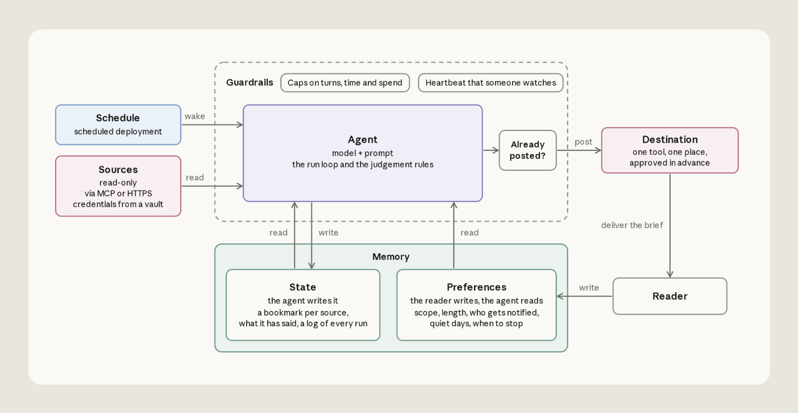
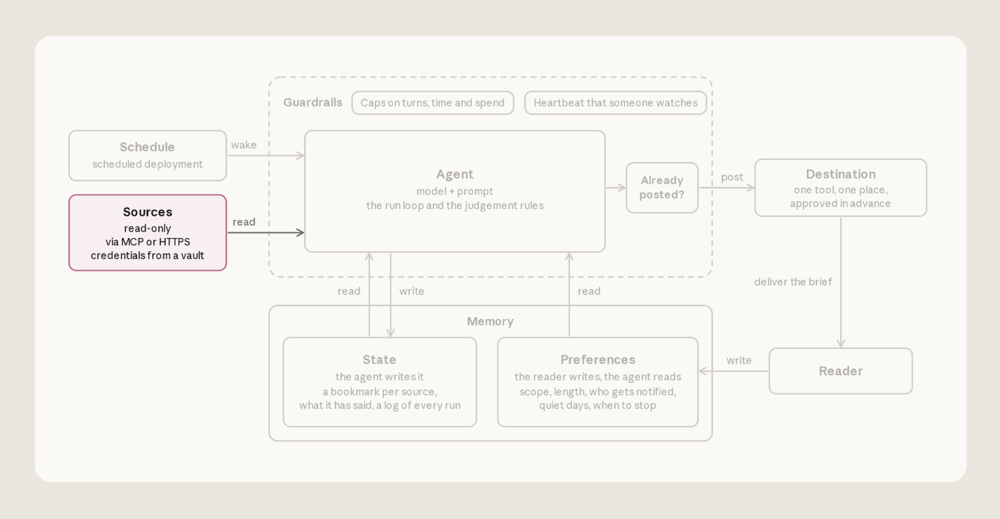
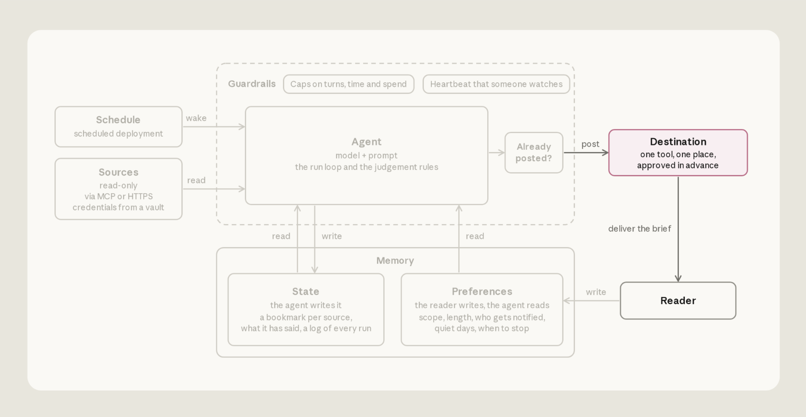
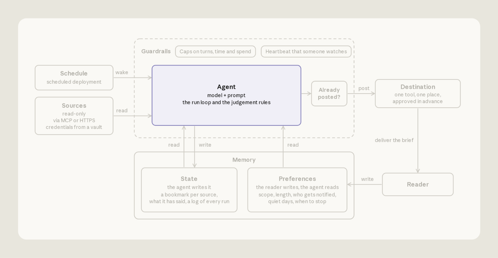
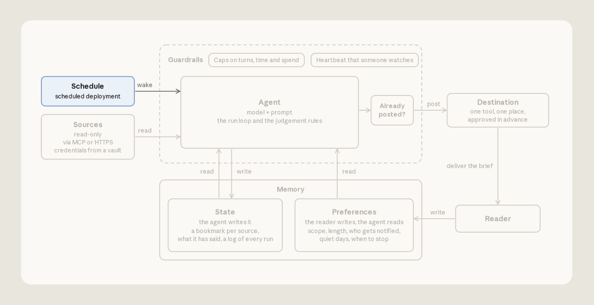
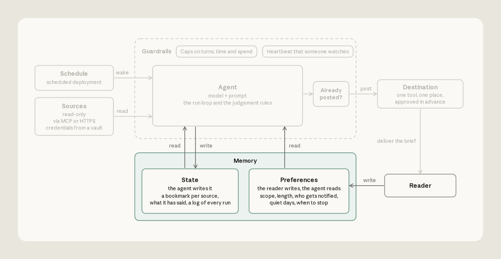
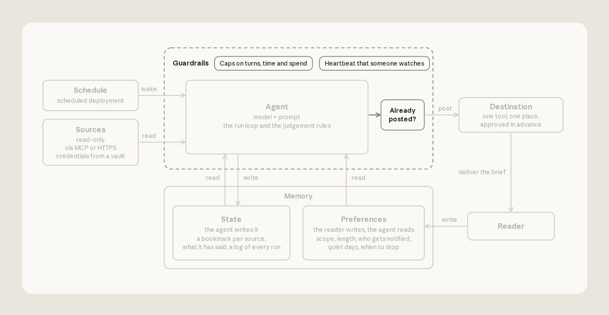

# 构建高效的 agent 自动化（中英对照）

> **原文标题：** Building effective agent automations
> **原文链接：** https://claude.dev/blog/building-effective-agent-automations/
> **原文作者：** Lance Martin and CJ Avilla（Member of Technical Staff）
> **发布日期：** 2026-10-08
> **翻译模型：** DeepSeek-V4.1-Flash
> **评分：** ★★★★☆ —— 把"定时读取信息源、追踪增量变化、主动播报"这类 agent 自动化拆成信息源、目标位置、智能体、调度、记忆、护栏六个部件，逐段给出可跑通的参考实现与常见失败模式，工程落地价值高
> 排版：每段英文原文在前，中文翻译紧随其后。默认收录正文主体。术语保留英文原文并附中文释义。

---

A reference implementation walkthrough with common failure modes

一份参考实现走查，附常见失败模式。

As AI accelerates our work, it's getting harder to keep up. At Anthropic, simple agent automations are frequently used to help. They often run on a schedule, gather context in the background, and proactively tell us what we need to know. But it’s difficult to build effective agent automations: they can lose access to a source without anyone noticing or fail to follow our preferences.

随着 AI 加速我们的工作，跟上节奏变得越来越难。在 Anthropic，我们经常借助简单的 agent 自动化来应对。它们通常按计划运行、在后台收集上下文，并主动告诉我们需要知道的事情。但要构建高效的 agent 自动化并不容易：它们可能在不被任何人察觉的情况下失去对某个信息源（source）的访问权限，也可能无法遵循我们的偏好设置。

Using [Claude Managed Agents](https://platform.claude.com/docs/en/managed-agents/overview) (beta), we built a reference implementation that reads custom sources (e.g., Slack and GitHub repos) on a schedule, tracks what changed since the last run, and posts what you need to know (e.g., to Slack). In this article, we walk through each step, share a reference implementation, and provide a command to run in Claude Code that configures the agent for you.

借助 [Claude Managed Agents](https://platform.claude.com/docs/en/managed-agents/overview)（beta），我们构建了一个参考实现：它按计划读取自定义信息源（例如 Slack 和 GitHub 仓库），追踪自上次运行以来的变化，并把你需要知道的内容发布出去（例如发到 Slack）。在本文中，我们逐步走查每一个环节，分享这份参考实现，并提供一条可在 Claude Code 中运行的命令，替你完成 agent 的配置。

# 获取代码（Get the code）

The reference implementation is [here](https://github.com/anthropics/claude-quickstarts/tree/main/managed-agents/daily-brief). For an interactive walkthrough, run the command below in Claude Code. The `claude-api` skill can help set up the agent following the guidance in this article:

参考实现在[这里](https://github.com/anthropics/claude-quickstarts/tree/main/managed-agents/daily-brief)。想要交互式走查，可在 Claude Code 中运行下面的命令。`claude-api` skill 可以按照本文的指导帮你完成 agent 的设置：

```prompt
/claude-api managed-agents-onboard https://claude.dev/blog/building-effective-agent-automations/
```

For this reference implementation, you need a Slack app ([create it from the manifest](https://api.slack.com/apps?new_app=1\&manifest_yaml=display_information%3A%0A%20%20name%3A%20Daily%20brief%0A%20%20description%3A%20Posts%20one%20short%20brief%20each%20weekday%20morning.%0Afeatures%3A%0A%20%20bot_user%3A%0A%20%20%20%20display_name%3A%20Daily%20brief%0A%20%20%20%20always_online%3A%20false%0A%20%20app_home%3A%0A%20%20%20%20home_tab_enabled%3A%20false%0A%20%20%20%20messages_tab_enabled%3A%20true%0A%20%20%20%20messages_tab_read_only_enabled%3A%20true%0Aoauth_config%3A%0A%20%20scopes%3A%0A%20%20%20%20bot%3A%0A%20%20%20%20%20%20-%20channels%3Ahistory%0A%20%20%20%20%20%20-%20chat%3Awrite%0Asettings%3A%0A%20%20org_deploy_enabled%3A%20false%0A%20%20socket_mode_enabled%3A%20false%0A%20%20token_rotation_enabled%3A%20false%0A)) and a [GitHub token](https://github.com/settings/personal-access-tokens/new). The provided files (shown below) are configuration for Claude API resources, including the agent, its environment, memory stores, vault, and deployment.

要使用这份参考实现，你需要一个 Slack app（[通过 manifest 创建](https://api.slack.com/apps?new_app=1\&manifest_yaml=display_information%3A%0A%20%20name%3A%20Daily%20brief%0A%20%20description%3A%20Posts%20one%20short%20brief%20each%20weekday%20morning.%0Afeatures%3A%0A%20%20bot_user%3A%0A%20%20%20%20display_name%3A%20Daily%20brief%0A%20%20%20%20always_online%3A%20false%0A%20%20app_home%3A%0A%20%20%20%20home_tab_enabled%3A%20false%0A%20%20%20%20messages_tab_enabled%3A%20true%0A%20%20%20%20messages_tab_read_only_enabled%3A%20true%0Aoauth_config%3A%0A%20%20scopes%3A%0A%20%20%20%20bot%3A%0A%20%20%20%20%20%20-%20channels%3Ahistory%0A%20%20%20%20%20%20-%20chat%3Awrite%0Asettings%3A%0A%20%20org_deploy_enabled%3A%20false%0A%20%20socket_mode_enabled%3A%20false%0A%20%20token_rotation_enabled%3A%20false%0A)）和一个 [GitHub token](https://github.com/settings/personal-access-tokens/new)。随附的文件（如下所示）是 Claude API 资源的配置，包括 agent 本身、它的环境（environment）、记忆存储（memory store）、vault 以及部署（deployment）。

```text
daily-brief/
├── agent.md                        model, tools, instructions
├── deployment.md                   schedule, time zone, budget, input message
├── environment.yaml                network allowlist
├── memory_store_preferences.yaml   user preferences
├── memory_store_state.yaml         the agent's bookmarks, ledger, notes, and run records
├── vault.yaml                      the vault that holds the credentials
├── claude-lock.json                resource IDs, written by ant apply
└── slack/manifest.yaml             one bot app
```

[`ant apply`](https://platform.claude.com/docs/en/cli-sdks-libraries/cli/apply), a command in the ant CLI, reads these files, creates the resources in your Claude API workspace (where the platform stores and runs them), and records the IDs in `claude-lock.json`.

[`ant apply`](https://platform.claude.com/docs/en/cli-sdks-libraries/cli/apply) 是 ant CLI 中的一条命令，它会读取这些文件，在你的 Claude API workspace（平台存放并运行这些资源的地方）中创建资源，并把资源 ID 记录到 `claude-lock.json`。

We'll use this command in the sections below. Once configured, the automation runs on a schedule on Anthropic's infrastructure, so nothing has to stay running on your machine.

下面的章节中我们会用到这条命令。一旦配置完成，自动化就会按计划在 Anthropic 的基础设施上运行，你的机器上不需要常驻任何进程。

# 概览（Overview）

The agent we’ll build has six components, covered in this order:

我们要构建的 agent 有六个组成部分，按以下顺序介绍：

- Sources - A named list of places to read
- Destination - One place the agent may write
- Agent - The model, tools, and run steps in agent.md
- Schedule - A cron schedule
- Memory - Your preferences and the agent's own memory
- Guardrails - Read-only access wherever the agent only reads, and a spending cap per run

- Sources（信息源）——一份命名的可读取位置清单
- Destination（目标位置）——agent 唯一允许写入的地方
- Agent（智能体）——agent.md 中的模型、工具与运行步骤
- Schedule（调度）——一个 cron 计划
- Memory（记忆）——你的偏好设置与 agent 自己的记忆
- Guardrails（护栏）——凡 agent 只做读取之处一律只读，并设置每次运行的花费上限



> **Figure 1:** Architecture of the agent: a schedule wakes the agent, which reads from its sources and posts a brief to one destination for the reader. Memory holds the agent's state and the reader's preferences, and guardrails surround the agent.
> **图 1：** agent 的架构：调度唤醒 agent，agent 从各信息源读取内容，并把一份简报发布到唯一的目标位置供读者查看。记忆保存 agent 的状态与读者的偏好设置，护栏环绕在 agent 外围。

# 信息源（Sources）

The agent reads two default sources: Slack channels and GitHub pull requests. The channels and repos are listed in your `preferences` file. The template can be extended to use other sources.

agent 默认读取两类信息源：Slack 频道和 GitHub pull request。这些频道和仓库列在你的 `preferences` 文件中。该模板可以扩展以使用其他信息源。



> **Figure 2:** The architecture diagram with Sources highlighted. The sources are read-only, reached through MCP or HTTPS with credentials from a vault, and feed the agent.
> **图 2：** 架构图中高亮 Sources 部分。信息源是只读的，通过 MCP 或 HTTPS 并使用来自 vault 的凭据访问，为 agent 提供输入。

## 给 agent 独立且收窄范围的凭据（Give the agent its own, scoped credentials）

With [Managed Agents](https://platform.claude.com/docs/en/managed-agents/overview), credentials live in [vaults](https://platform.claude.com/docs/en/managed-agents/vaults). The agent can reference these credentials but the real values stay in the vault, outside the sandbox where Claude's code runs (see [here](https://www.anthropic.com/engineering/managed-agents) and [here](https://x.com/katelyn_lesse/status/2099315903884415400)):

使用 [Managed Agents](https://platform.claude.com/docs/en/managed-agents/overview) 时，凭据存放在 [vault](https://platform.claude.com/docs/en/managed-agents/vaults) 中。agent 可以引用这些凭据，但真实值始终留在 vault 里，位于 Claude 代码所运行的沙箱（sandbox）之外（参见[这里](https://www.anthropic.com/engineering/managed-agents)和[这里](https://x.com/katelyn_lesse/status/2099315903884415400)）：

- **MCP servers (GitHub).** The agent calls MCP tools through a proxy that runs outside the sandbox. The proxy finds the vault credential whose URL matches the server’s.
- **The shell (Slack).** The agent calls the Slack API with curl using the bash tool inside the sandbox. The sandbox only holds an opaque placeholder, `$SLACK_BOT_TOKEN`. As the request leaves the sandbox, the platform swaps in the real token for hosts you allow.

- **MCP servers（GitHub）。** agent 通过一个运行在沙箱之外的代理（proxy）调用 MCP 工具。代理会找出 URL 与该服务器匹配的那条 vault 凭据。
- **The shell（Slack）。** agent 在沙箱内使用 bash 工具，通过 curl 调用 Slack API。沙箱里只有一个不透明的占位符 `$SLACK_BOT_TOKEN`。当请求离开沙箱时，平台会为你允许的主机替换成真实的 token。

Create the vault using the `ant` CLI and the template file in the repo:

使用 `ant` CLI 和仓库中的模板文件创建 vault：

```shell
ant apply vault.yaml
```

This creates the vault in your Claude API workspace, where the platform stores it, and records its ID in `claude-lock.json`. Then add each credential to the vault with the [TypeScript SDK](https://platform.claude.com/docs/en/cli-sdks-libraries/sdks/typescript). Here is an example showing addition of the Slack credential:

这会在你的 Claude API workspace（平台存放 vault 的地方）中创建 vault，并把它的 ID 记录到 `claude-lock.json`。然后用 [TypeScript SDK](https://platform.claude.com/docs/en/cli-sdks-libraries/sdks/typescript) 把每一条凭据添加到 vault 中。下面是一个添加 Slack 凭据的示例：

```typescript
const vaultId = process.env.VAULT_ID!; // the vault's ID, from claude-lock.json

await client.beta.vaults.credentials.create(vaultId, {
  display_name: "SLACK_BOT_TOKEN",
  auth: {
    type: "environment_variable",
    secret_name: "SLACK_BOT_TOKEN",
    secret_value: process.env.SLACK_BOT_TOKEN!,
    networking: { type: "limited", allowed_hosts: ["slack.com"] },
    injection_location: { header: true },
  },
});
```

After creating the vault and adding each credential, attach the vault to the deployment. Copy the vault ID from `claude-lock.json` into `vault_ids` in the deployment file, `deployment.md`.

创建 vault 并添加好每一条凭据后，把 vault 挂载到部署（deployment）上。从 `claude-lock.json` 中复制 vault ID，填入部署文件 `deployment.md` 里的 `vault_ids`。

## 从上次读到的地方继续（Read from where you left off）

A common mistake is asking the agent to read a fixed window like "*the last 24 hours*." A late run leaves a gap and an early run repeats items. Instead, give the agent a bookmark per source. At the end of each run, the agent writes the timestamp of the newest item it read from each source to one file, `bookmarks.json`, with an entry per source: `"slack": "2026-09-14T13:02:11Z"`.

一个常见的错误是让 agent 读取一个固定的时间窗口，比如"*最近 24 小时*"。运行晚了会留下空档，运行早了又会重复播报同一批事项。正确的做法是给 agent 为每个信息源各配一个书签（bookmark）。每次运行结束时，agent 把它从每个信息源读到的最新一条的时间戳写进同一个文件 `bookmarks.json`，每个信息源一条记录：`"slack": "2026-09-14T13:02:11Z"`。

The next run starts from those bookmarks, so its window stretches or shrinks to cover everything since the last run. The bookmarks live in the [memory store](https://platform.claude.com/docs/en/managed-agents/memory) called `state`: a folder of text files that the platform mounts into every run's sandbox under `/mnt/memory/` and keeps between runs. The agent reads and writes it with its ordinary file tools, and the instructions in `agent.md` tell it how.

下一次运行就从这些书签开始，因此它的窗口会伸缩，以覆盖自上次运行以来的全部内容。书签存放在名为 `state` 的[记忆存储](https://platform.claude.com/docs/en/managed-agents/memory)中：这是一个存放文本文件的文件夹，平台会把它挂载到每次运行的沙箱中的 `/mnt/memory/` 下，并在各次运行之间保留。agent 用自己常规的文件工具读写它，而 `agent.md` 中的指令告诉它该怎么做。

## 不要把读取失败误当成平静的一天（Don't mistake a failed read for a quiet day）

If an MCP server is down or its token has expired, the run still starts, just without that server's tools. The session logs an error, but the agent sees nothing from that source and reports "nothing new."

如果某个 MCP 服务器宕机或其 token 已过期，本次运行仍会启动，只是少了那台服务器的工具。session 会记录一条错误，但 agent 从该信息源什么都看不到，于是报告"没有新内容"。

Three rules in `agent.md` help fix this. When a source fails, the agent will: keep the source’s bookmark where it is, write the brief from the other sources, and end the brief with one line naming what it couldn't read ("pull requests unavailable this run"), so the reader is made aware.

`agent.md` 中的三条规则可以解决这个问题。当某个信息源读取失败时，agent 会：保持该信息源的书签不动，用其他信息源撰写简报，并在简报结尾用一行说明它读不到什么（"本次运行 pull request 不可用"），让读者知情。

# 目标位置（Destination）

Our template posts to one Slack channel, with a dated post each time it runs.

我们的模板只发布到一个 Slack 频道，每次运行发一条带日期的消息。



> **Figure 3:** The architecture diagram with Destination highlighted. After a check that today's brief isn't already posted, the agent posts to one destination, which delivers the brief to the reader.
> **图 3：** 架构图中高亮 Destination 部分。在确认今天的简报尚未发布之后，agent 把内容发布到唯一的目标位置，由它把简报送达读者。

The agent posts to Slack using the bash tool in its sandbox, using the same bot token it reads with.

agent 在沙箱内使用 bash 工具向 Slack 发布消息，用的是与读取时相同的 bot token。

Nothing has to approve the post. The agent sends it with a bash command, and the built-in bash tool runs without asking for approval by default. `slack.com` is also on the allowlist of the agent's [environment](https://platform.claude.com/docs/en/managed-agents/environments), the sandbox it runs in. The post is one request:

发布消息不需要任何审批。agent 用一条 bash 命令把它发出去，而内置的 bash 工具默认运行时不请求审批。`slack.com` 也在 agent 的[环境](https://platform.claude.com/docs/en/managed-agents/environments)（即它运行所在的沙箱）允许列表中。这次发布就是一个请求：

```bash
curl -s https://slack.com/api/chat.postMessage \
  -H "Authorization: Bearer $SLACK_BOT_TOKEN" \
  -H "Content-Type: application/json; charset=utf-8" \
  -d '{"channel": "C0123456789", "text": "Daily brief, Tue Sep 15 ..."}'
```

## 确认发布成功后再记录（Confirm the post landed before recording it）

Once a post is confirmed, the agent updates its ledger of reported items and its bookmarks. If those records don't match what was actually posted, two things can go wrong. If the agent records a post that never landed, the bookmarks move on and those items are never reported. If it posts again because it isn't sure the first post landed, readers get the same brief twice.

一旦发布得到确认，agent 就更新它已报告事项的账本（ledger）和书签。如果这些记录与实际发布的内容不一致，就可能出两类问题。如果 agent 记录了一次根本没发出去的发布，书签会继续前移，那些事项就永远不会被报告。如果它因为不确定第一次是否发出而重发，读者会两次收到同一份简报。

Three rules in `agent.md` prevent this. First, the agent looks for today's title in the channel's recent messages and doesn't post if the edition is already there. Second, the post counts as sent only if Slack returns `"ok": true` and a message ts. Third, the agent updates the ledger and bookmarks only after that confirmation. If the result is unclear, it marks the run "maybe posted" and changes nothing else, so nothing is lost.

`agent.md` 中的三条规则可以防止这种情况。第一，agent 会在该频道最近的消息里查找今天的标题，如果这一期已经存在就不再发布。第二，只有当 Slack 返回 `"ok": true` 和 message ts 时，这次发布才算已发送。第三，agent 只在得到该确认之后才更新账本和书签。如果结果不明确，它把本次运行标记为"maybe posted"，其他什么都不改，这样什么都不会丢。

The agent keeps a run record in its memory store (`runs/<date>.md`). It marks the run "posting" before the post, then "posted" with the message ID, or "maybe posted."

agent 在它的记忆存储中保存一条运行记录（`runs/<date>.md`）。它在发布之前把本次运行标记为"posting"，发布之后标记为"posted"并附上消息 ID，或者标记为"maybe posted"。

# 智能体（Agent）

In Claude Managed Agents, an [agent](https://platform.claude.com/docs/en/managed-agents/agent-setup) is a versioned configuration: a model, a system prompt, and tools. Each run follows its run steps and stops.

在 Claude Managed Agents 中，一个 [agent](https://platform.claude.com/docs/en/managed-agents/agent-setup) 就是一份带版本的配置：一个模型、一段系统提示词（system prompt）以及一组工具。每次运行都按其运行步骤执行，然后停止。



> **Figure 4:** The architecture diagram with the Agent highlighted: a model plus a prompt that holds the run loop and the judgement rules.
> **图 4：** 架构图中高亮 Agent 部分：一个模型，加上一段承载运行循环与判断规则的提示词。

In our reference implementation, the agent configuration is `agent.md`:

在我们的参考实现中，agent 的配置就是 `agent.md`：

```markdown
---
name: Daily brief
model: claude-sonnet-5-5
mcp_servers:
  - type: url
    name: github
    url: https://api.githubcopilot.com/mcp/
tools:
  - type: agent_toolset_20260401
    configs:
      - name: web_search
        enabled: false
      - name: web_fetch
        enabled: false
  - type: mcp_toolset
    mcp_server_name: github
    default_config:
      permission_policy:
        type: always_allow
---

[Eight numbered run steps; the full text is in agent.md in the repo.]
```

The frontmatter supplies the agent name, model, tools, and MCP servers. The body provides the agent instructions. MCP tools ask for approval by default and nobody is there to give it, so the GitHub toolset is set to `always_allow` and the GitHub token is `read-only`.

frontmatter 提供 agent 的名称、模型、工具和 MCP 服务器。正文部分给出 agent 的指令。MCP 工具默认会请求审批，而现场没有人来批准，因此 GitHub 工具集被设为 `always_allow`，GitHub token 则设为 `read-only`。

## 保持简报简短（Keep the brief short）

`agent.md` steers Claude toward brevity:

`agent.md` 引导 Claude 保持简短：

```text
4. Decide. An item earns a line when the reader would act on it today, or it changes a decision they are about to make. When unsure, leave it out. Most days that is a few items, sometimes none. A count ("12 open reviews") is not an item; link the ones that are blocked. An item already in the ledger and still open is carried as one marked line ("still waiting, day 3"), not re-reported; a closed item is dropped without comment. Do not bring back a topic the preferences file has retired.
```

## 发布前重新检查所有仍然未决的事项（Re-check anything still open right before posting）

Items can change between when the agent reads sources and when it posts. Just before posting, `agent.md` instructs the agent to re-check the live status of each item:

在 agent 读取信息源到它发布内容之间，事项可能发生变化。就在发布之前，`agent.md` 会指示 agent 重新检查每个事项的实时状态：

```text
5. Verify. The world moved while you read. For every item you will report, re-check its live source just before posting: resolved since you read it, drop it; still open but changed, fix the line; cannot confirm, drop it and list it in the run record's cuts. One stale "still waiting on you" costs more trust than ten missing items, so never hedge an item's status: assert it or drop it. Every link is copied from the source's own link field (a pull request's html_url, a Slack permalink), never assembled by hand.
```

# 调度（Schedule）

With Claude Managed Agents, the agent is only a configuration file; a [deployment](https://platform.claude.com/docs/en/managed-agents/scheduled-deployments) runs it. The deployment names the agent, environment, and the first message of each run. It also holds the schedule, vault, memory stores, and budget. Each time the schedule fires, the platform starts a fresh agent [session](https://platform.claude.com/docs/en/managed-agents/sessions).

在 Claude Managed Agents 中，agent 只是一个配置文件；由[部署](https://platform.claude.com/docs/en/managed-agents/scheduled-deployments)来运行它。部署指定 agent、环境以及每次运行的首条消息。它还持有调度、vault、记忆存储和预算。每当调度触发，平台就启动一个新的 agent [session](https://platform.claude.com/docs/en/managed-agents/sessions)。



> **Figure 5:** The architecture diagram with Schedule highlighted: a scheduled deployment that wakes the agent for each run.
> **图 5：** 架构图中高亮 Schedule 部分：一个定时部署，在每次运行时唤醒 agent。

In our template, the deployment is captured in `deployment.md`, with the first message as its body:

在我们的模板中，部署写在 `deployment.md` 里，首条消息就是它的正文：

```markdown
---
name: Daily brief
agent: ./agent.md
environment_id: ./environment.yaml
schedule:
  type: cron
  expression: "32 7 * * 1-5"
  timezone: America/New_York
vault_ids: [vlt_...]   # the vault you create under Sources
resources:
  - path: ./memory_store_preferences.yaml
    access: read_only
    instructions: The reader's preferences. Re-read them every run. Never write here.
  - path: ./memory_store_state.yaml
    access: read_write
    instructions: Your state. Bookmarks, ledger, notes, proposals, and run records.

---

Write today's brief.
The reader's time zone is America/New_York. Work out every date in that zone.

Follow your run steps in order. Today's edition is titled "Daily brief, <weekday> <month> <day>".
```

This creates the deployment with the agent, environment and memory stores it names by path.

这会创建部署，并带上它按路径指定的 agent、环境和记忆存储。

```shell
ant apply deployment.md
```

To test it without waiting for the schedule, start a run by hand with `ant beta:deployments run --deployment-id <id>`, using the ID from `claude-lock.json`.

要想不等调度就测试它，可以用 `ant beta:deployments run --deployment-id <id>` 手动启动一次运行，其中 ID 取自 `claude-lock.json`。

## 在你自己所在时区计算日期（Compute dates in your time zone）

A common bug is the agent calling this morning "yesterday" because it computes dates in the server's time zone. In `deployment.md`, the `timezone` field sets when the run fires and the second line of the body tells the agent which zone to use for dates.

一个常见的 bug 是 agent 把今天早上称作"昨天"，因为它在服务器的时区里计算日期。在 `deployment.md` 中，`timezone` 字段设定运行何时触发，正文的第二行则告诉 agent 用哪个时区来计算日期。

# 记忆（Memory）

Each run starts in a fresh sandbox with no memory of the last one. Without memory, feedback doesn't stick. However, stale memory can confuse the agent: it reports an item as still waiting after it was resolved, or drops one that's still open because it was "already reported."

每次运行都在一个全新的沙箱中开始，对上一次运行毫无记忆。没有记忆，反馈就无法沉淀。然而，过期的记忆也会让 agent 出错：某个事项已经解决，它却报告说仍在等待；或者某个事项仍未决，它却因为"已经报告过"而把它丢掉。



> **Figure 6:** The architecture diagram with Memory highlighted. State is what the agent reads and writes, and Preferences is what the reader writes and the agent only reads.
> **图 6：** 架构图中高亮 Memory 部分。State 是 agent 读写的部分，Preferences 是读者写入、agent 只读的部分。

Our template keeps two [memory stores](https://platform.claude.com/docs/en/managed-agents/memory), the folders mounted under /mnt/memory/ (see Sources):

我们的模板保留两个[记忆存储](https://platform.claude.com/docs/en/managed-agents/memory)，即挂载在 /mnt/memory/ 下的那些文件夹（见信息源一节）：

- **preferences** (yours, read-only to the agent): which channels and repos to read, what to leave out, the length cap, the destination, and when to stop.
- **state** (the agent's, read-write): the bookmarks, a ledger of what it reported, one record per run, changes it proposes to your preferences, and notes on how each source behaves ("returns only the newest 50 items").

- **preferences**（你的，对 agent 只读）：要读取哪些频道和仓库、要排除什么、长度上限、目标位置，以及何时停止。
- **state**（agent 的，可读写）：书签、已报告内容的账本、每次运行一条记录、它建议对你偏好设置所做的修改，以及关于各信息源行为的笔记（"只返回最新的 50 条"）。

`ant apply deployment.md` creates the preferences store, but not the file in it. Before the first run, write your preferences.md there with the repo's `scripts/seed-preferences.sh`.

`ant apply deployment.md` 会创建 preferences 存储，但不会创建其中的文件。在第一次运行之前，用仓库中的 `scripts/seed-preferences.sh` 把你的 preferences.md 写进去。

## 每次运行开始时重新读取你的偏好设置（Re-read your preferences at the start of every run）

A common problem occurs when a copy of the preferences is baked into the prompt, which keeps applying rules you've already changed. Have the agent read the file fresh every run. If it can't read the file, it should stop and say so instead of running on defaults.

一个常见问题是把偏好设置的一份副本固化进提示词里，这样它就会一直沿用你已经改掉的规则。让 agent 每次运行都重新读取该文件。如果它读不到这个文件，就应该停下来并说明情况，而不是靠默认值继续运行。

## 维护已报告事项的账本，并报告变化（Keep a ledger of what you've already reported, and report the change）

The agent keeps a ledger, `ledger.md`, of every item it has reported, so the brief doesn't repeat itself. Each line records when the item was reported, where it came from, an ID that doesn't change (a Slack message timestamp or a pull request number), and its last known status:

agent 维护一份账本 `ledger.md`，记录它报告过的每一个事项，这样简报就不会重复自己。每一行记录该事项的报告时间、来源、一个不会变化的 ID（Slack 消息时间戳或 pull request 编号），以及它最后已知的状态：

```text
2026-09-09 slack:C0123456789 1788963600.000100 refund thread: customer waiting on a decision
2026-09-11 github 481 review blocked, day 2 (still waiting)
2026-09-11 slack:C0234567891 1789117333.000300 enterprise escalation: owner named, in progress
```

# 护栏（Guardrails）

Because our automation runs in the “background” on a schedule, we set limits on what the agent can do and what it can spend.

由于我们的自动化是按计划在"后台"运行的，因此我们对 agent 能做什么、能花多少钱都设了限制。



> **Figure 7:** The architecture diagram with Guardrails highlighted: a boundary around the agent with caps on turns, time and spend, and a heartbeat that someone watches.
> **图 7：** 架构图中高亮 Guardrails 部分：围绕 agent 的一圈边界，限制轮次、时间与花费，并有一个有人盯着的"心跳"。

## 对它能力的限制（Limits on what it can do）

The agent reads messages and issues that other people wrote, and that text can be interpreted as instructions. Limit what the agent could do if it followed them. In our example, the GitHub token and the `preferences` store are read-only, and the environment only reaches the hosts on its allowlist. A planted instruction can still change what the brief says, including through the notes the agent keeps between runs. It can't write to GitHub or edit your rules.

agent 会读取别人写的消息和 issue，而这些文本可能被当成指令来解释。要限制 agent 万一真的照做时能做什么。在我们的示例中，GitHub token 和 `preferences` 存储都是只读的，环境也只能访问其允许列表中的主机。一段被植入的指令仍然可以改变简报的内容，包括通过 agent 在各次运行之间保存的笔记来实现。但它无法写入 GitHub，也无法修改你的规则。

Slack is the exception: the same token posts, so invite the bot only where it needs to read or post.

Slack 是个例外：读取和发布用的是同一个 token，因此只在 bot 需要读取或发布的地方把它邀请进频道。

## 用真实运行数据设定花费上限（Set the spending cap from real runs）

A spending cap protects you from runaway costs. Start at three to five times the cost of a normal run, then tighten it as you see real numbers. A run that hits its cap pauses instead of failing, so a cap set too low looks like a brief that went quiet. The cap is the [`budget`](https://platform.claude.com/docs/en/managed-agents/budgets) in `deployment.md`. Every run gets the full amount, and a run that reaches it pauses with a `budget_reached` stop reason:

花费上限可以保护你免受成本失控的影响。先设成一次正常运行成本的三到五倍，看到真实数据后再收紧。达到上限的运行会暂停而不是失败，所以上限设得太低，看起来就像简报突然不出声了。这个上限就是 `deployment.md` 中的 [`budget`](https://platform.claude.com/docs/en/managed-agents/budgets)。每次运行都获得全额额度，而达到额度的运行会以 `budget_reached` 停止原因暂停：

```yaml
budget:
  type: limit
  max_list_cost:
    amount: "500" # a string, in cents: "500" is $5.00
    currency: USD
```

# 快速开始（Getting started）

Our reference implementation comes down to six rules:

我们的参考实现归根结底就是六条规则：

- Read each source from a bookmark, not a fixed time window.
- Report a failed read as unreadable, never as a quiet day.
- Re-check every item right before posting.
- Count a post as sent only when Slack confirms it, then update bookmarks and ledger.
- Re-read your preferences every run, from a store the agent can't edit.
- Give the agent read-only access wherever it only reads, and cap what each run can spend.

- 每个信息源都从书签开始读取，而不是用固定时间窗口。
- 把读取失败报告为"读不到"，绝不要报告为平静无事。
- 发布之前重新检查每一个事项。
- 只有当 Slack 确认之后才把发布算作已发送，然后再更新书签和账本。
- 每次运行都重新读取你的偏好设置，且从一个 agent 无法编辑的存储中读取。
- 凡 agent 只做读取之处都给它只读权限，并为每次运行设定花费上限。

Claude Code can walk you through the guidance provided in this article. First, update:

Claude Code 可以带你走查本文提供的这些指导。首先，更新：

```shell
claude update
```

Then, use the claude-api skill:

然后，使用 claude-api skill：

```prompt
/claude-api managed-agents-onboard https://claude.dev/blog/building-effective-agent-automations/
```

The claude-api skill reads this post, proposes a setup, writes the files to an agents/ folder in your project, and creates the resources with ant apply. Treat this as a starting point, and customize the agent for your sources, destination, or memory preferences.

claude-api skill 会读取这篇文章，提出一套配置方案，把文件写入你项目中的 agents/ 文件夹，并用 ant apply 创建这些资源。把它当作一个起点，再根据你自己的信息源、目标位置或记忆偏好来定制这个 agent。
