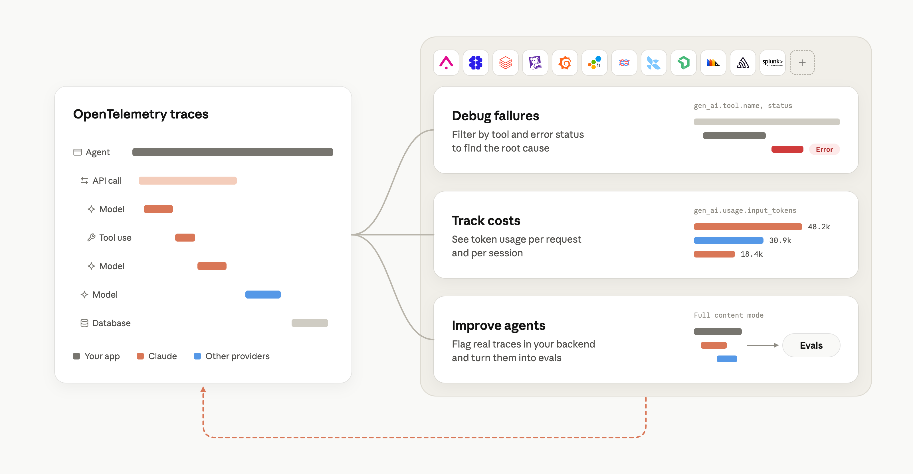

# 在 Claude 平台上用 OpenTelemetry 追踪 agent（中英对照）

> 原文标题：Trace agents with OpenTelemetry on the Claude Platform
> 页面副标题：Agent observability on the Claude Platform
> 原文链接：https://claude.com/resources/articles/agent-observability-on-the-claude-platform
> 原文作者：Anthropic
> 发布日期：2026-10-14
> **翻译模型：** DeepSeek-V4.1-Flash
> **评分：** ★★★☆☆ —— Claude Platform 官方发布原生 OpenTelemetry 链路追踪能力，覆盖 Managed Agents、Messages API 与 SDK，并可与主流可观测性工具对接
> 排版：每段英文原文在前，中文翻译紧随其后。默认收录正文主体。

You can now send OpenTelemetry (OTel) traces from Claude Managed Agents, the Messages API, and Claude SDKs to any OTel tool, and follow each step your agents take. If you already send Claude Code or Cowork traces to your observability tool, the agents you build on the Claude Platform can also show up in the same place.

现在，你可以把来自 Claude Managed Agents、Messages API 和 Claude SDK 的 OpenTelemetry（OTel，开放遥测）链路追踪（trace）发送到任意 OTel 工具，并逐步跟踪 agent（智能体）执行的每一步。如果你已经在把 Claude Code 或 Cowork 的 trace 发送到你的可观测性工具，那么你在 Claude Platform 上构建的 agent 也能出现在同一个地方。

### 用 OpenTelemetry 追踪 agent（Trace agents with OpenTelemetry）

Trusting an agent with more access starts with tracing its model calls, tool use, and MCP server calls. Review its traces, then widen its access as it proves reliable.

信任一个 agent 并赋予它更多权限，要从追踪它的模型调用、工具使用和 MCP 服务器调用开始。先审查它的 trace，再随着它表现出可靠性逐步放开权限。

Add a destination in the Claude Console, and every agent turn, model call, and tool use arrives in your observability tool as a standard OpenTelemetry trace, with latency, tokens, and IDs.

在 Claude Console（Claude 控制台）中添加一个 destination（接收端），之后每一次 agent 轮次（turn）、模型调用和工具使用，都会以标准 OpenTelemetry trace 的形式到达你的可观测性工具，并带上延迟（latency）、token 用量和各类 ID。

**Figure 1:** How OpenTelemetry traces work
**图 1：** OpenTelemetry 链路追踪的工作原理

### 与你的可观测性工具配合使用（Works with your observability tools）

Claude traces follow the OpenTelemetry GenAI semantic conventions, so data from Claude and other providers works in the same tools and dashboards.

Claude 的 trace 遵循 OpenTelemetry GenAI 语义约定（semantic conventions），因此来自 Claude 和其他供应商的数据可以在同一套工具和仪表盘中通用。

- **Debug agents next to the rest of your stack**. In Grafana Cloud, Honeycomb, Sentry, and Splunk, agent traces sit beside your logs and metrics, so you can see which service a slow or failed step came from.
- **Improve agents with production data**. With Arize AI, Braintrust, Datadog, Langfuse, LangSmith by LangChain, New Relic, and PostHog, you can turn real traces into evals, catch quality issues, and measure whether a change helped.
- **Track usage across your organization**. Send traces to Databricks Unity Gateway so platform and security teams can see token usage by team and flag unusual activity.

- **把 agent 的调试与其余技术栈放在一起**。在 Grafana Cloud、Honeycomb、Sentry 和 Splunk 中，agent 的 trace 就位于你的日志和指标旁边，因此你能看出某个缓慢或失败的步骤来自哪个服务。
- **用生产数据改进 agent**。借助 Arize AI、Braintrust、Datadog、Langfuse、LangSmith by LangChain、New Relic 和 PostHog，你可以把真实的 trace 转化为评测（eval）、发现质量问题，并衡量某项改动是否有帮助。
- **在组织范围内跟踪用量**。把 trace 发送到 Databricks Unity Gateway，平台与安全团队就能按团队查看 token 用量，并标记异常活动。

Claude traces also work with any other OpenTelemetry tool that accepts a standard OTLP endpoint.

Claude 的 trace 也能配合任何其他接受标准 OTLP endpoint（端点）的 OpenTelemetry 工具使用。

**Video 1:** OpenTelemetry on the Claude Platform (embedded demo video)
**视频 1：** OpenTelemetry on the Claude Platform（原文嵌入的演示视频，未收录）

### 快速上手（Get started）

OpenTelemetry traces on the Claude Platform is available in public beta. Managed Agents and the Messages API need a destination in the Claude Console, while Claude SDKs export traces automatically.

Claude Platform 上的 OpenTelemetry trace 目前处于公测（public beta）阶段。Managed Agents 和 Messages API 需要在 Claude Console 中配置一个 destination（接收端），而 Claude SDK 会自动导出 trace。

See the docs to get started.

参见文档（链接见原文）开始使用。

### 客户评价（Customer quotes）

“At Foxglove, we’re building agents that help robotics teams debug their robots. Native OpenTelemetry export from the Claude Platform lets us analyze agent interactions in PostHog alongside product usage data. That helps us evaluate how our agents perform in practice, identify where they fall short, and prioritize improvements for robotics teams.”
— Roman Shtylman, Co-Founder and CTO, Foxglove

“在 Foxglove，我们正在构建帮助机器人团队调试其机器人的 agent。Claude Platform 原生的 OpenTelemetry 导出让我们能在 PostHog 中把 agent 交互与产品使用数据放在一起分析。这有助于我们评估 agent 在实践中的表现、找出它们的不足之处，并为机器人团队排定改进优先级。”
—— Roman Shtylman，联合创始人兼 CTO，Foxglove

“Claude powers some of Ramp’s most capable internal and customer-facing agents. We built Reflect, an agentic system that scores their Langfuse traces, finds recurring failures, and proposes fixes. On some agents, we’ve already cut token usage by 10–20% and made sessions 30% faster. But Reflect can only improve what it observes. Native OpenTelemetry export from the Claude API can feed high-fidelity instrumentation directly into that improvement loop, with no extra steps.”
— David Traina, Senior Software Engineer, Ramp

“Claude 驱动着 Ramp 一些最强大的内部 agent 和面向客户的 agent。我们构建了 Reflect，这是一个 agentic 系统，会对它们的 Langfuse trace 打分、找出反复出现的故障并提出修复方案。在某些 agent 上，我们已经把 token 用量降低了 10–20%，并让会话速度提升了 30%。但 Reflect 只能改进它能观测到的东西。Claude API 原生的 OpenTelemetry 导出可以把高保真的埋点（instrumentation）直接送入这个改进闭环，无需额外步骤。”
—— David Traina，高级软件工程师，Ramp

“At Sterling Labs, we tune our systems like a race team tunes its engine. For agents analyzing live markets 24/7, Langfuse is our pit wall. Native OpenTelemetry export from the Claude Platform streams every trace straight in with no custom instrumentation, so my team can focus on the edge, not the wiring.”
— Hyon Lee, CTO, Sterling Labs

“在 Sterling Labs，我们像赛车队调校引擎那样调校我们的系统。对于 7×24 小时分析实时行情的 agent 来说，Langfuse 就是我们的维修墙（pit wall）。Claude Platform 原生的 OpenTelemetry 导出把每一条 trace 直接流入其中，无需自定义埋点，因此我的团队可以专注于优势本身，而不是线路连接。”
—— Hyon Lee，CTO，Sterling Labs

“Agents that touch a company’s books have to show their work, the same way an accountant does. Our agents run on the Claude Platform and our telemetry lives in Grafana Cloud, and native OpenTelemetry export from Claude puts each model call in the same trace as the reconciliation or journal-entry workflow it ran inside. We see the prompt version, tool calls, latency, and token spend alongside the rest of our stack, so when an auditor asks what an agent did and why, we can answer from one timeline.”
— Ankush Sharma, Head of Infrastructure

“涉及公司账目的 agent 必须像会计师一样展示自己的工作过程。我们的 agent 运行在 Claude Platform 上，遥测数据存放在 Grafana Cloud 中，而 Claude 原生的 OpenTelemetry 导出会把每一次模型调用与它所运行的对账或记账凭证工作流放进同一条 trace。我们能在其余技术栈旁边看到 prompt 版本、工具调用、延迟和 token 开销，因此当审计人员询问某个 agent 做了什么、为什么这么做时，我们可以从同一条时间线给出答案。”
—— Ankush Sharma，基础设施负责人
