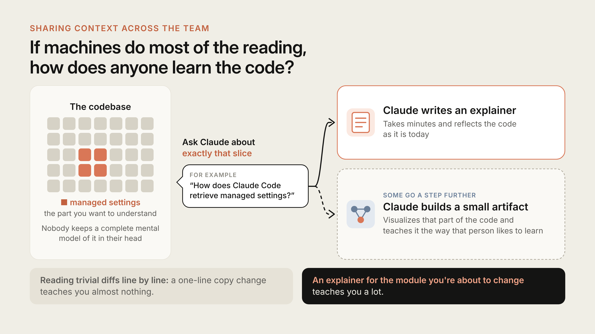

# Claude Code 团队如何做代码评审（中英对照）

> **原文标题：** How the Claude Code team does code review
> **原文链接：** https://claude.dev/blog/solving-code-review-at-anthropic/
> **原文作者：** Addy Osmani, Morgan Westlee Lunt, and Qing Wang（Member of Technical Staff）
> **发布日期：** 2026-10-15
> **翻译模型：** DeepSeek-V4.1-Flash
> **评分：** ★★★★☆ —— 用"合并量翻倍、回滚率下降 40%"的真实数据，把 Claude Code 团队从"人工逐行读 diff"转向"机器读 + 人只做机器做不好的判断"的完整评审流水线讲透，含风险分级审批表、收敛机制与可照做的落地清单。
> 排版：每段英文原文在前，中文翻译紧随其后。默认收录正文主体。术语保留英文原文并附中文释义。

---

We've said before that Claude writes about 90 percent of Claude Code's own code. So how do we review code at the volume we produce it? Does anyone read code anymore? And if something breaks, who catches it?

我们之前说过，Claude 编写了 Claude Code 自身大约 90% 的代码。那么在如此庞大的产出量下，我们是怎么做代码评审（code review）的？现在还真的有人读代码吗？如果出了问题，谁来发现？

This post covers the code review flow on the Claude Code team and how it has evolved. From June to September, merged pull requests to Claude Code's codebase more than doubled while the share that had to be reverted fell by more than 40 percent.

本文介绍 Claude Code 团队的代码评审流程及其演进。从 6 月到 9 月，合并进 Claude Code 代码库的 pull request 数量翻了一倍多，而其中不得不回滚（revert）的比例下降了 40% 以上。

We didn't remove review. But we did move most of the reading to machines, optimized for human time and attention, and invested heavily in making it fast and easy to undo mistakes.

我们并没有取消评审。但我们把大部分"读代码"的工作交给了机器，围绕人的时间和注意力做了优化，并大力投入，让撤销错误这件事变得又快又容易。

## 重新思考代码评审的目的（Rethinking the purpose of code review）

When agents write code, the number of changes goes up, fast. In Anthropic's monorepo, changes landing per day went from about [2,500 in May to more than 30,000 in September](https://www.anthropic.com/engineering/redesigning-source-control) this year.

当智能体（agent）来写代码时，变更数量会迅速上升。在 Anthropic 的单体仓库（monorepo）里，每天落地的变更数从今年 [5 月的约 2,500 次增长到 9 月的 30,000 次以上](https://www.anthropic.com/engineering/redesigning-source-control)。

Claude Code lives in its own repository, separate from the monorepo, but it's seeing a lot of pressure too. When you are shipping this fast, manual, line-by-line code review is incredibly difficult if not impossible.

Claude Code 位于自己独立的仓库中，与单体仓库分开，但它同样承受着巨大压力。以这样的速度交付时，人工逐行评审代码即便不是完全不可能，也极其困难。

Code review does two jobs:

代码评审承担两项职能：

1. Find and fix issues before they ship
2. Build shared context and codebase understanding across the team

1. 在问题上线之前发现并修复它们
2. 在团队内部建立共享的上下文和对代码库的理解

This article mainly focuses on finding and fixing issues, but we will come back to the second job near the end.

本文主要聚焦于"发现并修复问题"，第二项职能我们会在接近结尾时再回头讨论。

We think "did a human read the code?" is an imprecise proxy for "what could go wrong with this change, and which check—automated or human—is the right one to catch it?"

我们认为，"有没有人读过这段代码？"是一个不够精确的替代指标。真正该问的是："这次变更可能出什么问题，而哪种检查——自动的还是人工的——才是抓住它的正确手段？"

Asking that question also changed *when* review happens. Before, review was a gate at the end of the road: write the code, open a PR, wait for your colleague.

换一个问法，也改变了评审发生的*时机*。以前，评审是道路尽头的一道关卡：写代码、开 PR（pull request）、等同事来看。

Now, review runs continuously, more like spellcheck while you write. Most changes have been reviewed and fixed by Claude at least once before a human is asked to look. This catches most routine mistakes, and saves team attention for higher-level questions and scrutiny.

现在，评审是持续进行的，更像是写作时的拼写检查。在请人来看之前，大多数变更已经被 Claude 至少评审并修复过一次。这拦下了大部分常规错误，把团队的注意力留给更高层次的问题和更审慎的推敲。

## 稀缺资源：人的时间与注意力（The scarce resource: human time and attention）

We want to preserve human time and attention for issues only humans can solve and make sure automated checks catch the rest. At our current rate of change, there is still an incredible amount of work for humans to do, and our team encounters new and novel challenges almost daily.

我们希望把人的时间和注意力保留给只有人才能解决的问题，并确保其余问题由自动化检查兜住。以我们当前的变更速度，人要做的工作依然极其庞大，团队几乎每天都在遇到新的、前所未见的挑战。

Human time covers both sides of review's cost: the time people spend reviewing, and the time they spend fixing what bad code breaks. Cutting the first doesn't help if the time just shows up in the second.

人的时间涵盖了评审成本的两端：人们花在评审上的时间，以及花在修复坏代码所造成的后果上的时间。如果省下前者却让时间从后者冒出来，那就毫无意义。

So the goal is that most pull requests in the Claude Code repos (the CLI, the desktop and web apps, and the mobile apps) merge with at most one human in the loop, who can be the author, with no increase in reverts or incidents. To measure human time, we track human approvals per PR (median and 95th percentile), human comments, and how long a PR waits on a person. Revert and incident rates are the guardrail: if they rise, we haven't saved human time, we've only moved it.

所以我们的目标是：Claude Code 各仓库（CLI、桌面端与 Web 应用、移动端应用）中的大多数 pull request，在"最多只有一个人参与"的情况下完成合并——这个人可以是作者本人——同时不增加回滚或事故（incident）的数量。为了度量人的时间，我们追踪每个 PR 的人工批准次数（中位数与 95 分位）、人工评论数，以及 PR 等待某个人的时长。回滚率和事故率是护栏：如果它们上升，说明我们并没有省下人的时间，只是把时间挪到了别处。

## 一次变更的生命周期（The life of a change）

A typical change, from an engineer's laptop (or a Claude session in Slack), goes through multiple layers of code review.

一次典型的变更，从工程师的笔记本电脑（或 Slack 里的一个 Claude 会话）出发，要经过多层代码评审。

*图：一次 PR 的检查项，自上而下。PR 之前先做工作验证；每个 PR 上依次是：必需的 CI、Claude 代码评审与安全评审（全部自动化），然后是一次基于风险的审批（由人来决定）；再之后是合并队列（merge queue），合并后先在内部使用 feature flag、逐步放量发布，最后一步是观察、向前修复（fix forward）或回滚。*　**（图未收录）**

*Figure: A pull request's checks, top to bottom. Before the pull request, the work is verified. On every pull request: required CI, Claude code review and security review, all automated, then a risk-based approval where a person decides. Then the merge queue, and after the merge a feature flag used internally first, a gradual release, and a last step to watch, fix forward or roll back.*

*Most of the path is automated; a person's attention goes where the risk is*

*这条路径的大部分是自动化的；人的注意力只投向有风险的地方。*

## 逐层拆解（Layer by layer）

*图：六层结构自上而下堆叠：验证、必需的 CI、AI 评审、安全评审、人工审批，以及合并队列加 feature flag。每一层的漏洞位置各不相同。从某层漏洞漏下去的问题会被更后面的层抓住；只有一个问题穿过了每一层的漏洞，最终落到底部的快速回滚上。*　**（图未收录）**

*Figure: Six layers stacked from top to bottom: verification, required CI, AI review, security review, human approval, and merge queue plus flags. Each has holes in different places. Problems falling through a hole are caught by a later layer; one passes through a hole in every layer and lands in fast rollback at the bottom.*

*Each layer catches some problems and misses others. Few get through all of them, and rollback handles the rest.*

*每一层都能抓住一些问题、也会漏掉另一些问题。很少有问题能穿过所有层，剩下的由回滚兜底。*

### 1. 在任何人看之前，工作已被验证（The work is verified before anyone else looks）

Most review now happens before a PR exists. We give Claude something it can run—like tests, a build or a screenshot to compare against the design—and ask it to show the output instead of saying it's done. Then a subagent reviews the diff with fresh context. Both habits come from our [best-practices guide](https://code.claude.com/docs/en/best-practices).

现在大部分评审发生在 PR 存在之前。我们给 Claude 一些它可以运行的东西——比如测试、构建，或一张用来和设计稿比对的截图——并要求它展示输出，而不是只说"做完了"。然后由一个子智能体（subagent）带着全新的上下文来评审 diff。这两个习惯都来自我们的[最佳实践指南](https://code.claude.com/docs/en/best-practices)。

Before opening a PR, many of us also run a few internal skills: one hunts for bugs, one simplifies the diff, and one checks the behavior end to end. UI changes also get checked against our design guidelines.

在开 PR 之前，我们中许多人还会跑几个内部 skill：一个找 bug，一个简化 diff，一个端到端地验证行为。UI 改动还会对照我们的设计规范来检查。

Boris Cherny, who created Claude Code, has called giving Claude a way to verify its work [probably the most important thing](https://x.com/bcherny/status/2007179861115511237) for getting good results. He estimates it makes the final result two to three times better, and writes, "Verification looks different for each domain. It might be as simple as running a bash command, or running a test suite, or testing the app in a browser or phone simulator."

Claude Code 的创造者 Boris Cherny 曾说，给 Claude 一个能验证自己工作的手段，是[得到好结果大概最重要的一件事](https://x.com/bcherny/status/2007179861115511237)。他估计这能让最终结果好上两到三倍，并写道："验证在每个领域看起来都不一样。它可能简单到只是跑一条 bash 命令，或跑一个测试套件，或在浏览器或手机模拟器里测试这个应用。"

**When the automated reviewer keeps flagging the same thing, we fix it at the source:** in the skill, with a lint rule, or with updates to instructional files such as:

**当自动评审器反复标记同一个问题时，我们从源头修复它：** 在 skill 里改，加一条 lint 规则，或者更新指导性文件，例如：

- `CLAUDE.md` tells Claude what the project is: the stack, the conventions, the goals and the non-goals. Every review loads it, so in a large codebase we keep it short and point to other docs from there. The reviewer also flags code that breaks a convention in it, and changes that make a line in it out of date.
- `REVIEW.md`, written by code owners, tells the reviewer what matters in their part of the code. We check separately whether the reviewer actually follows it. The good ones are short. They say what failure looks like in that repo (for docs it's "it lies," for config it's "it misroutes"), cap the nits, list paths to skip, and ask for a file and line as evidence instead of a guess from a name. They also ask for a summary that starts with a count and says plainly when there's nothing to fix.

- `CLAUDE.md` 告诉 Claude 这个项目是什么：技术栈、约定、目标与非目标。每次评审都会加载它，所以在大型代码库里我们会把它写得很短，并从那里指向其他文档。评审器还会标记出违反其中约定的代码，以及让其中某一行变得过时的改动。
- `REVIEW.md` 由代码所有者（code owner）撰写，告诉评审器在他们负责的这部分代码里什么才是重要的。我们会单独检查评审器是否真的遵循了它。写得好的都很短。它们说明在这个仓库里"失败"长什么样（对文档来说是"它在说谎"，对配置来说是"它路由错了"），限制吹毛求疵（nit）的数量，列出可以跳过的路径，并要求提供文件和行号作为证据，而不是根据名字猜。它们还要求摘要以数量开头，并在无物可改时直说。

### 2. 每个 pull request 上的 AI 评审（AI review on every pull request）

Every pull request gets a Claude review before a person looks. It reads the diff against the whole repo and the PR's stated intent, and asks: does the change solve its problem, fit the system, or break something else?

每个人在看之前，每个 pull request 都会先得到一次 Claude 评审。它会结合整个仓库和 PR 声明的意图来读 diff，并追问：这次变更解决了它要解决的问题吗？它契合这个系统吗？它会不会弄坏别的东西？

On a bug fix, it looks for the root cause. The public version, [Code Review for Claude Code](https://code.claude.com/docs/en/code-review), is now generally available on Team and Enterprise plans, and `/code-review` runs a lighter version locally.

在修 bug 的 PR 上，它会去找根因。面向公众的版本 [Code Review for Claude Code](https://code.claude.com/docs/en/code-review) 现已在 Team 和 Enterprise 套餐上正式可用，而 `/code-review` 可以在本地运行一个更轻量的版本。

When we [launched the research preview](https://claude.com/resources/articles/code-review), the share of internal PRs getting substantive review comments went from 16% to 54%. Most PRs over 1,000 lines get findings, and most small ones come back clean. Admins set each repo to Quick, Standard, or Deep. Deep is worth it where one missed bug costs more than the extra review time.

当我们[推出研究预览版](https://claude.com/resources/articles/code-review)时，获得实质性评审意见的内部 PR 占比从 16% 上升到 54%。超过 1,000 行的 PR 大多能得到发现项（finding），而大多数小 PR 会干净地返回。管理员可以把每个仓库设置为 Quick、Standard 或 Deep。在"漏掉一个 bug 的代价高于额外评审时间"的场景，Deep 是值得的。

**Findings get verified by other agents before humans review them.** Several agents look for bugs at the same time. Then a separate group votes on each finding, and it only gets posted if enough of them agree it's real. Findings that are only about style, diagnostics, or cleanup get dropped. We A/B tested those filters on our own PRs before keeping them. What's left shows up as inline comments sorted by severity. Each is tagged Important, Nit, or Pre-existing, so a bug the PR didn't introduce doesn't look like the author's fault.

**发现项在给人看之前，会先由其他智能体验证。** 若干智能体同时找 bug。然后由另一组智能体对每个发现项投票，只有足够多的智能体认同它是真的，才会被发布出来。仅仅关于风格、诊断信息或清理工作的发现项会被丢弃。保留这些过滤器之前，我们先在自己的 PR 上做了 A/B 测试。剩下的以行内评论的形式出现，并按严重程度排序。每一条都标注为 Important、Nit 或 Pre-existing，这样一个并非由该 PR 引入的 bug，就不会看起来像是作者的错。

**Every finding has to be answered.** You either fix it or resolve the thread with a reason. Often an agent picks up the fix overnight, so the author comes back to a PR that's already been through another round.

**每一条发现项都必须被回应。** 你要么修掉它，要么给个理由把讨论线程（thread）结掉。通常一个智能体会在一夜之间把修复接手做完，所以作者回来时，PR 已经又走过了一轮。

### 3. 可以阻断合并的安全评审（Security review that can block）

Security gets its own automated review too. A PR can't merge while any finding from the bug review or the security review is still open. You either fix it or close the thread with a short reason, which is how you clear a false positive.

安全也有自己独立的自动评审。只要 bug 评审或安全评审还有任何发现项处于未关闭状态，PR 就不能合并。你要么修复它，要么用一个简短的理由关闭该线程——这也是你清除误报（false positive）的方式。

If a later commit fixes the issue, the finding clears on its own. You can set up the same thing with the open-source security review GitHub Action or the `/security-review` command. Setup is covered in [automated security reviews in Claude Code](https://support.claude.com/en/articles/11932705-automated-security-reviews-in-claude-code).

如果后续的 commit 修复了这个问题，发现项会自动清除。你也可以用开源的安全评审 GitHub Action 或 `/security-review` 命令搭出同样的机制。配置方法见 [Claude Code 中的自动化安全评审](https://support.claude.com/en/articles/11932705-automated-security-reviews-in-claude-code)。

### 4. 可以阻断合并的自动化检查（Automated checks that block）

The usual: lint, type checks, tests on every platform, and a build. (We wrote about scaling CI for this volume [here](https://claude.com/resources/articles/agentic-coding-is-straining-ci-heres-how-we-scaled-test-impact-analysis-at-anthropic).) A typical CLI pull request may run dozens of checks before anyone looks at it. The PR template asks how the change was tested and how to undo it. Claude can fill that in, but the person who asked for the change signs off on it.

都是老一套：lint、类型检查、各平台上的测试，以及一次构建。（我们写过如何为这样的量级扩展 CI，见[此处](https://claude.com/resources/articles/agentic-coding-is-straining-ci-heres-how-we-scaled-test-impact-analysis-at-anthropic)。）一个典型的 CLI pull request 在任何人看之前，可能就要跑几十项检查。PR 模板会问这次变更是怎么测试的、以及如何撤销它。Claude 可以帮忙填，但为这次变更提出需求的人要在上面签字确认。

### 5. 按风险分级的人工审批（Human approval, scaled by risk）

A docs fix and an auto-updater change carry different risk, so they get different review.

一次文档修复和一次自动更新器（auto-updater）改动承担的风险不同，所以它们得到的评审也不同。

| Risk   | Examples                                                                                                      | Human approvals                                                   |
| ------ | ------------------------------------------------------------------------------------------------------------- | ----------------------------------------------------------------- |
| Low    | Docs, copy, internal-only features, additive changes behind a flag                                            | None required once automated review and security checks are green |
| Medium | Ordinary product changes, and changes to sensitive areas such as caching, the auto-updater, or system prompts | One person                                                        |
| High   | The highest-risk code, plus a small set of paths that always need two people                                  | Two people                                                        |

| 风险 | 示例 | 人工审批要求 |
| ------ | ------------------------------------------------------------------------------------------------------------- | ----------------------------------------------------------------- |
| 低 | 文档、文案、仅内部使用的功能、藏在 flag 后面的增量式改动 | 自动评审与安全检查通过后无需人工审批 |
| 中 | 普通的产品改动，以及对缓存、自动更新器、系统提示词等敏感区域的改动 | 一个人 |
| 高 | 风险最高的代码，外加一小批始终需要两个人把关的路径 | 两个人 |

**The change sets the tier, not the author.** A classifier reads the change and picks its risk tier. A second classifier asks whether this particular change needs another person even when its tier says it doesn't. Some paths always need a person, anything owners have listed as sensitive and any CI workflow file.

**决定分级的是变更本身，而不是作者。** 一个分类器读取变更并判定它的风险等级。第二个分类器则追问：即使等级显示不需要，这次特定变更是否仍需要另一个人？有些路径始终需要人：凡是所有者列为敏感的路径，以及任何 CI 工作流文件。

**Only trusted authors get the lighter paths.** Only authors on the repo's trusted list get the lighter paths, mostly the team that owns it. Everyone else needs a second person to approve. An agent's approval never counts as a person's, either. Automated review can clear a low-risk change, but it can't fill a slot that calls for a human.

**只有受信任的作者才能走更轻的路径。** 只有在该仓库受信任名单上的作者才能走更轻的路径，名单里主要是拥有这个仓库的团队。其他所有人都需要第二个人来批准。智能体的批准也永远不能算作人的批准。自动评审可以为一次低风险变更放行，但它不能填补一个要求由人来填的席位。

**Whoever prompted the change is on the hook for it.** On an agent-written PR, the person directing the agent counts as one of the required reviewers, the same as if they'd typed the code themselves.

**谁提出这次变更，谁就要对它负责。** 在一个由智能体编写的 PR 上，指挥这个智能体的人算作必需评审人之一，就跟他自己亲手敲下这些代码一样。

**An approval covers one specific commit.** If new commits land that the system can't vouch for, like an agent's push or a merge someone resolved by hand, the approval has to be given again.

**一次批准只覆盖某一个特定的 commit。** 如果落入了系统无法担保的新 commit，比如智能体的推送，或某人手工解决的合并，那么批准就必须重新给一次。

### 6. 合并队列、flag 与逐步放量（Merge queue, flags and a gradual release）

The merge queue re-runs every check against main with the change applied, so two PRs that pass separately can't combine into a broken main. New behavior usually ships behind a flag to Anthropic employees first, and our heavy use often surfaces regressions before users do. Public releases go to the `latest` channel first. The `stable` channel trails it.

合并队列会把这次变更应用到 main 上，重新跑一遍所有检查，这样两个各自通过的 PR 就无法组合成一个坏掉的 main。新行为通常会藏在 flag 后面，先发给 Anthropic 员工使用，而我们重度使用往往会先于用户暴露出回归（regression）。公开发布先进入 `latest` 通道，`stable` 通道紧随其后。

### 7. 快速发现、快速回滚（Fast detection, fast rollback）

Some mistakes will still get through, so the last layer is about catching them fast. Flags turn off without a deploy. Claude Code has a weekly on-call rotation, and incident reviews ask which layer should have caught the issue.

总还是会有一些错误溜过去，所以最后一层的关键在于快速抓住它们。flag 无需部署就能关掉。Claude Code 有每周轮换的值班（on-call），事故复盘（incident review）会追问：本应是哪一层抓住这个问题？

Noticing a bad merge still depends on the author and on-call as well as the revert and incident dashboards. We don't yet have circuit breakers that tighten approval when those numbers move; engineers here want them before more code moves to zero-human merges.

发现一次糟糕的合并，目前仍要依靠作者和值班人员，以及回滚与事故看板。我们还没有在那些数字变化时自动收紧审批的熔断机制（circuit breaker）；这里的工程师希望在更多代码转向"零人工合并"之前先有它。

One colleague said slowing down does lower your error rate, but mostly because you're doing less of everything. We'd rather get faster at noticing and fixing problems.

一位同事说，放慢速度确实能降低出错率，但这主要是因为你在所有事情上都做得更少了。我们更愿意在"更快地发现并修复问题"上下功夫。

## 我们如何让评审器变得更好（How we make the reviewer better）

Our code review process is constantly improving in a loop.

我们的代码评审流程在一个循环中持续改进。

**Any incidents are now an eval.** The team collected past PRs that caused incidents, with their fix-forwards and reverts, and had engineers who know that code confirm each bug and where it lived. The reviewer runs against that set daily.

**现在，任何事故都会变成一个 eval（评测用例）。** 团队收集了过去引发事故的 PR，连同它们的向前修复和回滚记录，并请熟悉那段代码的工程师确认每个 bug 及其位置。评审器每天都会在这套用例集上跑。

*图：一次事故或回滚会变成一个经专家核验的用例，并被加入 eval 集。对评审器的任何改动都会进入每日 eval 运行，针对每个用例打分；分数上升就保留该改动，否则丢弃，随后循环从下一个改动重新开始。*　**（图未收录）**

*Figure: An incident or revert becomes an expert-checked case and is added to the eval set. A change to the reviewer goes into the daily eval run, scored against every case; the change is kept if the score went up and dropped if not, and the loop starts again with the next change.*

*The eval grows with every incident, and every change to the reviewer is scored against all of it.*

*eval 集随着每一次事故而增长，而对评审器的每一次改动都要针对它的全部用例来打分。*

**We measure noise by watching what people do with the comments.** It's easy to catch more bugs if you don't mind flagging a lot of non-bugs, so we need a check on that. We sort every comment the reviewer leaves by how the person on the PR responded: they fixed it, said it was wrong, said the behavior was intentional, or decided it didn't matter. We also run the reviewer on PRs we know are clean and count how often it reports something that would have led someone to make a harmful change. Our priority, written down, is catching real bugs first and cutting review rounds second.

**我们通过观察人们如何处理评论来度量噪声（noise）。** 如果你不在乎误报大量非 bug 的东西，那么抓出更多 bug 是很容易的，所以我们需要对此有所制约。我们把评审器留下的每条评论，按 PR 上那个人的回应方式分类：他修了它、说它是错的、说这个行为是有意为之，或认定它无关紧要。我们还会让评审器去跑那些我们已知是干净的 PR，统计它有多频繁地报出某种会诱导人做出有害改动的东西。我们白纸黑字的优先级是：抓真 bug 第一，减少评审轮次第二。

Noise costs more when the author is an agent. A person can wave off a nit in seconds. An agent fixes it, which means another commit and another round of review.

当作者是智能体时，噪声的代价更大。一个人可以在几秒内挥手放过一个 nit。而智能体会去修它，这意味着又一个 commit 和又一轮评审。

**Review has to converge.** An agent author and an agent reviewer can keep each other busy indefinitely. One CLI PR went through more than fifty rounds of review and fixes overnight before its author stopped it.

**评审必须收敛（converge）。** 一个智能体作者和一个智能体评审器可以让彼此无限期地忙下去。有一个 CLI PR 在一夜之间经历了五十多轮评审和修复，最后才被作者叫停。

When we ran git blame on what the reviewer kept flagging, about 59% of it was code that had been there since the reviewer's first pass. The reviewer was rarely finding new bugs, it was finding a few more old ones each round.

当我们对评审器反复标记的内容跑 git blame 时，其中约 59% 是评审器第一遍时就已经在那里的代码。评审器很少发现新 bug，它只是在每一轮里又多翻出几个老 bug。

We made it worse ourselves. We'd gotten used to running several rounds by default, since each pass catches something new. This can be worthwhile on a risky change, but not on every PR. The team now tracks rounds-to-pass alongside recall, and changed re-review:

我们自己把它弄得更糟了。我们习惯了默认跑好几轮，因为每一遍都能抓到点新东西。对于一次有风险的变更，这可能值得；但对每个 PR 都这样就不值了。团队现在把"通过所需轮数（rounds-to-pass）"和召回率（recall）放在一起追踪，并改变了重新评审的方式：

- **A round cap.** After three rounds, the reviewer asks the author to step back and reconsider the approach.
- **Diff-only re-review** after the first few passes.
- **Flag the class of bug,** so the author fixes every instance, not one line.
- **No repeats** of findings already posted.

- **设定轮数上限。** 三轮之后，评审器会请作者退一步，重新考虑这个方案。
- **只对 diff 重新评审**：在前几遍之后，只重新评审新增的 diff。
- **标记一整类 bug**，让作者修掉每一个实例，而不是只修一行。
- **不重复**已经发布过的发现项。

Review agents also run nightly over existing code, helping us catch old bugs before they show up somewhere else.

评审智能体还会每晚在既有代码上运行，帮助我们在老 bug 于别处冒出来之前就抓住它们。

*图：收敛工作之前与之后：一次评审加修复轮次后即通过的 pull request 从 65% 上升到 78%；需要五轮及以上的 pull request 从 8.9% 下降到 1.5%；通过所需的平均评审次数从 2.08 下降到 1.32。*　**（图未收录）**

*Figure: Before and after the convergence work: pull requests passing after one review and fix round rose from 65% to 78%; pull requests needing five or more rounds fell from 8.9% to 1.5%; mean reviews to pass fell from 2.08 to 1.32.*

*Fewer review rounds per internal pull request after the convergence changes*

*收敛改动之后，每个内部 pull request 所需的评审轮数更少了。*

## 人始终留在环里的地方（Where humans stay in the loop）

Pulling a senior engineer out of deep work to catch a routine mistake costs far more than an automated review. At Anthropic, our jobs have moved from reading every diff to the decisions machines are bad at:

把一位资深工程师从深度工作中拉出来去抓一个常规错误，代价远高于一次自动评审。在 Anthropic，我们的工作已经从"读每一个 diff"转向"做机器不擅长的判断"：

- **Should we build this at all?** Direction, taste and scope. One team that declared its review bottleneck solved still kept human review for changes from outside the team, so someone asks "should we even do this?"
- **Risky code** such as billing, the auto-updater and CI workflows.
- **Architecture** that sets a pattern others will copy.
- **Reading the evidence.** Test output, the command that ran and what it returned, a screenshot, the reviewer's findings. If you can't say what the checks would miss, ask for a real review rather than a quick approval.
- **Owning the outcome.** A person is accountable for every change that ships, whoever typed it.

- **这件事到底该不该做？** 方向、品味和范围。有一个团队宣称自己的评审瓶颈已经解决，但仍然保留了对外部团队所提变更的人工评审，以便有人去问"我们真的要做这件事吗？"
- **有风险的代码**，比如计费、自动更新器和 CI 工作流。
- **架构**——它会立下一种会被他人复制的模式。
- **读证据。** 测试输出、跑过的命令及其返回结果、一张截图、评审器的发现项。如果你说不出这些检查会漏掉什么，那就请对方做一次真正的评审，而不是快速批准。
- **对结果负责。** 每一个上线的变更都由某个人负责，无论代码是谁敲的。

*图：自动化检查贯穿全程，另有五个由人来做决定的位置：该不该做、有风险的代码、架构、读证据，以及对结果负责。*　**（图未收录）**

*Figure: Automated checks run throughout, with five points where a person decides: should we build it, risky code, architecture, reading the evidence, and owning the outcome.*

*People moved from reading every diff to the decisions machines are bad at*

*人从"读每一个 diff"转向了"做机器不擅长的判断"。*

## 在团队内部共享上下文（Sharing context across the team）

Code review's second job has always been to spread codebase understanding. Reading a teammate's diff is how you learn what changed and how the pieces fit. If machines do most of the reading, how does anyone learn the code?

代码评审的第二项职能一直是传播对代码库的理解。读同事的 diff，是你了解改了什么、各部分如何拼接的方式。如果大部分阅读都由机器完成，那还有谁会去学这些代码呢？

We don't have a formal process for this. Nobody on the team keeps a complete mental model of Claude Code in their head, and we don't think anyone needs to. When someone wants to understand a part of the codebase, they ask Claude to write an explainer for exactly that slice. It takes minutes and reflects the code as it is today.

我们对此没有正式的流程。团队里没有人能在脑子里维护 Claude Code 的完整心智模型，我们也认为没有人需要这么做。当有人想理解代码库的某个部分时，他们会请 Claude 专门为那一小片区域写一份讲解。这只要几分钟，而且反映的是代码今天的样子。

**Figure: If machines do most of the reading, how does anyone learn the code? On the left, a grid stands for the codebase, with a few squares highlighted as managed settings, the part you want to understand; nobody keeps a complete mental model of it in their head. An arrow labeled "Ask Claude about exactly that slice", with the example question "How does Claude Code retrieve managed settings?", leads to two outcomes: Claude writes an explainer, which takes minutes and reflects the code as it is today; and, for some, Claude builds a small artifact that visualizes that part of the code and teaches it the way that person likes to learn. Along the bottom: reading trivial diffs line by line, a one-line copy change teaches you almost nothing; an explainer for the module you are about to change teaches you a lot.**

**图：如果大部分阅读都由机器完成，那还有谁会去学这些代码？** 左侧的网格代表代码库，其中几个方块被高亮为 managed settings，也就是你想理解的那部分；没有人在脑子里维护它的完整心智模型。一条标注为"就这一小片区域问 Claude"的箭头，带着示例问题"How does Claude Code retrieve managed settings?"，指向两种结果：Claude 写出一份讲解，只需几分钟，且反映代码今天的样子；而对一些人来说，Claude 会构建一个小工件（artifact），把代码的这部分可视化出来，并按那个人喜欢的学习方式来教他。底部：逐行阅读琐碎的 diff——一处一行的文案改动几乎教不了你什么；而为你即将修改的那个模块写一份讲解——则能教给你很多东西。

Some of us go a step further and have Claude build a small artifact that visualizes that part of the code and teaches it the way that person likes to learn.

我们中的一些人更进一步，让 Claude 构建一个小工件，把代码的这部分可视化出来，并按那个人喜欢的学习方式来教他。

If the goal is to spend human attention well, this beats reading trivial diffs line by line. A one-line copy change teaches you almost nothing. An explainer for the module you're about to change teaches you a lot. Our culture of defaulting to working on open Slack channels helps too, since you see what others are building while they build it.

如果目标是把人的注意力花在刀刃上，这比逐行阅读琐碎的 diff 要好得多。一处一行的文案改动几乎教不了你什么。而为你即将修改的那个模块写一份讲解，则能教给你很多东西。我们"默认在公开 Slack 频道里工作"的文化也有帮助，因为你能在别人构建的同时看到他们在做什么。

## "你上线的，你就负责"（"You land it, you own it"）

If you land a small or medium change and something still goes wrong, it's a team norm that you usually fix it. A few things keep this from going badly:

如果你上线了一个小或中等的变更，而它仍然出了问题，团队惯例通常是由你来修它。有几件事能让这不会变糟：

- **Changes are small,** so they're easy to review, debug and revert.
- **Everything is reversible.** Flags, reverts and staged releases undo most mistakes in minutes.
- **Blast radius sets the bar.** Expensive code gets more people and more checks.
- **Regressions surface fast** through telemetry and internal use.
- **It isn't blame.** Owning a fix means you have the most context; incident reviews look at the system.

- **变更都很小**，所以容易评审、调试和回滚。
- **一切都是可逆的。** flag、回滚和分阶段发布能在几分钟内撤销大多数错误。
- **影响范围（blast radius）决定标准。** 代价高昂的代码会得到更多的人和更多的检查。
- **回归会很快浮现**，通过遥测（telemetry）和内部使用。
- **这不是追责。** 认领一次修复意味着你掌握的上下文最多；事故复盘看的是系统。

Ownership is also shared. Much of the team works in [open channels](https://claude.com/product/tag) where anyone can see what others are building, pick up a thread, or point a Claude at a gap, and feedback comes from people who don't own the code too. That openness is a big part of how quality stays high without a gate on every line.

责任也是共担的。团队大部分人在[公开频道](https://claude.com/product/tag)里工作，任何人都能看到别人在构建什么、接起一个话题，或让一个 Claude 去补一个缺口，反馈也来自那些并不拥有这段代码的人。这种开放性是"不必给每一行都设关卡、质量却依然保持高水平"的重要原因。

## 当我们改变方向时（When we change direction）

Agents make it cheap to start things, so some work shouldn't land. Usually someone in the channel asks why, points at an earlier decision, or suggests a simpler route, and the author closes or reshapes the PR.

智能体让"开始做一件事"变得很廉价，所以有些工作本就不该落地。通常频道里会有人问为什么，指向更早的一个决定，或建议一条更简单的路线，然后作者关闭或重塑这个 PR。

Since the code was fast to write, closing the PR doesn't feel like a loss. The trick is to raise a different direction in the thread early, not as a blocking comment on a finished PR.

既然代码写得很快，关掉这个 PR 就不会让人觉得是损失。诀窍在于尽早在线程里提出不同方向，而不是等 PR 完成后把它作为一条阻断性评论丢上去。

## 你可以如何采纳这套流程（How you can adopt this process）

Most of the pieces to do this with your team exist today.

用来和你的团队一起做这件事的绝大部分组件，今天都已经存在。

### PR 之前（Before the pull request）

- Give your agent checks it can run, listed in a short `CLAUDE.md`, plus hooks that run formatters and linters.
- Run `/code-review` and `/security-review` locally, or a fresh-context subagent review.
- Add a `REVIEW.md`, and move repeated review comments into it.

- 给你的智能体一些它能运行的检查，列在一个简短的 `CLAUDE.md` 里，再加一些运行格式化和 lint 工具的 hook。
- 在本地运行 `/code-review` 和 `/security-review`，或做一次带全新上下文的子智能体评审。
- 加一个 `REVIEW.md`，把重复出现的评审评论挪进去。

### 每个 PR 上（On every pull request）

- Require CI, and add "Testing", "Risk" and "How to revert" to your PR template.
- Add an AI reviewer (Code Review for Claude Code, or the Claude Code GitHub Action) on one repo, tune `REVIEW.md` for a few weeks, then widen.
- Add automated security review, and require every review thread resolved before merge.
- Match review effort to risk: a quick pass on routine changes, a deep one where a missed bug is expensive (Quick, Standard or Deep in Code Review).
- Cap review rounds; after the first few, re-review only the new diff.

- 强制要求 CI，并在 PR 模板里加上"Testing""Risk"和"How to revert"。
- 先在一个仓库上加入 AI 评审器（Code Review for Claude Code，或 Claude Code GitHub Action），花几周时间调好 `REVIEW.md`，然后再推广。
- 加入自动化安全评审，并要求合并前每条评审线程都已解决。
- 让评审投入与风险匹配：常规改动快速过一遍，漏掉 bug 代价高昂的地方则深审（Code Review 里的 Quick、Standard 或 Deep）。
- 给评审轮数设上限；前几轮之后，只重新评审新增的 diff。

### 审批（Approval）

- Write down risk tiers, set from the change rather than the author; start strict and loosen with evidence.
- Keep the lighter approval paths for authors you trust.
- Use CODEOWNERS and branch protection so auth, billing, CI and release workflows, and installers always need a person.
- Never let a bot's approval replace a required human's; dismiss approvals on new commits.

- 把风险等级写下来，由变更而非作者来定；先从严，再有证据地放宽。
- 把更轻的审批路径留给你信任的作者。
- 用 CODEOWNERS 和分支保护（branch protection），让认证、计费、CI 与发布工作流、以及安装程序始终需要人参与。
- 绝不让机器人的批准替代必需的人工批准；在新 commit 出现时作废旧批准。

### 合并及之后（Merge and after）

- Use a merge queue, feature flags, internal use first, staged releases and one-step rollback.
- Turn incidents and reverts into an eval set, and rescore the reviewer whenever its prompts, tools or model change.
- Measure human time, with revert and incident rates as the guardrail.

- 使用合并队列、feature flag、先内部使用、分阶段发布，以及一键回滚。
- 把事故和回滚变成一个 eval 集，并在评审器的提示词、工具或模型发生变化时重新给它打分。
- 度量人的时间，以回滚率和事故率作为护栏。

## 这件事将走向何方（Where this is going）

Code Review's [announcement](https://claude.com/resources/articles/code-review) said approving a pull request is still a human call; the product posts findings, not approvals. Our own repos go further, letting owners decide which low-risk changes merge on automated checks alone, and that line keeps moving.

Code Review 的[发布公告](https://claude.com/resources/articles/code-review)说，批准一个 pull request 仍然要由人来做决定；这个产品发布的是发现项，而不是批准。我们自己的仓库走得更远，让所有者决定哪些低风险变更仅凭自动化检查即可合并，而这条界线还在不断移动。

When a review misses something, we ask what the model didn't have in front of it and put the fix into a `CLAUDE.md`, a skill or a new check. The goal hasn't changed: less human time per change, and no more reverts than before.

当一次评审漏掉了某个东西，我们会追问模型当时眼前缺了什么，并把修正写进 `CLAUDE.md`、某个 skill 或一项新检查里。目标始终没变：让每次变更消耗的人的时间更少，同时回滚不比以前更多。

If your team lets agents open pull requests, we'd like to hear which checks you've automated, which still need a person, and what you think we have wrong.

如果你的团队允许智能体开 pull request，我们很想听听你们自动化了哪些检查、哪些仍然需要人、以及你们觉得我们哪里做错了。

*With thanks to Emma Webb, Michael Segner and Amie Rotherham for their reviews.*

*感谢 Emma Webb、Michael Segner 和 Amie Rotherham 的评审。*
