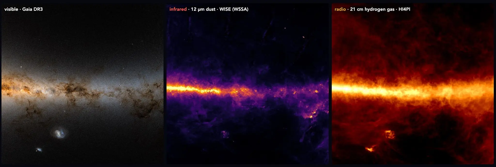
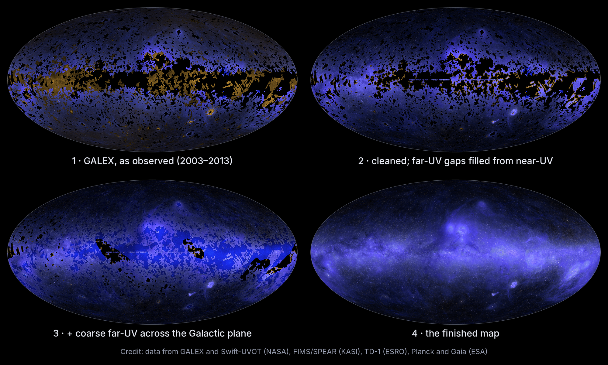
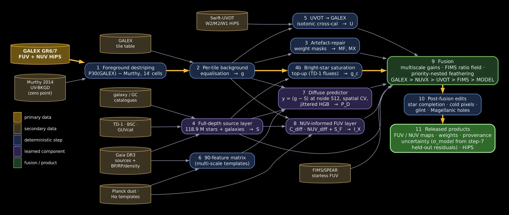
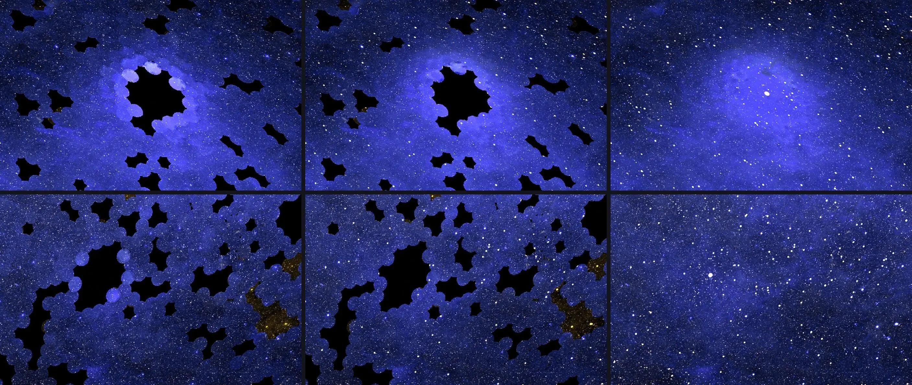

# 缺失的天空地图（中英对照）

> 原文标题：The missing map of the sky
> 原文链接：https://www.anthropic.com/research/the-missing-map-of-the-sky
> 原文作者：Brice Ménard（约翰斯·霍普金斯大学天体物理学家、Anthropic 研究员）
> 发布日期：2026-10-08
> **翻译模型：** DeepSeek-V4.1-Flash
> **评分：** ★★★★☆（4/5，强推荐）—— Claude Science 以多智能体流程整合 GALEX/Swift/FIMS/TD-1 等巡天数据并用 inpainting 补全三分之一从未被紫外观测过的天空，产出首张完整紫外天图；留出数据自检误差约 10%，含 GALEX 光斑残留的排错复盘
> 排版：每段英文原文在前，中文翻译紧随其后。默认收录正文主体。

---

Here, Brice Ménard, an astrophysicist at Johns Hopkins University and a researcher at Anthropic, explains how he worked with Claude Science to produce the first complete map of the sky in UV light. The map will be a valuable educational tool, allowing students to see in detail the rich structure of the Milky Way visible at this wavelength.

在本文中，约翰斯·霍普金斯大学天体物理学家、Anthropic 研究员 Brice Ménard 讲述了他如何与 Claude Science 合作，制作出首张完整的紫外（UV）天图。这张图将成为一份宝贵的教学工具，让学生能够细致地看到银河系在这一波段上呈现的丰富结构。

The entire sky, with the galactic center in the middle, in the ultraviolet (combining far-UV 154 nm and near-UV 232 nm). About a third of this map, including much of the galactic plane, was predicted with Claude Science using the method outlined in this post. Additional layers of the map label each pixel as “measured” or “predicted” and provide uncertainty estimates; you can see it here.

整片天空（银心位于正中）的紫外视图（融合了 154 nm 的远紫外与 232 nm 的近紫外）。这张图中约三分之一（包括银河盘面的大部分）是借助本文所述方法、由 Claude Science 预测得到的。天图还附带若干附加图层，把每个像素标注为“实测”或“预测”，并给出不确定度估计；可在此处查看。

When I teach astrophysics, I often begin by showing my students that the sky looks completely different depending on the wavelength you observe it in. Each brings out different features. In visible light, one mainly sees stars. Switching to infrared reveals the glow of tiny grains of dust concentrated in a band along the Milky Way. In radio waves, the stars and dust fade and hydrogen gas—the raw material from which new stars form—becomes visible. And in X-rays, one can see violent phenomena, like stars exploding, or matter spiraling into a black hole. Together, these features let astronomers understand how gas collapses into stars, how stars seed the galaxy with dust, and how galaxies like ours take shape.

当我在课堂上教授天体物理时，我常常先让学生们看到：同一天空，在不同的观测波段下呈现的样子截然不同。每个波段都会凸显不同的特征。在可见光下，人们主要看到恒星。切换到红外，则显现出聚集在银河系一条带状区域中的细小尘埃颗粒的辉光。到了射电波段，恒星与尘埃黯淡下去，而氢气——形成新恒星的原料——变得可见。在 X 射线波段，则能看到剧烈现象，比如恒星爆发，或物质螺旋落入黑洞。这些特征合在一起，让天文学家得以理解气体如何塌缩成恒星、恒星如何向星系播撒尘埃，以及像我们银河系这样的星系如何成形。

> Three views of the sky: in visible light, infrared and radio. Credit: ESA Gaia DR3, NASA WISE, HI4PI.

When talking about UV light and how it reveals dust illuminated by starlight, from the clouds around young stars to the rings left by stellar explosions, I have always had to apologize. The only UV map I could show was full of holes.

每当讲到紫外光、讲到它如何揭示被星光照亮的尘埃——从年轻恒星周围的云团，到恒星爆炸留下的环状结构——我总得先道歉。因为我能展示的唯一一张紫外天图，上面满是空洞。

## 为何没有一张完整的紫外天图（Why no complete UV map existed）

UV light is absorbed by the ozone layer of the atmosphere, so to observe the universe in the UV spectrum, one has to go to space. Over the past 50 years, space telescopes have observed parts of the sky in UV and published their data. But much remains unobserved.

紫外光会被大气臭氧层吸收，因此要在紫外波段观测宇宙，就必须进入太空。过去 50 年间，空间望远镜已在紫外波段观测了天空的一部分并公开了数据。但仍有大片天区从未被观测。

The largest dataset comes from NASA’s GALEX mission, which ran from 2003 to 2013 and imaged about two-thirds of the sky in some 38,000 separate observations. But GALEX deliberately skipped locations with very bright stars, including those on the plane of the Milky Way (the flat disk of the galaxy, where stars are most densely packed), because of the risk of damaging the satellite’s detectors. Other space telescopes, such as NASA’s Swift and South Korea’s FIMS/SPEAR, acquired additional data, but even in those combined datasets, there are a number of missing pieces.

最大的数据集来自 NASA 的 GALEX 任务。该任务在 2003 至 2013 年间运行，通过约 38,000 次独立观测成像了约三分之二的天空。但 GALEX 有意跳过了有极亮恒星的位置，包括银河盘面（星系扁平盘状结构，恒星分布最密集之处）上的那些位置，因为担心损坏卫星探测器。其他空间望远镜，如 NASA 的 Swift 和韩国的 FIMS/SPEAR，也获取了额外数据；但即便把这些数据集合并起来，仍有不少缺口。

Statistical techniques exist to estimate the missing data and create a complete UV map of the sky. But doing this properly takes weeks of painstaking work, involving meticulous calibrations at the level of individual pixels and sophisticated, repeated analyses. Understandably, astrophysicists tend to put this kind of work aside in pursuit of more pressing research. Most fields have a backlog of similar projects, ones that would explain a key concept or help other researchers, but which never rise high enough on anyone’s list to get done. With Claude, it has become easier to tackle such lower-priority work.

已有一些统计技术可以估计缺失的数据，从而制作出一张完整的紫外天图。但要把这件事做扎实，需要数周艰苦细致的工作，包括精确到单个像素的细致定标，以及复杂而反复的分析。可以理解，天体物理学家往往会搁置这类工作，转而去追逐更紧迫的研究。大多数学科都积压着类似的项目：它们能解释某个关键概念，或帮到其他研究者，却始终排不到任何人待办清单的高处，于是永远做不完。有了 Claude，处理这类低优先级的工作变得容易多了。

## 构建这张缺失的地图（Building the missing map）

> Four images showing the UV map being filled in. The first image has gaps, and they are progressively filled in.

This summer, I set out to make a complete UV map of the sky with Claude Science. The instructions were simple to state, but not to carry out: gather every available UV dataset, put them all on a common scale, merge them into a single map, and fill in every patch of sky that no UV telescope has ever observed.

今年夏天，我着手用 Claude Science 制作一张完整的紫外天图。任务描述起来很简单，做起来却不容易：收集所有可用的紫外数据集，把它们统一到同一标度，合并成一张天图，并填补每一片从未被紫外望远镜观测过的天区。

To do this, Claude orchestrated a team of AI agents. First, the agents searched the web for publicly available astronomical UV surveys, each comprising a massive collection of individual data points or images—tens of thousands of images, in the case of NASA’s GALEX mission—taken over several years and under varying conditions.

为此，Claude 统筹了一支由 AI 智能体（agent）组成的团队。首先，这些智能体在网络上搜寻公开可用的天文紫外巡天数据，每一份巡天都由海量的单点数据或图像构成——就 NASA 的 GALEX 任务而言，是数以万计的图像——它们是在数年之间、不同条件下拍摄的。

After downloading the data, the agents had to make each survey internally consistent, so that an image taken in one time period could be compared with an image taken in another. This required paying special attention to the regions around bright stars. Just as the sun or a streetlight can add glare to a photo here on Earth, stars can add glare to an image of the sky captured by a space telescope. That glare needed to be removed before the fainter UV light around the stars could be measured precisely. Many agents, working in parallel on different regions of the sky, were able to even out these differences.

下载数据之后，智能体必须让每一份巡天内部自洽，这样才能把不同时段拍摄的图像相互比较。这需要特别关注亮星周围的区域。正如太阳或路灯会给地球上的照片带来眩光，恒星也会给空间望远镜拍摄的天空图像带来眩光。必须先去除这种眩光，才能精确测量恒星周围更微弱的紫外光。许多智能体并行处理天空的不同区域，从而把这些差异抹平。

Next, the surveys had to be combined. The datasets were collected by different instruments on different telescopes, and each one captures the ultraviolet sky slightly differently, so they had to be cross-calibrated against one another, redrawn at the same resolution, and mapped onto a common coordinate system before they could be merged into one map. I gave high-level instructions to Claude on how to do so, and Claude set a team of agents on the tasks.

接下来要把这些巡天合并起来。这些数据集由不同望远镜上的不同仪器采集，每一台仪器拍摄紫外天空的方式都略有差异，因此必须彼此交叉定标、重绘到相同分辨率、并映射到统一的坐标系上，之后才能合并成一张天图。我向 Claude 给出了高层次的指示，Claude 则安排一支智能体团队去执行这些任务。

Then came the hardest part: filling in the gaps in the map. Roughly a third of the sky has never been observed in UV. To account for those blank spots, I asked Claude Science to use a technique called inpainting—a common process in machine learning, in which a model trained on millions of photos learns how each part of an image relates to its surroundings, and uses that knowledge to restore damaged or missing portions of an image.

然后是最困难的部分：填补天图中的空缺。大约三分之一的天空从未在紫外波段被观测过。为了处理这些空白区域，我请 Claude Science 使用一种称为“图像修复”（inpainting）的技术——这是机器学习中常见的过程：在数百万张照片上训练出的模型学会图像的每一部分与周围环境的关系，并利用这些知识还原图像中损坏或缺失的部分。

Claude combined this approach with additional information we had at our disposal. Where UV data is missing, we do have observations at other wavelengths, including visible, infrared, and radio. Using the two-thirds of the sky that has been mapped in UV, Claude learned how UV brightness relates to these other wavelengths. It then applied that relationship to the third of the sky for which no UV data exists, and estimated what it should look like at each point, and how confident it was in that estimate.

Claude 把这一方法与我们可以利用的额外信息结合起来。在紫外数据缺失的地方，我们确实拥有其他波段的观测，包括可见光、红外和射电。Claude 利用已被紫外覆盖的那三分之二天空，学习紫外亮度与其他波段之间的关系，再把这一关系应用到没有紫外数据的那三分之一天空上，估计出每个位置应当呈现的样子，以及它对这一估计的把握有多大。

To check how accurate the model’s predictions were, I asked Claude to take regions for which we already have UV data and deliberately hide parts of them, creating the kinds of blank patches inpainting is designed to fill. The model had to use what it had learned to complete the picture without access to the real values. After several rounds of refinement, it was able to estimate the hidden data to within about 10% of the real UV measurements, a difference almost imperceptible to the human eye.

为了检验模型预测的准确程度，我让 Claude 取出我们已有紫外数据的区域，刻意遮住其中一部分，制造出正是图像修复所要填补的那种空白。模型必须在看不到真实数值的情况下，用自己学到的东西把图补完。经过数轮改进，它对被隐藏数据的估计与真实紫外测量值相差约 10% 以内，这种差异人眼几乎无法察觉。

Finally, on top of this diffuse inpainted background, Claude added estimates of UV light from more than 100 million individual stars inferred from measurements by the European Space Agency’s Gaia satellite in visible light. The first version of the full UV map of the sky was complete.

最后，在这层弥散的、经图像修复得到的背景之上，Claude 又叠加了超过 1 亿颗单颗恒星的紫外光估计——这些恒星是从欧洲空间局 Gaia 卫星的可见光测量中推断出来的。首版完整的紫外全天图就此完成。

> How data flowed through the Claude Science pipeline to create the final map. Cylinders are public dataset inputs; blue boxes are deterministic steps Claude performed; purple boxes are components Claude learned statistically; green boxes are the fusion and the finished products.

## 试错与排错（Trial and error）

Claude did not get everything right on the first try. Looking through the processed images one evening, for example, I noticed something off in one of the dimmest fields: faint circles, each a touch brighter or darker than its neighbors.

Claude 并非一次就把所有事情做对。比如某个晚上，我在翻看处理后的图像时，发现最暗的一个天区有些不对劲：有一些微弱的圆斑，每一个都比周围稍亮或稍暗一点。

These were the footprints of individual GALEX observations. Each GALEX image captures a circular patch of the sky, and each contains a slight, not-quite-uniform UV glow from the Earth’s atmosphere. If that glow is not fully removed, each circle appears slightly brighter or darker than those around it. Claude had listed this as a known issue at the start of the project, but the map had still passed two rounds of review by other agents without the problem being caught.

这些是单次 GALEX 观测留下的印记。每张 GALEX 图像拍摄的是一块圆形天区，而每张图像都带有来自地球大气的一层微弱且并不完全均匀的紫外辉光。如果这层辉光没有被完全扣除，每个圆斑就会显得比周围的略亮或略暗。Claude 在项目开始时就把这一点列为已知问题，但这张天图仍然通过了其他智能体的两轮审查，问题都没被发现。

I told Claude, “I can see discs with the imprint of individual observations; can you correct that?” The agents traced the problem back to the leftover atmospheric glow. Claude then corrected for that glow in all 38,000 observations. After a couple of hours of processing, the circles were gone.

我对 Claude 说：“我能看到带有个体观测印记的圆盘，你能修正吗？”智能体把问题追溯到了残留的大气辉光。随后 Claude 在全部 38,000 次观测中扣除了这层辉光。经过几个小时的运算，那些圆圈消失了。

> Bright stars contaminate nearby UV observations even when not observed directly. Each row shows observations with regions GALEX avoided. Left: individual pointings visible as faint discs. Middle: after removing one background level per pointing, some disks are still visible. Right: the finished map, after an additional calibration process done by Claude with the holes filled by the prediction and Gaia stars.

## 最终的天图（The final map）

Together, Claude and I created more than a dozen successive versions of the map, each more refined than the last. Our collaboration spread over several days and took on a predictable rhythm: I would have several exchanges within Claude Science to plan the next steps, then Claude would independently perform hours of computations, while I went back to working on other projects.

Claude 和我一起做出了十多个前后相继的版本，每一版都比上一版更精细。我们的合作持续了数天，并形成了一种可预期的节奏：我先在 Claude Science 里进行几轮交流、规划下一步，然后 Claude 独立运行数小时的运算，而我就回去做其他项目。

The finished map shows the entire sky in UV light, and displays many interesting structures: dust clouds glowing around luminous young stars, giant dust rings and loops tracing gas bubbles blown out by the explosions of massive stars. Far from the galactic plane, faint filaments of dust thread across the sky, lit by the combined starlight of the entire galaxy. Below the plane sit the Large and Small Magellanic Clouds, two small neighboring galaxies bright with young stars. I think it’s beautiful—and it can join the other canonical maps in helping generations of students appreciate the variety of physical processes at work in our galaxy.

完成后的天图呈现了整片天空的紫外景象，展示出许多有趣的结构：明亮年轻恒星周围发光的尘埃云；勾勒出大质量恒星爆炸所吹出的气泡的巨型尘埃环与尘埃弧。远离银河盘面之处，微弱的尘埃纤维横贯天空，被整个星系汇聚的星光点亮。盘面下方是大麦哲伦云和小麦哲伦云——两个因年轻恒星而明亮的邻近小星系。我觉得它很美——它可以加入那些经典天图的行列，帮助一代代学生领略我们星系中各种正在运转的物理过程。

For once, I was able to pursue a project like this without sacrificing time I would otherwise have devoted to research. I suspect many scientists can think of a map, a figure, or a resource they’ve been putting off for the same reason.

这一次，我终于能推进这样一个项目，而不必牺牲本应用于研究的时间。我猜想，许多科学家都能想到某张图、某个图表或某份资源，他们正是因为同样的原因一直搁置着。

## 致谢（Acknowledgments）

The measurements used to create this map are from GALEX and Swift (NASA), FIMS/SPEAR (Korea), TD-1 (Europe), and Planck and Gaia (ESA). I’m grateful to everyone involved in these missions and in making the data public. Many agents working in Claude Science contributed the patient labor of putting this map together. My contribution was limited to guiding them in the process.

用于制作这张天图的测量数据来自 GALEX 与 Swift（NASA）、FIMS/SPEAR（韩国）、TD-1（欧洲），以及 Planck 与 Gaia（ESA）。我感谢参与这些任务以及推动数据公开的每一个人。Claude Science 中许多智能体为拼合这张天图付出了耐心的劳动。我的贡献仅限于在这个过程中引导它们。
