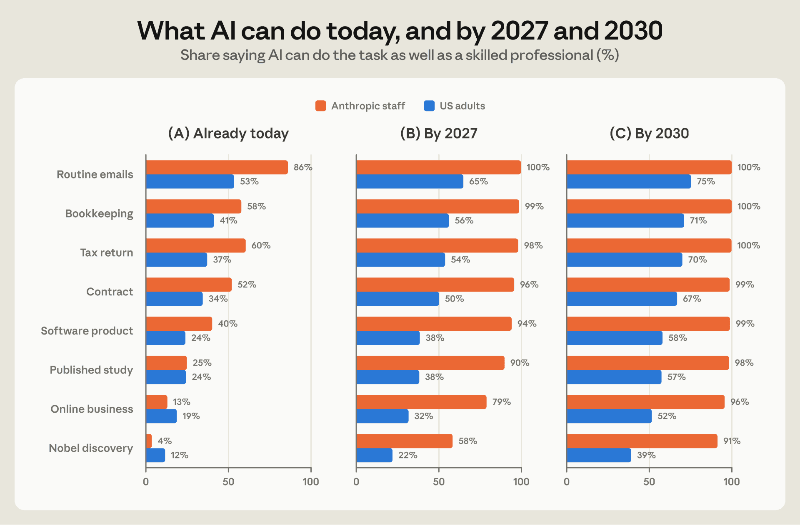
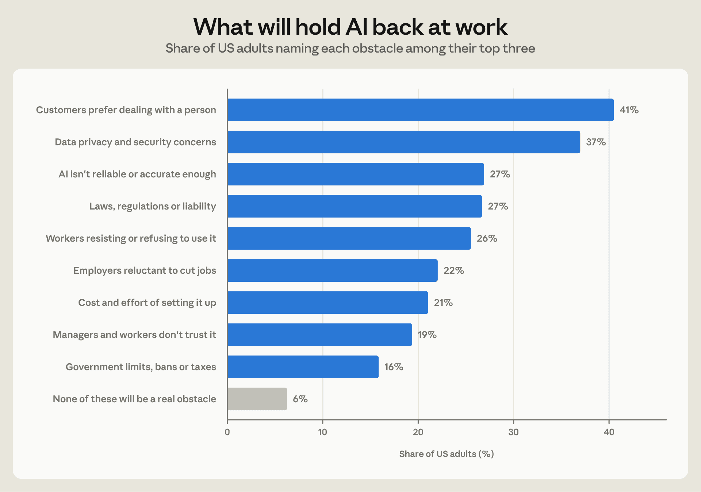
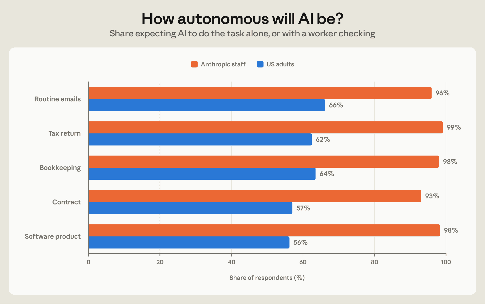
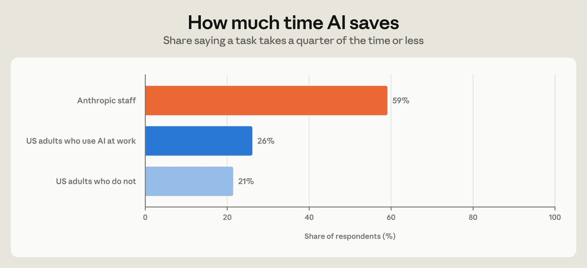
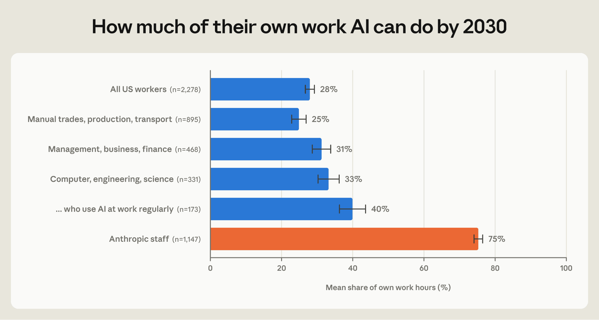
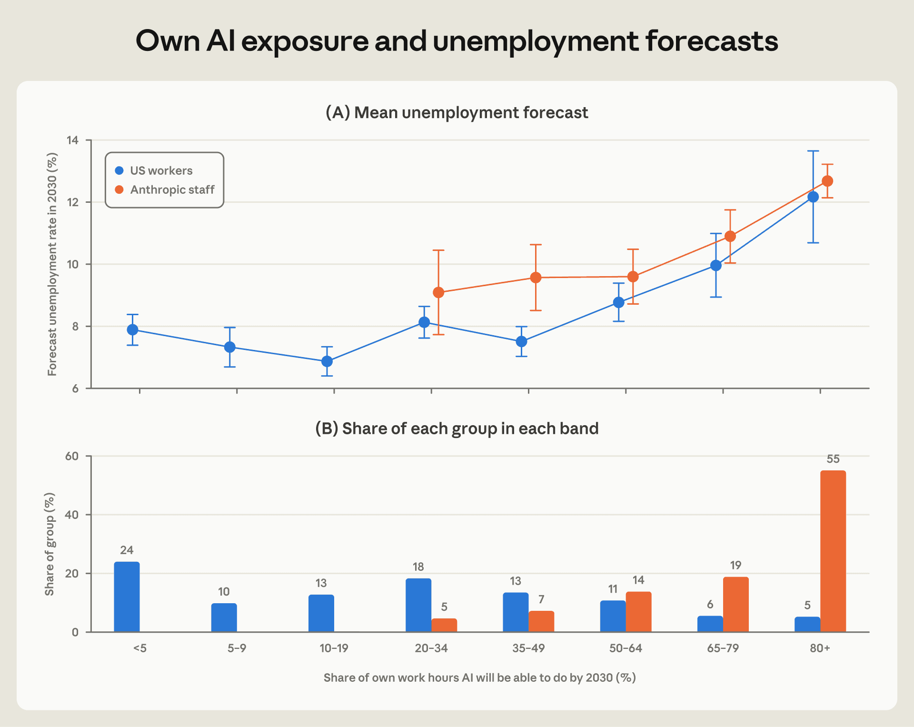
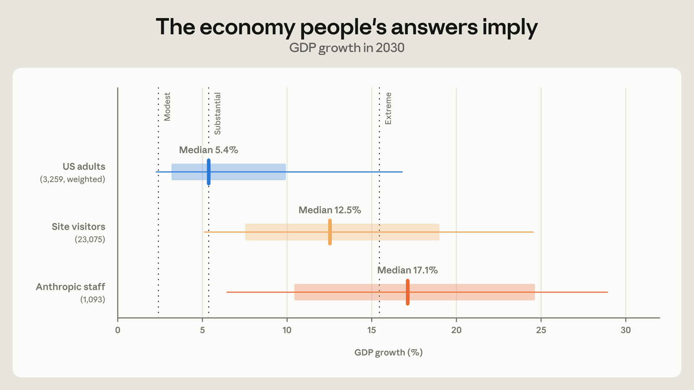
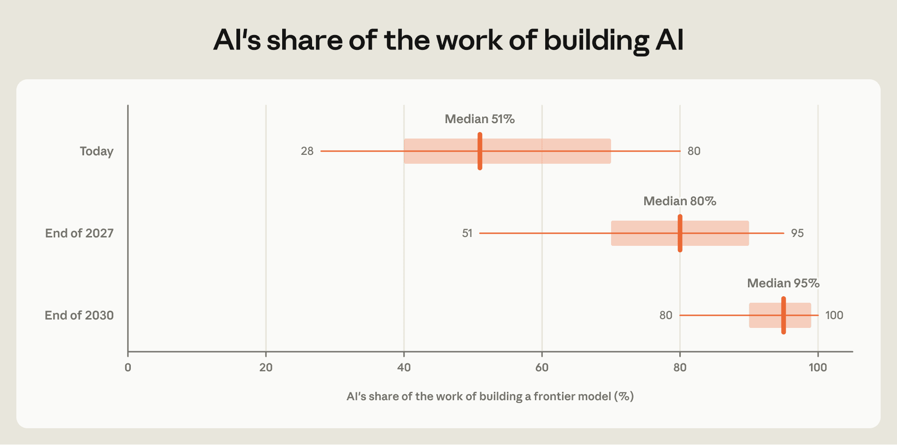

# AI 期望差距（中英对照）

> 原文标题：The AI expectations gap
> 原文链接：https://www.anthropic.com/research/ai-expectations-gap
> 原文作者：Szymon Sacher, Tess Cotter, Charles I. Jones, Anton Korinek, Peter McCrory
> 发布日期：2026-10-16
> **翻译模型：** GLM-5.3-Flash
> **评分：** ★★★★☆（4/5，强推荐）—— 91% 员工 vs 39% 公众预期 2030 年前出现诺贝尔奖级发现、自身工作自动化预期 75% vs 28%，公众与前沿实验室员工的首创对照调查
> 排版：每段英文原文在前，中文翻译紧随其后。默认收录正文主体；文末脚注 [^1]–[^7] 自原页补全（原页正文标记仅 1–6，脚注 7 在原页无正文标记，按内容归位，见文末译注）；References、BibTeX 引用格式与附录未收录，见文末说明。

---

## 关键发现（Key findings）

- US adults expect AI capabilities to advance rapidly in the coming years; Anthropic staff expect even faster progress; 39% of US adults and 91% of staff expect that AI will be able to make a Nobel-level discovery by 2030.

  美国成人预期 AI 能力将在未来几年快速进步；Anthropic 员工预期进步更快。39% 的美国成人与 91% 的员工预期，到 2030 年 AI 将能做出诺贝尔奖级（Nobel-level）的科学发现。

- Anthropic staff expect much larger productivity gains from AI on the tasks it is well-suited for. Among US adults who use AI at work, 26% say a task takes a quarter of the time or less with AI, compared to 59% of Anthropic staff.

  在 AI 擅长的任务上，Anthropic 员工预期 AI 带来的生产率提升远大于公众。在在工作中使用 AI 的美国成人中，26% 表示借助 AI 完成一项任务只需四分之一的时间或更少；Anthropic 员工中这一比例为 59%。

- When it comes to their own job, over half of Anthropic staff expect AI to be able to do at least 80% of their current work by 2030, compared with 5% of US workers.

  谈到自己的工作时，超过半数的 Anthropic 员工预期，到 2030 年 AI 将能完成其当前工作的至少 80%；美国劳动者中这一比例仅为 5%。

- Among both US workers and Anthropic staff, people who expect AI to do more of their own work anticipate higher unemployment. While there are differences in beliefs about future capabilities, the perceived link between how AI might change one's own job and broader unemployment is very similar for both groups.

  无论是美国劳动者还是 Anthropic 员工，预期 AI 能完成自己更多工作的人，也预期更高的失业率。尽管双方对未来能力的判断存在分歧，但在「AI 将如何改变自己的工作」与「整体失业率」之间的关联认知上，两组人非常一致。

## 引言（Introduction）

How will AI reshape the economy in the years ahead? AI capabilities are advancing rapidly, and the possibility that future AI models may be able to build their own successors (recursive self-improvement) could further accelerate the rate of progress. How quickly this might materialize and to what extent is unclear. Forecasts vary widely and are fiercely debated.

未来几年，AI 将如何重塑经济？AI 能力正在快速进步，而未来的 AI 模型或许能造出自己的继任者——即递归自我改进（recursive self-improvement）——这可能进一步加快进步的速度。这一切会多快实现、实现到什么程度，尚不清楚。各种预测差异巨大，且争论激烈。

What is the core source of disagreement about AI's future impact on the economy? Is it principally due to differences in beliefs about how quickly AI capabilities will improve? Or does it reflect disagreement about how quickly and in what form those capabilities translate to real-world adoption? Which views on the future path of AI are consistent with rapid economic growth?

关于 AI 未来经济影响的分歧，其核心来源是什么？主要是由于对 AI 能力提升速度的判断不同？还是由于对这些能力将以多快速度、以何种形式转化为现实采用的看法不同？哪些关于 AI 未来路径的观点与经济高速增长相容？

This note presents new survey evidence on these questions. In August 2026, we surveyed two groups: a sample of US adults that was nationally representative and Anthropic staff. [^1] The questions covered, among other things, AI's capabilities, how widely it will be used, how much time it saves, how autonomous it will be, and how difficult it will be for a displaced worker to find a job in a different occupation. [^2] Anthropic staff build and use frontier AI every day. The second survey therefore shows how people closest to the technology anticipate its future, both in capabilities and in broader economic impact.

本文就这些问题给出新的调查证据。2026 年 8 月，我们调查了两组人群：一个具有全国代表性（nationally representative）的美国成人样本，以及 Anthropic 员工。[^1] 问题涵盖 AI 的能力、它将被多广泛地使用、能节省多少时间、将有多高的自主性，以及被取代的劳动者转换职业另找工作有多难等。[^2] Anthropic 员工每天都在构建和使用前沿 AI。因此，第二份调查展示了最贴近这项技术的人如何预期它的未来——既包括能力，也包括更广泛的经济影响。

We report the following main findings. First, the two groups largely agree about what AI can do today but disagree about the pace of future progress. Anthropic staff expect capabilities to advance faster, AI to be used more widely and with less human involvement, and the time it saves on a task to be much larger. For example, 91% of staff expect AI to be able to make a Nobel-level discovery by 2030, compared to 39% of US adults.

我们报告以下主要发现。第一，两组人对 AI 今天能做什么大体一致，但对未来进步的速度分歧明显。Anthropic 员工预期能力进步更快、AI 的使用更广泛且所需人工介入更少、在任务上节省的时间也大得多。例如，91% 的员工预期到 2030 年 AI 将能做出诺贝尔奖级发现，而美国成人中这一比例为 39%。

Second, there are sharp differences concerning people's own jobs. On average, staff members expect AI to be able to do 75% of their current work by 2030, compared to 28% for US workers overall.

第二，在涉及自身工作时，分歧显著。平均而言，员工预期到 2030 年 AI 将能完成其当前工作的 75%，而全体美国劳动者的平均值仅为 28%。

Third, the two groups seem to reason about the labor market in a similar way: people who expect AI to do more of their own work in the future forecast higher unemployment. And, at the same level of expected AI automation of their own work, both groups forecast about the same unemployment rate.

第三，两组人推理劳动力市场的方式看起来相似：预期未来 AI 能完成自己更多工作的人，预测的失业率更高。而在预期自身工作被 AI 自动化的程度相同的条件下，两组人预测的失业率大致相同。

## 人们期望 AI 做什么（What people expect AI to do）

### 能力（Capabilities）

We first investigate expectations about AI capabilities. We asked when AI will be able to do each of eight tasks as well as a skilled professional, from writing routine emails to making a Nobel-level scientific discovery. US adults and Anthropic staff largely agree on what AI can do today, particularly when it comes to more complex tasks. Both groups rank tasks in nearly the same order of difficulty (Figure 1, panel A).

我们首先考察对 AI 能力的预期。我们询问受访者：AI 何时能像熟练专业人士一样完成八项任务中的每一项——从撰写日常邮件到做出诺贝尔奖级科学发现。美国成人与 Anthropic 员工对 AI 今天能做什么大体一致，在更复杂的任务上尤其如此。两组人对任务难度的排序几乎相同（图 1，面板 A）。

The groups disagree on the path of future AI progress. For example, around a quarter of US adults and Anthropic staff think that AI can design, conduct, and publish scientific studies today. But by next year, 9 in 10 staff expect this to be feasible for AI as compared to just 38% for the general public. By 2030, 39% of US adults expect AI to be able to make a Nobel-level discovery (panel C), compared with 91% of staff. What is perhaps the most striking difference, depending on the task, between 19 and 40% of US adults say AI will never be able to do a given task, compared with at most 2% of staff.

两组人对 AI 未来进步路径的判断则不同。例如，约四分之一的美国成人和 Anthropic 员工认为 AI 今天已能设计、执行并发表科学研究；但到明年（2027 年），90% 的员工预期 AI 将能做到这一点，而公众中仅有 38%。到 2030 年，39% 的美国成人预期 AI 能做出诺贝尔奖级发现（面板 C），员工中则为 91%。最显著的差异或许是：视任务而定，有 19% 到 40% 的美国成人认为 AI 永远无法完成某项给定任务，而员工中这一比例至多只有 2%。

In part, differences in views reflect differences in frequency of AI use. Among those who use AI at work regularly (about a fifth of respondents), 56% expect AI to be able to do at least seven of the eight named tasks by 2030. This is substantially higher than among all US adults (41%) and among those who have never used an AI tool (28%), but still well short of the staff view (96%).

观点差异部分反映了 AI 使用频率的差异。在经常于工作中使用 AI 的受访者（约占五分之一）中，56% 预期到 2030 年 AI 将能完成八项任务中的至少七项。这显著高于全体美国成人（41%）和从未用过 AI 工具的人（28%），但仍远低于员工的看法（96%）。

> Figure 1: Share of respondents who expect AI to be able to complete the listed tasks as well as a skilled professional. Respondents were asked when AI will be able to complete these tasks, regardless of whether companies will actually use it. Panels show the share answering (A) already, (B) by 2027, and (C) by 2030. US adults' responses (N=10,980) are weighted to be nationally representative, Anthropic staff responses are unweighted.

## 采用及其障碍（Adoption and its obstacles）

The impact of AI on the economy is not solely determined by raw capabilities. People and businesses need to actually use AI, which takes time and experimentation. Of the work tasks AI will be able to do, US adults expect that 42% will be done with AI by 2030. Anthropic staff expect noticeably faster diffusion over the next few years, with AI used for 65% of all tasks for which it could be used.

AI 对经济的影响并非仅由原始能力决定。个人和企业需要真正用上 AI，而这需要时间和试验。在 AI 将能完成的工作任务中，美国成人预期到 2030 年会有 42% 由 AI 完成。Anthropic 员工预期未来几年的扩散速度明显更快：在所有 AI 力所能及的任务中，65% 会用上 AI。

To understand what might hold back AI adoption at work, we asked US adults to choose up to three obstacles from a list of nine that they expect to be the biggest. The general public expects that people's preferences and rules, more than the technological constraints, may be what holds adoption back (Figure 2). "Customers preferring to deal with a person" was the obstacle selected most often, followed by "data privacy and security concerns," "AI not being reliable enough," and "laws, regulations or liability."

为了解可能阻碍工作中采用 AI 的因素，我们请美国成人从九个选项中选出最多三个他们认为最大的障碍。公众预期，比起技术约束，人的偏好与规则更可能拖慢采用（图 2）。「顾客更愿意与人打交道」是被选最多的障碍，其次是「数据隐私与安全顾虑」、「AI 不够可靠」，以及「法律、法规或责任问题」。

> Figure 2: Obstacles to AI use at work in 2030 named by US adults. Respondents were told that businesses do not always use AI even when it is technically capable of doing a task, and were asked which of nine obstacles will be the biggest to AI being used at work in 2030. Each could choose up to three, so shares sum to more than 100%. We did not ask this question to Anthropic staff.

Notably, US adults who use AI regularly at work rank data privacy and security concerns first (42% consider it among the top 3 obstacles, compared with 37% among the rest) and see customer preferences to deal with humans as slightly less important (37% vs 42%).

值得注意的是，经常在工作中使用 AI 的美国成人将数据隐私与安全顾虑排在首位（42% 的人将其列入前三大障碍，其余受访者为 37%），而认为「顾客更愿意与人打交道」更重要的比例略低（37% 对 42%）。

## AI 将有多自主（How autonomous AI will be）

The impact of AI on the labor market will in part depend on whether AI completes complex tasks autonomously or in collaboration with a human. The former tends to displace human workers. Alternatively, when AI complements human capabilities, workers become more productive. To get a sense for anticipated automation versus augmentation in 2030 among Anthropic staff and the general public, we asked how AI and humans will work together on various tasks ranging from email drafting to legal contracting by 2030. At Anthropic, the vast majority of staff say that by 2030 AI will either complete tasks alone or with a worker evaluating the work (Figure 3). By contrast, 4 in 10 US adults instead expect that humans will do most of the work themselves or with some AI help.

AI 对劳动力市场的影响，将部分取决于 AI 是自主完成复杂任务，还是与人类协作完成：前者往往取代人类劳动者，而当 AI 补充（augment）人类能力时，劳动者的生产率会提高。为了解 Anthropic 员工与公众对 2030 年「自动化还是增强」的预期，我们询问：到 2030 年，在从起草邮件到拟定法律合同的各种任务上，AI 与人类将如何分工。在 Anthropic，绝大多数员工表示，到 2030 年 AI 要么独立完成任务，要么在有工作人员评估其成果的情况下完成（图 3）。相比之下，四成美国成人预期人类将自行完成大部分工作，或仅在少量 AI 协助下完成。

> Figure 3: Share of respondents who expect AI to do each task alone or with a worker checking. Respondents were asked to imagine that AI is useful for each of the five tasks and asked who will be doing them: AI alone; AI does most of it, with workers checking; workers do most of it, with AI helping; or workers alone. Bars show the share choosing either of the first two.

### 节省的时间（Time savings）

How much AI raises output depends not only on which tasks it can do and how widely it is used, but also on how much faster and better it does them. A technology that is just good enough to replace workers—what Acemoglu and Restrepo (2019) call a "so-so" technology—displaces work without much increase in GDP. By contrast, a technology that completes tasks at a small fraction of cost or in a fraction of time can meaningfully raise GDP.

AI 能把产出提高多少，不仅取决于它能做哪些任务、被多广泛地使用，还取决于它做这些任务时快多少、好多少。一种仅仅「刚好够用来替代工人」的技术——Acemoglu 与 Restrepo（2019）所称的「马马虎虎」（so-so）技术——只会取代工作，而不会带来多少 GDP 增长。相比之下，能以极小部分成本或极短时间完成任务的技术，才能切实抬高 GDP。

To measure perceptions about the productivity lift from AI, we asked the general public and Anthropic staff how long a task for which AI is well suited takes with AI, compared with doing it without AI. A task done in half the time corresponds to a doubling of output per hour. [^3]

为了测量人们对 AI 生产率提升的感知，我们询问公众与 Anthropic 员工：与不用 AI 相比，完成一项 AI 非常擅长的任务、用 AI 需要多长时间。同一任务若只需一半时间完成，即相当于每小时产出翻倍。[^3]

Anthropic staff report much larger expected savings, with 85% saying that it takes half the time or less. Among US adults who use AI at work, the typical answer is half the time, and 29% say the task takes just as long or longer, while only 5% of staff say so. Among US adults, 26% of those who use AI at work say a task takes a quarter of the time or less, and 21% of those who do not use AI at work say the same. For staff, that share is 59% (Figure 4).

Anthropic 员工报告的预期节省大得多：85% 表示只需一半时间或更少。在在工作中使用 AI 的美国成人中，最典型的回答是省一半时间；29% 表示任务耗时与不用 AI 一样甚至更长，而员工中这样说的只有 5%。在美国成人中，在工作中使用 AI 的人有 26% 表示任务只需四分之一的时间或更少，不在工作中使用 AI 的人也有 21% 这样说；员工中该比例为 59%（图 4）。

Staff may be describing what they experience at work. As discussed further in How Employment is Changing at Anthropic, Anthropic employees increased productivity on some dimensions after adopting agentic tools: the lines of code engineers added tripled in the month after adopting coding agents and sales representatives closed more deals with clients after adopting AI agents. Output per person also rose in other business functions, like legal and recruiting.

员工描述的可能是他们工作中的切身体验。正如《Anthropic 的就业如何变化》（How Employment is Changing at Anthropic）一文所进一步讨论的，Anthropic 员工在采用智能体（agentic）工具后，某些维度的生产率有所提高：工程师在采用编码智能体后的一个月内，新增代码行数增至三倍；销售代表在采用 AI 智能体后与客户达成了更多交易。法务、招聘等其他业务职能的人均产出也在上升。

> Figure 4: Share of respondents who say a task takes a quarter of the time or less with AI. Respondents were asked to think of a task that today's AI is well suited for, such as summarizing a document or drafting an email, and how long it takes to finish using AI, counting the time spent checking and fixing its work, compared with not using AI. Bars show the share answering "about a quarter of the time" or "about a tenth of the time or less." Figure A2 shows all answers.

## 自己的工作与就业（Own work and jobs）

### AI 将能完成自己工作的多少（How much of their own work AI will be able to do）

Perhaps unsurprisingly, we find a large gap in perceptions between the general public and Anthropic staff when it comes to AI's impact on their own jobs (Figure 5). On average, Anthropic staff members say AI will be able to do 75% of their current work hours by 2030. US workers (respondents who report having a job) put the share at 28% on average, and only 1 in 20 say that AI could do 80% or more of their work hours by 2030.

或许并不意外：在 AI 对自身工作的影响上，公众与 Anthropic 员工的感知存在巨大差距（图 5）。平均而言，Anthropic 员工表示，到 2030 年 AI 将能完成其当前工时的 75%。美国劳动者（报告自己有工作的受访者）给出的平均值为 28%，且只有二十分之一的人表示，到 2030 年 AI 能完成其工时的 80% 或更多。

Across US workers, expectations vary by occupation: AI is expected to be able to do 25% of work hours among manual trades, production and transport workers and 33% for workers in computer, engineering and science occupations. For this latter group, those who use AI regularly expect only 40%, a belief that is closer to the average US worker than to the average Anthropic staff member (75%).

在美国劳动者内部，预期因职业而异：手工行业、生产与运输工人预期 AI 能完成 25% 的工时；计算机、工程与科学职业的工人预期为 33%。而在后一群体中，经常使用 AI 的人也只预期 40%——这一判断更接近美国劳动者的平均水平，而非 Anthropic 员工的平均水平（75%）。

> Figure 5: Share of their own work hours that respondents expect AI to be able to do by 2030. Share of the respondent's current work hours that AI will be able to do by 2030. The US adults sample is restricted to employed respondents only. Staff answered on a slider while US adults choose a range and we use range midpoints. Bars show 95% confidence intervals.

### 自身工作暴露度与失业率预测（Own-job exposure and unemployment forecasts）

How much of their own work people expect AI to do goes a long way toward explaining what they expect for the labor market. We told respondents that the current unemployment rate was about 4.2% and asked them to forecast the rate in 2030. Figure 6 groups respondents by the share of their own hours they expect AI to be able to do by 2030, and shows each group's average unemployment rate forecast.

人们预期 AI 能完成多少自己的工作，在很大程度上解释了他们对劳动力市场的预期。我们告知受访者当前失业率约为 4.2%，并请他们预测 2030 年的失业率。图 6 按受访者预期到 2030 年 AI 能完成其自身工时的比例对其分组，并显示各组的平均失业率预测。

US workers who expect AI to be able to do less than half of their work forecast unemployment of 7 to 8%. Above half, the forecast increases with the share of AI-exposed work. Those who expect AI to do 80% or more of their work expect, on average, an unemployment rate of 12.2% in 2030, above its peak during the Great Financial Crisis. Across US workers, ten more percentage points of work affected is associated with 0.4 points more forecasted unemployment. General optimism about AI does not explain this. Holding their own work exposure fixed, the share of the eight tasks a worker expects AI to master is unrelated to the forecast.

预期 AI 能完成自己不到一半工作的美国劳动者，预测失业率为 7% 到 8%。超过一半之后，预测值随 AI 暴露（AI-exposed）工作占比的上升而上升。预期 AI 能完成自己 80% 或更多工作的人，平均预测 2030 年失业率为 12.2%，高于大金融危机（Great Financial Crisis）时期的峰值。在美国劳动者整体中，受影响工作占比每多十个百分点，预测失业率平均高出 0.4 个百分点。对 AI 的总体乐观情绪并不能解释这一点：在固定自身工作暴露度的条件下，劳动者预期 AI 能掌握的八项任务占比与失业率预测无关。

Even though their own reported exposure is much higher, the same gradient appears among Anthropic staff, with forecasts closely mirroring those of the general population. Therefore, these two groups do not seem to hold different theories of how AI will simultaneously affect their own jobs and the broader labor market. They have different experiences of what AI capabilities are and, in turn, expectations.

尽管员工自报的暴露度要高得多，同样的梯度也出现在 Anthropic 员工中，其预测与普通人群的如出一辙。因此，对于「AI 将如何同时影响自己的工作与整体劳动力市场」，这两组人似乎持有相同的理论；他们不同的只是对 AI 能力现状的体验，进而才有不同的预期。

> Figure 6: Mean forecast of the 2030 unemployment rate, by the share of their own work hours that respondents expect AI to be able to do. Respondents were told that the US unemployment rate is 4.2% today and asked what they expect it to be in 2030. Panel (A) groups employed respondents by the share of their current work hours they expect AI to be able to do by 2030, and shows each group's mean forecast and 95% confidence interval. Groups with fewer than 20 respondents are omitted. Panel (B) shows the share of US workers and of Anthropic staff in each group.

## 招聘与再就业（Hiring and re-employment）

Even though Anthropic staff expect AI to be able to do most of their work, they also expect Anthropic to keep hiring. 95% of Anthropic staff expect headcount to grow over the next 12 months, the median staff member expects it to grow by 66%, and 27% expect it at least to double. These are the personal expectations of staff members in an internal poll and do not represent Anthropic's plans or its view of its headcount. Even so, they show that automating tasks and shedding jobs are different forecasts, at least at a frontier AI lab.

尽管 Anthropic 员工预期 AI 将能完成其大部分工作，他们同样预期 Anthropic 会继续招聘。95% 的 Anthropic 员工预期未来 12 个月公司人数将增长，员工预期增长的中位数为 66%，27% 的人预期至少翻倍。这些是员工在内部投票中的个人预期，不代表 Anthropic 的计划或公司对自身人数规模的看法。即便如此，它们表明：自动化任务与裁减岗位是两种不同的预测——至少在一家前沿 AI 实验室是如此。

Anthropic staff, however, are slightly more pessimistic than US adults about how quickly workers displaced by AI can find new work. We asked how long it would take a person who loses their job to AI automation in 2030—and who needs to switch occupations—to find a new one. [^4] The median Anthropic staff member expects that a worker displaced by AI would take 12 months to find a role in a new occupation. This compares to the median US adult response in the range of 7-12 months.

不过，对于被 AI 取代的劳动者能多快找到新工作，Anthropic 员工比美国成人略为悲观。我们询问：一个在 2030 年因 AI 自动化而失业、且需要转换职业的人，需要多久才能找到新工作。[^4] Anthropic 员工回答的中位数是 12 个月；美国成人回答的中位数则在 7–12 个月之间。

## 对 AI 的预期及其经济含义（Expectations about AI and their economic implications）

### 将调查回答映射为模型隐含的经济情景（Mapping survey responses to model-implied economic scenarios）

In Economic Scenarios for Transformative AI we introduced a structured framework for assessing how different future paths for AI capabilities and diffusion might translate into differences in economic outcomes. The model allows us to translate each respondent's answers across five dimensions — capabilities, diffusion, automation, productivity, and worker transition frictions — into model-implied economic outcomes. [^5] Across both our US adult and Anthropic staff samples, we identify every respondent who answered all questions related to the key model inputs (3,259 US adults and 1,093 staff). We then evaluate the economic scenario implied by those answers for each respondent, focusing below on implications for GDP growth in 2030.

在《变革性 AI 的经济情景》（Economic Scenarios for Transformative AI）中，我们提出了一个结构化框架，用于评估 AI 能力与扩散的不同未来路径会如何转化为不同的经济结果。借助该模型，我们可以把每位受访者在五个维度——能力、扩散、自动化、生产率与劳动者转换摩擦——上的回答，换算成模型隐含（model-implied）的经济结果。[^5] 在美国成人与 Anthropic 员工两个样本中，我们找出回答了与模型关键投入相关的全部问题的每一位受访者（3,259 名美国成人与 1,093 名员工），然后对每位受访者评估其回答所隐含的经济情景，下文聚焦其对 2030 年 GDP 增长的含义。

The median US adult's answers imply GDP growth of 5.4% in 2030, according to the model. The median staff member's answers imply GDP growth accelerating to 17.1% by 2030. There is significant variation within each group, so the distributions overlap widely (Figure 7). Figure A1 in the appendix shows how much each belief contributes to this gap.

按该模型，美国成人回答的中位数隐含 2030 年 GDP 增长 5.4%；员工回答的中位数隐含 GDP 增速到 2030 年加快至 17.1%。每组内部差异都很大，因此两个分布大面积重叠（图 7）。附录中的图 A1 显示了每一种信念对这一差距的贡献。

### 在线情景探索测验的回答（Responses from online scenario explorer quiz）

Figure 7 also shows the economic scenarios implied by inputs provided by site visitors to an interactive scenario explorer based on this economic model that was published at www.anthropic.com/institute/econ-scenarios on September 9, 2026.

图 7 还展示了网站访客在一款交互式情景探索工具中输入的答案所隐含的经济情景。该工具基于上述经济模型，于 2026 年 9 月 9 日发布于 www.anthropic.com/institute/econ-scenarios。

The interactive explorer asked shorter form versions of the questions we fielded to US adults and Anthropic staff in August 2026. 23,075 visitors completed the survey in the first 48 hours after publication, connecting from more than 140 countries worldwide. These visitors chose to come to a page on Anthropic's website and to take the quiz, so they are likely to be more interested in AI than the general public. Indeed, their answers place them between those of US adults and Anthropic staff: the median visitor's answers imply 12.5% growth.

这款交互式探索工具所提的问题，是我们 2026 年 8 月面向美国成人与 Anthropic 员工调查问题的精简版。发布后的前 48 小时内，来自全球 140 多个国家和地区的 23,075 名访客完成了测验。这些访客是主动来到 Anthropic 网站页面并选择作答的，因此他们对 AI 的兴趣很可能高于普通公众。事实上，他们的回答也恰好落在美国成人与 Anthropic 员工之间：访客回答的中位数隐含 12.5% 的增速。

> Figure 7: Model-implied GDP growth in 2030, based on the expectations of US adults, website visitors and Anthropic staff. Each respondent's answers to the five questions on capabilities, adoption, autonomy, time savings and re-employment are run through the model from Economic Scenarios for Transformative AI; see Appendix B therein for details. The thick bar spans the 25th to 75th percentile and the thin line the 10th to 90th percentile. Dotted lines mark three scenarios laid out in the paper: Modest (annual GDP growth of 2.4%), Substantial (5.4% GDP growth) and Extreme (15.4% GDP growth). The figure includes respondents who answered all five questions: 3,259 US adults (2030 half only), 1,093 Anthropic staff, and the 23,075 website visitors who completed the quiz available at anthropic.com/institute/econ-scenarios in the 48 hours after its launch on September 9, 2026.

## 实验室内部（Inside the lab）

One reason staff are more optimistic about AI capabilities may be that they have greater visibility into the development process. The Anthropic Institute recently published a report on progress toward recursive self-improvement (RSI), a process where AI systems increasingly improve their own capabilities (Favaro and Clark, 2026).

员工对 AI 能力更乐观的一个原因，可能是他们对研发过程有更多一手了解。Anthropic Institute（Anthropic 研究院）最近发布了一份关于递归自我改进（recursive self-improvement, RSI）进展的报告——所谓 RSI，指 AI 系统不断改进自身能力的过程（Favaro 与 Clark，2026）。

To shed light on whether staff themselves expect this to happen, we asked Anthropic staff what share of the work of building an early-2026 frontier model is done by AI today, and what they expect it to be in the future (Figure 8). [^6][^7] Among surveyed Anthropic staff, the median answer today is 51%, 80% by the end of 2027 and 95% by the end of 2030.

为了解员工自己是否预期这一幕会发生，我们询问 Anthropic 员工：构建一个 2026 年初水平的前沿模型，今天有多大比例的工作由 AI 完成，以及他们预计未来这一比例会是多少（图 8）。[^6][^7] 在受调查的 Anthropic 员工中，回答的中位数为：今天 51%，2027 年底 80%，2030 年底 95%。

Estimates of the share of work that AI does in AI development vary far more within teams than between them. Still, staff on research teams, who are closest to the work of building models, put AI's share today somewhat higher: 60% on average, against 53% for all other survey respondents. This is consistent with information playing some role, although researchers—by virtue of the nature of their work—may also use AI more in their own work than other employees.

关于 AI 在 AI 研发中所做工作份额的估计，团队内部的差异远大于团队之间的差异。不过，最贴近模型构建工作的研究团队员工，给出的当前份额略高：平均 60%，而其他所有受访者为 53%。这与「信息起了作用」的解释相符——不过，研究人员因其工作性质，本身也可能比其他员工在工作中更多使用 AI。

As with the hiring forecasts, these responses are the personal views of staff members in an internal poll fielded to Anthropic staff in August 2026.

与招聘预期一样，这些回答是 2026 年 8 月面向 Anthropic 员工开展的内部投票中员工的个人观点。

> Figure 8: Anthropic staff's estimates of the share of the work of building a frontier model that is done by AI. Anthropic staff were asked what share of the work of building an early-2026 frontier model is done by AI today, and what they expect that share to be at the end of 2027 and 2030. The tick marks the median answer, the boxes span 25th to 75th percentile, and the lines span 10th to 90th percentile. Answers are the personal estimates of staff members in an internal poll and are not a measurement by Anthropic or a company forecast.

## 结论（Conclusion）

US adults and Anthropic staff largely agree about what AI can do today. However, they disagree about how quickly it will improve, how widely it will be used, and how large the productivity gains measured by time saved will be. Through the lens of the model in Economic Scenarios for Transformative AI, the median US adult's answers imply a scenario in which the US economy grows at more than twice its typical rate. Among Anthropic staff working at the frontier of AI development and usage, expectations about AI progress, adoption, and automation of knowledge work imply a transformative and historically unprecedented change to the economy: by 2030, GDP is doubling in size roughly every four and a half years.

美国成人与 Anthropic 员工对 AI 今天能做什么大体一致。但在它将以多快的速度改进、将被多广泛地使用、以及以节省时间衡量的生产率收益会有多大这三点上，双方分歧明显。透过《变革性 AI 的经济情景》中模型的视角，美国成人回答的中位数隐含这样一种情景：美国经济以两倍于常态的速度增长。而在 AI 开发与使用前沿工作的 Anthropic 员工中，关于 AI 进步、采用与知识工作自动化的预期，则隐含一场变革性的、历史上前所未有的经济变化：到 2030 年，GDP 规模大约每四年半翻一番。

Those who expect AI to do more of their own work in the years ahead expect higher unemployment as well. This is true for the general public in the US and among Anthropic employees; on average, Anthropic staff expect faster automation of their own work and, in turn, higher unemployment. We find that this disagreement in expectations is closely tied to differing views between Anthropic staff and the general public about how much of their own work will be automated in the years ahead.

预期未来几年 AI 能完成自己更多工作的人，同时也预期更高的失业率。这在美国公众与 Anthropic 员工中都成立；平均而言，Anthropic 员工预期自己的工作会被更快自动化，相应地也预期更高的失业率。我们发现，这一预期分歧与 Anthropic 员工和公众对「未来几年自己有多大比例工作会被自动化」的不同看法紧密相关。

The day-to-day experience with AI varies widely between the two groups. Most Anthropic staff already work alongside AI that does much of their job, whereas few US workers do. Those who do already hold expectations closer to those of Anthropic staff, which suggests that public expectations may shift as AI use spreads. How far they shift will depend on whether AI comes to do as much of the work elsewhere as it does at a frontier lab.

两组人对 AI 的日常体验差别很大。大多数 Anthropic 员工已经在与承担其大量工作的 AI 共事，而能做到这一点的美国劳动者寥寥无几。那些已经有此体验的人，预期也已更接近 Anthropic 员工——这表明，随着 AI 使用范围的扩大，公众预期可能随之改变。改变多少，将取决于 AI 是否会在前沿实验室之外的地方，也做掉像在实验室里那么多的工作。

## 作者与致谢（Authors and acknowledgments）

Szymon Sacher, Tess Cotter, Charles I. Jones, Anton Korinek, Peter McCrory.

作者：Szymon Sacher、Tess Cotter、Charles I. Jones、Anton Korinek、Peter McCrory。

Scott Booth, Meredith Callan, Yena Cho, Adam Farina, Ben Fowler, Ryan Heller, Aisling Keenan, Eva Lyubich, Maxim Massenkoff, Matt Mohn (Morning Consult), Matt Monday (Morning Consult), Kerry Persen, Sarah Pollack, Santi Ruiz, Monika Tuchowska, Heather Whitney, Nathan Wilmers, Kim Withee, Charles Yang, Jack Clark, Dario Amodei.

致谢：Scott Booth、Meredith Callan、Yena Cho、Adam Farina、Ben Fowler、Ryan Heller、Aisling Keenan、Eva Lyubich、Maxim Massenkoff、Matt Mohn（Morning Consult）、Matt Monday（Morning Consult）、Kerry Persen、Sarah Pollack、Santi Ruiz、Monika Tuchowska、Heather Whitney、Nathan Wilmers、Kim Withee、Charles Yang、Jack Clark、Dario Amodei。

## 附录与未收录内容（Appendix and omitted matter）

The appendix is available here.

附录见原文链接。References（参考文献）、Suggested citation（BibTeX 引用格式）未收录，均见原文链接。

## 脚注（Footnotes）

*译注：原页正文脚注标记为 1–6，但文末脚注定义共 7 条。脚注 7 的内容显然对应「构建前沿模型的工作份额」一句，但原页在该处只标了一个「6」，脚注 7 没有任何正文标记，疑似原页编号错位。译文将 [^6] 按原页位置标注，并将 [^7] 一并标注于同一句。*

[^1]: Morning Consult fielded the survey of US adults between August 11 and 23 and reached 10,980 US adults. Its responses are weighted to be representative of the adult population. Questions about the future were asked about 2027 for one half of respondents and about 2030 for the other half. We report the 2030 responses unless we say otherwise. The survey was administered online to opt-in panelists, so it excludes adults without internet access and may differ from the population in ways weighting on demographics cannot correct. The staff survey was an internal poll that ran from August 9 to 12 and drew 1,334 respondents from every part of the company. It is unweighted, and everyone was asked about 2030. / 针对美国成人的调查由 Morning Consult 于 8 月 11 日至 23 日执行，触及 10,980 名美国成人，其回答经加权以代表成年人口。关于未来的问题，一半受访者针对 2027 年作答，另一半针对 2030 年作答；除另有说明外，本文报告 2030 年的回答。该调查以在线方式面向自愿加入的样本组成员进行，因此不包含无法上网的成年人，且可能存在人口统计加权无法纠正的样本偏差。员工调查为内部投票，于 8 月 9 日至 12 日进行，覆盖公司各部门的 1,334 名受访者；未加权，且所有人一律针对 2030 年作答。

[^2]: Morning Consult fielded the same questions again between September 17 and 24, with two new questions added at the end, and reached 7,613 US adults. The main results changed little: the median US adult's answers in this sample imply GDP growth of 5.6% and unemployment of 4.7% in 2030. The largest change was a rise in the share of US adults expecting a Nobel-level discovery by 2030 to 44%, up from 39%. We report the August results throughout. / Morning Consult 于 9 月 17 日至 24 日再次执行了同样的问题（结尾新增两题），触及 7,613 名美国成人。主要结果变化不大：该样本中美国成人回答的中位数隐含 2030 年 GDP 增长 5.6%、失业率 4.7%。最大的变化是预期 2030 年前出现诺贝尔奖级发现的美国成人比例从 39% 升至 44%。全文统一报告 8 月结果。

[^3]: This is analogous to the classifier we use in the Anthropic Economic Index to assess time savings among the tasks that people and businesses bring to Claude. See, for example, Estimating AI productivity gains from Claude conversations. / 这类似于我们在 Anthropic 经济指数（Anthropic Economic Index）中用于评估个人与企业带给 Claude 的任务之时间节省的分类器。例如参见「Estimating AI productivity gains from Claude conversations」。

[^4]: Both groups were asked the following: In normal times, someone who loses a job typically takes about 3 months to find a new one. Now think about a person who loses their job in 2030 due to AI automation and needs to switch into a different occupation. How long do you think it would take them to find a new job?. For the general public the answer options ranged from "less than 1 month" to "more than 3 years, or would never find a new job". Anthropic staff answered in months on a slider. / 两组受访者都被问及以下问题：「在正常时期，失业者通常约需 3 个月找到新工作。现在设想一个在 2030 年因 AI 自动化而失业、且需要转入不同职业的人，你认为他需要多久才能找到新工作？」对公众，选项从「不到 1 个月」到「超过 3 年，或永远找不到新工作」；Anthropic 员工通过滑块以月数作答。

[^5]: We follow the procedure outlined in Economic Scenarios for Transformative AI for mapping raw survey answers into implied paths for key inputs into the model. See Appendix B therein. For this exercise, we hold all other parameters in the model at their values in the "Substantial" scenario. / 我们沿用《变革性 AI 的经济情景》中概述的方法，把原始调查回答映射为模型关键投入的隐含路径，细节见该文附录 B。在本练习中，模型所有其他参数固定在「可观（Substantial）」情景的取值。

[^6]: Medians are computed separately for each outcome, so the median growth rate and the median unemployment rate may not come from the same respondent. / 各结果的中位数分别计算，因此增速中位数与失业率中位数可能并非来自同一位受访者。

[^7]: This is a broader question than how much code AI writes. Favaro and Clark (2026) report that more than 80% of the code merged into Anthropic's codebase is now written by Claude, but building a frontier model also involves research direction, experiment design and evaluation and more. / 这一问题的范围比「AI 写了多少代码」更宽。Favaro 与 Clark（2026）报告，如今 Anthropic 代码库中合并的代码有超过 80% 由 Claude 编写，但构建前沿模型还涉及研究方向、实验设计与评估等诸多环节。
