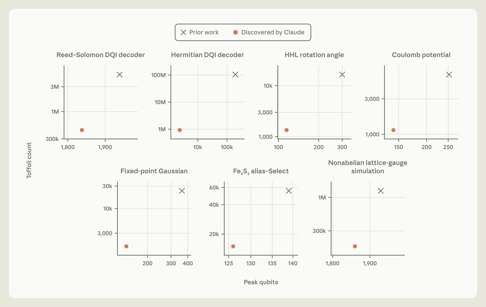
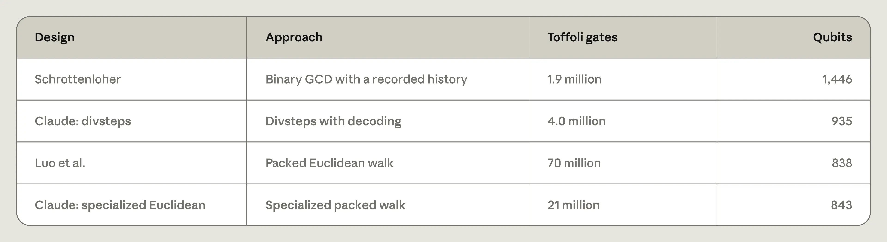
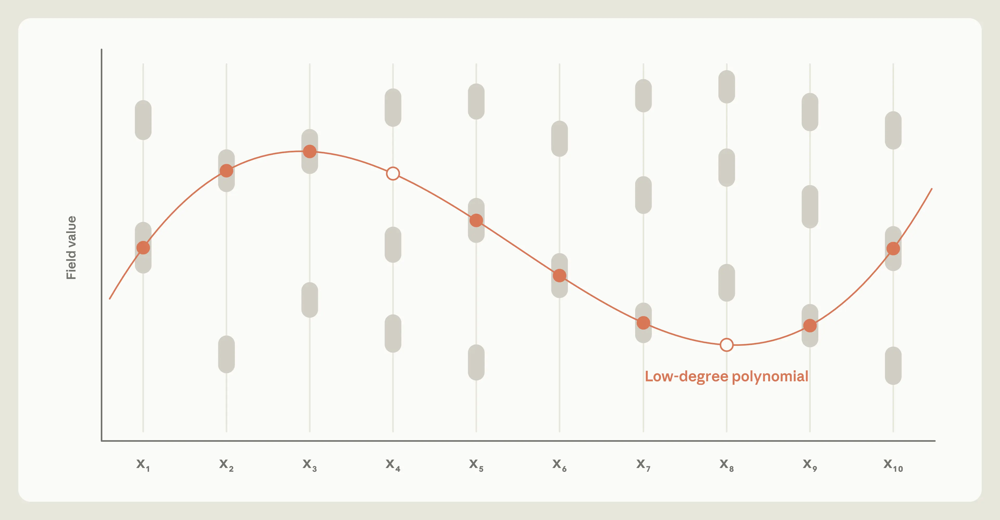
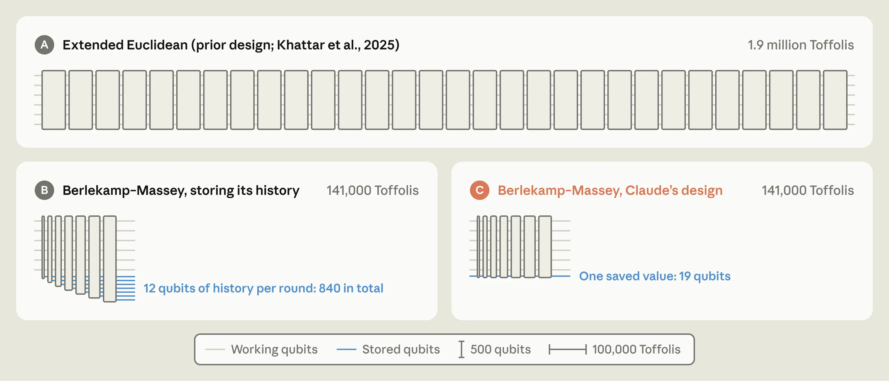

# 用 Claude 设计更高效的量子线路（中英对照）

> 原文标题：Designing more efficient quantum circuits with Claude
> 原文链接：https://www.anthropic.com/research/designing-efficient-quantum-circuits
> 原文作者：Andi Gu（Anthropic STEM Fellows Program，主导）；Alek Kemeny（Anthropic 量子物理学家，指导）；合作者 Susanne Yelin（哈佛大学）、Mikhail Lukin（哈佛大学及 QuEra Computing）
> 发布日期：2026-10-16
> **翻译模型：** GLM-5.3-Flash
> **评分：** ★★★★☆（4/5，强推荐）—— 八项计算原语全面超越已发表最优设计：DQI 译码器门数较 Google 此前构造降至约 1/12（一个数量级以上），并给出首个无需存储分支历史的可逆 divsteps 实现
> 排版：每段英文原文在前，中文翻译紧随其后。默认收录正文主体；原文图 1 的图片未随提取稿保存（仅存图注，已注明见原文）；正文脚注 1 为实质性引注，已自原页补出并译于文末。

---

Quantum computers will need carefully designed circuits to run useful algorithms on limited hardware. We gave Claude plain-language specifications for eight such circuits, drawn from chemistry, optimization, physics simulation, and number theory, along with an automated evaluator that checks and scores each design. Working largely on its own, Claude found designs that improve on the best published circuits, in some cases by an order of magnitude or more. Such improvements substantially reduce the quantum resources that useful applications require, so practical quantum computers could arrive sooner than previously anticipated.

量子计算机要在有限的硬件上运行有用的算法，离不开精心设计的线路。我们向 Claude 提供了八个此类线路的通俗语言规格说明——取材于化学、优化、物理模拟和数论——以及一个自动评估器，用于核查每个设计并为其打分。Claude 在基本独立工作的状态下，找到了优于已发表最优线路的设计，有些改进幅度达到一个数量级以上。这类改进能大幅削减实际应用所需的量子资源，因此实用的量子计算机可能比先前预期的更早到来。

This work was led by Andi Gu as part of Anthropic's STEM Fellows Program, with mentorship from Alek Kemeny, a quantum physicist at Anthropic, in collaboration with Susanne Yelin (Harvard University) and Mikhail Lukin (Harvard University and QuEra Computing). Read the full paper on arXiv.

本研究由 Andi Gu 在 Anthropic STEM Fellows Program 框架下主导完成，由 Anthropic 量子物理学家 Alek Kemeny 指导，并与 Susanne Yelin（哈佛大学）及 Mikhail Lukin（哈佛大学及 QuEra Computing）合作。完整论文见 [arXiv](https://arxiv.org/abs/2610.22367)。

Unlike classical computers, which store information in bits whose value is either 0 or 1, quantum computers store information in qubits, which can be built from single atoms, superconducting circuits, or particles of light. These qubits make use of quantum phenomena such as superposition—which allows a quantum system to exist in a combination of states at once—in order to process information in ways that could make certain problems in fields like chemistry, materials science, and number theory tractable, even when they are too hard for traditional computers.

经典计算机用取值非 0 即 1 的比特存储信息；量子计算机则用量子比特（qubit）存储信息，后者可由单个原子、超导电路或光粒子构成。量子比特利用叠加（superposition）等量子现象——即量子系统可以同时处于多个状态的组合——来处理信息，有望让化学、材料科学和数论等领域的某些问题变得可以求解，即便这些问题对传统计算机来说过于困难。

The quantum computers the field has built to date only have hundreds to thousands of qubits—too few to run many of the algorithms that promise practical advantages over classical computers. And these qubits are highly sensitive to environmental noise, such as heat, vibration, and even cosmic rays. A tiny disturbance can nudge a qubit's state, and these small errors pile up until the computer gives the wrong answer.

迄今为止，业界造出的量子计算机只有数百到数千个量子比特——远不足以运行许多有望超越经典计算机的实用算法。而且这些量子比特对环境噪声极为敏感，热、振动甚至宇宙射线都会造成干扰。一丝扰动就可能挪动量子比特的状态，这些微小误差不断累积，最终使计算机给出错误的答案。

Given that both qubits and computing time are scarce resources, researchers have been working to redesign quantum algorithms to use fewer qubits and complete computations in less time. An illustrative example is simulating FeMoco, the iron–sulfur cluster at the heart of nitrogenase, the enzyme that bacteria use to turn nitrogen from the air into ammonia. Understanding how it works could help scientists design better industrial catalysts—the substances manufacturers use to speed up chemical reactions.

鉴于量子比特和计算时间都是稀缺资源，研究人员一直在重新设计量子算法，使其用更少的量子比特、以更短的时间完成计算。一个典型例子是模拟 FeMoco——固氮酶（nitrogenase，细菌用来把空气中的氮转化为氨的酶）核心处的铁硫簇。理解它的工作原理，有助于科学家设计更好的工业催化剂——即制造商用来加速化学反应的物质。

In 2017, researchers estimated that a quantum computer would need about 50 trillion Toffoli gates to compute FeMoco's ground-state energy—the energy of its most stable configuration, which chemists need in order to predict how FeMoco reacts. (Similar to ordinary computers, quantum computers work by applying a long sequence of simple operations, called gates, to their qubits. The Toffoli gate is one of the most expensive gates to run, so counting Toffoli gates is a standard way to estimate how long a computation will take.)

2017 年，研究人员估计量子计算机需要约 50 万亿个 Toffoli 门才能算出 FeMoco 的基态能量（ground-state energy，即其最稳定构型的能量，化学家需要它来预测 FeMoco 如何反应）。（与普通计算机类似，量子计算机的工作方式是对量子比特施加一长串简单操作，即「门」（gate）。Toffoli 门是运行开销最高的门之一，因此清点 Toffoli 门数量是估算计算耗时的一种标准方法。）

Through a series of algorithmic advances, the estimated number of gates has come down to about 340 million—a roughly 150,000-fold reduction, corresponding to a few hours of computation on a future machine with about three million physical qubits.[^1]

经过一系列算法进展，这一估计门数已降至约 3.4 亿——约为原来的 1/150,000（缩减约 15 万倍），相当于在一台拥有约 300 万个物理量子比特的未来机器上计算几个小时。[^1]

These reductions largely came from redesigning the circuits that carry out the computation, rather than from making better hardware. Claude has proven particularly adept at optimizing classical algorithms, so we wanted to see whether it could do the same for quantum algorithms if it were given only a plain-language description of what each circuit must compute.

这些缩减主要来自对执行计算的线路的重新设计，而非更好的硬件。事实证明，Claude 特别擅长优化经典算法，所以我们想看看：如果只给它一段通俗语言描述、说明每个线路必须计算什么，它能否对量子算法也做到同样的事。

Claude is unusually well suited to this task, for several reasons. First, quantum algorithms are implemented as quantum circuits. These are composed of sequences of gates, like the Toffoli gates mentioned above. Importantly, these circuits can be described in code, so we can make use of Claude's coding capabilities to write, run, and revise circuit designs as ordinary programs. Second, the (fairly common) class of quantum algorithms we were most interested in optimizing can be tested efficiently for correctness, as each input gives one definite output that an ordinary computer can check. This means we could have an external evaluator program validate Claude's proposals. Finally, we can give Claude a clear, objective score to improve: the number of qubits used, multiplied by the number of gates, which serves as a proxy for how long the circuit would take to run.

Claude 之所以格外适合这项任务，有几个原因。首先，量子算法以量子线路（quantum circuit）实现，线路由一串串门组成，比如上文提到的 Toffoli 门。重要的是，线路可以用代码描述，因此我们可以利用 Claude 的编程能力，像写普通程序那样编写、运行和修改线路设计。其次，我们最想优化的一类（相当常见的）量子算法可以高效地检验正确性：每个输入都给出一个确定的输出，普通计算机即可核查。这意味着我们可以用一个外部评估程序来验证 Claude 提出的方案。最后，我们可以给 Claude 一个清晰、客观、可供改进的分数：所用量子比特数乘以门数，它大致反映了线路运行所需的时长。

We found that Claude Mythos 5 could successfully work in a closed loop, proposing a circuit design, receiving feedback and a score from the evaluator program, and using that feedback to improve its next attempt, with no human input between rounds (see Figure 1). Across eight computational primitives—the basic routines that larger quantum algorithms are built from—for chemistry, optimization, quantum simulation, number theory, and numerical computing, Claude discovered novel designs that used both fewer qubits and fewer gates than the best previously published algorithms (Figure 2).

我们发现，Claude Mythos 5 能够成功地闭环工作：提出线路设计，接收评估程序给出的反馈和分数，再利用反馈改进下一次尝试，各轮之间无需任何人类介入（见图 1）。在化学、优化、量子模拟、数论和数值计算领域的八个计算原语（computational primitive，构建更大量子算法的基本例程）上，Claude 发现了新颖的设计，其量子比特数和门数都少于以往已发表的最优算法（图 2）。

In each case, the improvement resulted from uncovering new structural and mathematical insights about the problem, rather than from fine-tuning existing designs. For example, when compiling a circuit for simulating an iron-sulfide molecule, Claude noticed that the molecule's symmetries and repeating structure meant that some results could be calculated once and reused, rather than recomputed for every part of the system. In other cases, it found that existing circuits included costly components that were needed to handle only extremely rare inputs, and it redesigned them without those components.

每一项改进都源于对问题背后新的结构与数学洞见，而非对现有设计的微调。例如，在为模拟一个硫化铁分子编译线路时，Claude 注意到该分子的对称性与重复结构意味着某些结果只需计算一次即可复用，而不必对系统的每个部分重新计算。在另一些情况下，它发现现有线路中包含一些开销高昂、却只为处理极罕见输入而需要的组件，于是重新设计，去掉了这些组件。

Below, we describe two of Claude's discoveries. The first is a new way to perform modular inversion, a bit of arithmetic that is the most expensive step in elliptic-curve calculations. The second makes the costliest step of a leading quantum optimization algorithm about 12x cheaper.

下文介绍 Claude 的两项发现。第一项是执行模逆（modular inversion）的新方法——模逆是椭圆曲线计算中最昂贵的一步算术。第二项把一个领先的量子优化算法中开销最高的一步变得便宜约 12 倍（即开销降至约 1/12）。

These results suggest that AI can now help redesign quantum circuits, a key step in making quantum algorithms faster and easier to run. Faster circuit design could bring the problems quantum computers are meant to solve—from designing new medicines and better batteries to finding cleaner ways of making fertilizer—within reach sooner.

这些结果表明，AI 如今已能协助重新设计量子线路，而这是让量子算法更快、更容易运行的关键一步。更快的线路设计，有望让量子计算机旨在解决的问题——从设计新药、更好的电池，到寻找更清洁的化肥制造方法——更早进入可及范围。

> **Figure 1:** Closed–loop quantum circuit optimization. Claude designs new implementations in Python, which are then sent to a programmatic evaluator. The evaluator checks whether the proposed implementation is correct, then scores it on the number of qubits and gates it requires. This information is then sent to Claude, which uses it to improve its implementation. The code and values shown are illustrative.
>
> **图 1：** 闭环量子线路优化。Claude 用 Python 设计新的实现，交给程序化评估器；评估器核查所提实现是否正确，再按其所需量子比特数与门数打分；这些信息回传给 Claude，供其改进实现。图中代码与数值仅为示意。（原图未收录于本文件，见原文链接）

> Figure 2: Claude designed smaller and faster circuits across eight different quantum-circuit design tasks. Gray marks show the best previously published designs; orange marks and lines show Claude's designs. Point addition, the eighth task, is compared in Table 1 below.

## 一种新的可逆算法（A new reversible algorithm）

Designing a quantum circuit involves two constraints that ordinary programming doesn't have. The first is that a quantum circuit can't make "if-then" decisions the way an ordinary program can. An ordinary program can check a value and then run only one of two pieces of code. But a quantum computer runs on a superposition of many inputs at once, some of which would run the first piece of code and some of which would run the second, so the circuit has to include the operations for both every time it runs.

设计量子线路要面对两个普通编程没有的约束。第一，量子线路无法像普通程序那样做「如果—那么」的分支决策。普通程序可以检查一个值，然后只运行两段代码中的一段；但量子计算机同时运行在许多输入的叠加之上，其中一些输入会执行第一段代码、另一些会执行第二段，因此线路每次运行都必须同时包含两者的操作。

The second is that a quantum circuit can't discard information. An ordinary program can overwrite or delete its scratch work once it's completed it; in a quantum computer, such intermediate information can't simply be erased, because every step of a quantum circuit must be reversible. Leaving that information in place isn't an option, either, because leftover scratch work would corrupt the final result. The only way to discard information is to "uncompute" it by running the computation that created it in reverse, at the cost of additional gates. Both of these constraints make quantum circuits far more expensive, in both runtime and qubits, than their classical counterparts.

第二，量子线路不能丢弃信息。普通程序在完成计算后可以覆写或删除自己的草稿数据；而在量子计算机中，这类中间信息不能简单地抹除，因为量子线路的每一步都必须可逆。把信息留在原地也不行，因为残留的草稿数据会污染最终结果。丢弃信息的唯一办法是「反计算」（uncompute）——把产生它的计算倒着再跑一遍，代价是额外的门。这两个约束都使量子线路在运行时间和量子比特两方面都远比对应的经典线路昂贵。

This constraint forces a difficult trade-off between space (i.e., qubits) and time. At one extreme, a quantum circuit can uncompute intermediate results as soon as they have been used. This frees up qubits, but if those same results are needed again later, the circuit must recompute them, which adds gates and increases the runtime. At the other extreme, the circuit can retain intermediate results until they're no longer needed. This avoids repeating work, but it can require many more qubits.

这一约束迫使设计者在空间（即量子比特）与时间之间做艰难的权衡。一个极端是，线路在使用完中间结果后立即将其反计算。这能腾出量子比特，但如果稍后再次需要同样的结果，线路就必须重新计算，从而增加门数、拉长运行时间。另一个极端是，线路保留中间结果，直到不再需要为止。这避免了重复劳动，却可能需要多得多的量子比特。

This is what makes quantum circuit design an especially interesting test of Claude's capabilities. The circuits can be written as ordinary code, but improving them requires the model to reason under a set of constraints quite unlike those of ordinary programming.

正是这一点让量子线路设计成为检验 Claude 能力的一个格外有趣的试金石。线路可以写成普通代码，但改进线路要求模型在一组与普通编程截然不同的约束下进行推理。

### 第一场硬仗：模逆（A hard first test: modular inversion）

The first task we gave Claude was point addition, a rule for combining two points on a mathematical curve (an elliptic curve) to produce a third. Point addition is the core step in quantum algorithms for the discrete logarithm problem on elliptic curves: given a starting point and the result of adding it to itself n times, find n. For large curves, ordinary computers can't solve this problem in any reasonable amount of time, but a sufficiently large quantum computer could.

我们给 Claude 的第一个任务是点加法（point addition）：一种把数学曲线（椭圆曲线）上的两个点合并、产生第三个点的规则。点加法是求解椭圆曲线上离散对数问题（discrete logarithm problem）的量子算法的核心步骤：给定一个起点和它与自身相加 n 次的结果，求 n。对大曲线而言，普通计算机无法在合理时间内解出这个问题，但足够大的量子计算机可以。

These algorithms perform point addition many times over, including in reverse, and these additions account for most of their qubit and runtime costs. Problems like this—easy to compute, extremely hard to reverse—were among the first where quantum computers were shown to offer an exponential speedup over ordinary ones. For these reasons, point addition has become one of the field's standard benchmarks. This made it a demanding test for Claude. So, we asked it to map out how few qubits, as well as how few gates, point addition really needs.

这类算法要反复执行点加法，包括反向执行，而这些加法占了它们量子比特与运行时间开销的大头。像这样「计算容易、逆向极难」的问题，正是最早被证明量子计算机相对普通计算机具有指数级加速的问题之一。出于这些原因，点加法已成为该领域的标准基准之一。这对 Claude 是一次严苛的考验。于是，我们请它摸清点加法真正需要的量子比特数与门数的下限。

We gave Claude a one-paragraph brief. It explained the mathematical rule for point addition, and how the evaluator would check each proposed circuit for correctness and score it on the number of qubits and gates it used. It also instructed Claude to explore several approaches in parallel. After working for 53 hours with minimal human input (limited to the initial brief and occasional prompts to think more broadly), Claude arrived at a completely new approach to the problem.

我们给了 Claude 一份只有一段话的任务简报。其中说明了点加法的数学规则，评估器将如何核查每个提议线路的正确性、并按其使用的量子比特数与门数打分，还指示 Claude 并行探索多种方法。在以最少的人类介入（仅限于初始简报和偶尔「思路再放开些」的提示）工作了 53 小时后，Claude 得出了一种全新的解法。

### divsteps 的内存开销（The memory demands of divsteps）

Most of the cost of point addition comes from a single step, called modular inversion. Elliptic-curve arithmetic uses numbers that wrap back around when they reach a fixed limit. Modular inversion is the wraparound version of division: given an integer a, find x such that ax ≡ 1 (mod p). Ordinary computers can perform this operation efficiently using a method called divsteps. Divsteps starts with a pair of numbers and repeatedly simplifies them over many rounds of iteration. In each round, divsteps examines the current pair of numbers and conditionally swaps, adds, subtracts, or halves them. Along the way, it preserves just enough information to produce the modular inverse at the end.

点加法的大部分开销来自一个单独的步骤，称为模逆（modular inversion）。椭圆曲线算术使用的数字会在到达固定上限后回绕（wrap around）。模逆就是回绕版本的除法：给定整数 a，求 x 使得 ax ≡ 1 (mod p)。普通计算机可以用一种叫 divsteps 的方法高效完成这一操作。divsteps 从一对数字出发，在多轮迭代中反复化简。每一轮，divsteps 检查当前这对数字，视情况交换、相加、相减或减半。在此过程中，它只保留刚好够用的信息，以便在最后产出模逆元。

Despite its success on ordinary computers, divsteps had not yet produced a practical quantum circuit, because of the reversibility constraint described above. The record of which operation was chosen at each iteration, called branch information, is the kind of scratch work that a traditional program can simply discard. In contrast, a quantum circuit has to retain that record so the computation can be run backward. A straightforward quantum version of divsteps is therefore forced to accumulate a long history of branch information, which requires an enormous number of additional qubits to store.

尽管 divsteps 在普通计算机上大获成功，由于上文所述的可逆性约束，它一直未能产出实用的量子线路。每一轮迭代选择了哪个操作的记录，称为分支信息（branch information），属于传统程序可以直接丢弃的草稿数据。相反，量子线路必须保留这份记录，以便计算能够倒着运行。因此，直接照搬的量子版 divsteps 被迫累积一长串分支信息历史，需要海量的额外量子比特来存储。

### Claude 如何绕开内存难题（How Claude got around the memory problem）

Claude recognized that this divsteps approach could be promising for quantum circuits, but only if there were a way around needing to store the full history. It had an idea: perhaps the record didn't need to be stored at all. Claude reasoned that it might be possible to directly infer (or "decode") the branch information by carefully inspecting the pair of numbers after each iteration. In essence, the numbers themselves would store the record. The circuit could then be run backward without needing any extra qubits.

Claude 意识到 divsteps 这条路线对量子线路可能大有可为，但前提是能找到办法，免掉存储完整历史的需要。它有了一个想法：也许这份记录根本无需存储。Claude 推断，或许可以通过仔细审视每次迭代后的那对数字，直接推断（即「解码」）出分支信息。本质上，数字本身就承载着记录。这样，线路就能倒着运行，而不需要任何额外量子比特。

To test this idea, Claude explored a number of simple candidate rules for performing the decoding. These early rules worked on small test cases, but they failed when Claude tested them at the full problem size, on 256-bit numbers.

为了检验这一想法，Claude 探索了若干简单的候选解码规则。这些早期规则在小测试用例上行得通，但当 Claude 在完整问题规模——256 位数字——上测试时，它们失败了。

Claude then tried a more theoretical approach. Rather than guessing and testing rules, it set out to understand mathematically why divsteps behaves the way it does. It proved a series of results about the iteration process, including several new algebraic identities. From these identities, Claude derived a precise formula for the decoding rule that would correctly recover the branch information from the numerical pairs. It then checked the formula, first by running it through large-scale numerical simulations, and then formalizing the claim in Lean. With the full validation complete, Claude produced the first reversible implementation of divsteps with no stored branch history.

随后 Claude 转向更理论化的路线。它不再猜测并测试规则，而是着手从数学上理解 divsteps 为何如此运作。它证明了关于该迭代过程的一系列结果，其中包括几条新的代数恒等式。从这些恒等式出发，Claude 推导出一个精确的解码规则公式，能从数字对中正确恢复分支信息。接着它验证了这个公式：先在大规模数值模拟中运行，再用 Lean 形式化证明了这一论断。全部验证完成后，Claude 给出了首个不存储分支历史的可逆 divsteps 实现。

### 一族设计方案（A family of designs）

Decoding saves qubits, but it costs time. So, as a further refinement, Claude looked for situations in which it would be cheaper to store the branch information than to decode it. By varying the threshold at which the circuit stores rather than decodes the branch information, Claude produced a new family of designs between the two extremes. Compared with the smallest previous design, one circuit in the family uses 12% more qubits but 17x fewer gates. More generally, the new designs expand the Pareto frontier, offering combinations of qubit count and runtime that weren't available before (Table 1).

解码节省量子比特，但耗费时间。于是，作为进一步改良，Claude 寻找那些「存储分支信息比解码更划算」的情形。通过改变线路在「存储」与「解码」分支信息之间的阈值，Claude 得出了介于两个极端之间的一族新设计。与此前最小的设计相比，该族中的一个线路多用 12% 的量子比特，门数却减少为原来的 1/17。更一般地说，这些新设计扩展了帕累托前沿（Pareto frontier），提供了以前不存在的量子比特数与运行时间的组合（表 1）。

> Table 1: Resources for elliptic-curve point addition. Bold rows are Claude's designs; the others are the best previously published designs. Sources: Schrottenloher (2026), Luo et al. (2026).

## 优化一个量子优化器（Optimizing a quantum optimizer）

Optimization problems are at the heart of a wide range of tasks, including scheduling, logistics, and materials design. An optimization problem presents a set of competing constraints and asks for the solution that satisfies as many of them as possible. Many quantum algorithms have been proposed for problems like these, but most promise only modest or uncertain gains over ordinary computers. Decoded quantum interferometry (DQI) is one of the strongest candidates for offering a superpolynomial quantum speedup—an advantage that rapidly widens as the problems get larger.

优化问题是许多任务的核心，包括调度、物流和材料设计。优化问题给出一组相互竞争的约束，要求找到尽可能多满足这些约束的解。针对这类问题已有许多量子算法被提出，但大多数相对普通计算机只有有限或不确定的收益。解码量子干涉（Decoded quantum interferometry, DQI）是最有希望带来超多项式量子加速（superpolynomial quantum speedup）——即随问题规模增大而迅速扩大的优势——的候选之一。

When a quantum computer finishes a computation, reading out its qubits produces just one answer, selected at random from the possibilities they were holding in superposition. DQI works by preparing a quantum state in which good solutions are more likely to be read out than bad ones. Doing this involves using an error-correcting decoder, which recovers a short list of "errors" from a compact summary. This is the most expensive step in the algorithm. So, if we could make a faster decoder, we could also perform DQI faster.

量子计算机完成计算后，读出其量子比特只会得到一个答案——从它们以叠加形式承载的诸多可能性中随机选出。DQI 的做法是制备这样一个量子态：好的解比坏的解更可能被读出。这要用到一个纠错译码器（error-correcting decoder），它从一份紧凑的摘要中恢复出一份简短的「错误」清单。这是算法中最昂贵的一步。因此，如果能造出更快的译码器，我们也能更快地执行 DQI。

### 更高效的量子译码器（A more efficient quantum decoder）

The researchers who introduced DQI demonstrated it on a problem called optimal polynomial intersection (OPI), a grid-based version of curve fitting (Figure 3). Imagine a grid in which each position x contains several acceptable values of y. The goal is to find a simple curve (a low-degree polynomial) that passes through an acceptable square for as many x positions as possible. DQI tackles this optimization problem using a specific type of decoder, called a Reed–Solomon decoder.

提出 DQI 的研究人员在一个叫最优多项式插值（optimal polynomial intersection, OPI）的问题上演示了它——这是曲线拟合的网格版本（图 3）。想象一张网格，每个位置 x 上有若干可接受的 y 值。目标是找一条简单曲线（低次多项式），使其在尽可能多的 x 位置上穿过某个可接受的方格。DQI 使用一种特定类型的译码器——里德–所罗门（Reed–Solomon）译码器——来攻克这个优化问题。

> Figure 3: Optimal Polynomial Intersection (OPI) as discrete curve fitting. Each column contains several acceptable values. The optimization problem is to find a polynomial that passes through as many of the acceptable values as possible.

Reed–Solomon decoding starts from the compact summary of errors mentioned above, which is known as a syndrome. The decoder's job is to infer, from this summary, where in the data the errors occurred and what they were. The previous state-of-the-art quantum circuit processed these syndromes using the extended Euclidean algorithm, a sequence of divisions and swaps in which the number and order of steps depend on the particular input it's given. Here, the constraints of quantum circuits reemerge: while an ordinary program can follow a different path for every input, a quantum circuit, working on many inputs at once, has to handle all of them with a single fixed sequence of gates. To manage this, the previous design had to stretch the computation over many more rounds of iteration than any single input would need, and had to run every operation in every round, even when doing so was unnecessary.

里德–所罗门译码从上文提到的那份紧凑的错误摘要开始，这份摘要称为校验子（syndrome）。译码器的任务是从这份摘要推断：错误发生在数据的哪些位置、是什么错误。此前最先进的量子线路用扩展欧几里得算法（extended Euclidean algorithm）处理这些校验子——那是一连串除法与交换，其步数和顺序取决于收到的具体输入。这里，量子线路的约束再次浮现：普通程序可以为每个输入走不同的路径，而量子线路同时处理许多输入，必须用单一固定的门序列应对所有输入。为做到这一点，此前的设计不得不把计算拉长到远超任何单个输入所需的迭代轮数，并且每一轮都要执行每一个操作，即便毫无必要。

Improving this decoder could substantially reduce DQI's runtime. Estimates by researchers at Google Quantum AI imply that solving one particular OPI problem would take about three months on Frontier, one of the world's most powerful supercomputers, compared with roughly an hour on a future quantum computer running DQI. Most of that hour would be spent on Reed–Solomon decoding.

改进这个译码器可以大幅缩短 DQI 的运行时间。Google Quantum AI 研究人员的估计表明：求解某个特定的 OPI 问题，在世界最强超算之一 Frontier 上大约需要三个月，而在运行 DQI 的未来量子计算机上只需约一小时。这一小时的大部分将花在里德–所罗门译码上。

So, we asked Claude to design a more efficient quantum circuit for the decoding step. Claude quickly concluded that the extended Euclidean algorithm was a poor fit for a quantum circuit. Instead, it organized its circuit around a different decoding method, known as Berlekamp–Massey decoding, which reads through syndromes (summaries of errors) one at a time and gradually works out the simplest rule that predicts each number in the list based on the ones that came before it. Once that rule is found, it reveals the errors. Unlike the extended Euclidean algorithm, Berlekamp–Massey performs the same kind of step in every round and always runs the same number of rounds, which suits a quantum circuit's single fixed sequence of gates, ultimately giving Claude a much more efficient foundation to build on.

于是，我们请 Claude 为译码步骤设计一个更高效的量子线路。Claude 很快断定：扩展欧几里得算法不适合量子线路。转而围绕另一种译码方法——伯利坎普–梅西（Berlekamp–Massey）译码——来组织它的线路。该方法逐个读取校验子（错误摘要），逐步推演出「根据列表中前面的数预测下一个数」的最简规则；一旦找到该规则，错误便随之显露。与扩展欧几里得算法不同，伯利坎普–梅西每一轮执行同类步骤，且轮数固定不变，恰好契合量子线路单一固定的门序列，最终为 Claude 提供了一个高效得多的构建基础。

### 一种更简化的存储方案（A simplified approach to storage）

Switching to Berlekamp–Massey removed the need for the circuit to take different paths for different inputs. But making it reversible introduced another challenge, this time as a result of the uncomputing constraint discussed above. In every round, the circuit calculates temporary values that it needs only briefly, but this information can't simply be deleted: to uncompute it later, the circuit has to be able to recover that information.

换用伯利坎普–梅西之后，线路不再需要为不同输入走不同路径。但要让它可逆，又带来新的挑战——这次源于上文讨论过的反计算约束。每一轮中，线路会算出一些只在片刻之间需要的临时值，但这些信息不能一删了之：为了日后反计算，线路必须能够恢复这些信息。

Storing this information would have been prohibitively expensive. So Claude took the same kind of approach as it had for divsteps: it found a way to reconstruct most of this information from the circuit's current state, so it didn't need to be stored. However, a few exceptional values couldn't be recovered in this way and had to be saved.

把这些信息全部存起来会昂贵得难以接受。于是 Claude 采用了与 divsteps 时同类型的思路：找到从线路当前状态重构大部分信息的方法，从而无需存储。不过，少数例外值无法这样恢复，必须保存下来。

Setting aside enough memory for the worst possible case, in which an exceptional value arises in 35 different rounds, would take 665 qubits. Instead, Claude wrote a high-speed simulator and ran 403 million sample decodings to measure how often these exceptions actually occurred. Almost every run needed to save one value at most. So Claude's circuit sets aside room for just one saved value, or 19 qubits. About one run in 10,000 needs more than that and fails, which is well within the error rate the task allows. These improvements replaced large, worst-case reserves with a small, fixed number of qubits and gates (Figure 4).

若按最坏情形预留足够内存——即在 35 个不同轮次中都出现例外值——需要 665 个量子比特。Claude 没有这么做，而是编写了一个高速模拟器，运行了 4.03 亿次抽样译码，测量这些例外实际发生的频率。几乎每一次运行至多只需保存一个值。因此 Claude 的线路只给一个保存值预留空间，即 19 个量子比特。约万分之一的运行会超出这个上限而失败，这远在任务允许的错误率之内。这些改进用少量、固定的量子比特和门取代了庞大的最坏情形储备（图 4）。

Together, these optimizations reduced the number of gates in the decoder by a factor of 12 relative to Google's previous construction. The improvement came from redesigning the computation at three levels: a different method (replacing the extended Euclidean algorithm with Berlekamp–Massey decoding), a different circuit architecture (reconstructing temporary values instead of storing them), and a different resource budget (measuring precisely how much memory and computation the circuit really needed). No single change would have been enough on its own, but together, they make the most expensive step of DQI just a little over an order of magnitude cheaper.

综合起来，这些优化使译码器的门数较 Google 此前的构造减少为原来的约 1/12。改进来自在三个层面重新设计计算：不同的方法（用伯利坎普–梅西译码取代扩展欧几里得算法）、不同的线路架构（重构临时值而非存储它们），以及不同的资源预算（精确测量线路真正需要多少内存和计算）。任何单一改动都不足以奏效，但合在一起，它们把 DQI 中最昂贵的一步变得便宜了一个数量级出头。

> Figure 4: Three designs for the locator step of the Reed–Solomon decoder. The designs are drawn to scale: each block's width is proportional to its gate count. (a) The previous design, based on the extended Euclidean algorithm (Khattar et al., 2025). (b) A design based on Berlekamp–Massey needs far fewer gates, but a naive reversible version has to store a 12-qubit record in every round, adding up to 840 qubits. (c) Claude's circuit reconstructs most of the history from the updated state, so it needs to have room only for a single saved value of 19 qubits.

## 我们的收获（What we learned）

Scientific progress often comes from making theoretical ideas practical. One of the main ways this happens is by making a process that was once thought to be impractical fast and cheap enough to carry out. Quantum circuit design is a prime example: the 150,000-fold drop in the FeMoco estimate described above took many research groups eight years, with each step typically representing months of work. By contrast, Claude's elliptic-curve design was the result of a single 53-hour run.

科学进步往往来自把理论想法变为实用。而实现这一点的主要途径之一，是把一度被认为不实用的过程变得足够快、足够便宜，从而可以执行。量子线路设计就是一个典型例子：上文所述 FeMoco 估计值 15 万倍的下降，耗费了许多研究小组八年时间，其中每一步通常都意味着数月的工作。相比之下，Claude 的椭圆曲线设计只是一次 53 小时运行的结果。

Our results suggest that AI can support the work of circuit design, producing implementations that bring useful quantum computations closer to the capabilities of real hardware. If AI can speed up that work, useful quantum computing could arrive sooner.

我们的结果表明，AI 能够支持线路设计工作，产出把实用量子计算推向更接近真实硬件能力的实现。如果 AI 能加速这项工作，实用的量子计算就可能更早到来。

Despite Claude's encouraging performance on these tasks, we also observed some limitations. In our early experiments, Claude was conservative by nature. It repeatedly second-guessed apparent improvements, and sometimes continued to double- and even triple-check results that were already well supported. This caution was sometimes valuable: for example, it prompted Claude to write Lean proofs to verify its divsteps design. But it also manifested in a tendency to prefer existing, well-known approaches to more novel ones.

尽管 Claude 在这些任务上表现出色、令人鼓舞，我们也观察到一些局限。在早期实验中，Claude 天性保守。它反复质疑看似成立的改进，有时对已经证据充分的结果还要二次、甚至三次复核。这种谨慎有时很有价值：例如，它促使 Claude 编写 Lean 证明来验证其 divsteps 设计。但它也表现为一种偏好既有知名方法、而非更新颖方法的倾向。

We took two steps to mitigate this. First, our setup required Claude to propose several qualitatively different approaches, and to develop them in parallel. Second, we also occasionally prompted Claude to broaden its search. These interventions succeeded in getting Claude to pursue more ambitious ideas. The elliptic-curve result, for example, didn't come from shaving gates off of a pre-existing design but from exploring a method of doing reversible modular inversion that hadn't been possible previously, and then deriving the mathematical results needed to make it practical. Once it had come up with the idea, Claude developed the approach, implemented it, and verified its correctness autonomously.

我们采取了两个步骤来缓解这一点。第一，我们的设置要求 Claude 提出若干种在性质上不同的方法，并并行地发展它们。第二，我们也不时提示 Claude 扩大搜索范围。这些干预成功地推动 Claude 去追求更大胆的想法。例如，椭圆曲线方面的成果并非来自在既有设计上削减几个门，而是来自探索一种此前无法实现的可逆模逆方法，然后再推导出使其实用所需的数学结果。一旦想出这个点子，Claude 便自主地发展该方法、加以实现，并验证了其正确性。

Circuit design is only one part of building a useful quantum computer. Because qubits are so fragile, the machine must also catch and fix its own errors as it runs, and that depends on many other components, ranging from error-correcting codes to fast decoders to control of the hardware itself. These components all affect one another, but to manage complexity, each is usually designed separately. Many of them share the characteristics that made circuit design a good fit for Claude: a design can be written as code, checked for correctness, and scored by its cost.

线路设计只是建造实用量子计算机的一部分。由于量子比特如此脆弱，机器还必须在运行中自行捕获并修正错误，而这依赖许多其他组件——从纠错码到快速译码器，再到对硬件本身的控制。这些组件相互影响，但为了控制复杂度，通常各自分开设计。其中许多都具备使线路设计非常适合 Claude 的那些特征：设计可以写成代码、核查正确性、并按成本打分。

This raises an intriguing possibility. Rather than designing each component on its own, AI could optimize all of them jointly, from the algorithm down to the hardware, to build an entire error-corrected quantum computer tailored to a specific problem. Such designs could also tell hardware builders which capabilities matter most for a given application. That could put problems such as designing catalysts and understanding new materials within reach of the first fault-tolerant machines.

这引出一个耐人寻味的可能性：AI 或许不必逐个设计组件，而是从算法到硬件联合优化所有组件，打造一台为特定问题量身定制的完整纠错量子计算机。这类设计还能告诉硬件建造者，对给定应用而言哪些能力最为关键。这可能让催化剂设计、理解新材料之类的问题进入第一代容错机器的能力范围。

## 致谢（Acknowledgments）

We thank Arjun Kar and Vinay Ramasesh for helpful discussions in the early stages of the project.

我们感谢 Arjun Kar 和 Vinay Ramasesh 在项目早期阶段的有益讨论。

---

[^1]: Both estimates are for the same 54-orbital model of FeMoco, as tabulated by Low et al., "Fast quantum simulation of electronic structure by spectrum amplification" (2025), Table 1; the 2017 estimate is from Reiher et al. Intermediate estimates for the same model came from Berry et al. (2019), von Burg et al. (2021), Lee et al. (2021), and Rocca et al. (2024).

    两个估计值均针对同一 FeMoco 54 轨道模型（见 Low et al., "Fast quantum simulation of electronic structure by spectrum amplification"，2025，表 1）；2017 年的估计来自 Reiher et al.。针对同一模型的中间估计来自 Berry et al.（2019）、von Burg et al.（2021）、Lee et al.（2021）和 Rocca et al.（2024）。
