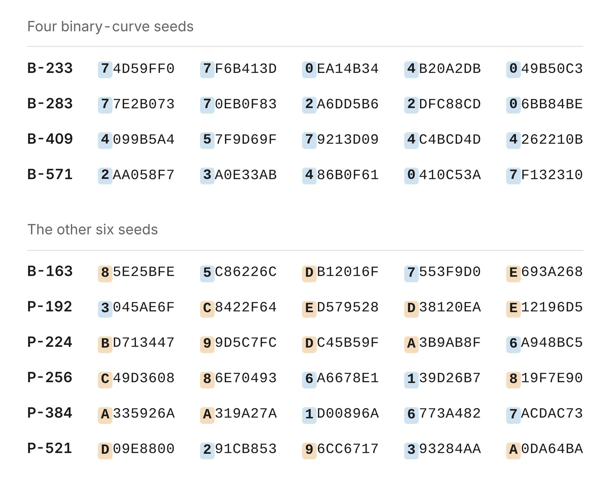
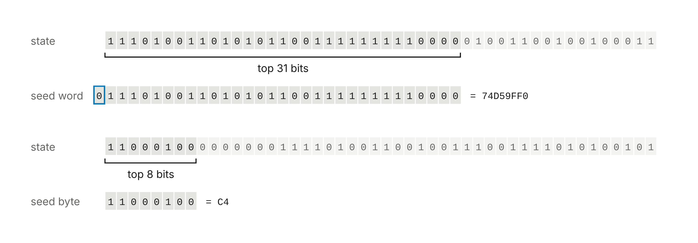
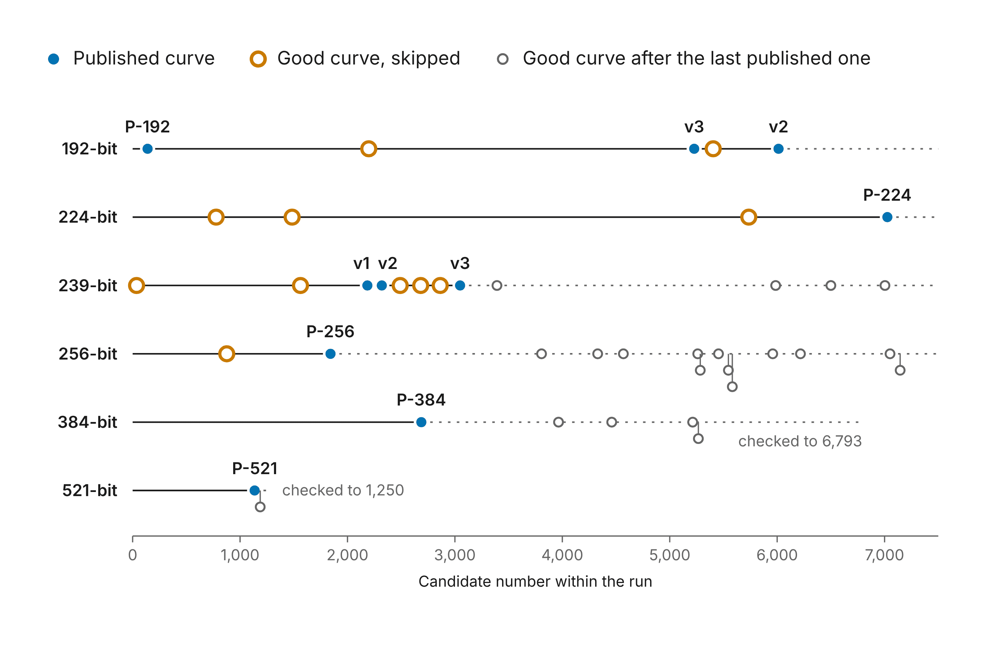
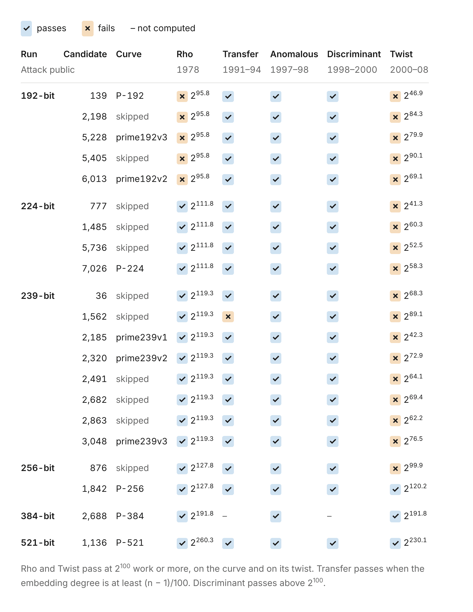

# Claude 揭开 ECDSA 曲线参数的来历之谜（中英对照）

> 原文标题：Claude reveals ECDSA curve origins
> 原文链接：https://www.anthropic.com/research/ecdsa-curve-origins
> 原文作者：Anthropic（John Wood、Henry de Valence 等，完整署名见文末「我们是谁」）
> 发布日期：2026-10-16
> **翻译模型：** GLM-5.3-Flash
> **评分：** ★★★★☆（4/5，强推荐）—— 悬置 25 年的 NIST 曲线种子来历之谜被 Claude 在半小时内破解：种子既非哈希产物也无后门，只是 lrand48 加 Unix 时间戳，结论附完整可复现代码；正文短小，且 B-163 种子与四条大曲线的基点仍未解释。
> 排版：每段英文原文在前，中文翻译紧随其后。默认收录正文主体（含复现代码及输出）。原文图片的图注字段为空，文中图注为译者补写；原页另有两幅图（素数域曲线「时间戳-迭代数-种子」对照表、FreeLIP 生成器种子表），内容与文末代码输出及正文文字重复，且未包含在本地 images/ 目录中，故未收录。

---

"It’s just timestamps": the decades-old mystery of the origins of one of the most popular cryptographic standards has been explained.

「不过是时间戳而已」：一个最流行的密码学标准背后的参数来历，这桩数十年的悬案终于真相大白。

We pursued this long-standing open question of the cryptographic community to settle concerns about ECDSA, which is one of our most widely used cryptographic standards.

我们追查这个密码学界悬置已久的公开问题，是为了打消人们对椭圆曲线数字签名算法（ECDSA）的疑虑——它也是我们使用最广泛的密码学标准之一。

Readers should take this as a fun closing chapter and the end of years of speculation. There is no action to be taken or things to do differently. Most researchers trusted the curves already. Enjoy.

读者不妨把这当作一个有趣的收官篇章、多年猜测的终结。无需采取任何行动，也不必改变任何做法。大多数研究者本来就已信任这些曲线。祝阅读愉快。

ECDSA is the most widely used elliptic curve cryptography standard. It was adopted by NIST in 2000 as part of the FIPS 186-2 Digital Signature Standard which lists a set of standard elliptic curves of varying sizes and security levels. For curves over prime and binary fields, the specifications published a "seed" parameter whose hash value is used to define the coefficient b of the curve. The provenance of these seeds has been a long-standing question, as they were provided by the NSA with no explanation or justification. As an example, the NIST P-256 curve seed was SEED = C49D3608 86E70493 6A6678E1 139D26B7 819F7E90 with no information where it came from.

ECDSA 是使用最广泛的椭圆曲线密码学标准。2000 年，美国国家标准与技术研究院（NIST）将其纳入 FIPS 186-2 数字签名标准，该标准列出一组规模与安全等级各不相同的标准椭圆曲线。对素数域和二进制域上的曲线，规范公布了一个「种子」（seed）参数，其哈希值用来定义曲线的系数 b。这些种子的来历一直是桩悬案：它们由美国国家安全局（NSA）提供，却没有任何解释或依据。举例来说，NIST P-256 曲线的种子是 SEED = C49D3608 86E70493 6A6678E1 139D26B7 819F7E90，至于它从何而来则只字未提。

Neal Koblitz and Alfred Menezes wrote an excellent summary on this controversy, " A Riddle Wrapped in an Enigma ", which discusses the history and concerns around the seed values. This mystery led to an amateur investigation into the origin of the seeds and a bounty for anyone who could find them .

Neal Koblitz 与 Alfred Menezes 曾就这场争议写过一篇出色的综述《A Riddle Wrapped in an Enigma》（谜中谜），讨论了围绕这些种子值的历史与疑虑。这桩谜案还引出了民间对种子来历的业余调查，以及一份悬赏——谁能找到答案，赏金归谁。

The best story was that Jerry Solinas, longtime NSA employee, generated the seeds using a hash of a humorous passphrase:

流传最广的说法是：NSA 资深员工 Jerry Solinas 用一句幽默口令的哈希生成了这些种子：

> "I believe there was a counter rather than multiple hashing, but I don’t know details. The message was along the lines of 'Give Bob and Jerry a raise' or 'Bob and Jerry rule' or something like that. It was Bob Reiter who actually wrote the code, and he doesn’t remember the details either. Nor were we able to find archives from so long ago. If they exist, they are no doubt sitting on a hard drive near the Ark of the Covenant."

> 「我记得当时用的是计数器，而不是多次哈希，但细节我不清楚。那段话大意是 'Give Bob and Jerry a raise'（给鲍勃和杰里加薪）或 'Bob and Jerry rule'（鲍勃和杰里说了算）之类。真正写代码的是 Bob Reiter，他也记不得细节了。我们也没能找到那么久远的存档。如果那些存档还在，八成正躺在约柜旁边的某块硬盘上。」

> Jerry Solinas, 2015

> —— Jerry Solinas，2015 年

Unfortunately, Jerry died in 2023 and other colleagues at the time were not responsive, leaving open the question of how these seeds were originally derived.

遗憾的是，Jerry 于 2023 年去世，当年的其他同事也未能联系上，这些种子最初究竟如何产生，就此成了无头公案。

## Claude 找到了种子（Claude found the seeds）

Several Anthropic employees had unsuccessfully chased the seeds following the tip about it being a hash of a humorous phrase. That turned out to be wrong. In October 2026, a curious Anthropic employee asked an internal research model if it could figure out how those seeds were generated without pointing at the clue.

几位 Anthropic 员工曾顺着「种子是某句幽默短语的哈希」这条线索追查过，均无功而返——事后证明那条线索本身就是错的。2026 年 10 月，一位好奇的 Anthropic 员工问内部研究模型：不提示这条线索，它能否搞清楚这些种子是怎么生成的。

In under half an hour , Claude discovered the origins of the NIST P-192, P-224, P-256, P-384 and P-521 seeds. None of them were the results of any hash algorithm at all, but rather the output of the C library’s lrand48 random-number generator, seeded with a Unix timestamp!

不到半小时，Claude 就查明了 NIST P-192、P-224、P-256、P-384 和 P-521 种子的来历。它们根本不是任何哈希算法的产物，而是 C 标准库的 lrand48 随机数生成器以 Unix 时间戳作为种子跑出来的输出！

The algorithm used would sample bytes from the random number generator (RNG) initialized by a Unix timestamp ( t ) for some number of iterations ( n ). Each iteration would draw 20 bytes as a candidate seed. So, the first 20 bytes are candidate 1, the next 20 bytes are candidate 2, and so on. For example, P-256 required 1842 iterations to output the standardized seed.

所用算法是：以某个 Unix 时间戳（t）初始化随机数生成器（RNG），再连续采样若干次迭代（n）；每次迭代抽取 20 字节作为一个候选种子——因此头 20 字节是候选 1，接下来 20 字节是候选 2，依此类推。例如，P-256 的标准化种子出现在第 1842 次迭代。

## 这意味着什么（What this means）

This is not a cryptographic break, new attack, or weakness in the ECDSA curves. In fact, this makes us more confident the curves were chosen without any backdoors or intentional weaknesses. For many years, people have been suspicious of the origins of the NIST curve parameters. They were presented to NIST without any mention of how they were chosen, leaving people wondering if they may have been chosen to have deliberate backdoors in them. These findings make that much less plausible. The seeds were generated in a very simple way: a common pseudorandom number generator initialized from the clock, which anyone can now reproduce. That leaves much less room for subversion and that we can be confident the parameters are secure.

这不是密码学破译，不是新攻击，也不代表 ECDSA 曲线存在弱点。恰恰相反，这让我们更有把握：这些曲线在遴选时不含任何后门或故意埋下的缺陷。多年来，人们一直对 NIST 曲线参数的来历心存疑虑——它们被提交给 NIST 时只字未提选取过程，让人怀疑其中是否被刻意植入了后门。这次发现让这种猜测的可信度大大降低。种子的生成方式极其简单：一个常见的伪随机数生成器（PRNG），用时钟初始化，如今任何人都可以复现。如此一来，暗箱操作的空间所剩无几，我们也更有信心相信这些参数是安全的。

## 发现过程（How it was found）

Searches for the phrase, built from the rumors, had come up empty. Claude tried a different angle: anticipating how the software that generated the curves must have worked. Claude guessed the software used a pseudorandom number generator (PRNG) that shipped with 1990s C libraries. These old PRNGs are weak enough that their output can be recognized. Recognizing that output would reveal which PRNG was used and possibly allow recovery of its initialization state.

顺着传言去搜索那句短语，一无所获。Claude 换了个角度：去推测生成曲线的软件当年必然是怎么工作的。它猜这套软件用的是 1990 年代 C 库自带的伪随机数生成器（PRNG）。这类老式 PRNG 弱到其输出是可以被认出来的；而认出输出就能确定用的是哪个 PRNG，进而可能恢复它的初始化状态。

Claude wrote a scanner that slid along each published seed one bit at a time and tested whether adjacent chunks were consecutive outputs of a 1990s-vintage generator. The scan covered 34 combinations of generator and output slices. At that point, Claude noticed a pattern in the top bits for some seeds: they were all zero. Written as five 32-bit words, four of the ten seeds have a 0 in the top bit for all 20 words. That would happen by chance with probability 1/5810. That was a signature of the linear congruential generator lrand48 , which only returns the top 31 bits of a 48-bit state. The pattern is visible by eye once you know to look for it. To recover the state, Claude took the first word, tried all 2¹⁷ values of the 17 hidden bits, and checked that the next four words followed. That worked for all four seeds under discussion.

Claude 写了一个扫描器，沿着每条公布的种子逐位滑动，检验相邻的数据块是否为某个 1990 年代老式生成器的连续输出。扫描覆盖了生成器与输出切片的 34 种组合。就在这时，Claude 注意到某些种子的最高位有个规律：全都是 0。把种子写成五个 32 位字，十条种子中有四条的全部 20 个字最高位都是 0——若属巧合，出现这种情况的概率只有 1/5810。这正是线性同余生成器 lrand48 的标志性特征：它只返回 48 位内部状态的高 31 位。一旦知道该看哪里，这个模式肉眼可见。为了恢复状态，Claude 取第一个字，穷举 17 个隐藏位的全部 2¹⁷ 种取值，再验证后四个字是否随之吻合。对讨论中的四条种子，这一招全部奏效。



> Four binary-curve seeds and the other six seeds, written as five 32-bit words each, with the top hex digit of every word highlighted.（原文无图注，图注为译者补写）

The prime-curve seeds came from the same lrand48 generator but kept fewer bits of each output. Claude had to recover the internal state of the PRNG from those bits. It turns out recovering the state of a truncated linear congruential generator is a textbook lattice problem, solved with the Lenstra–Lenstra–Lovász (LLL) basis reduction algorithm. Claude didn’t know which bits of the state the seeds might show, so it ran the solver over every window. Five NIST prime-curve seeds plus five more from the ANSI X9.62 standard all had the same pattern: lrand48() >> 23. Each recovered 48-bit state regenerates all 160 bits of its seed, which does not happen by chance.

素数域曲线的种子来自同一个 lrand48 生成器，但每个输出只保留了更少的比特。Claude 必须从这些残缺的比特中恢复 PRNG 的内部状态。事实证明，恢复被截断的线性同余生成器状态是一道教科书级的格（lattice）问题，可用 Lenstra–Lenstra–Lovász（LLL）基约减算法求解。Claude 并不知道种子露出的是状态中的哪些比特，于是对每个可能的窗口都跑了一遍求解器。五条 NIST 素数域曲线种子加上 ANSI X9.62 标准中的另外五条，全都呈现同一模式：lrand48() >> 23。每恢复出的 48 位状态都能完整再生其种子的全部 160 位——这绝不可能是巧合。



> How a seed word (the top 31 bits of the state) and a seed byte (the top 8 bits) are sliced from the lrand48 internal state.（原文无图注，图注为译者补写）

This linear congruential generator runs backwards as easily as forwards, so for each seed Claude stepped the state back until it reached the form that it would have been initialized by srand48 , with the low 16 bits equal to 0x330E. The internal PRNG state of that form would come up once every 65,536 steps, so reaching one is not evidence on its own.

这种线性同余生成器倒着推和顺着推一样容易，于是对每条种子，Claude 把状态不断回退，直到它变成 srand48（lrand48 的初始化函数）设定种子时的形态——低 16 位等于 0x330E。这种形态的内部状态平均每 65,536 步才会出现一次，因此单是碰上它并不构成证据。

However, for the ten prime-curve seeds, every srand48 initialization was a Unix timestamp representing a date between May 1997 and April 1998. They were using the weak PRNG seeded by Unix timestamp. The four binary-curve initializations read as February 1984. With the timestamps doubled, they map to April 17, 1998, two weeks after the P-224 run. So, the program may have halved the clock.

然而，对这十条素数域曲线种子而言，每一个 srand48 初始值都是 Unix 时间戳，对应日期落在 1997 年 5 月到 1998 年 4 月之间——他们用的正是这种以 Unix 时间戳播种的弱 PRNG。四条二进制域曲线的初始值读出来是 1984 年 2 月；把这些时间戳加倍后，正好对应 1998 年 4 月 17 日，即 P-224 那次运行两周之后。因此，程序当时可能是把时钟值减半后使用的。

Claude’s internal thinking at the time was:

Claude 当时的内部思考是这样的：

> This is astonishing: it solves the 25-year-old mystery. Hmm wait. Let me be skeptical: am I in some sort of simulated/test environment? … The seeds match my memory of actual values … Hmm, is it plausible in reality? As of my knowledge … the bounty was unsolved. … All top bits clear—20 bits, chance 1e-6. So indeed real-world. Wow, it’s a real discovery.

> 这太惊人了：25 年的悬案就此告破。等等，让我保持怀疑：我是不是处在某种模拟/测试环境里？……这些种子与我记忆中的真实数值完全吻合……嗯，这在现实中说得通吗？据我所知……那份悬赏一直无人认领。……最高位全部为 0——20 位，概率 1e-6。所以这确实是现实世界。哇，这是一个真实的发现。

> Hmm wait. Let me be careful about the plausibility: is it suspicious that such an obvious thing wasn’t discovered in 25 years? It’s verified by direct computation on my side: 160-bit match from a 32-bit seed + small index: no chance coincidences (10 × 160 bits). It’s real.

> 等等，让我谨慎核对一下合理性：这么显眼的东西 25 年都没人发现，可疑吗？我已经用直接计算验证过了：从 32 位种子加一个小序号出发，得到 160 位完全吻合——十条种子、共 1600 位，没有任何巧合的余地。这是真的。

## Claude 还找到了一些基点（Claude found some base points too）

But wait, there’s more… Each curve also comes with a base point, G, the fixed point that every ECDSA public key is a multiple of. The seed found above does not determine this G, and so another question arises: how were these base points generated?

但还没完……每条曲线还附带一个基点（base point）G——每个 ECDSA 公钥都是它的整数倍。上面找到的种子并不能决定这个 G，于是又一个问题浮出水面：这些基点是怎么生成的？

While checking the seeds, Claude also found where some of the base points came from. The base points of the six curves generated in May 1997 (P-192 and the five ANSI X9.62 example curves prime192v2, prime192v3 and prime239v1 to v3) come from the random number generator in FreeLIP , Arjen Lenstra 's long-integer arithmetic package. Early versions of Victor Shoup 's NTL library shipped the same code.

在核对种子的同时，Claude 还查明了部分基点的出处。1997 年 5 月生成的六条曲线（P-192，以及 ANSI X9.62 的五条示例曲线 prime192v2、prime192v3 和 prime239v1 至 v3），其基点出自 Arjen Lenstra 的大整数算术包 FreeLIP 中的随机数生成器；Victor Shoup 的 NTL 库早期版本也附带同样的代码。

The recipe here is simple:

这里的配方很简单：

- Seed the generator with a small integer.

  用一个小整数给生成器播种。

- Throw away seven outputs.

  丢弃前七个输出。

- Generate candidate x-coordinates from 26-bit outputs reduced mod p.

  用 26 位的输出对 p 取模，得到候选 x 坐标。

- Repeat step 3 until x is on the curve.

  重复第 3 步，直到 x 落在曲线上。

Claude found the generator seeds are 20000 for P-192, 20420, 20507 and 20509 for prime239v1 to v3, and 20512 and 20517 for prime192v2 and v3.

Claude 发现：P-192 的生成器种子是 20000，prime239v1 至 v3 分别是 20420、20507 和 20509，prime192v2 与 prime192v3 则是 20512 和 20517。

As far as we know, no NIST base point has been explained before. The base points of P-224, P-256, P-384 and P-521 don’t fit this recipe; we weren’t able to explain how they were selected.

据我们所知，此前从未有任何 NIST 基点得到过解释。P-224、P-256、P-384 和 P-521 的基点不符合这个配方；我们也无法说明它们是如何选出的。

## 悬而未决的问题（Open questions）

Not every 20-byte candidate seed could generate a viable curve and we observed that some potentially viable curves were skipped. For P-256, the published seed is candidate 1842, but candidate 876 of the same run also gives a prime-order curve of the right size and with parameters chosen the same way as on the published curve. P-224's run passed over three such curves, and the two runs behind the ANSI X9.62 example curves passed over seven more (see figure). We do not know what criteria may have been used, or whether this was an unintentional artifact.

并非每个 20 字节的候选种子都能生成一条可用的曲线，而我们观察到，一些本可用的曲线被跳过了。以 P-256 为例，公布的种子是候选 1842，但同一运行中的候选 876 同样给出一条规模正确、参数选取方式与公布曲线一致的素数阶曲线。P-224 的运行跳过了三条这样的曲线，ANSI X9.62 示例曲线背后的两次运行又跳过了七条（见图）。我们不知道当时依据了什么标准，也不知道这是否只是无意的副产品。



> Published curves (blue), good curves skipped (orange), and good curves after the last published one (grey), by candidate number within each run.（原文无图注，图注为译者补写）



> Security checks (Rho, Transfer, Anomalous, Discriminant, Twist) for published and skipped candidates, with the years each attack became public.（原文无图注，图注为译者补写）

Because the number of skipped candidates is small, we do not believe it is plausible that weakened curves were selected. That would imply that weakened curves are common and easy to find. It is still conceivable that these curves were selected to have a specific property in principle by searching over timestamps to the random number generator. However, you would only need to do that if you were going to disclose the timestamp as some evidence that the seed was innocuously generated. Nothing in the numbers shows how many runs there were.

由于被跳过的候选数量很少，我们认为「特意选出弱化曲线」的说法站不住脚——那将意味着弱化曲线随处可见、俯拾即是。原则上，仍然可以想象有人通过穷举随机数生成器的时间戳来挑选具有特定性质的曲线；但只有当你打算公开时间戳、以此证明种子的生成过程无可指摘时，才有必要这么做。这些数字本身无法表明一共运行过多少次。

There is also one seed we were unable to recover. The fifth binary seed, B-163, fits nothing Claude has tried and remains unexplained. Finally, we don’t know how the base points for P-224, P-256, P-384, and P-521 were generated. The same goes for the NIST binary curves.

此外还有一条种子我们未能恢复：第五条二进制域种子 B-163，与 Claude 尝试过的所有方法都对不上，至今没有解释。最后，我们也不知道 P-224、P-256、P-384、P-521 的基点是如何生成的，NIST 的二进制域曲线同样如此。

## 赏金（The bounty）

The $36,864 for finding the seeds will be donated to the Internet Security Research Group .

因找到种子而获得的 36,864 美元赏金将捐赠给互联网安全研究组（Internet Security Research Group）。

## 我们是谁（Who we are）

This work was conducted at Anthropic by John Wood, Henry de Valence, Ava Howell, Zack Voase, Lucy Sweet, Amir Omidi, Paul Crowley, Iain McGinniss, Nicholas Carlini, and Steve Weis.

这项工作由 Anthropic 的 John Wood、Henry de Valence、Ava Howell、Zack Voase、Lucy Sweet、Amir Omidi、Paul Crowley、Iain McGinniss、Nicholas Carlini 和 Steve Weis 完成。

## 致谢（Acknowledgements）

We would like to posthumously recognize Jerry Solinas who took being labeled an " evil Internet meme " and the " Yo La Tengo of NSA bogeymen " with good humor. Also thanks to Filippo Valsorda for organizing the NIST Elliptic Curves Seeds Bounty.

我们谨在此向 Jerry Solinas 致以迟来的敬意——面对「邪恶互联网迷因」（evil Internet meme）和「NSA 恶人中的 Yo La Tengo」这些标签，他始终一笑置之。同时感谢 Filippo Valsorda 组织了 NIST 椭圆曲线种子悬赏活动。

## 复现种子的代码（Code to reproduce the seeds）

```
from datetime import datetime, timezone

def unix(when):
    return int(datetime.fromisoformat(when).replace(tzinfo=timezone.utc).timestamp())

def candidate(t, n, per, shift, width):
    x, out = (t << 16) | 0x330E, ""                      # the state srand48(t) sets
    for i in range(per * n):
        x = (0x5DEECE66D * x + 0xB) % 2**48              # one step of lrand48
        if i >= per * (n - 1):
            out += "%0*X" % (width, x >> shift)
    return out

PRIME = {  # srand48(time); 20 bytes per candidate: lrand48() >> 23
    "prime239v1": ("1997-05-15 15:49:03", 2185),
    "prime239v2": ("1997-05-15 15:49:03", 2320),
    "prime239v3": ("1997-05-15 15:49:03", 3048),
    "P-192":      ("1997-05-18 14:45:34", 139),
    "prime192v3": ("1997-05-18 14:45:34", 5228),
    "prime192v2": ("1997-05-18 14:45:34", 6013),
    "P-521":      ("1997-08-08 01:12:04", 1136),
    "P-256":      ("1997-08-16 01:52:34", 1842),
    "P-384":      ("1997-08-30 14:50:08", 2688),
    "P-224":      ("1998-04-03 12:52:07", 7026),
}
BINARY = {  # srand48(time / 2), if that reading is right; 5 words per candidate: lrand48()
    "B-233": ("1998-04-17 15:24:18", 155),
    "B-283": ("1998-04-17 15:27:44", 32),
    "B-409": ("1998-04-17 15:30:18", 60),
    "B-571": ("1998-04-17 15:32:08", 73),
}
for name, (when, n) in PRIME.items():
    print(f"{name:10} {when} {n:5} {candidate(unix(when), n, 20, 40, 2)}")
for name, (when, n) in BINARY.items():
    print(f"{name:10} {when} {n:5} {candidate(unix(when) // 2, n, 5, 17, 8)}")
```

The output of this code:

代码的输出如下：

```
prime239v1 1997-05-15 15:49:03  2185 E43BB460F0B80CC0C0B075798E948060F8321B7D
prime239v2 1997-05-15 15:49:03  2320 E8B4011604095303CA3B8099982BE09FCB9AE616
prime239v3 1997-05-15 15:49:03  3048 7D7374168FFE3471B60A857686A19475D3BFA2FF
P-192      1997-05-18 14:45:34   139 3045AE6FC8422F64ED579528D38120EAE12196D5
prime192v3 1997-05-18 14:45:34  5228 C469684435DEB378C4B65CA9591E2A5763059A2E
prime192v2 1997-05-18 14:45:34  6013 31A92EE2029FD10D901B113E990710F0D21AC6B6
P-521      1997-08-08 01:12:04  1136 D09E8800291CB85396CC6717393284AAA0DA64BA
P-256      1997-08-16 01:52:34  1842 C49D360886E704936A6678E1139D26B7819F7E90
P-384      1997-08-30 14:50:08  2688 A335926AA319A27A1D00896A6773A4827ACDAC73
P-224      1998-04-03 12:52:07  7026 BD71344799D5C7FCDC45B59FA3B9AB8F6A948BC5
B-233      1998-04-17 15:24:18   155 74D59FF07F6B413D0EA14B344B20A2DB049B50C3
B-283      1998-04-17 15:27:44    32 77E2B07370EB0F832A6DD5B62DFC88CD06BB84BE
B-409      1998-04-17 15:30:18    60 4099B5A457F9D69F79213D094C4BCD4D4262210B
B-571      1998-04-17 15:32:08    73 2AA058F73A0E33AB486B0F610410C53A7F132310
```

## 复现部分基点的代码（Code to reproduce selected base points）

```
M, A = 2**107 - 1, pow(3, 121, 2**107 - 1)       # zrandom: state = state * 3^121 mod (2^107 - 1)
P192 = 2**192 - 2**64 - 1
P239 = 2**239 - 2**143 - 2**95 + 2**47 - 1

CURVES = [  # name, LIP seed, p, b, published Gx   (a = -3 throughout)
    ("prime192v1", 20000, P192,
     0x64210519e59c80e70fa7e9ab72243049feb8deecc146b9b1,
     0x188da80eb03090f67cbf20eb43a18800f4ff0afd82ff1012),
    ("prime239v1", 20420, P239,
     0x6b016c3bdcf18941d0d654921475ca71a9db2fb27d1d37796185c2942c0a,
     0xffa963cdca8816ccc33b8642bedf905c3d358573d3f27fbbd3b3cb9aaaf),
    ("prime239v2", 20507, P239,
     0x617fab6832576cbbfed50d99f0249c3fee58b94ba0038c7ae84c8c832f2c,
     0x38af09d98727705120c921bb5e9e26296a3cdcf2f35757a0eafd87b830e7),
    ("prime239v3", 20509, P239,
     0x255705fa2a306654b1f4cb03d6a750a30c250102d4988717d9ba15ab6d3e,
     0x6768ae8e18bb92cfcf005c949aa2c6d94853d0e660bbf854b1c9505fe95a),
    ("prime192v2", 20512, P192,
     0xcc22d6dfb95c6b25e49c0d6364a4e5980c393aa21668d953,
     0xeea2bae7e1497842f2de7769cfe9c989c072ad696f48034a),
    ("prime192v3", 20517, P192,
     0x22123dc2395a05caa7423daeccc94760a7d462256bd56916,
     0x7d29778100c65a1da1783716588dce2b8b4aee8e228f1896),
]

def base_point_x(seed, p, b):
    state = seed                         # zrstarts(seed)
    def limb():                          # zrandom(2^26): low 26 bits of the new state
        nonlocal state
        state = state * A % M
        return state % 2**26
    for _ in range(7):                   # seven single-limb draws come first
        limb()
    limbs = -(-p.bit_length() // 26) + 1 # zrandomb(p): limbs of p plus one, top limb first
    tries = 0
    while True:
        x = 0
        for _ in range(limbs):
            x = x << 26 | limb()
        x %= p
        tries += 1
        if pow(x**3 - 3*x + b, (p - 1) // 2, p) == 1:   # is x on the curve?
            return x, tries

for name, seed, p, b, gx in CURVES:
    x, tries = base_point_x(seed, p, b)
    print(f"{name:20} seed {seed}  tries {tries}  matches published Gx: {x == gx}")
```

The output of this code:

代码的输出如下：

```
prime192v1           seed 20000  tries 2  matches published Gx: True
prime239v1           seed 20420  tries 3  matches published Gx: True
prime239v2           seed 20507  tries 2  matches published Gx: True
prime239v3           seed 20509  tries 1  matches published Gx: True
prime192v2           seed 20512  tries 5  matches published Gx: True
prime192v3           seed 20517  tries 1  matches published Gx: True
```

## 许可（License）

To the extent possible under law, the authors have waived all copyright and related or neighboring rights to the code on this page, dedicating it to the public domain under CC0 1.0 Universal ( https://creativecommons.org/publicdomain/zero/1.0/ ).

在法律允许的最大范围内，作者已放弃本页代码的一切版权及相关或邻接权利，依 CC0 1.0 Universal（https://creativecommons.org/publicdomain/zero/1.0/）将其贡献至公有领域。
