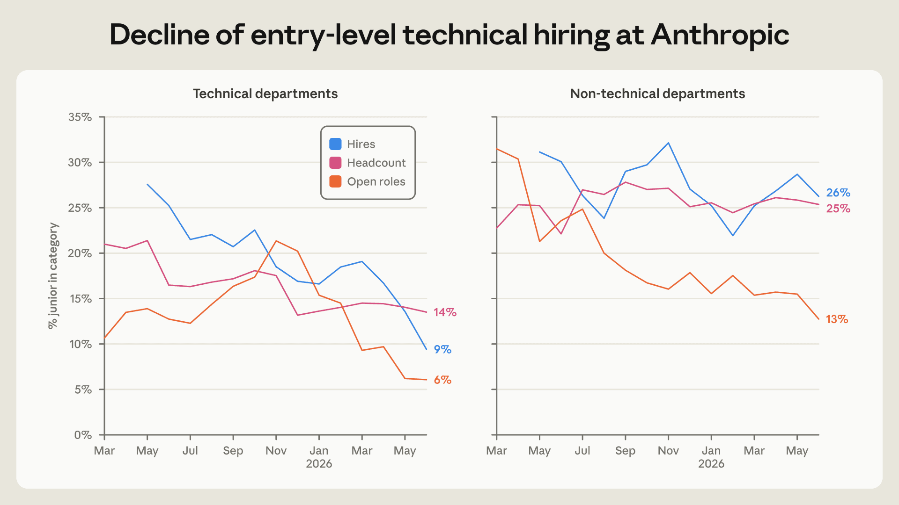
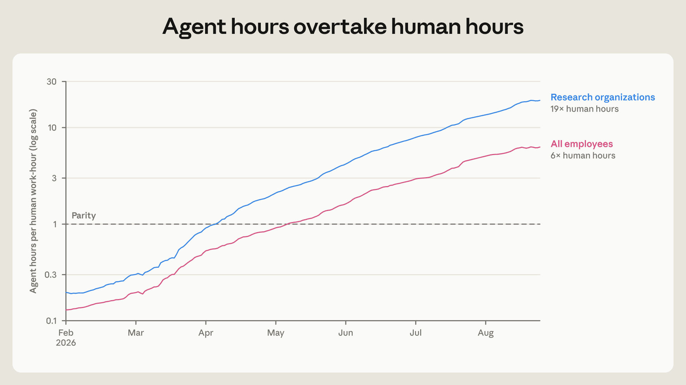
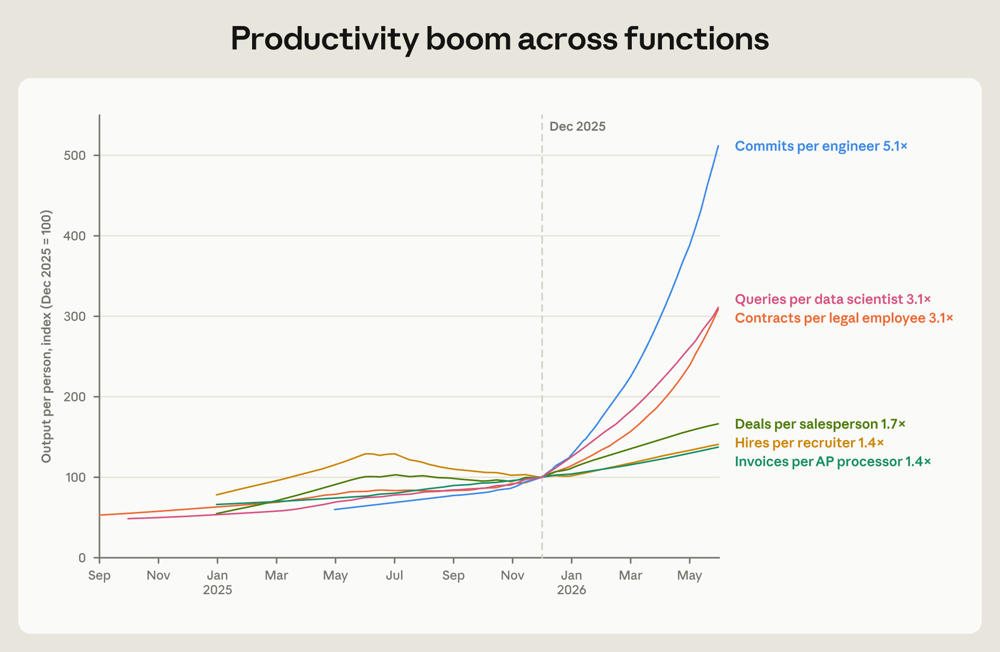
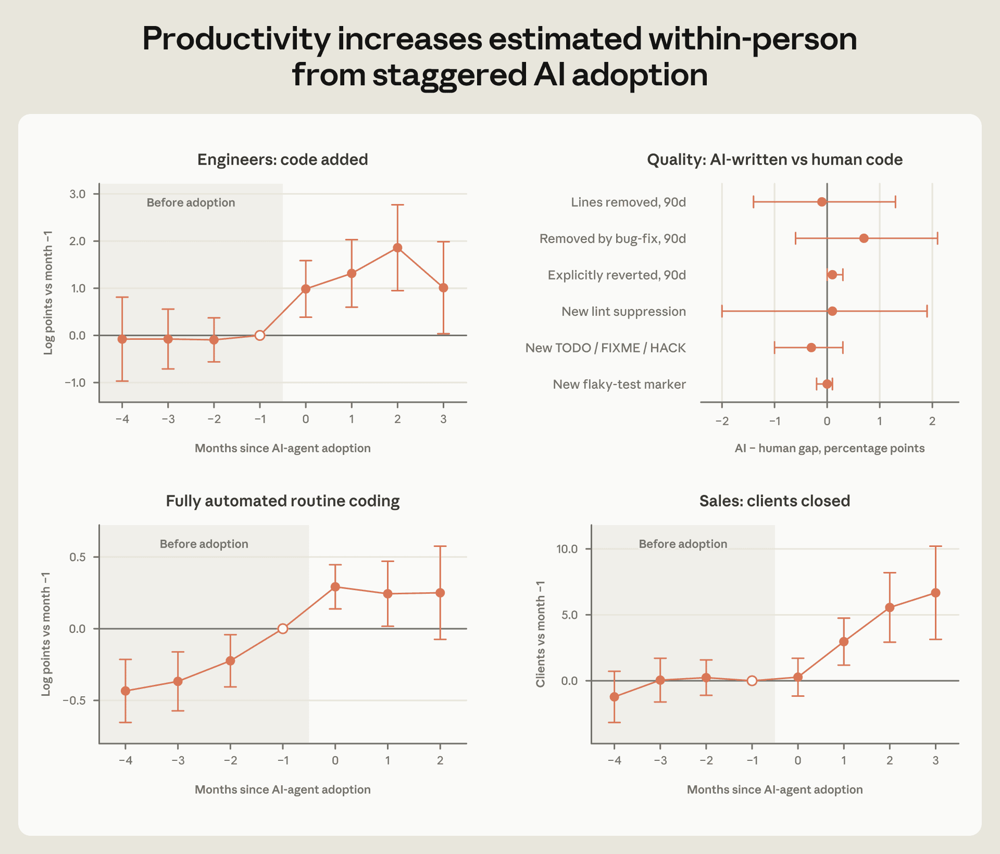
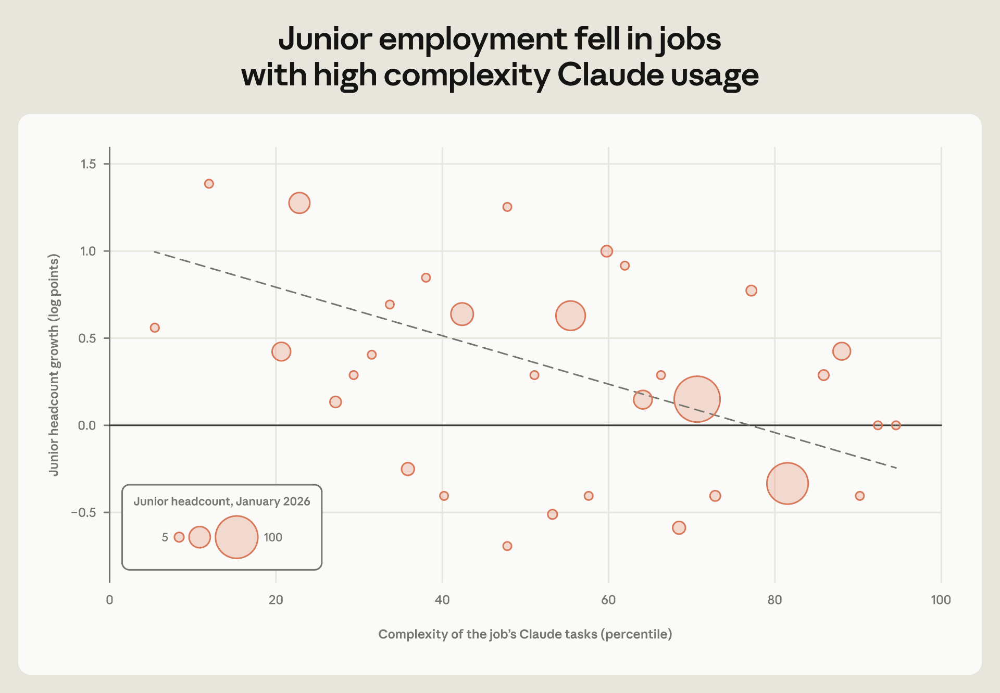
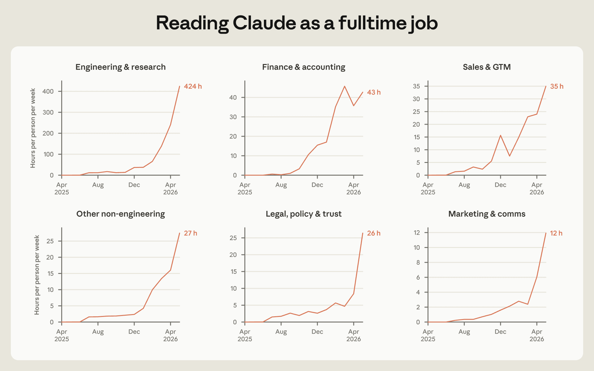
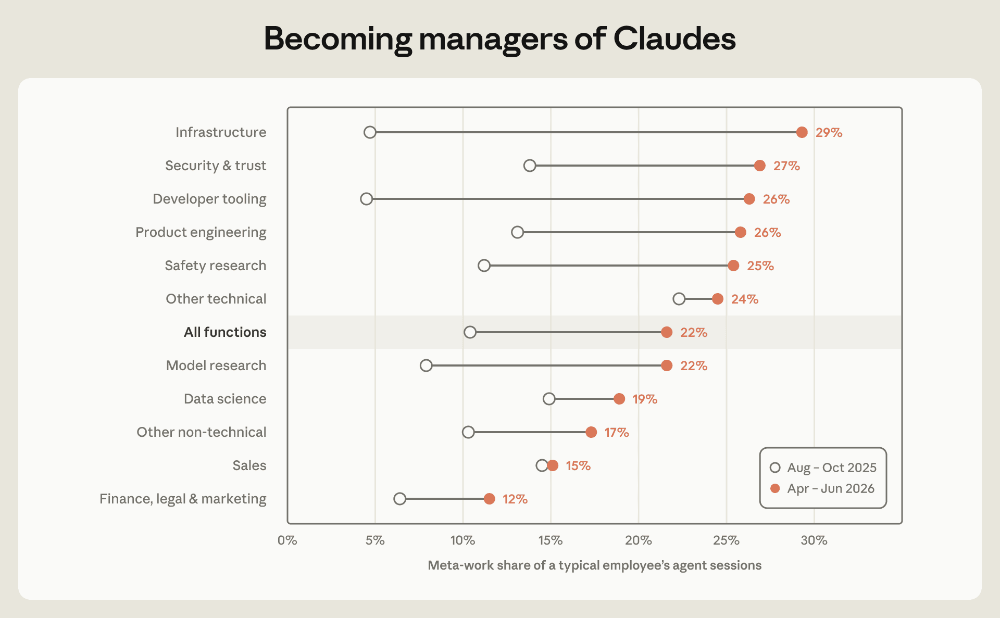

# Anthropic 的就业形态正在如何改变（中英对照）

> 原文标题：How employment is changing at Anthropic
> 原文链接：https://www.anthropic.com/research/employment-at-anthropic
> 原文作者：Nathan Wilmers, Regina Catipon, Maxim Massenkoff, Peter McCrory
> 发布日期：2026-10-16
> **翻译模型：** GLM-5.3-Flash
> **评分：** ★★★★☆（4/5，强推荐）—— 智能体工时已达员工工时的 6 倍、初级技术岗员工占比一年内从 21% 跌至 14%、招聘权重从专长转向自主性与判断力，是对 AI 重塑雇佣与工作组织最难得的一手内部量化记录
> 排版：每段英文原文在前，中文翻译紧随其后。默认收录正文主体；Works cited 与 BibTeX 未收录，见原文链接；正文中的上标 1 为脚注引用，定义已补于文末；图 8 原页为交互式图，未收录于图片目录。

---

## 关键发现（Key findings）

- Anthropic has been hiring for a smaller share of junior technical positions. This occurred as hours worked by AI agents relative to employees rapidly expanded. By August interactive AI agent hours outnumbered employees' 6 to 1.

  Anthropic 招聘中初级技术岗位的占比持续缩小。与此同时，AI 智能体（agent）的工时相对员工工时迅速扩张：到 8 月，交互式 AI 智能体工时已达员工工时的 6 倍。

- As AI agents diffused through the company, Anthropic began producing more code per person, closing more sales per rep, and processing more contracts. Following the same employee over time, output rose as they adopted new AI tools.

  随着 AI 智能体在公司内扩散，Anthropic 的人均代码产出、每位销售的成单量、合同处理量都在上升。对同一批员工随时间的追踪显示，产出随其采用新 AI 工具而增长。

- This acceleration makes human attention the bottleneck for agent output. Even among non-technical employees, reading all the output of their Claude agents would take half their work week. In response, employees turn to "meta-work," of building visibility tools and monitoring agent pipelines.

  这种加速让人类注意力成为智能体产出的瓶颈。即便在非技术员工中，读完自家 Claude 智能体的全部输出也要占去半个工作周。作为应对，员工转向「元工作」（meta-work）：搭建可见性工具、监控智能体流水线。

- Changes in work organization are reflected in shifting priorities among hiring managers, who increasingly emphasize autonomy and judgment, relative to technical domain expertise and implementation.

  工作组织方式的变化也体现在招聘负责人优先级的转变上：相较于技术领域专长与具体实现，他们越来越强调自主性与判断力。

## 引言（Introduction）

What transformations of work and employment can we expect under increasingly powerful AI? Anthropic is worth studying because it has thoroughly molded its workflows around AI. Agents flit through Slack chats and schedule meetings. They autonomously fix bugs and collectively tackle huge engineering projects. Agent hours worked outnumber human hours 6 to 1. Changes happening at Anthropic now give advanced signals about a possible future of work and employment.

在日益强大的 AI 之下，工作与就业会发生怎样的转型？Anthropic 值得研究，因为它已围绕 AI 彻底重塑了自身的工作流。智能体穿梭于 Slack 聊天、安排会议，自主修复缺陷（bug），并协同攻克大型工程项目。智能体工时已超过人类工时，达 6 比 1。Anthropic 此刻发生的变化，为一种可能的未来工作与就业图景提供了先行信号。

This report draws on comprehensive internal Anthropic data covering employment, AI use, output metrics, employee surveys, internal communication patterns, employee calendar data, and hiring decision records. It contextualizes these quantitative data with 17 employee interviews.

本报告基于 Anthropic 全面的内部数据，涵盖雇佣、AI 使用、产出指标、员工调查、内部沟通模式、员工日历数据与招聘决策记录，并以 17 次员工访谈为这些定量数据补充情境。

We find that even as the company grows, relative hiring in junior technical positions has slowed. Productivity for both engineers and non-technical employees has leapt up and did so sharply when they adopted coding agents. Hiring managers increasingly emphasize applicants' autonomy and judgement relative to specific technical expertise. A defining feature of working in an AI-heavy organization is constant pressure to streamline oneself out of this bottleneck position when possible. One engineer described work as facing "an army of Claudes, with every one asking for my attention." Employees at Anthropic remain critical. But the nature of their contributions has changed.

我们发现，即便公司仍在扩张，初级技术岗位的相对招聘速度已经放缓。工程师与非技术员工的生产率都大幅跃升，且在采用编码智能体（coding agent）时出现陡增。招聘负责人日益看重应聘者的自主性与判断力，而非特定的技术专长。在重 AI 组织中工作的一大特征，是一种持续的压力：只要可能，就把自己从这个瓶颈位置上「精简」出去。一位工程师形容自己的工作是面对「一支 Claude 大军，每一个都在争抢我的注意力」。Anthropic 的员工依然不可或缺，只是他们贡献的性质已经改变。

Anthropic has responded to these changes by setting up an early warning system to track jobs at risk of disruption, and as jobs evolve the company has prioritized internal redeployments. These actions, taken at the frontier of both AI development and workplace change, show how specific organizational commitments can shape the impact of AI on employment. But they also raise difficult questions about exactly what those commitments should be.

针对这些变化，Anthropic 设立了预警系统（early warning system）来追踪有被颠覆风险的岗位；随着岗位演变，公司优先进行内部转岗。这些在 AI 发展与职场变革双重前沿上采取的行动表明，具体的组织承诺能够塑造 AI 对就业的冲击。但它们也引出难题：这些承诺究竟应当是什么。

## 前沿的劳动力需求（Labor demand at the frontier）

Anthropic has expanded rapidly. But it has hired less per dollar of revenue than an earlier generation of large tech companies. At five years old, Anthropic takes in between 2–4 times as much revenue per employee as Meta and Google as they crested in their own rapid growth. 1

Anthropic 扩张迅速，但每一美元营收对应的招聘人数低于上一代大型科技公司。成立五年时，Anthropic 的人均营收达到 Meta 与 Google 在各自高速增长巅峰期的 2–4 倍。[^1]

What jobs are missing? Within Anthropic, discussion of a decline in demand for junior technical employees emerged in core technical functions in January 2026. The teams that relied most heavily on Claude in their own work found that writing code and finding bugs could increasingly be offloaded to Claude. Newly capable models accelerated this perception: "the thing that raised eyebrows was the uplift for performance engineers in particular and it basically overnight changed what we were looking for."

哪些岗位消失了？在 Anthropic 内部，关于初级技术员工需求下滑的讨论于 2026 年 1 月出现在核心技术职能中。那些在工作中最重度依赖 Claude 的团队发现，写代码、找缺陷（bug）越来越可以交给 Claude。新模型能力的跃升加速了这种认知：「真正让人侧目的是性能工程师岗位的提升尤其明显，这几乎一夜之间改变了我们的招聘标准。」

By April, engineering and research teams had deemphasized hiring for lower band technical positions. When surveyed in the same month, a majority of managers described hiring for a different set of skills due to AI. Around a third of ML and a fifth of SWE managers reported hiring less due to AI.

到 4 月，工程与研究团队已降低对较低职级技术岗位的招聘权重。同月的调查显示，多数管理者表示因 AI 而在招聘不同类型的技能；约三分之一的机器学习（ML）管理者与五分之一的软件工程（SWE）管理者报告因 AI 而减少招聘。

The shift in employment shares is striking. Figure 1 shows that the share of junior-level employees in technical departments at Anthropic slipped from 21% to 14% since early 2025. The proportion of junior technical hires fell even faster, from 27% to 9%. Postings for juniors have fallen particularly sharply since December 2025.

雇佣结构的变化令人瞩目。图 1 显示，自 2025 年初以来，Anthropic 技术部门中初级员工的占比从 21% 滑落至 14%；初级技术岗位新招占比下降更快，从 27% 跌至 9%。自 2025 年 12 月起，初级岗位招聘发布数量的骤减尤为明显。

> Figure 1: Decline of entry-level technical hiring at Anthropic.

At the same time, the overall employment share of technical departments within Anthropic has fallen, from 61% to 56% in the last year. As the company expands, technical hiring has continued growing in absolute terms, but intensive hiring in sales, finance, and recruiting has outpaced it. Part of this shift is the natural expansion of business functions as the company scales. Part could reflect coding tools increasingly allowing non-technical employees to make software themselves. For example, a sales representative designed a custom dashboard and pipeline tailored to their work: "a build like this was out of my wheelhouse, especially with the UI, connecting all the tools, the MCPs. But I built this probably in three to four hours, just iterating on it." Coding-focused AI agent sessions for non-technical employees (identified as those with no code commits at baseline, excluding new hires) leapt from 2 per month in August 2025 to 90 in May 2026.

与此同时，技术部门在 Anthropic 内部的整体雇佣占比在过去一年里从 61% 降至 56%。公司扩张中，技术招聘的绝对数量仍在增长，但销售、财务与招聘等职能的密集招聘增速超过了它。这一转变部分是公司规模化带来的业务职能自然扩张，部分可能反映出编码工具正让非技术员工越来越多地自行造软件。例如，一位销售代表设计了一个贴合自身工作的定制仪表盘与流水线：「这样的东西原本不在我的能力范围内，尤其是 UI，还要把各种工具、各种 MCP（Model Context Protocol，模型上下文协议）都连接起来。但我大概只花了三四个小时就搭出来了，就是不断迭代。」非技术员工（以基线无代码提交、且剔除新员工来识别）的编码类 AI 智能体会话数，从 2025 年 8 月的每月 2 次跃升至 2026 年 5 月的 90 次。

Yet this shift in hiring composition is not only a story about automated coding allowing it to diffuse to other domain experts. Within technical departments, the share of employees not actively coding (defined as those making no code commits in the prior 30 days) fell by almost half over the year through April 2026. Part of this is due to a thinning share of non-engineers: the ratio of engineers to product managers, for example, sits at around 17 to 1 and has increased since 2025. The number of commits from managers has also doubled. The supervising and coordinating roles within technical teams increasingly involve building and shipping code.

然而，招聘结构的这种转变不只是「自动编码让编程扩散到其他领域专家」这一个故事。在技术部门内部，未活跃编码的员工占比（定义为过去 30 天内没有代码提交者）截至 2026 年 4 月的一年里几乎减半。部分原因在于非工程师的占比变薄：例如工程师与产品经理之比约为 17 比 1，且自 2025 年以来还在上升。管理者提交的代码数量也翻了一番。技术团队中的监督与协调角色，越来越多地包含构建与发布代码。

One area in which non-technical hiring has not accelerated is in the administrative functions that typically scale with a company's size. A combination of agent assistants, automated review and ticket service outsourcing has left Anthropic clerical-light even as it has grown rapidly. A financial manager built a purchase request review agent and explained to colleagues "it's just trying to find the things that take a lot of hours so they can focus on the other stuff."

非技术招聘没有加速的一个领域，是那些通常随公司规模同步扩张的行政职能。智能体助手、自动化审查与工单服务外包的组合，让 Anthropic 在快速增长的同时保持了轻事务（clerical-light）。一位财务经理搭建了一个采购申请审查智能体，并向同事解释：「它就是在找出那些耗费大量工时的环节，好让人们专注其余的工作。」

Even clerical work tightly connected to in-person interaction has grown slowly. An executive assistant, who built a personal assistant agent for scheduling and email triage, explained: "I think we've already moved past the point of Claude augmenting away the really entry-level admin type role," and instead focused their work on higher-order "chief of staff" tasks.

即便是与当面互动紧密绑定的文书工作，增长也很缓慢。一位行政助理为日程安排与邮件分诊搭建了个人助理智能体，他解释道：「我认为我们已经跨过了那道坎：Claude 用『增强』的方式把真正入门级的行政岗位消解掉了。」他们的工作转向更高阶的「幕僚长」（chief of staff）式任务。

These changes have already involved reallocation: employees working at the company for at least a year were 50% more likely to move across departments each month in 2026 than they were in 2025. Whole teams have also been reallocated as they handed off their work to agents. Consider one product design team, which wrote content like the greetings on Claude.ai: "Hello night owl;" "Coffee and Claude time?" In spring 2026, the team developed a context graph that effectively guided agents to write compelling product content. This "scaled the team out," its manager explained, but also raised the question of what was left for human writers. The team then rotated into agent prompting and began writing model evals and prompts for Claude. "Writers who used language to drive human behavior are now using it to drive Claude behavior."

这些变化已经伴随着岗位再配置：司龄至少一年的员工，2026 年每月跨部门流动的概率比 2025 年高 50%。整个团队也会在把工作移交给智能体后被重新调配。以一个产品设计团队为例，他们撰写 Claude.ai 上的问候语等内容：「夜猫子你好」「来杯咖啡配 Claude 吗？」。2026 年春，该团队开发了一个上下文图谱（context graph），能够有效引导智能体写出动人的产品文案。经理解释说，这相当于「把团队的产出规模化了（scaled the team out）」，但也留下问题：人类写作者还剩什么可做？随后该团队轮换到智能体提示工作，开始为 Claude 编写模型评测（evals）与提示词。「过去用语言驱动人类行为的写作者，如今在用它驱动 Claude 的行为。」

## 是 AI 在驱动 Anthropic 的生产率提升吗？（Is AI driving productivity increases at Anthropic?）

Are these shifts attributable to AI? At Anthropic, humans are a thin layer atop a growing contingent of AI agents. Based on agent session telemetry, in March 2026, the sum of autonomous and interactive agent work hours leapt past human work hours for the first time. Part of this is fleets of agents conducting industrial scale software engineering, filling in myriad routine tests and checks, conducting maintenance on a growing mass of infrastructure code, and driving concerted campaigns to translate massive codebases. But even narrowing in on the agents deployed by individual employees, as in Figure 2, by August the agents worked 6 times as many hours as their human handlers.

这些变化能归因于 AI 吗？在 Anthropic，人类只是日益壮大的 AI 智能体群体之上的一层薄膜。基于智能体会话遥测数据，2026 年 3 月，自主式与交互式智能体工作时长之和首次超过人类工作时长。其中一部分是成群结队的智能体在进行工业级规模的软件工程：填补海量常规测试与检查、维护不断膨胀的基础设施代码，并推动协同战役来翻译庞大的代码库。但即便只看员工个人部署的智能体（如图 2），到 8 月，智能体的工作时长也已达其人类主管的 6 倍。

> Figure 2: Agent hours overtake human hours. Note: We limit to employee-directed interactive sessions and pool subagents. Working time concept is agent runtime, including inference and active tool use, but excluding any wait longer than 30 minutes. Human work hours are calculated as headcount and assumed 40 hours per week.

Anthropic is a software producer, and the vast bulk of tokens flowing through these agents is spent producing software code. Dashboards monitor fleets of agents operating across the company. But personal assistant agents also monitor employee calendars and messages, scheduling, sending to-do lists accumulated from incoming messages, and automatically briefing employees on the people and purpose of their upcoming meetings. Tokens touch a growing range of everyday work tasks.

Anthropic 是一家软件生产公司。Token（词元）流经这些智能体，其中绝大多数都用于生产软件代码。仪表盘监控着全公司运行的智能体舰队。而个人助理智能体也在监控员工的日历与消息：安排日程、发送从收到的消息中累积的待办清单，并在会议开始前自动向员工简报参会者背景与会议目的。词元正触及越来越多的日常工作任务。

> Figure 3: Productivity boom across functions. Note: Loess smoother fit across underlying indexed output data.

What do all of these tokens amount to? Figure 3 plots output over time for a range of job functions with measurable output. Consistent with prior reports surveying Anthropic engineers and describing automation of model training and research, code commits per engineer have risen the fastest, coming in at 5x their velocity as 6 months ago. Data scientists are also querying the growing mass of Anthropic data more, asking Claude agents to get real-time metrics to dashboards and decisionmakers. But Figure 3 shows that even non-technical employees saw output rise as coding agents diffused: lawyers processed more contracts; accounts payable ushered through invoices; salespeople closed more deals.

这些词元究竟换来了什么？图 3 描绘了多个产出可度量的职能随时间的产出变化。与此前对 Anthropic 工程师的调查以及关于模型训练与研究自动化的报告一致，每位工程师的代码提交量增速最快，达到 6 个月前的 5 倍。数据科学家也在更频繁地查询日益庞大的 Anthropic 数据，让 Claude 智能体把实时指标送上仪表盘与决策者案头。但图 3 显示，即便非技术员工，其产出也随编码智能体的扩散而上升：律师处理了更多合同；应付账款推进了更多发票；销售签下了更多订单。

But is all of this due to Claude usage? During this same period, the company saw explosive business growth. It is easier to close deals when you sell a strong model. To assess the independent effect of AI, we compare the output of employees who adopt agentic coding tools to those who have not yet adopted the tools. This lets us compare employees working in the same month at the company, and therefore exposed to a similar business context, but approaching it with different tools. Note however that tool adoption is not random: if employees on the cusp of driving some big new project decide to tool up for it, for example, this would bias our estimates.

但这一切都源于 Claude 的使用吗？同期，公司业务经历了爆炸式增长——卖一个强模型，成单自然更容易。为分离 AI 的独立效应，我们比较了采用智能体编码工具与尚未采用的员工的产出。这让我们可以比较同月在职、因此处于相似业务环境中、却用不同工具应对工作的员工。但请注意，工具采用并非随机：例如，即将主导某个大型新项目的员工若为此决定「武装」自己，就会使我们的估计产生偏误。

We follow 192 engineers over time as they adopt coding agents, compared to 74 engineers who do not adopt agents during the period studied. Figure 4 shows that in the months following adoption, the amount of code that engineers add rises sharply. More code does not necessarily mean better code or business impact. To test for AI code slop, we study code commits made at Anthropic. We compare code committed by the same employee, in the same month, in the same coding directory, but written by coding agents rather than written directly by the human employee. There are many dimensions of code quality, and AI errors may be harder to identify than human ones. But we find no difference in rates of lines of code subsequently removed or reverted.

我们追踪了 192 位随时间采用编码智能体的工程师，并与研究期内未采用智能体的 74 位工程师对比。图 4 显示，采用之后的几个月里，工程师新增的代码量急剧上升。代码更多并不必然意味着代码更好或更有业务影响。为检验是否存在「AI 代码糟粕」（code slop），我们研究了 Anthropic 的代码提交：比较同一员工在同一月、同一代码目录下提交的代码——一次由编码智能体写出，一次由本人直接写出。代码质量有很多维度，AI 错误也可能比人类错误更难识别。但我们发现，两者在随后被删除或回滚的代码行比例上并无差异。

Figure 4 also looks at what happens after an engineer adopts their first fully autonomous agent. Those who adopt were already on a steeply upward trajectory compared to non-adopters. This suggests that employees shifting toward fully autonomous agents were already ramping up their output.

图 4 还考察了工程师首次采用完全自主智能体之后发生了什么。相比未采用者，采用者在采用之前就已处于陡峭的上升轨道。这表明转向完全自主智能体的员工，本就在加码提升自己的产出。

> Figure 4: Productivity increases estimated within-person from staggered AI adoption. Note: Coefficients compare coding agent adopters to non adopters with person and calendar-month two-way fixed effects. Treatment timing is based on the person's first month with at least 5 agentic sessions. Bars are 95% confidence intervals from standard errors clustered on person. The quality panel compares code written directly by a person to code written by the same person's coding agent. Quality proxies are the share of lines deleted for any reason within 90 days; the share deleted by a bug-fix specifically; whether the whole commit is explicitly reverted; adding a lint-suppression comment; adding a need fixing note; and marking a test to be skipped, retried, or allowed to fail.

Do these patterns go beyond coding, into a broader transformation of knowledge work? Anthropic sales representatives steadily adopted AI agents starting last September. Figure 4 shows that after sales representatives adopt agents, they close deals with more clients. Part of this pattern could be driven by representatives with more sales opportunities selecting into automation. But it could also reflect automation of logging and routine communication. One account executive explained that Claude automations handled email drafting and customer management software integrations, replacing around 20% of their prior work tasks. Another noted that similar automations freed them up to focus on face-to-face time, letting them talk to 30% more of their customers than was previously possible: "anytime you do anything a second time, you're kind of like, okay, how can I use Claude to make it so that I don't have to do it a third time?"

这些模式是否超出编码，指向知识工作的更广泛转型？从去年 9 月起，Anthropic 的销售代表开始稳步采用 AI 智能体。图 4 显示，销售代表采用智能体后，会与更多客户达成交易。这一模式部分可能源于销售机会更多的代表自选择进入自动化，但也可能反映了日志记录与例行沟通的自动化。一位客户经理解释说，Claude 自动化负责起草邮件和对接客户管理软件，替代了他此前约 20% 的工作任务。另一位则表示，类似的自动化让他们得以专注面对面的时间，能沟通的客户比以往多 30%：「任何时候，只要你第二遍做某件事，你就会想：好吧，怎么用 Claude 让我不必做第三遍？」

Beyond sales, an Anthropic lawyer built a series of Claude automations to scan risks and opportunities, triage legal questions and take first passes through public-facing copy for legal review. A recruiter used Claude to help with candidate sourcing, tracking applications and an analysis that would have taken "maybe a couple of weeks," freeing him to redesign outdated interview questions and meet with more applicants.

销售之外，Anthropic 的一位律师搭建了一系列 Claude 自动化，用于扫描风险与机会、给法律问题分诊，并对面向公众的文案做法律审查的初筛。一位招聘人员用 Claude 辅助搜寻候选人、跟踪申请，并完成一项本来「可能要花上几周」的分析，从而腾出时间重新设计过时的面试题、见更多应聘者。

All of this suggests that as AI capabilities improve, it impacts a wide range of jobs across Anthropic. Descriptively, we see junior employment slowing in jobs that use Claude for the most complex tasks (Figure 5).

这一切都表明，随着 AI 能力提升，它正波及 Anthropic 内广泛的岗位。描述性地看，在那些用 Claude 处理最复杂任务的工作中，初级雇佣的增速正在放缓（图 5）。

> Figure 5: Junior employment growth by Claude usage complexity. Notes: Plot at job level. Growth compares January 2026 headcount to July 2026. AI complexity is based on an automated coder of agent logs (prior to the employment decline, October to December 2025) and percentile transformed. Dots are scaled by January employment in the job; regression line is fit across weighted points.

## 瓶颈与流程：AI 密集型职场中的新任务与旧任务（Bottlenecks and process: new and old tasks in an AI-intensive workplace）

Heavy AI adoption reshapes more than employment and productivity. It also drives continual changes in work processes, generating new tasks and shifting employees' perceptions of their workplace. One employee described this as the "eternal pressure at Anthropic to move as fast as possible and use Claude for everything" and another that "things we expect in a week are things that would take three months elsewhere." An internal employee survey asked whether work processes at Anthropic made respondents as productive as possible: 44% of employees agreed in late 2024; 58% by November 2025 (in April 2026, 75% answered yes, but the question weakened by dropping "as possible"). As of August, employees at Anthropic expected that AI will be able to do 75% of their work by 2030, compared to 28% for other Americans.

重度的 AI 采用重塑的不只是雇佣与生产率。它还持续改变工作流程，催生新任务，并改变员工对职场的感知。一位员工把这形容为「在 Anthropic 有一种永恒的压力：动作要尽可能快，凡事都要用 Claude」；另一位说「我们期望一周内交付的事，换在别处要花三个月」。一项内部员工调查询问 Anthropic 的工作流程是否让受访者发挥了最大生产率：2024 年底有 44% 的员工同意；到 2025 年 11 月为 58%（2026 年 4 月有 75% 回答是，但该问题删去了「尽可能」的字样，力度有所减弱）。截至 8 月，Anthropic 员工预期到 2030 年 AI 将能完成他们工作的 75%，而其他美国人的这一比例仅为 28%。

These ratcheting productivity expectations are dramatized by the cadence of internal model releases. As soon as a new model is available, Anthropic employees start tackling harder problems in interactive coding agent sessions. We measure this with an automated Claude grader rating deidentified sessions' task demands based on depth, scope and number of systems implicated. The share of tasks above the 90th percentile of difficulty for the old model rises sharply by around 30% (from 10% to 13% of all tasks) and stays elevated in the weeks following model releases. The easy end of tasks given to agents changes little.

内部模型发布的节奏，把这种棘轮式上升的生产率预期演绎得淋漓尽致。新模型一上线，Anthropic 员工就开始在交互式编码智能体会话中攻克更难的问题。我们用一个自动化的 Claude 评分器来度量这一点：依据深度、范围与涉及系统的数量，为去标识化会话的任务需求评级。超过旧模型难度第 90 百分位的任务占比急剧上升约 30%（从全部任务的 10% 升至 13%），并在模型发布后的数周内保持高位。交给智能体的任务中容易的那一端则变化不大。

Spiraling agent productivity translates into output pitched across humans' screens and attention. One engineer compared this to babysitting:

螺旋上升的智能体生产率，化作涌向人类屏幕与注意力的产出洪流。一位工程师把这比作照看孩子：

> They're like, I need my juice box opened and it's an emergency that my juice box is opened. And that is voiced with the same level of concern as the one who has sliced their finger and is bleeding. [...] When you are babysitting, every child brings to you concerns with an equal demand for your attention and the various [Claudes] also do that.

> 它们的架势是：我要人帮我开果汁盒，我的果汁盒没打开就是十万火急。而且说这话的语气，和那个切破手指正在流血的孩子如出一辙。[…] 照看孩子时，每个孩子向你提出的请求都同样亟需你的关注——形形色色的 [Claude] 也一样。

In the April 2026 survey, an open-ended question about how AI has impacted day-to-day work, 27% described productivity gains from Claude tools and 20% described their role shifting from actually doing work to managing Claudes.

在 2026 年 4 月调查中那道关于 AI 如何影响日常工作的开放题里，27% 的回答提到 Claude 工具带来的生产率提升，20% 描述自己的角色从亲手干活转向管理 Claude。

Amid this model-driven acceleration, human attention is a constant bottleneck. In interactive, multi-turn sessions, the vast majority of agents' session time is not spent working at all, but spent waiting. We track idle time by subtracting each agent's active working time from each interactive session's total wall-clock time. Claude sessions amount to around 80% idly waiting for human input. As one engineer put it, people are "bottlenecking the agents."

在这种模型驱动的加速中，人类注意力是一个恒定的瓶颈。在交互式多轮会话中，智能体的会话时间绝大部分根本不是在工作，而是在等待。我们用交互式会话的总挂钟时间减去每个智能体的活跃工作时间来追踪闲置时间：Claude 会话约 80% 是在空等人输入。用一位工程师的话说，是人在「卡着智能体的进度」。

How much time exactly would be needed to read all of Claude's output from interactive sessions? For each interactive session, we convert each session's agent output token to word count, assuming average human reading speed. Figure 6 shows that technical functions have seen the volume of coding agent output leap up over the last 6 months. But even for non-technical groups, interactive Claude sessions are outputting enough content to take up over half of the work week. The deluge of Claude text needs organizing.

读完交互式会话中 Claude 的全部输出，究竟需要多少时间？我们对每个交互式会话，按人类平均阅读速度把智能体输出的词元换算为词数。图 6 显示，过去 6 个月里，技术职能的编码智能体输出量猛增。而即便对非技术群体，交互式 Claude 会话产出的内容也已多到要占去半个工作周。Claude 文本的洪流需要有人打理。

> Figure 6: Reading Claude as a full-time job. Note: Hours estimated by converting output tokens to words, assuming 0.75 words per token and 250 words read per minute.

One solution to this deluge is rising automation. But this requires work of a different kind. Written standing instructions for agents grew from a few hundred in July 2025 to 8,500 a year later. One engineer set up an agent chief of staff to triage agent requests. Another wrote a performance review for their Claude team: "Hey, let's talk about what is and is not working about our communication style." Recruiters built integrated dashboards with agents surfacing problems and initiating actions. A lawyer shifted their attention from reviewing legal questions to doing "SEO for legal advice, you need to write frameworks that [clients'] agents discover."

应对洪流的一个办法是更多的自动化。但这本身需要另一种工作。写给智能体的书面常设指令从 2025 年 7 月的数百条增长到一年后的 8,500 条。一位工程师搭了一个「智能体幕僚长」来给智能体的请求分诊。另一位为自家的 Claude 团队写了一份绩效评估：「嘿，我们来聊聊我们的沟通方式哪些行得通、哪些行不通。」招聘人员与智能体共建集成仪表盘，让智能体浮出问题、发起行动。一位律师的注意力则从审查法律问题转向给法律建议做「SEO」——「你需要写出能让 [客户的] 智能体检索发现的框架」。

Figure 7 shows that this kind of meta-work leapt from 10% of the average employee's interactive Claude sessions in fall 2025 to 22% in spring 2026. Much of this rise was due specifically to agent management: writing specs for multi-agent runs, looping one agent to review another's output, and monitoring pipelines. Across functions, human involvement increasingly abstracted from a particular piece of code or writing to the tooling necessary to get agents to do their tasks effectively.

图 7 显示，这类元工作从 2025 年秋占普通员工交互式 Claude 会话的 10%，跃升至 2026 年春的 22%。增长中很大一部分具体来自智能体管理：为多智能体运行撰写规格说明、让一个智能体循环审查另一个的输出、监控流水线。各职能中，人类的参与日益从某段具体的代码或文字，抽象为让智能体有效完成任务所需的工具建设。

> Figure 7: Becoming managers of Claudes. Note: Meta-work estimates are based on an automated coder assessing a sample of 2,000 1-line chat summaries according to whether they focus on building Claude skills, plans and reviews for other agents, dashboards and monitors for agent pipelines, and documenting how work is done, in contrast to the actual work itself.

Despite increases in agent reliability and these significant investments in tooling to supervise them, human trust and accountability remains critical. One employee explained that, increasingly, chasing down bugs "uncovers these organizational or systemic or tech debt things that actually require some amount of human convening and decision-making and governance to solve." In interview after interview, employees described face-to-face coordination as indispensable. Based on calendar data, the median employee spends 20% more time in meetings than a year ago. Part of this reflects the growth of the company, and a shift toward meeting-intensive non-technical roles. But even among employees in technical individual contributor roles, meeting time is up 16% over the past year. Big picture strategic questions touch a broad range of leveraged positions, and typically require debate and engagement with others. A break from managing the agents typically looks like jumping into a meeting.

尽管智能体的可靠性在提升、公司也在监督工具上投入巨大，人类的信任与问责依然关键。一位员工解释说，追查缺陷（bug）越来越多地「会挖出这些组织性的、系统性的或技术债的问题，它们其实需要一定量的人类召集、决策与治理才能解决」。一场又一场访谈里，员工都把面对面协调形容为不可或缺。日历数据显示，中位数员工的会议时间比一年前多 20%。部分原因是公司扩张，以及向会议密集型非技术岗位的转移。但即便在技术个人贡献者（individual contributor）中，会议时间过去一年也上升了 16%。大局层面的战略问题牵动广泛的杠杆性位置，通常需要辩论和与他人互动。从管理智能体中抽身喘口气，典型形式就是跳进一场会议。

Broadly, both technical and non-technical roles have seen implementation parts of their job automated (writing code, identifying bugs, logging progress, drafting emails). Engineers described becoming leaders and managers of agents; non-technical employees described doing more and more of the strategic parts of their job: "that 20% that was strategic becomes 90% of the job." But for many non-technical roles, core implementation work is also interpersonal: a sales call, an interview, cross-functional alignment on a complex problem. All of this remains human.

总体上，技术与非技术岗位工作的实现部分都在被自动化（写代码、找缺陷、记录进度、起草邮件）。工程师形容自己成了智能体的领导者和经理；非技术员工形容自己越来越多地做工作中属于战略的部分：「原来那 20% 的战略部分，变成了工作的 90%。」但对许多非技术岗位而言，核心实现工作本身也是人际的：一通销售电话、一场面试、就一个复杂问题做跨职能对齐。这些都依然是人的活儿。

Consider too the Slack channels that provide both the front page and backchannels of Anthropic communication. Agents diffused through Slack and eventually appeared in nearly half of active, public channels. Figure 8 zooms in on the communication network of a single large department, drawing on all public Slack channels that department members interacted through. It links both human and agent participants by whether they participated in a Slack thread. The figure shows the remarkable rise of agents, as orange dots blossom and dominate the network.

再看看那些既是 Anthropic 沟通门面、又是其内部暗线的 Slack 频道。智能体在 Slack 中扩散，最终出现在近半数的活跃公共频道里。图 8 聚焦一个大部门的沟通网络，数据来自该部门成员互动过的全部公共 Slack 频道，依据是否参与同一 Slack 讨论串来连接人类与智能体参与者。图中可见智能体的惊人崛起：橙色圆点成片绽放，进而主导整个网络。

Figure 8: Agents come to the communication network. Note: Blue dots are employees; orange dots are agent threads. Ties are interaction among humans or agents in the same thread.

图 8：智能体进入沟通网络。注：蓝色圆点为员工，橙色圆点为智能体讨论串；连线代表人类或智能体在同一讨论串中的互动。（原图为交互式图，见原文链接。）

Agents appear disproportionately in dedicated channels for Claude-human interactions, rather than messaging a lot in incumbent human channels. The underlying structure and density of human communication changes little. Agents did not replace human interaction, but rather added to it: human threads in this department sustained the same number of human responses, while additionally layering on agent responses. Agents become teams for a single employee, rather than nodes with high connectivity to many employees at once.

智能体不成比例地出现在专设的 Claude-人类互动频道，而较少在既有的人类频道里发消息。人类沟通的底层结构与密度几乎没有变化。智能体没有取代人类互动，而是在其上叠加：该部门的人类讨论串维持了同样数量的人类回复，另加上了智能体回复。智能体成了单个员工的「团队」，而非同时连接众多员工的高连接度节点。

As humans work amid a growing fleet of AI agents, they face pressure to shift human work into agent-visible channels. If a decision is made in an in-person meeting, and no notes or report-out appears, agents are missing crucial context for updating their goals and assumptions. An employee explained how having their name on a months-old document about Claude swag meant agents kept bringing requests for t-shirts and mugs, long after their responsibilities had changed. Private work, in unlogged meetings and direct messages, is invisible, confusing and discouraged in an AI-heavy workplace. One researcher described this default toward openness as critical to Anthropic's thoroughgoing integration of AI: "most organizations do not run that way and I think that's a big shift because leaders have to defend feedback out in the open." The need to feed AI context requires observability of human work and decisions.

当人类在日益庞大的 AI 智能体舰队中工作时，他们面临把人类工作转入智能体可见渠道的压力。如果一个决定是在当面会议中做出的，而没有出现任何纪要或汇报，智能体就缺失了更新其目标与假设的关键上下文。一位员工解释说，只因名字挂在一个几个月前关于 Claude 周边衫的文档上，智能体就不断把 T 恤和马克杯的请求送到他面前——那时他的职责早已变了。在重 AI 职场中，不留记录的会议与私信里的「私人」工作是不可见的、令人困惑的、也是不被鼓励的。一位研究者把这种默认开放视为 Anthropic 能彻底整合 AI 的关键：「大多数组织不是这样运转的，而我认为这是个巨大的转变，因为领导者必须在公开场合为反馈辩护。」喂养 AI 上下文的需求，要求人类的工作与决策可被观察。

Who will thrive in a workplace like this? Shifts in the content of work at Anthropic also show up as changes in the skills that hiring managers prioritize in hiring decisions. We used an automated coder to process hiring manager interview score cards for thousands of employees hired at Anthropic since 2024. These comments are qualitative reactions by interviewers assessing candidates' performance. The clearest change is increased emphasis on whether candidates have demonstrated creative use of AI tools. In 2024, hiring managers noted candidates' track record on AI tooling in around 5% of assessments for technical roles, and 7% for non-technical roles. By 2026, these rates had tripled for technical roles and quadrupled for non-technical roles. Hiring managers increasingly focus on whether candidates effectively use AI.

谁能在这类职场中如鱼得水？Anthropic 工作内容的变化，也体现为招聘负责人在招聘决策中优先考量的技能之变。我们用自动化编码器处理了 2024 年以来数千名 Anthropic 新员工的招聘负责人面试评分卡。这些评语是面试官评估候选人表现的定性反馈。最明显的变化，是更看重候选人是否展现了对 AI 工具的创造性使用。2024 年，招聘负责人在约 5% 的技术岗评估和 7% 的非技术岗评估中提到候选人在 AI 工具上的过往记录；到 2026 年，技术岗这一比例增至三倍，非技术岗增至四倍。招聘负责人日益聚焦于候选人能否有效使用 AI。

Deeper changes in assessment are also visible. Among interviews for technical candidates, the single biggest increases were in comments on applicants' autonomy and judgment. Discussion of domain expertise shrank as a share of overall assessment. As one manager explained, "I expect models to continue to be jagged, so for my team I want them to be fungible across domains." Similarly, for non-technical candidates, customer and mission orientation increased, while discussion of execution skills fell. Increasingly, hiring managers assess applicants based on their judgment and commitment, rather than the domain-specific skills and execution automated by AI tools.

评估中更深层的变化同样可见。在技术岗面试中，增幅最大的是关于应聘者自主性与判断力的评语；领域专长的讨论在整体评估中的份额缩小。正如一位经理所解释的：「我预计模型会继续参差不齐（jagged），所以对我的团队，我希望成员能跨领域互换通用。」类似地，非技术岗候选人的评估中，客户与使命导向的权重上升，执行技能的讨论下降。招聘负责人越来越多地依据判断力与投入度来评估应聘者，而非那些已被 AI 工具自动化的领域专项技能与执行。

## 雇主可以做什么（What employers can do）

The deep adoption of AI at Anthropic makes it a useful case. As AI diffuses and improves, the organization of work could shift as it has in prior waves of technological change. The railroads gave us the managerial corporation, steam power allowed factories, and personal computers delivered the startup. What new organizations will tool-using, reasoning LLMs require, and what will be our role in them? One possibility is single-person start-ups, each with a human founder steering swarms of agents to rake in billions in revenue. Another is companies built by AI genius CEOs employing human agents only to wield pipettes and testify before congress.

Anthropic 对 AI 的深度采用使它成为一个有用的案例。随着 AI 扩散与改进，工作组织方式或将如以往历次技术变革浪潮那样发生转变。铁路带来了经理式公司（managerial corporation），蒸汽机让工厂成为可能，个人计算机成就了初创公司。会使用工具、会推理的 LLM 将需要什么样的新组织？我们在其中又扮演什么角色？一种可能是一人初创公司：人类创始人指挥成群的智能体，坐收数十亿美元营收。另一种是由 AI 天才 CEO 打造的公司，雇用人类只为操作移液管、到国会作证。

Anthropic does not look like either of these. It has tripled in size in the last year. It is no longer a small startup. It has also not ceded executive control to its models. Written Slack debates and in-person meetings steer everything from company strategy to team decisions, with little input from AI agents. Keeping human work visible across the company ensures autonomous agents reason from fresh context. Individual contributors orchestrating teams of agents look more like managers in terms of the knowledge they need and the interdependencies in their work. Working and deciding in the open is critical at an AI-intensive organization.

Anthropic 两者都不像。它在过去一年里规模增至三倍，已不再是小型初创公司；它也未曾把经营管理权移交给自己的模型。从公司战略到团队决策，一切仍由书面 Slack 辩论与当面会议来掌舵，AI 智能体的输入很少。让人类工作在全公司保持可见，确保自主智能体从新鲜上下文出发推理。编排智能体团队的个人贡献者，就所需知识和工作中的相互依赖而言，看上去更像管理者。在 AI 密集型组织中，公开工作与公开决策至关重要。

As employees increasingly see their work as managing teams of Claudes, they spend more time building the tools needed to do this effectively in their own distinctive domains. This experimentation means that employees are continually automating their own tasks away. In some roles, they are increasingly removed from the object-level work that originally built their skills. As agents sprint through workflows, human attention and judgment are a bottleneck that the system strains against. From sales to legal, human employees are expected to do more and different tasks. Roles broaden to include building products, managing agents and tackling the strategic and interpersonal work that remain beyond the scope of the best LLMs.

随着员工日益把工作视为管理一支支 Claude 团队，他们花更多时间去搭建在自己独特领域内高效管理所需的各种工具。这种试验意味着员工在持续把自己的任务自动化掉。在一些岗位上，他们与最初练就自身技能的对象级工作渐行渐远。当智能体在工作流中全速冲刺，人类的注意力与判断力成了整个系统承压顶撞的瓶颈。从销售到法务，人类员工被期待去完成更多、也更不同的任务。角色扩展为：构建产品、管理智能体，并处理最先进 LLM 仍无法覆盖的战略性与人际性工作。

These changes in the organization and content of work have appeared alongside declining shares of junior technical roles in headcount, hiring, and posting. Hiring managers increasingly focus on applicants' autonomy and judgment, rather than execution and narrow expertise. Overall, Anthropic's revenue growth relative to its employment growth has sped past even the rapid early productivity growth of a prior generation of technology companies.

伴随工作组织与内容之变的，是初级技术岗位在人头、招聘与职位发布中占比的下滑。招聘负责人日益聚焦应聘者的自主性与判断力，而非执行与狭窄的专业技能。总体上，Anthropic 相对于雇佣增长的营收增长，已超过上一代科技公司早期的快速生产率增长。

Reading these patterns forward and out across the economy suggests that AI diffusion could risk worker displacement. Prior work also finds that AI-native start-ups and AI-adopters are flatter and employ fewer entry-level employees. What can we learn from Anthropic about how to manage AI upheavals in a way that serves the humans working around them?

把这些模式外推到整个经济体，意味着 AI 的扩散可能带来劳动者被置换的风险。已有研究发现，AI 原生初创公司与 AI 采用者的组织更扁平，雇用的入门级员工更少。关于如何管理 AI 带来的剧变、使之服务于在 AI 身边工作的人们，我们能从 Anthropic 学到什么？

Here we want to proceed carefully. There are many parts of Anthropic's employment practices that cannot be replicated across the economy.

在这一点上我们想谨慎行事。Anthropic 的雇佣实践中有许多部分无法在整个经济体中复制。

But three features stand out. First, widespread stock ownership gives employees a strong interest in the company's success. Of course, this is an easy posture for a company that has seen substantial increases in valuation. For many firms, shared ownership may be insufficient or otherwise undesirable. But it is difficult to imagine a version of pro-worker AI adoption in which workers do not hold a financial stake in successful rollout. If individual contributors are expected to "manage agents," "make VP level decisions" and be "their own business line," as interviewees put it, then aligning their interests with the organization is crucial. The post-World War II union-management settlement forged in the 1950s rested on exactly this kind of bargain: labor unions like the United Auto Workers and the United Steel Workers allowed management prerogative over work reorganization (and even intensification) in return for pay increases tied to productivity increases and to a rich array of benefits. Whatever the new deal between AI-affected employees and their employers, a mechanism to share benefits of adoption is essential. At Anthropic, workers codify their expertise for the machine, see their work routines constantly roiled and disrupted, and have seen a large part of their job become speedreading the output of their AI collaborators. They do not do this for free.

但有三点格外突出。第一，普遍的持股让员工与公司的成败休戚相关。当然，对一个估值大幅上涨的公司来说，这是容易摆出的姿态；对许多企业而言，共享所有权可能不够、也未必可取。但很难想象一种「亲劳动者」的 AI 采用方式，其中劳动者竟不在成功落地中持有经济利益。如果个人贡献者被期待去「管理智能体」「做 VP 级的决策」并成为「自己的业务线」——正如受访者所言——那么让他们的利益与组织保持一致就至关重要。二战后于 1950 年代铸就的劳资协议，依靠的正是这样一种交易：全美汽车工人联合会、全美钢铁工人联合会等工会允许管理层拥有工作重组（乃至强化劳动强度）的特权，以换取与生产率提升挂钩的加薪和一揽子丰厚福利。无论受 AI 影响的员工与其雇主之间将达成何种新交易，分享采用收益的机制都必不可少。在 Anthropic，劳动者把自身专长编纂给机器，眼看工作例程被不断搅动、打断，工作的大部分变成了快速通读 AI 协作者的输出。他们做这些，不是出于免费。

Second, Anthropic is standing up an ongoing early warning system to monitor jobs facing AI-driven transformation. A series of role-level metrics for demand and productivity are read against AI capabilities and use. These aggregate metrics help flag where work is shifting. An early warning system allows the company to start reallocating affected employees to jobs with a skills fit that may be less immediately at risk. As companies across the economy reorient to an accelerated pace of work reorganization, effective systems for guiding internal employee reallocation will become increasingly valuable. Turning to the external labor market to meet every new task demanded by AI advances will be a stronger bottleneck the faster AI advances. In this report, we found increased mobility between departments, changing work content, and employees shifting to new tasks as old ones were automated. Building systems to flexibly reallocate workers internally will be critical for AI-intensive organizations.

第二，Anthropic 正在建立一个持续的预警系统，以监测面临 AI 驱动转型的岗位。一系列职位层面的需求与生产率指标，会对照 AI 的能力与使用情况来解读。这些汇总指标帮助标记工作正在何处转移。预警系统让公司得以着手把受影响的员工重新配置到技能匹配、且或许不会立刻处于风险中的岗位。当整个经济体中的公司都要适应加速的工作重组节奏，引导内部员工再配置的有效系统将愈发宝贵。AI 进步越快，为每一项新任务都转向外部劳动力市场的瓶颈就越强。在本报告中，我们看到了部门间流动性的上升、工作内容的变化，以及员工在旧任务被自动化时转向新任务。构建灵活的内部再配置系统，将是 AI 密集型组织的关键。

This commitment to internal worker reallocation raises important tradeoffs. A well-functioning labor market should shift workers into their most productive positions, whether that is at their current employer or another one. Commitments to reallocate incumbent workers could make employers hesitant to take a risk on hiring new employees. In normal economic conditions, particularly intensely competitive ones, such commitments could be costly.

对内部员工再配置的承诺带来重要的权衡。运转良好的劳动力市场应把劳动者配置到其最具生产率的位置——无论在现任雇主还是别处。对在册员工再配置的承诺，可能让雇主在冒险招聘新员工时更加犹豫。在正常经济环境下，尤其是竞争异常激烈的环境下，这类承诺可能有成本。

But prioritizing reallocation forces AI-adopting companies to consider ways that AI can create new tasks for new products and new markets, rather than funneling AI applications into replacing human workers to save on labor costs. This could help employers resist the temptation of ' so-so' or ' inefficient ' automation in which AI or other technologies just barely outcompete human workers: employers replace human workers, imposing substantial social costs in lost income for displaced workers, while delivering minimal productivity benefits.

但把再配置置于优先，会迫使采用 AI 的公司去思考 AI 如何能为新产品、新市场创造新任务，而不是把 AI 应用一律导入「替换人类员工以节省人力成本」的漏斗。这有助于雇主抵御「马马虎虎（so-so）」或「低效」自动化的诱惑——那种 AI 或其他技术勉强胜过人类工人的情形：雇主换掉了人，给被置换劳动者带来收入损失等可观的社会成本，生产率收益却微乎其微。

From what we see in Anthropic, both novel and persistently human tasks remain alongside intensive AI use. Uncertainty about the future set of these tasks should recommend preserving a flexible workforce. As one Anthropic executive noted, "a workforce that is anxiously worried is not a workforce doing its best work."

从 Anthropic 的情况看，在密集的 AI 使用之余，新型任务与持续属于人类的任务都还在。鉴于这些任务的未来集合尚不确定，保留一支灵活的劳动队伍才是明智之举。正如一位 Anthropic 高管所言：「一支焦虑不安的队伍，是做不出最佳工作的。」

None of these actions will prevent powerful AI from disrupting jobs. And indeed none directly address the slowdown in junior hires documented in this report. Employment protections for incumbents will not benefit those not hired to begin with. Private action on the part of employers must come alongside farsighted government policy around retraining and income support. Such policy should be guided by a clear picture of the scale of workplace transformation that AI can bring.

这些举措都无法阻止强大的 AI 颠覆岗位，而且确实没有一项直接回应本报告记录的初级招聘放缓。对在册员工的就业保护，惠及不了那些一开始就没被雇用的人。雇主的私人行动，必须与围绕再培训和收入支持的远见政府政策并行。这类政策应以对 AI 可能带来的职场转型规模的清醒认识为指引。

## 引用方式与致谢（Suggested citation and acknowledgements）

Suggested citation (BibTeX) is available at the original report page.

建议引用（BibTeX）见原文链接。

We are grateful to the Anthropic employees who gave time for interviews about how their work has changed. For very helpful comments and assistance, we thank Kate Astbury, Shehzad Bashir, Zoe Blumenfeld, Scott Booth, Henry Brill, Yena Cho, Henry de Valence, Adam Farina, Johannes Hermle, Zoe Hitzig, Hasnain Lakhani, Eva Lyubich, Kerry Persen, Kristina Pham, Sarah Pollack, Hannah Pritchett, Georg Rilinger, Santi Ruiz, Szymon Sacher, Florian Scholz, Meg Tong, Monika Tuchowska, Helen Wang, Kim Withee, Charles Yang, and Jack Clark.

我们感谢拨冗接受访谈、谈及自身工作变化的 Anthropic 员工，并感谢以下人士给予的宝贵意见与协助：Kate Astbury、Shehzad Bashir、Zoe Blumenfeld、Scott Booth、Henry Brill、Yena Cho、Henry de Valence、Adam Farina、Johannes Hermle、Zoe Hitzig、Hasnain Lakhani、Eva Lyubich、Kerry Persen、Kristina Pham、Sarah Pollack、Hannah Pritchett、Georg Rilinger、Santi Ruiz、Szymon Sacher、Florian Scholz、Meg Tong、Monika Tuchowska、Helen Wang、Kim Withee、Charles Yang、Jack Clark。

Works cited（参考文献）未收录，见原文链接。

## 脚注（Footnotes）

[^1]: Anthropic estimates come from internal financial and headcount records for the twelve months to April 2026 (approximately five years after founding). Google and Meta employment and revenue figures based on Form 10-K filings at 5 years after founding (2003 and 2009, respectively). All figures are deflated to 2025 dollars. / Anthropic 的估计来自截至 2026 年 4 月十二个月内的内部财务与人头记录（约创立五年后）。Google 与 Meta 的就业与营收数据基于各自创立五年后（分别为 2003 年与 2009 年）的 10-K 表格。所有数字均平减至 2025 年美元。
